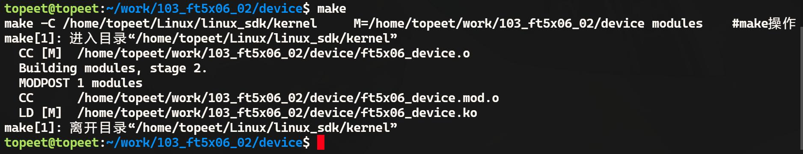
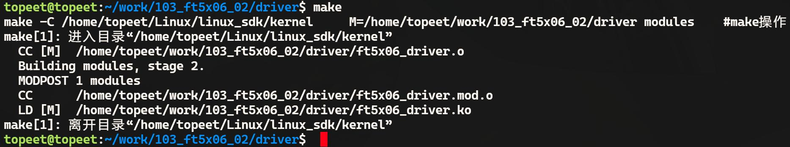

# 第167章 编写i2c client代码（方法2）

图166.5由图166.5 可以看到成功打印了在probe()函数中的打印，证明ft5x06 对应的i2c client 和ft5x06_driver（即i2c driver 框架）匹配成功了。实验成功后使用rmmod ft5x06_driver.ko 命令进行驱动模块的卸载，如图166.6 所示。

图166.6

本章使用C 文件实现i2c client 代码并与上一章编写的i2c driver 框架进行匹配。需要注意的是，主流开发方式是使用设备树编写i2c client 而不是使用C 文件编写i2c client。
## 167.1API 函数介绍
### 167.1.1 i2c_get_adapter 函数
i2c_get_adapter()函数的主要作用是根据给定的i2c 控制器编号nr 从i2c_adapter_idr 中查找对应的i2c_adapter 结构体，该函数定义在drivers/i2c/i2c-core-base.c 文件中，具体内容如代码清单167.1 所示。代码清单167.1
```c
struct i2c_adapter *i2c_get_adapter(int nr)
{
    struct i2c_adapter *adapter;
    //获取core_lock 锁，以防止其他线程同时访问i2c_adapter_idr
    mutex_lock(&core_lock);
    //在i2c_adapter_idr 中查找指定编号的控制器
    adapter = idr_find(&i2c_adapter_idr, nr);
    if (!adapter)
        goto exit;
    //尝试获取控制器所属模块的引用计数
    if (try_module_get(adapter->owner))
        //增加控制器device 的引用计数
        get_device(&adapter->dev);
    else
        adapter = NULL;
exit:
    //释放i2c_adapter_idr 中的锁
    mutex_unlock(&core_lock);
```

```c
return adapter;
}
```
### 167.1.2 i2c_put_adapter 函数
当驱动卸载时使用i2c_put_adapter()函数释放i2c_adapter 结构体，i2c_put_adapter()函数定义在drivers/i2c/i2c-core-base.c 文件中，具体内容如代码清单167.2 所示。代码清单167.2
```c
void i2c_put_adapter(struct i2c_adapter *adap)
{
    //如果adap 指针为NULL，直接返回
    if (!adap)
        return;
    put_device(&adap->dev);//调用put_device()函数释放i2c_adapter 设备
    module_put(adap->owner);//减少i2c_adapter 所属模块的引用计数
}
```
### 167.1.3 i2c_new_device 函数
i2c_new_device()函数用于实例化一个i2c 设备，该函数定义在drivers/i2c/i2c-core-base.c 文件中，具体内容如代码清单167.3 所示。代码清单167.3
```c
struct i2c_client *i2c_new_device(struct i2c_adapter *adap, struct i2c_board_info const *info)
{
        struct i2c_client*client;
        intstatus;
        //分配i2c_client 结构体空间
        client = kzalloc(sizeof *client, GFP_KERNEL);
        if (!client)
                return NULL;
        //设置i2c_client 的控制器指针，将传入的i2c_adapter 指针保存到i2c_client 的adapter 字段中
        client->adapter = adap;
        //从i2c_board_info 结构体中拷贝相关信息到i2c_client
        client->dev.platform_data = info->platform_data;
        client->flags = info->flags;
        client->addr = info->addr;
        client->init_irq = info->irq;
```

```c
if (!client->init_irq)
        client->init_irq = i2c_dev_irq_from_resources(info->resources,
                                                   info->num_resources);
client->irq = client->init_irq;
strlcpy(client->name, info->type, sizeof(client->name));
//检查地址是否有效
status = i2c_check_addr_validity(client->addr, client->flags);
if (status) {
        dev_err(&adap->dev, "Invalid %d-bit i2c address 0x%02hx\n",
                client->flags & i2c_CLIENT_TEN ? 10 : 7, client->addr);
        goto out_err_silent;
}
//检查地址是否已被其他设备占用
status = i2c_check_addr_ex(adap, i2c_encode_flags_to_addr(client));
if (status)
        dev_err(&adap->dev,
                "%d i2c clients have been registered at 0x%02x",
                status, client->addr);
//设置i2c_client 的设备信息
client->dev.parent = &client->adapter->dev;
client->dev.bus = &i2c_bus_type;
client->dev.type = &i2c_client_type;
client->dev.of_node = of_node_get(info->of_node);
client->dev.fwnode = info->fwnode;
i2c_dev_set_name(adap, client, info, status);
//如果有设备属性，添加到设备
if (info->properties) {
        status = device_add_properties(&client->dev, info->properties);
        if (status) {
                dev_err(&adap->dev,
                        "Failed to add properties to client %s: %d\n",
                        client->name, status);
                goto out_err_put_of_node;
        }
}
//注册设备
status = device_register(&client->dev);
if (status)
        goto out_free_props;
```

```c
dev_dbg(&adap->dev, "client [%s] registered with bus id %s\n",
        client->name, dev_name(&client->dev));
return client;
out_free_props:
if (info->properties)
        device_remove_properties(&client->dev);
out_err_put_of_node:
of_node_put(info->of_node);
out_err_silent:
kfree(client);
return NULL;
}
```
### 167.1.4 i2c_board_info 结构体
i2c_new_device()函数会传入一个i2c_board_info 类型的结构体，该结构体描述了i2c 设备的静态信息，如设备类型、地址、名称等，该结构体定义在include/linux/i2c.h 文件中，具体内容如代码清单167.4 所示。代码清单167.4
```c
struct i2c_board_info {
    char type[i2c_NAME_SIZE];// i2c 设备的类型名称，最大长度为i2c_NAME_SIZE
    unsigned short flags;// i2c 设备的标志位，用于指定设备的特殊属性
    unsigned short addr;// i2c 设备的地址
    const char *dev_name;// i2c 设备的设备名称
    void *platform_data;// i2c 设备的平台数据，可为NULL
    struct device_node *of_node;// i2c 设备节点在设备树中的节点指针
    struct fwnode_handle *fwnode;// i2c 设备节点在ACPI 中的fwnode 句柄
    const struct property_entry *properties;// i2c 设备的属性列表
    const struct resource *resources;// i2c 设备使用的资源列表
    unsigned int num_resources;// i2c 设备使用的资源数量
    int irq;
};
```
## 167.2 驱动程序的编写
本实验代码存储在网盘iTOP-RK3568 开发板\07_学习教程配套资料\03_Linux 驱动配套资料\04_Linux 驱动程序\103_ft5x06_02\路径下。

本实验使用C 文件编写i2c client 代码，实验代码ft5x06_device.c 如代码清单167.5 所示。代码清单167.5
```c
#include <linux/module.h>
#include <linux/init.h>
#include <linux/i2c.h>
//定义一个i2c_adapter 结构体指针
struct i2c_adapter *i2c_ada;
//定义i2c_board_info 结构体数组，用于描述ft5x06 设备
static struct i2c_board_info ft5x06[] = {
    {
        .type = "my-ft5x06",
        .addr = 0x38, // ft5x06 设备的i2c 地址
    },
};
//驱动的初始化函数
static int ft5x06_client_init(void)
{
    //获取i2c 控制器
    i2c_ada = i2c_get_adapter(1);
    if (!i2c_ada)
    {
        printk(KERN_ERR "Failed to get i2c adapter\n");
        return -ENODEV;
    }
    //注册ft5x06 设备
    i2c_new_device(i2c_ada, ft5x06);
    return 0;
}
//驱动的退出函数
static void ft5x06_client_exit(void)
{
     //释放i2c 控制器
    i2c_put_adapter(i2c_ada);
}
//驱动的初始化和退出入口函数
module_init(ft5x06_client_init);
```

```c
module_exit(ft5x06_client_exit);
MODULE_LICENSE("GPL");
```
使用C 文件编写i2c client 与使用设备树编写i2c client 与i2c driver 匹配方式不同，所以并不能直接使用上一章节编写的i2c driver，需要对驱动程序进行简单的修改，修改完成以后的实验代码ft5x06_driver.c 驱动程序如代码清单167.6 所示。代码清单167.6
```c
#include <linux/init.h>
#include <linux/module.h>
#include <linux/i2c.h>
#include <linux/of_device.h>
// ft5x06 设备的初始化函数
int ft5x06_probe(struct i2c_client *client, const struct i2c_device_id *id) {
    printk("This is ft5x06 probe\n");
    return 0;
}
// ft5x06 设备的移除函数
int ft5x06_remove(struct i2c_client *client) {
    return 0;
}
//定义i2c_device_id 结构体数组，用于标识ft5x06 设备
static const struct i2c_device_id ft5x06_id[] = {
    { "my-ft5x06", 0 },
    { }
};
MODULE_DEVICE_TABLE(i2c, ft5x06_id);
//定义i2c_driver 结构体，描述ft5x06 设备驱动
static struct i2c_driver ft5x06_driver = {
    .driver = {
        .name= "my-ft5x06",
        .owner= THIS_MODULE,
    },
    .probe= ft5x06_probe,
    .remove= ft5x06_remove,
    .id_table= ft5x06_id,
};
//驱动初始化函数
```

```c
static int __init ft5x06_driver_init(void) {
    int ret;
    //注册i2c 设备驱动
    ret = i2c_add_driver(&ft5x06_driver);
    if (ret < 0) {
        printk("i2c_add_driver is error\n");
        return ret;
    }
    return 0;
}
//驱动退出函数
static void __exit ft5x06_driver_exit(void) {
    //注销i2c 设备驱动
    i2c_del_driver(&ft5x06_driver);
}
module_init(ft5x06_driver_init);
module_exit(ft5x06_driver_exit);
MODULE_LICENSE("GPL");
```
## 167.3 运行测试
### 167.3.1 编译驱动程序
在ft5x06_device.c 代码同一目录下创建Makefile 文件，如图167.1 所示。

图167.1Makefile 文件内容如代码清单167.7 所示。代码清单167.7
```c
export ARCH=arm64#设置平台架构
export CROSS_COMPILE=aarch64-linux-gnu-#交叉编译器前缀
obj-m += ft5x06_device.o#此处要和你的驱动源文件同名
KDIR :=/home/topeet/Linux/linux_sdk/kernel#这里是你的内核目录
PWD ?= $(shell pwd)
all:
    make -C $(KDIR) M=$(PWD) modules#make 操作
clean:
    make -C $(KDIR) M=$(PWD) clean#make clean 操作
```

在存放ft5x06_device.c 和Makefile 文件目录下使用make 命令编译驱动程序，编译完成如图167.2 所示。

图167.2编译成功后得到ft5x06_driver.ko 文件，如图167.3 所示。

图167.3然后在ft5x06_driver.c 代码同一目录下创建Makefile 文件，如图167.4 所示。

图167.4Makefile 文件内容如代码清单167.8 所示。代码清单167.8
```c
export ARCH=arm64#设置平台架构
export CROSS_COMPILE=aarch64-linux-gnu-#交叉编译器前缀
obj-m += ft5x06_driver.o#此处要和你的驱动源文件同名
KDIR :=/home/topeet/Linux/linux_sdk/kernel#这里是你的内核目录
PWD ?= $(shell pwd)
all:
    make -C $(KDIR) M=$(PWD) modules#make 操作
clean:
    make -C $(KDIR) M=$(PWD) clean#make clean 操作
```
在存放ft5x06_driver.c 和Makefile 文件目录下使用make 命令编译驱动程序，编译完成如图167.5 所示。

图167.5编译成功后得到ft5x06_driver.ko 文件，如图167.6 所示。

