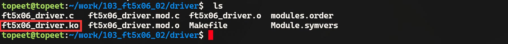
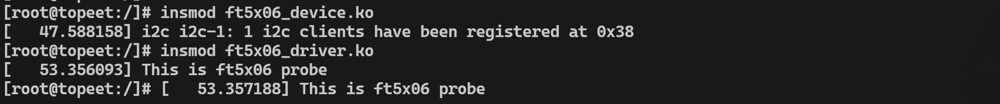
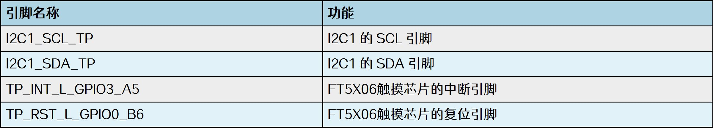
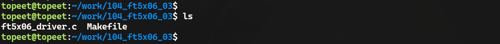
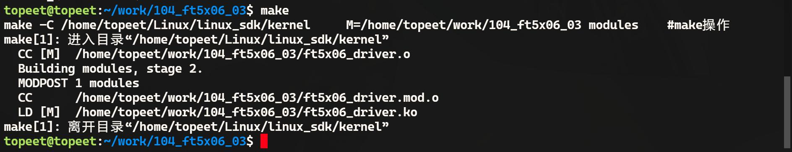

# 第168章 完善ft5x06设备节点和驱动


图167.6
### 167.3.2 运行测试
将本章节编译好的ft5x06_device.ko 和ft5x06_driver.ko 驱动文件拷贝到开发板上。然后分别使用insmod ft5x06_device.ko 和insmod ft5x06_driver.ko 命令加载这两个驱动程序，加载完成如图167.7 所示。

图167.7由图167.7 可以看到在ft5x06_device.ko 驱动加载成功之后，成功在i2c1 控制器注册了地址为0x38 的设备，然后加载ft5x06_device.ko 驱动，成功打印了在probe 函数中的打印，证明ft5x06对应的i2c client 和ft5x06_driver 驱动匹配成功了，而这里打印了两遍probe 函数中的打印是因为驱动还会和用设备树编写的i2c client 进行匹配，如果将使用设备树编写的i2c client 删除则只会执行一次probe 函数。实验成功后使用rmmod ft5x06_driver.ko 和rmmod ft5x06_device.ko 命令进行驱动模块的卸载，如图167.8 所示。

图167.8

本章在前面i2c client 和i2c driver 代码的基础上继续编写ft5x06 的对应的i2c client 与i2c driver，即ft5x06 的设备节点与驱动程序
## 168.1 完善ft5x06 设备节点
本实验修改完成的设备树存储在网盘iTOP-RK3568开发板\07_学习教程配套资料\03_Linux 驱动配套资料\04_Linux 驱动程序\104_ft5x06_03\01_修改完成的设备树路径下。ft5x06 触摸芯片除需要使用i2c 接口，还需要两个GPIO 引脚分别作为中断引脚和复位引脚，ft5x06 触摸芯片使用的i2c 接口与GPIO 引脚介绍如图168.1 所示。

图168.1根据图168.1 中引脚使用情况完善设备树中的ft5x06 的设备节点，完善后的ft5x06 设备节点如代码清单168.1 所示。代码清单168.1
```c
&i2c1 {
    status = "okay";
    myft5x06: my-ft5x06@38 {
        compatible = "my-ft5x06";
        reg = <0x38>;
        reset-gpios = <&gpio0 RK_PB6 GPIO_ACTIVE_LOW>;
        interrupt-parent = <&gpio3>;
        interrupts-gpio = <&gpio3 RK_PA5 GPIO_ACTIVE_LOW>;
        interrupts = <RK_PA5 IRQ_TYPE_LEVEL_LOW>;
        pinctrl-names = "default";
        pinctrl-0 = <&myft5x06_pins>;
    };
};
```

代码清单168.1 中使用reg 属性表示ft5x06 的设备地址，设备地址为0x38，compatible 属性用于指定驱动匹配的字符串。属性reset-gpios 用来指定复位引脚是gpio0_b6 引脚。属性interrupt-parent 来指定中断控制器为GPIO3，属性interrupts-gpio 用来指定中断引脚是gpio3_a5引脚，interrupts 属性指定触发方式是低电平触发。接着使用pinctrl 设置gpio3_a5 和gpio0_b6引脚复用为GPIO 功能。其中，pinctrl 节点名为myft5x06_pins，所以接下里在pinctrl 节点中追加代码清单168.2中内容。代码清单168.2
```c
&pinctrl {
        myft5x06 {
                myft5x06_pins: myft5x06-pins {
                rockchip,pins =
                    <3 RK_PA5 RK_FUNC_GPIO &pcfg_pull_none>,
                    <0 RK_PB6 RK_FUNC_GPIO &pcfg_pull_none>;
                };
        };
};
```
修改完成后，重新编译内核源码，得到boot.img 镜像，然后烧写到开发板。
## 168.2 完善ft5x06 驱动
本实验代码存储在网盘iTOP-RK3568 开发板\07_学习教程配套资料\03_Linux 驱动配套资料\04_Linux 驱动程序\104_ft5x06_03\03_module 路径下。在ft5x06 设备节点中除了i2c 接口，还使用到了中断和复位引脚，因此在完善ft5x06 驱动时需要申请这两个GPIO，并在加载驱动时使用复位引脚进行复位。接着编写中断服务函数，当触摸MIPI 屏幕之后会产生中断，从而执行中断服务函数。实验代码ft5x06_driver.c 如代码清单168.3 所示。代码清单168.3
```c
#include <linux/init.h>
#include <linux/module.h>
#include <linux/i2c.h>
#include <linux/gpio.h>
#include <linux/gpio/consumer.h>
#include <linux/interrupt.h>
#include <linux/delay.h>
```

```c
//定义ft5x06 设备的GPIO 描述符
struct gpio_desc *reset_gpio, *irq_gpio;
// ft5x06 中断处理函数
irqreturn_t ft5x06_handler(int irq, void *args)
{
    printk("This is ft5x06 handler\n");
    //返回中断已处理标志
    return IRQ_RETVAL(IRQ_HANDLED);
}
// ft5x06 设备的探测函数
int ft5x06_probe(struct i2c_client *client, const struct i2c_device_id *id)
{
    int ret;
    printk("This is ft5x06 probe\n");
    //获取reset GPIO 描述符
    reset_gpio = gpiod_get_optional(&client->dev, "reset", 0);
    if (!reset_gpio) {
        printk("gpiod_get_optional reset gpio is error\n");
        return -1;
    }
    //获取irq GPIO 描述符
    irq_gpio = gpiod_get_optional(&client->dev, "interrupts", 0);
    if (!irq_gpio) {
        printk("gpiod_get_optional irq gpio is error\n");
        return -1;
    }
    //设置reset GPIO 为输出，并拉低5ms 后拉高
    gpiod_direction_output(reset_gpio, 0);
    msleep(5);
    gpiod_direction_output(reset_gpio, 1);
    //请求中断,设置为下降沿触发，单次触发
    ret = request_irq(client->irq, ft5x06_handler,
                     IRQ_TYPE_EDGE_FALLING | IRQF_ONESHOT, "ft5x06 irq", NULL);
    if (ret < 0) {
        printk("request irq is error\n");
        return -2;
    }
```

```c
return 0;
}
// ft5x06 设备的移除函数
int ft5x06_remove(struct i2c_client *client)
{
free_irq(client->irq, NULL);
gpiod_put(reset_gpio);
gpiod_put(irq_gpio);
return 0;
}
//定义i2c_device_id 结构体数组，用于标识ft5x06 设备
static const struct i2c_device_id ft5x06_id[] = {
{ "my-ft5x06", 0 },
{ }
};
//定义i2c_driver 结构体，描述ft5x06 设备驱动
static struct i2c_driver ft5x06_driver = {
.driver = {
    .name = "my-ft5x06",
    .owner = THIS_MODULE,
},
.probe = ft5x06_probe,
.remove = ft5x06_remove,
.id_table = ft5x06_id,
};
//驱动初始化函数
static int __init ft5x06_driver_init(void)
{
int ret;
//注册i2c 设备驱动
ret = i2c_add_driver(&ft5x06_driver);
if (ret < 0) {
    printk("i2c_add_driver is error\n");
    return ret;
}
return 0;
}
//驱动退出函数
static void __exit ft5x06_driver_exit(void)
```

```c
{
    //注销i2c 设备驱动
    i2c_del_driver(&ft5x06_driver);
}
module_init(ft5x06_driver_init);
module_exit(ft5x06_driver_exit);
MODULE_LICENSE("GPL");
```
## 168.3 运行测试
### 168.3.1 编译驱动程序
首先在ft5x06_driver.c 代码同一目录下创建Makefile 文件，如图168.2 所示。

图168.2Makefile 文件内容如代码清单168.4 所示。代码清单168.4
```c
export ARCH=arm64#设置平台架构
export CROSS_COMPILE=aarch64-linux-gnu-#交叉编译器前缀
obj-m += ft5x06_driver.o#此处要和你的驱动源文件同名
KDIR :=/home/topeet/Linux/linux_sdk/kernel#这里是你的内核目录
PWD ?= $(shell pwd)
all:
    make -C $(KDIR) M=$(PWD) modules#make 操作
clean:
    make -C $(KDIR) M=$(PWD) clean#make clean 操作
```
在存放ft5x06_driver.c 和Makefile 文件目录下使用make 命令编译驱动程序，编译完成如图168.3 所示。

图168.3编译完生成ft5x06_driver.ko 目标文件，如图168.4 所示。

