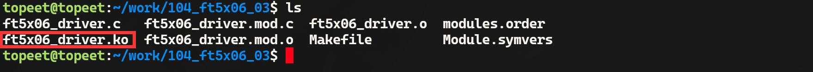
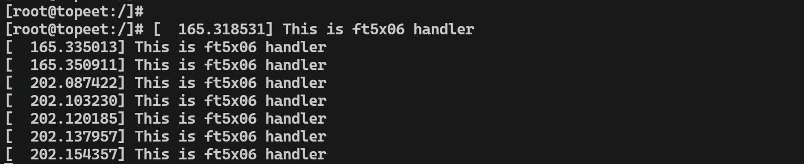

# 第169章 实现ft5x06驱动中i2c通信功能


图168.4
### 168.3.2 运行测试
在进行实验之前，首先要确保开发板烧写的是我们在本章节中编译出来的boot.img 并把MIPI 屏幕连接到开发板上。然后将本章节编译完成的ft5x06_driver.ko 文件拷贝到开发板上，并使用insmod ft5x06_driver.ko 命令加载驱动程序，加载完成如图168.5 所示。

图168.5然后触摸MIPI 屏幕，如果实验成功可以看到中断服务函数中的打印信息“This is ft5x06handler”。如图168.6 所示。

图168.6实验成功后使用rmmod ft5x06_driver.ko 命令进行驱动模块的卸载，如图168.7 所示。

图168.7

## 169.1 i2c_transfer 函数分析
i2c 核心负责i2c 设备驱动层和i2c 控制器驱动层之间数据的传递，i2c 核心层的主要API 函数为i2c_master_send()函数、i2c_master_recv()函数和i2c_transfer()函数，其中i2c_master_send()函数和i2c_master_recv()函数是i2c 核心层提供的读写函数。两个函数定义在include/linux/i2c.h文件中，具体内容如代码清单169.1 所示。代码清单169.1
```c
static inline int i2c_master_recv(const struct i2c_client *client,
                   char *buf, int count)
{
    return i2c_transfer_buffer_flags(client, buf, count, i2c_M_RD);
};
static inline int i2c_master_send(const struct i2c_client *client,
                   const char *buf, int count)
{
    return i2c_transfer_buffer_flags(client, (char *)buf, count, 0);
};
```
可以看到代码清单169.1 中两个函数都是调用的i2c_transfer_buffer_flags()函数，该函数定义在drivers/i2c/i2c-core-base.c 文件中，具体内容如代码清单169.2 所示。代码清单169.2
```c
int i2c_transfer_buffer_flags(const struct i2c_client *client, char *buf,
               int count, u16 flags)
{
int ret; //保存传输结果
//构建i2c_msg 结构体，描述本次传输操作
struct i2c_msg msg = {
    .addr = client->addr, //设置从设备地址
    //设置传输标志位，包括用户传入的标志位和客户端对象自身的标志位
    .flags = flags | (client->flags & i2c_M_TEN),
    .len = count, //设置传输数据长度
    .buf = buf, //设置数据缓冲区
};
```

```c
//调用i2c_transfer 函数进行数据传输
//该函数会根据传输的消息数量返回实际传输成功的消息数量
ret = i2c_transfer(client->adapter, &msg, 1);
/*
 * 如果传输成功(即传输了1 条消息),返回传输的字节数;
 * 否则返回错误码。
 */
return (ret == 1) ? count : ret;
}
```
由代码清单169.2 可知i2c_transfer_buffer_flags()函数最终调用i2c_transfer()函数进行实际的数据传输。综上所述，i2c_master_send()函数和i2c_master_recv()函数实际上便是调用的i2c_transfer()函数，因此后续的实验中我们并不会直接使用i2c_master_send()和i2c_master_recv()函数，而是通过i2c_transfer()函数来编写i2c 发送和接收的函数。i2c_transfer()函数定义在drivers/i2c/i2c-core-base.c 件中，具体内容如代码清单169.3 所示。代码清单169.3
```c
int i2c_transfer(struct i2c_adapter *adap, struct i2c_msg *msgs, int num)
{
    int ret; // 保存传输结果
    /*
     * 这里存在一些故障报告模型的弱点:
     * 1. 当我们在从设备接收N 个字节后出错时,没有办法报告"N"。
     * 2. 当我们在向从设备传输N 个字节后收到NAK 时,没有办法报告"N",
     *也没有办法让主设备继续执行剩余的消息(如果这是适当的响应)。
     * 3. 当"num"为两个,我们成功完成第一条消息但在第二条消息中途出错时,
     *不清楚应该报告为一个(丢弃第二条消息的状态)还是errno(丢弃第一条消息的状态)。
     */
    // 如果适配器支持master_xfer 操作,则使用该操作传输消息
    if (adap->algo->master_xfer) {
    #ifdef DEBUG
        // 打印每条消息的信息,用于调试
        for (ret = 0; ret < num; ret++) {
             dev_dbg(&adap->dev,
                 "master_xfer[%d] %c, addr=0x%02x, len=%d%s\n",
                 ret, (msgs[ret].flags & i2c_M_RD) ? 'R' : 'W',
                 msgs[ret].addr, msgs[ret].len,
```

```c
(msgs[ret].flags & i2c_M_RECV_LEN) ? "+" : "");
}
#endif
// 如果当前上下文不允许睡眠,则尝试锁定i2c 总线
// 如果总线已经被锁定,返回-EAGAIN
if (in_atomic() || irqs_disabled()) {
ret = i2c_trylock_bus(adap, i2c_LOCK_SEGMENT);
if (!ret)
return -EAGAIN;
} else {
// 否则,锁定i2c 总线
i2c_lock_bus(adap, i2c_LOCK_SEGMENT);
}
// 调用__i2c_transfer 执行实际的消息传输
ret = __i2c_transfer(adap, msgs, num);
// 解锁i2c 总线
i2c_unlock_bus(adap, i2c_LOCK_SEGMENT);
return ret;
} else {
// 如果适配器不支持master_xfer 操作,返回不支持的错误
dev_dbg(&adap->dev, "i2c level transfers not supported\n");
return -EOPNOTSUPP;
}
}
```
i2c_transfer()函数有三个参数，每个参数的具体作用如下所示：（1）struct i2c_adapter *adap: 表示要使用的i2c 控制器。每个i2c 控制器对应一个i2c_adapter 结构体，里面包含了这个控制器的各种属性和操作函数。（2）struct i2c_msg *msgs: 指向一个i2c_msg 结构体数组，该结构体用于描述要传输的i2c 消息。i2c_msg 结构体具体内容如代码清单169.4 所示。因此在调用i2c_transfer()函数进行i2c 通信前，需要先通过i2c_msg 结构体封装要传输的i2c 数据。（构建i2c_msg 结构体封装要传输的i2c 数据包是核心操作）代码清单169.4
```c
struct i2c_msg {
    __u16 addr;// 从设备的7 位地址
    __u16 flags;// 消息标志位
#define i2c_M_RD0x0001// 表示读操作,必须是0x0001
```

```c
#define i2c_M_TEN0x0010// 使用10 位从设备地址,需要i2c_FUNC_10BIT_ADDR 支持
#define i2c_M_DMA_SAFE0x0200// 表示数据缓冲区是安全的(仅在内核空间使用)
#define i2c_M_RECV_LEN0x0400// 表示在读操作中需要接收可变长度的数据
#define i2c_M_NO_RD_ACK0x0800// 表示不需要在读操作后接收ACK
#define i2c_M_IGNORE_NAK 0x1000// 表示即使收到NAK 也要继续传输
#define i2c_M_REV_DIR_ADDR 0x2000// 表示地址字节需要反转,
#define i2c_M_NOSTART0x4000// 表示不需要发送起始条件
#define i2c_M_STOP0x8000// 表示在消息传输后需要发送停止条
    __u16 len;// 要传输的数据长度(字节数)
    __u8 *buf;// 指向要传输的数据缓冲区
};
```
（3）int num: 数组msgs 中包含的消息个数。
## 169.2 实现ft5x06 驱动中i2c 通信代码
本实验代码存储在网盘iTOP-RK3568 开发板\07_学习教程配套资料\03_Linux 驱动配套资料\04_Linux 驱动程序\105_ft5x06_04\路径下。本节继续编写ft5x06 驱动，实现触摸摸芯片ft5x06 的i2c 读写函数。实验代码ft5x06_driver.c 如代码清单169.5 所示。代码清单169.5
```c
#include <linux/init.h>
#include <linux/module.h>
#include <linux/i2c.h>
#include <linux/gpio.h>
#include <linux/gpio/consumer.h>
#include <linux/interrupt.h>
#include <linux/delay.h>
//定义ft5x06 设备的GPIO 描述符
//用于保存reset 和interrupt 引脚的GPIO 描述符
struct gpio_desc *reset_gpio, *irq_gpio;
//保存ft5x06 设备的i2c 客户端对象指针
struct i2c_client *ft5x06_client;
//读取ft5x06 设备寄存器的函数
int ft5x06_read_reg(u8 reg_addr)
{
    u8 data;
    //定义两个i2c_msg 结构体,分别表示写操作和读操作的数据包
```

```c
struct i2c_msg msgs[2] = {
    [0] = {
        .addr = ft5x06_client->addr, //设备地址
        .flags = 0,//写操作
        .len = sizeof(reg_addr),
        .buf = &reg_addr,//写入要读取的寄存器地址
    },
    [1] = {
        .addr = ft5x06_client->addr,
        .flags = i2c_M_RD, //读操作
        .len = sizeof(data),
        .buf = &data,//读取到的数据存储位置
    },
};
   //使用i2c_transfer 函数进行i2c 总线读取操作
   //如果读取失败，返回-EIO 错误码
   if (i2c_transfer(ft5x06_client->adapter, msgs, ARRAY_SIZE(msgs)) != ARRAY_SIZE(msgs)){
    return -EIO;
}
return data; //返回读取到的寄存器值
}
//向ft5x06 设备写入寄存器的函数
void ft5x06_write_reg(u8 reg_addr, u8 *data, u16 len)
{
u8 buff[256];
//构建写操作的数据包
struct i2c_msg msgs[] = {
    [0] = {
        .addr = ft5x06_client->addr, //设备地址
        .flags = 0,//写操作
        .len = len + 1,//数据长度+ 寄存器地址长度
        .buf = buff,//数据缓冲区
    },
};
buff[0] = reg_addr;//写入寄存器地址
memcpy(&buff[1], data, len); //写入数据
//使用i2c_transfer()函数进行i2c 总线写入操作
//如果写入失败，直接返回
if (i2c_transfer(ft5x06_client->adapter, msgs, ARRAY_SIZE(msgs)) != ARRAY_SIZE(msgs)) {
```

```c
return;
}
}
// ft5x06 中断处理函数
irqreturn_t ft5x06_handler(int irq, void *args)
{
printk("This is ft5x06 handler\n");
//返回中断已处理标志
return IRQ_RETVAL(IRQ_HANDLED);
}
// ft5x06 设备的探测函数
int ft5x06_probe(struct i2c_client *client, const struct i2c_device_id *id)
{
int ret,value;
printk("This is ft5x06 probe\n");
ft5x06_client = client; //保存i2c 客户端对象指针
//获取reset GPIO 描述符
reset_gpio = gpiod_get_optional(&client->dev, "reset", 0);
if (!reset_gpio) {
printk("gpiod_get_optional reset gpio is error\n");
return -1;
}
//获取irq GPIO 描述符
irq_gpio = gpiod_get_optional(&client->dev, "interrupts", 0);
if (!irq_gpio) {
printk("gpiod_get_optional irq gpio is error\n");
return -1;
}
//设置reset GPIO 为输出，并拉低5ms 后拉高
gpiod_direction_output(reset_gpio, 0);
msleep(5);
gpiod_direction_output(reset_gpio, 1);
//请求中断,设置为下降沿触发，单次触发
ret = request_irq(client->irq, ft5x06_handler,
             IRQ_TYPE_EDGE_FALLING | IRQF_ONESHOT, "ft5x06 irq", NULL);
if (ret < 0) {
printk("request irq is error\n");
return -2;
```

```c
}
//写寄存器
ft5x06_write_reg(0x80, &(u8){0x4b}, 1);
//读寄存器
value = ft5x06_read_reg(0x80);
printk("reg 0x80 is %x\n", value);
return 0;
}
// ft5x06 设备的移除函数
//参数client 是i2c 客户端对象指针
int ft5x06_remove(struct i2c_client *client)
{
//释放中断
free_irq(client->irq, NULL);
//释放GPIO 资源
gpiod_put(reset_gpio);
gpiod_put(irq_gpio);
return 0;
}
//定义i2c_device_id 结构体数组，用于标识ft5x06 设备
static const struct i2c_device_id ft5x06_id[] = {
{ "my-ft5x06", 0 },
{ }
};
//定义i2c_driver 结构体，描述ft5x06 设备驱动
static struct i2c_driver ft5x06_driver = {
.driver = {
    .name = "my-ft5x06",
    .owner = THIS_MODULE,
},
.probe = ft5x06_probe,
.remove = ft5x06_remove,
.id_table = ft5x06_id,
};
//驱动初始化函数
static int __init ft5x06_driver_init(void)
{
```

```c
int ret;
//注册i2c 设备驱动
ret = i2c_add_driver(&ft5x06_driver);
if (ret < 0) {
    printk("i2c_add_driver is error\n");
    return ret;
}
return 0;
}
//驱动退出函数
static void __exit ft5x06_driver_exit(void)
{
//注销i2c 设备驱动
i2c_del_driver(&ft5x06_driver);
}
module_init(ft5x06_driver_init);
module_exit(ft5x06_driver_exit);
MODULE_LICENSE("GPL");
```
## 169.3 运行测试
### 169.3.1 编译驱动程序
在ft5x06_driver.c 代码同一目录下创建Makefile 文件，如图169.1 所示。

图169.1Makefile 文件内容如代码清单169.6 所示。代码清单169.6
```c
export ARCH=arm64#设置平台架构
export CROSS_COMPILE=aarch64-linux-gnu-#交叉编译器前缀
obj-m += ft5x06_driver.o#此处要和你的驱动源文件同名
KDIR :=/home/topeet/Linux/linux_sdk/kernel#这里是你的内核目录
PWD ?= $(shell pwd)
all:
    make -C $(KDIR) M=$(PWD) modules#make 操作
clean:
    make -C $(KDIR) M=$(PWD) clean#make clean 操作
```

