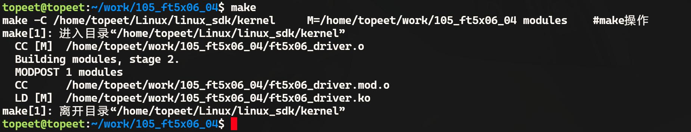
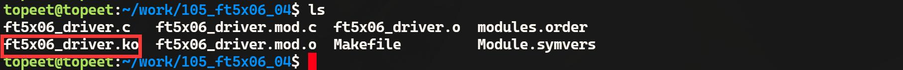
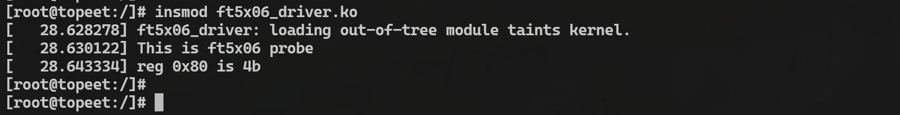
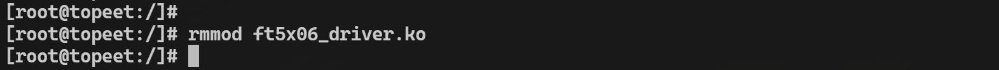

# 第170章 i2c_transfer函数分析

在存放ft5x06_driver.c 和Makefile 文件目录下使用make 命令编译驱动程序，编译完成如图169.2 所示。

图169.2编译完生成ft5x06_driver.ko 目标文件，如图169.3 所示。

图169.3
### 169.3.2 运行测试
将本章节编译完成的ft5x06_driver.ko 文件拷贝到开发板上，然后使用insmodft5x06_driver.ko 命令加载驱动程序，加载完成如图169.4 所示。

图169.4由图174.4 打印结果可以得到，通过ft5x06 的写函数成功向0x80 地址写入了0x4b 并通过fr5x06 的读函数程序读取，实验成功后使用rmmod ft5x06_driver.ko 命令卸载驱动程序，如图169.5 所示。

图169.5

本章分析i2c_transfer()函数通信流程。
## 170.1 i2c_transfer 函数分析
i2c_transfer()函数定义在drivers/i2c/i2c-core-base.c 文件中，具体内容如代码清单170.1 所示。代码清单170.1
```c
int i2c_transfer(struct i2c_adapter *adap, struct i2c_msg *msgs, int num)
{
    int ret; // 保存传输结果
    /*
     * 这里存在一些故障报告模型的弱点:
     * 1. 当我们在从设备接收N 个字节后出错时,没有办法报告"N"。
     * 2. 当我们在向从设备传输N 个字节后收到NAK 时,没有办法报告"N",
     *也没有办法让主设备继续执行剩余的消息(如果这是适当的响应)。
     * 3. 当"num"为两个,我们成功完成第一条消息但在第二条消息中途出错时,
     *不清楚应该报告为一个(丢弃第二条消息的状态)还是errno(丢弃第一条消息的状态)。
     */
    // 如果适配器支持master_xfer 操作，则使用该操作传输消息
    if (adap->algo->master_xfer) {
    #ifdef DEBUG
        // 打印每条消息的信息,用于调试
        for (ret = 0; ret < num; ret++) {
             dev_dbg(&adap->dev,
                 "master_xfer[%d] %c, addr=0x%02x, len=%d%s\n",
                 ret, (msgs[ret].flags & i2c_M_RD) ? 'R' : 'W',
                 msgs[ret].addr, msgs[ret].len,
                 (msgs[ret].flags & i2c_M_RECV_LEN) ? "+" : "");
        }
    #endif
        // 如果当前上下文不允许睡眠，则尝试锁定i2c 总线
        // 如果总线已经被锁定，返回-EAGAIN
        if (in_atomic() || irqs_disabled()) {
```

```c
ret = i2c_trylock_bus(adap, i2c_LOCK_SEGMENT);
if (!ret)
    return -EAGAIN;
} else {
// 否则,锁定i2c 总线
i2c_lock_bus(adap, i2c_LOCK_SEGMENT);
}
// 调用__i2c_transfer 执行实际的消息传输
ret = __i2c_transfer(adap, msgs, num);
// 解锁i2c 总线
i2c_unlock_bus(adap, i2c_LOCK_SEGMENT);
return ret;
} else {
// 如果适配器不支持master_xfer 操作，返回不支持的错误
dev_dbg(&adap->dev, "i2c level transfers not supported\n");
return -EOPNOTSUPP;
}
}
```
在代码清单170.1 中第15 行代码首先检查有没有实现master_xfer()函数，因为i2c_transfer()函数自身并没有控制硬件进行i2c 通信的能力，所以master_xfer()函数才是真正驱动硬件进行i2c 通信的函数，master_xfer()函数定义在i2c_adapter 结构体的i2c_algorithm 结构体中，该结构体具体内容如代码清单170.2 所示。代码清单170.2
```c
struct i2c_algorithm {
    /* 如果i2c 控制器算法无法执行i2c 级别的访问，则应将master_xfer 设置为NULL。
       如果i2c 控制器算法可以执行SMBus 访问，则应设置smbus_xfer。
       如果设置为NULL，则将使用通用的i2c 消息来模拟SMBus 协议*/
    /* master_xfer 函数应该返回成功处理的消息数量，或者在出现错误时返回一个负值*/
    int (*master_xfer)(struct i2c_adapter *adap, struct i2c_msg *msgs,
                       int num);
    /* 用于执行SMBus 传输操作的函数指针
       adap: i2c 控制器
       addr: 从设备地址
       flags: 传输标志
       read_write: 读/写标志
       command: SMBus 命令码
       size: 传输数据的大小
```

