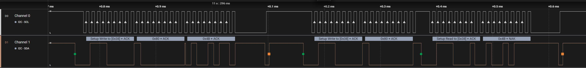
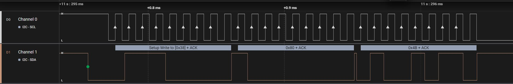
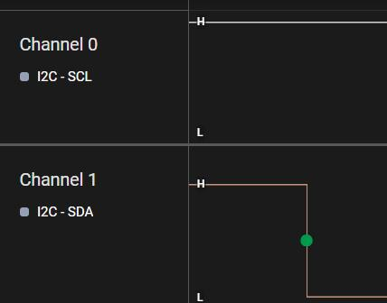
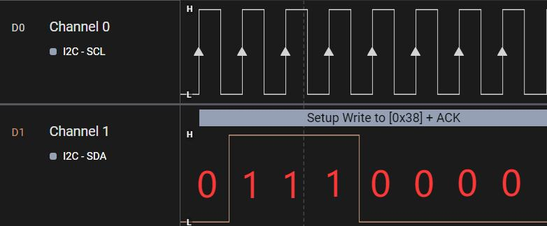
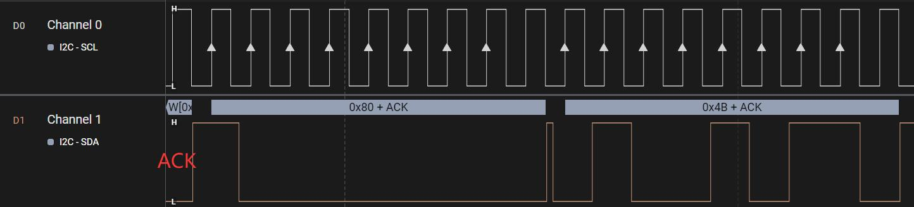
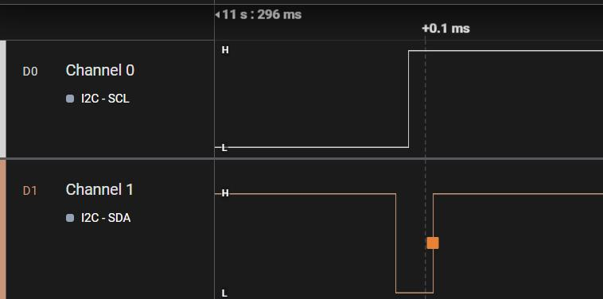

# 第171章 使用逻辑分析仪分析i2c波形

```c
data: 用于存储传输数据的联合体*/
int (*smbus_xfer) (struct i2c_adapter *adap, u16 addr,
                unsigned short flags, char read_write,
                u8 command, int size, union i2c_smbus_data *data);
/* 用于确定适配器支持的功能的函数指针*/
u32 (*functionality) (struct i2c_adapter *);
#if IS_ENABLED(CONFIG_i2c_SLAVE)
/* 用于注册和注销从设备的函数指针*/
int (*reg_slave)(struct i2c_client *client);
int (*unreg_slave)(struct i2c_client *client);
#endif
};
```
代码清单170.2 中第6 行和第17 行的两个函数都是i2c 通信函数，一般由原厂工程师进行编写，如iTOP-RK3568 开发板通过内核中drivers/i2c/busses/i2c-rk3x.c 文件实现这俩个函数，这个俩个函数实现后被i2c_transfer()函数间接调用，这样哪怕硬件平台不同，对应驱动中的i2c通信来说，都可以直接使用i2c_transfer()这个API 函数。

本章使用逻辑分析仪采集ft5x06 的i2c 通信波形，由于在采集波形时需要飞线，因此操作较为复杂，所以同学们不需要自己实际进行采集，跟着老师的脚步来学习即可。采集到的整体波形如下图171.1 所示。

图171.1
## 171.1 写操作形分析
在分析写操作波形之前，我们先复习一下写操作的步骤。写操作步骤：1.主机发送一个起始信号。2.主机发送i2c 外设的地址和写操作，等待应答信号。3.从机发送应答信号。4.主机要发送寄存器的地址，等待应答信号。5.从机发送应答信号6.主机发送要写入的寄存器的数据，等待应答信号。7.从机发送应答信号。8.主机要发送终止信号，如果写多个寄存器，重复6、7 步骤。接下来我们分析写操作波形。写操作波形如图171.2 所示。

图171.2图171.1 中主机要先发送一个起始信号，起始信号为SDA 线从高电平到低电平的跳变，同时SCL 线保持高电平，逻辑分析仪软件也用一个绿色的原点进行了标注，起始信号如图171.3所示。


图171.3然后主机写一个8 位数据，这8 位数据分别为7 位的地址和1 位读写方向，前七个时钟周期的值为0111000，如图176.2 所示，0111000 转换为16 进制是0x38，也就是ft5x06 的地址，第8 个时钟周期为0，表示读写方向为写入。如图171.24 所示。

图171.4主机发送完器件地址和读写方向位以后等待从机产生ACK 应答信号，主机收到ACK 应答信号后发送要操作的寄存器地址为0x80，并发送要写入的数据0x4b，波形图如图171.5 所示。

图171.5

发送完成之后主机会发送一个终止信号，终止信号为SDA 线从低电平到高电平的跳变，同时SCL 线保持高电平，波形图如图171.6 所示。写操作分析分析完毕。

图171.6
## 171.2 读操作波形分析
在分析读操作波形之前，我们先复习一下读操作的步骤。读操作步骤：1.主机发送一个起始信号。2.主机要发送12C 外设地址和写操作，等待应答。信号。3.从机发送应答信号。4.主机要发送要读取的寄存器的地址，等待应答信号。5.从机发送应答信号。6.主机发送起始信号。7.主机发送要读取的12C 外设的地址和读操作，等待应答信号。8.从机发送应答信号。9.从机发送数据，也就是要读取的寄存器的数据，等待应答或者非应答信号。10.主机如果不在读取数据，就要发送非应答信号，如果继续读取，就发送应答信号。无论是读操作还是写操作，主机都要先写入i2c 外设地址，所以读操作最开始的波形和写操作最开始的波形是相同的，如图171.7 所示是读操作的波形。

