# 第172章 实现ft5x06驱动数据上报功能

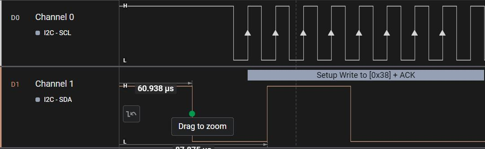
图171.7然后主机接收到从机发送的ACK 以后主机发送要都读取的寄存器地址，波形171.8 中要读取的寄存器地址是0x38。
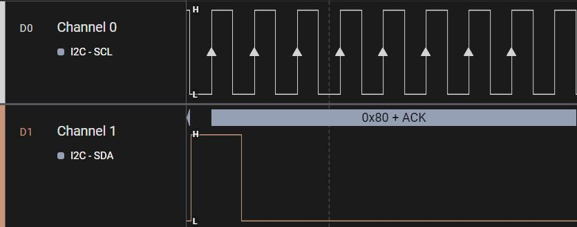
图171.8接下来主机就可以读取从机寄存器地址0x80 的数据了，波形图171.9 中读取到的数据为0x4B。
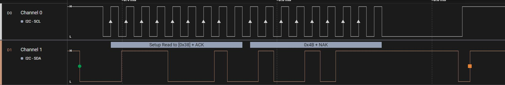
图171.9

本章使用输入子系统实现ft5x06 驱动中数据上报功能。
## 172.1 完善输入上报部分驱动
本实验代码存储在网盘iTOP-RK3568 开发板\07_学习教程配套资料\03_Linux 驱动配套资料\04_Linux 驱动程序\106_ft5x06_05\路径下。当用手触摸触摸屏时，触摸芯片会产生中断。因此可以在中断服务函数中通过i2c 接口读取坐标数据，然后通过输入子系统上报坐标数据。在中断服务函数使用i2c 接口读取坐标数据是属于比较耗时的操作，因此需要将该操作放在中断下文中。当手触摸触摸屏时候，要上报触摸和触摸的坐标。当手从触摸屏幕拿开时，要上报手从触摸屏拿开事件。手触摸屏幕和从屏幕拿开可以看作是按键事件。因此手触摸触摸屏对应输入子系统事件类型中的EV_KEY 事件，具体事件类型为BTN_TOUCH 事件。触摸坐标对应输入子系统事件类型中的EV_ABS 事件，具体事件类型为ABS_X 和ABS_Y 事件。按照以上思路编写实验代码ft5x06_driver.c，如代码清单172.1 所示。代码清单172.1
```c
#include <linux/init.h>
#include <linux/module.h>
#include <linux/i2c.h>
#include <linux/gpio.h>
#include <linux/gpio/consumer.h>
#include <linux/interrupt.h>
#include <linux/delay.h>
#include <linux/input.h>
#include <linux/workqueue.h>
//声明工作队列要用到的函数
void ft5x06_func(struct work_struct *work);
//声明一个工作结构体
static DECLARE_WORK(ft5x06_work, ft5x06_func);
```

```c
//定义ft5x06 设备的GPIO 描述符
//用于保存reset 和interrupt 引脚的GPIO 描述符
struct gpio_desc *reset_gpio, *irq_gpio;
//保存ft5x06 设备的i2c 客户端对象指针
struct i2c_client *ft5x06_client;
//保存ft5x06 输入设备的dev 指针
struct input_dev *ft5x06_input_dev;
//读取ft5x06 设备寄存器的函数
int ft5x06_read_reg(u8 reg_addr)
{
    u8 data;
    //定义两个i2c_msg 结构体,分别表示写操作和读操作
    struct i2c_msg msgs[2] = {
        [0] = {
            .addr = ft5x06_client->addr, //设备地址
            .flags = 0,//写操作
            .len = sizeof(reg_addr),
            .buf = &reg_addr,//写入要读取的寄存器地址
        },
        [1] = {
            .addr = ft5x06_client->addr,
            .flags = i2c_M_RD, //读操作
            .len = sizeof(data),
            .buf = &data,//读取到的数据存储位置
        },
    };
   //使用i2c_transfer 函数进行i2c 总线读取操作
   //如果读取失败,返回-EIO 错误码
   if (i2c_transfer(ft5x06_client->adapter, msgs, ARRAY_SIZE(msgs)) != ARRAY_SIZE(msgs)){
        return -EIO;
    }
    return data; //返回读取到的寄存器值
}
//向ft5x06 写入寄存器的函数
void ft5x06_write_reg(u8 reg_addr, u8 *data, u16 len)
{
    u8 buff[256];
    struct i2c_msg msgs[] = {
```

```c
[0] = {
    .addr = ft5x06_client->addr, //设备地址
    .flags = 0,//写操作
    .len = len + 1,//数据长度+ 寄存器地址长度
    .buf = buff,//数据缓冲区
},
};
buff[0] = reg_addr;//写入寄存器地址
memcpy(&buff[1], data, len); //写入数据
//使用i2c_transfer 函数进行i2c 总线写入操作
//如果写入失败，直接返回
if (i2c_transfer(ft5x06_client->adapter, msgs, ARRAY_SIZE(msgs)) != ARRAY_SIZE(msgs)) {
return;
}
}
//工作函数
void ft5x06_func(struct work_struct *work)
{
int TOUCH1_XH, TOUCH1_XL, x;
int TOUCH1_YH, TOUCH1_YL, y;
int TD_STATUS;
//从寄存器中读取触摸坐标数据
TOUCH1_XH = ft5x06_read_reg(0x03);
TOUCH1_XL = ft5x06_read_reg(0x04);
x = ((TOUCH1_XH << 8) | TOUCH1_XL) & 0xfff;
TOUCH1_YH = ft5x06_read_reg(0x05);
TOUCH1_YL = ft5x06_read_reg(0x06);
y = ((TOUCH1_YH << 8) | TOUCH1_YL) & 0xfff;
//读取触摸状态寄存器
TD_STATUS = ft5x06_read_reg(0x02);
TD_STATUS = TD_STATUS & 0xf;
//根据触摸状态更新输入设备
if (TD_STATUS == 0) {
//触摸释放
input_report_key(ft5x06_input_dev, BTN_TOUCH, 0);
input_sync(ft5x06_input_dev);
```

```c
} else {
    //触摸按下
    input_report_key(ft5x06_input_dev, BTN_TOUCH, 1);
    input_report_abs(ft5x06_input_dev, ABS_X, x);
    input_report_abs(ft5x06_input_dev, ABS_Y, y);
    input_sync(ft5x06_input_dev);
}
}
// ft5x06 中断处理函数
irqreturn_t ft5x06_handler(int irq, void *args)
{
//将ft5x06_work 工作结构体提交到工作队列中
schedule_work(&ft5x06_work);
//表示中断已经被处理
return IRQ_RETVAL(IRQ_HANDLED);
}
// ft5x06 设备的初始化函数
int ft5x06_probe(struct i2c_client *client, const struct i2c_device_id *id)
{
int ret;
printk("This is ft5x06 probe\n");
ft5x06_client = client; //保存i2c 客户端对象指针
//获取reset GPIO 描述符
// gpiod_get_optional 函数尝试获取设备树中名为"reset" 的GPIO 描述符
//如果获取失败则返回NULL
reset_gpio = gpiod_get_optional(&client->dev, "reset", 0);
if (!reset_gpio) {
    printk("gpiod_get_optional reset gpio is error\n");
    return -1;
}
//获取irq GPIO 描述符
// gpiod_get_optional 函数尝试获取设备树中名为"interrupts" 的GPIO 描述符,
//如果获取失败则返回NULL
irq_gpio = gpiod_get_optional(&client->dev, "interrupts", 0);
if (!irq_gpio) {
    printk("gpiod_get_optional irq gpio is error\n");
    return -1;
}
```

```c
//设置reset GPIO 为输出,并拉低5m 后拉高
//这是一个复位操作，用于初始化ft5x06 设备
gpiod_direction_output(reset_gpio, 0);
msleep(5);
gpiod_direction_output(reset_gpio, 1);
//请求中断,设置为下降沿触发，单次触发
//当ft5x06 设备产生中断时，会调用ft5x06_handler 函数处理
ret = request_irq(client->irq, ft5x06_handler,
                 IRQ_TYPE_EDGE_FALLING | IRQF_ONESHOT, "ft5x06 irq", NULL);
if (ret < 0) {
    printk("request irq is error\n");
    return -2;
}
//分配一个input 设备
ft5x06_input_dev = input_allocate_device();
if (ft5x06_input_dev == NULL) {
    printk("input allocate device is error\n");
    return -2;
}
//设置input 设备的名称
ft5x06_input_dev->name = "ft5x06_dev";
//设置input 设备支持的事件类型和事件
set_bit(EV_KEY, ft5x06_input_dev->evbit);
set_bit(BTN_TOUCH, ft5x06_input_dev->keybit);
set_bit(EV_ABS, ft5x06_input_dev->evbit);
set_bit(ABS_X, ft5x06_input_dev->absbit);
set_bit(ABS_Y, ft5x06_input_dev->absbit);
//设置input 设备的绝对坐标范围
input_set_abs_params(ft5x06_input_dev, ABS_X, 0, 800, 0, 0);
input_set_abs_params(ft5x06_input_dev, ABS_Y, 0, 1280, 0, 0);
//注册input 设备
ret = input_register_device(ft5x06_input_dev);
if (ret < 0) {
    printk("input register device is error\n");
    goto error_0;
}
return 0;
```

```c
error_0:
    input_free_device(ft5x06_input_dev);
    free_irq(client->irq, NULL);
    gpiod_put(reset_gpio);
    gpiod_put(irq_gpio);
    return ret;
}
// ft5x06 设备的移除函数
//参数client 是i2c 客户端对象指针
int ft5x06_remove(struct i2c_client *client)
{
    //释放中断
    free_irq(client->irq, NULL);
    //释放GPIO 资源
    gpiod_put(reset_gpio);
    gpiod_put(irq_gpio);
    return 0;
}
//定义i2c_device_id 结构体数组,用于标识ft5x06 设备
static const struct i2c_device_id ft5x06_id[] = {
    { "my-ft5x06", 0 },
    { }
};
//定义i2c_driver 结构体，描述ft5x06 设备驱动
static struct i2c_driver ft5x06_driver = {
    .driver = {
        .name = "my-ft5x06",
        .owner = THIS_MODULE,
    },
    .probe = ft5x06_probe,
    .remove = ft5x06_remove,
    .id_table = ft5x06_id,
};
//驱动初始化函数
static int __init ft5x06_driver_init(void)
{
    int ret;
    //注册i2c 设备驱动
```

```c
ret = i2c_add_driver(&ft5x06_driver);
if (ret < 0) {
    printk("i2c_add_driver is error\n");
    return ret;
}
return 0;
}
//驱动退出函数
static void ft5x06_driver_exit(void)
{
/* 释放中断*/
free_irq(ft5x06_client->irq, NULL);
/* 注销输入设备*/
input_unregister_device(ft5x06_input_dev);
/* 释放GPIO */
gpiod_put(reset_gpio);
gpiod_put(irq_gpio);
/* 删除i2c 驱动*/
i2c_del_driver(&ft5x06_driver);
}
module_init(ft5x06_driver_init);
module_exit(ft5x06_driver_exit);
MODULE_LICENSE("GPL");
```
## 172.2 运行测试
### 172.2.1 编译驱动程序
在ft5x06_driver.c 代码同一目录下创建Makefile 文件，如图172.1 所示。
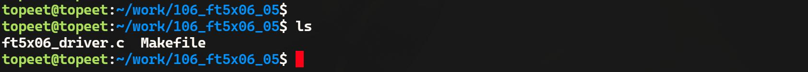
图172.1Makefile 文件内容如代码清单172.2 所示。代码清单172.2
```c
export ARCH=arm64#设置平台架构
```

```c
export CROSS_COMPILE=aarch64-linux-gnu-#交叉编译器前缀
obj-m += ft5x06_driver.o#此处要和你的驱动源文件同名
KDIR :=/home/topeet/Linux/linux_sdk/kernel#这里是你的内核目录
PWD ?= $(shell pwd)
all:
    make -C $(KDIR) M=$(PWD) modules#make 操作
clean:
    make -C $(KDIR) M=$(PWD) clean#make clean 操作
```
在存放ft5x06_driver.c 和Makefile 文件目录下使用make 命令编译驱动程序，编译完成如图172.2 所示。
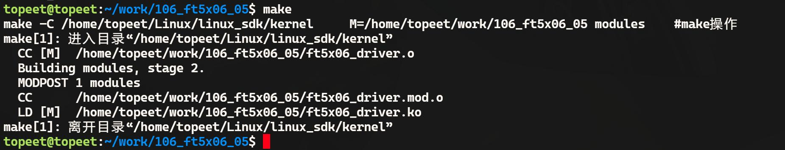
图172.2编译完生成ft5x06_driver.ko 目标文件，如图172.3 所示。
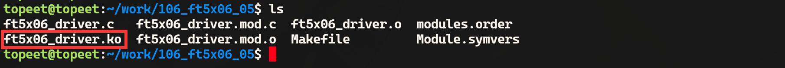
图172.3
### 172.2.2 运行测试
将本章编译完成的ft5x06_driver.ko 驱动文件拷贝到开发板上，然后使用insmodft5x06_driver.ko 命令加载驱动，加载完成如图172.4 所示。
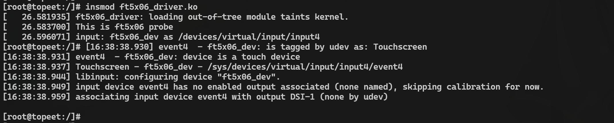
图172.4由图172.4 打印结果可以看出触摸芯片ft5x06 对应的设备节点为/dev/input/event4。使用hexdump /dev/input/event4 命令获取ft5x06 上报的数据。如果有数据上报则可成功获取到上报数据，如图172.5 所示。

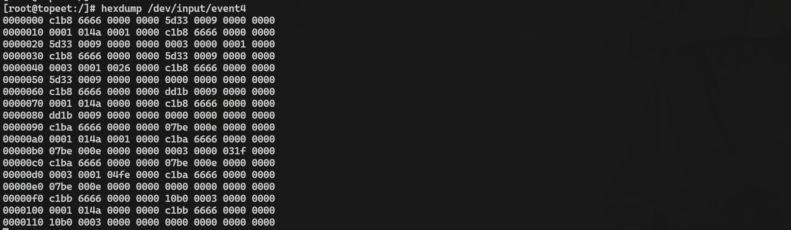
图172.5图172.5 中只是有数据上报，但是上报的数据是否正确呢？，我们继续往下分析。首先输入hexdump /dev/input/event4 命令准备获取ft5x06 的上报数据，然后点击MIPI 屏幕
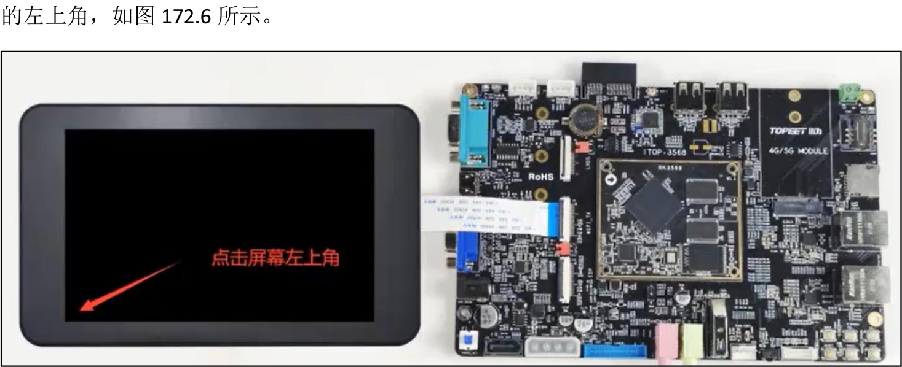
图172.6得到的上报数据如图172.7 所示。
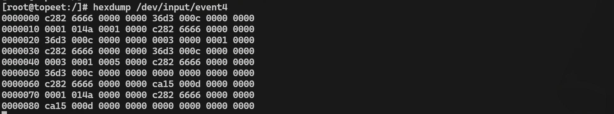
图172.7按照输入子系统章节种讲解的上报数据分析方法对图177.7 中数据进行分组，分组之后的数据如代码清单172.3 所示。代码清单172.3
```c
c282 6666 0000 0000 36d3 000c 0000 0000 0001 014a 0001 0000
c282 6666 0000 0000 36d3 000c 0000 0000 0003 0000 0001 0000
```

```c
c282 6666 0000 0000 36d3 000c 0000 0000 0003 0001 0005 0000
c282 6666 0000 0000 36d3 000c 0000 0000 0000 0000 0000 0000
c282 6666 0000 0000 ca15 000d 0000 0000 0001 014a 0000 0000
c282 6666 0000 0000 ca15 000d 0000 0000 0000 0000 0000 0000
```
这6 组数据具体代表的含义如图172.8 所示。
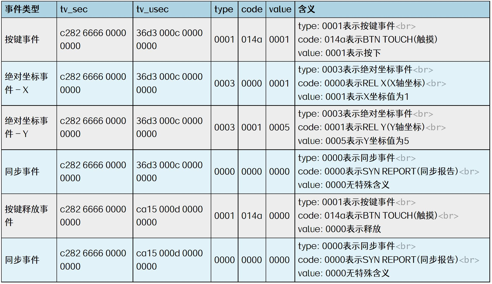
图172.8通过图172.8 中可知x 坐标为1，y 坐标为5。刚好对应屏幕四角中的其中一角。然后输入
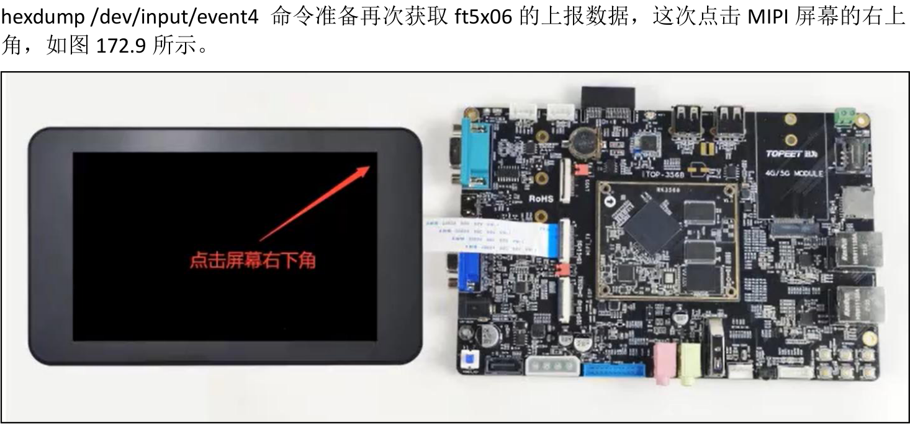
图172.9得到的上报数据如图172.10 所示。

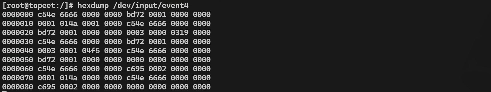
图172.10图172.10 中的数据分组如代码清单172.4 所示。代码清单172.4
```c
c54e 6666 0000 0000 bd72 0001 0000 0000 0001 014a 0001 0000
c54e 6666 0000 0000 bd72 0001 0000 0000 0003 0000 0319 0000
c54e 6666 0000 0000 bd72 0001 0000 0000 0003 0001 04f5 0000
c54e 6666 0000 0000 bd72 0001 0000 0000 0000 0000 0000 0000
c54e 6666 0000 0000 c695 0002 0000 0000 0001 014a 0000 0000
c54e 6666 0000 0000 c695 0002 0000 0000 0000 0000 0000 0000
```
这6 组数据具体代表的含义如图172.11 所示。
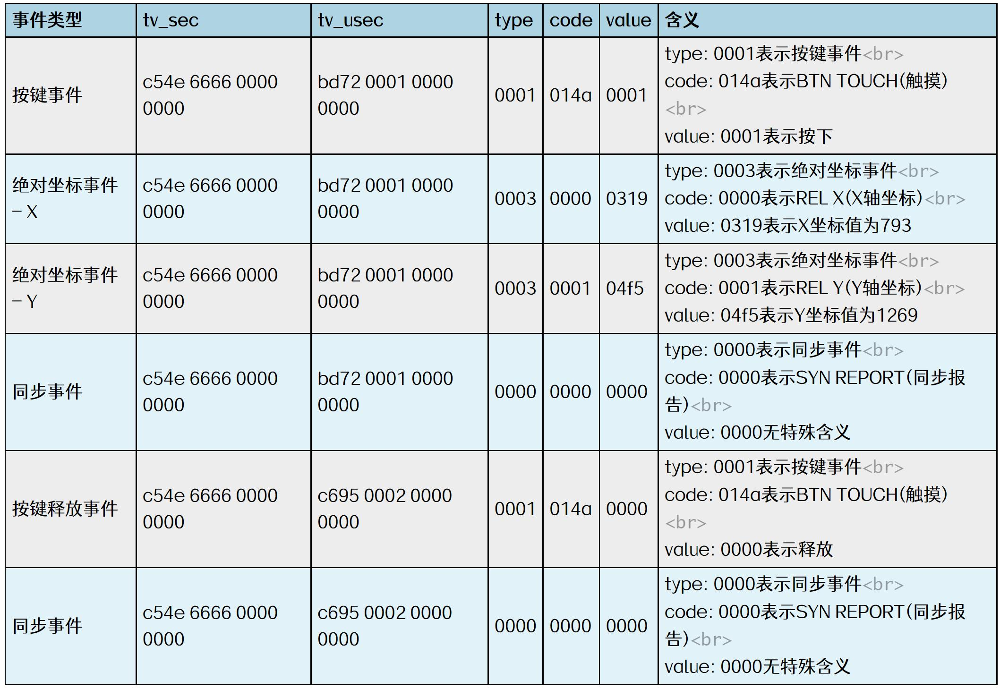
图172.11通过图172.11 可知x 坐标为793，y 坐标为1269。刚好对应屏幕四角中的其中一角，并且坐标数据和实际触摸点与第一次触摸屏幕的坐标数据和触摸点刚好成对角关系。从这个实验现象基本可以驱动ft5x06 驱动已经正确的上报了触摸坐标。

不够使用hexdump 命令得到的数据并不直观，所以接下来通过应用程序来进一步测试ft5x06 的驱动程序是否正常工作。应用程序编写步骤在输入子系统中已经讲过，这里不在赘述。本测试代码存放在网盘iTOP-RK3568 开发板\07_学习教程配套资料\03_Linux 驱动配套资料\04_Linux 驱动例程\106_ft5x06_05 路径下。测试代码app.c 如代码清单172.5 所示。代码清单172.5
```c
#include <fcntl.h>
#include <linux/input.h>
#include <unistd.h>
#include <stdio.h>
int main(int argc, char *argv[]) {
    int fd;
    struct input_event event;
    //打开输入设备事件流
    fd = open("/dev/input/event4", O_RDONLY);
    if (fd < 0) {
        perror("open");
        return -1;
    }
    while (1) {
        //读取一个事件
        if (read(fd, &event, sizeof(event)) != sizeof(event)) {
            perror("read");
            close(fd);
            return -1;
        }
        //判断事件类型是否为绝对坐标事件
        if (event.type == EV_ABS) {
            // 判断事件编码是否为X 轴坐标
            if (event.code == ABS_X) {
                printf("x = %d\n", event.value);
            }
            //判断事件编码是否为Y 轴坐标
            else if (event.code == ABS_Y) {
                printf("y = %d\n", event.value);
```

```c
}
}
}
return 0;
}
```
使用aarch64-linux-gnu-gcc app.c -o app 命令交叉应用程序，编译成功如图172.12 所示。
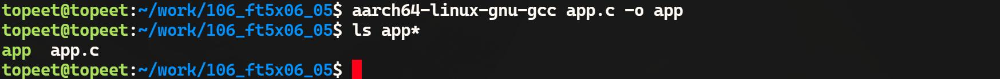
图172.12使用./app 命令运行可执行程序，如图172.13 所示。
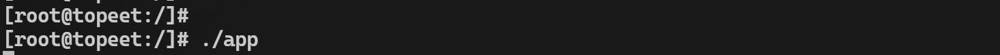
图172.13点击触摸屏时，应用程序就会打印触摸点坐标，如图172.14 所示。
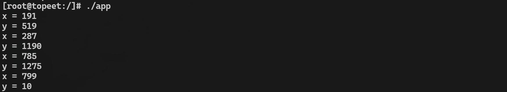
图172.14通过打印信息中的坐标与实际触摸位置进行比较可以进一步验证ft5x06 驱动是否正常工作。

