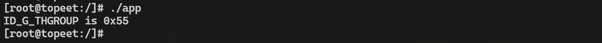
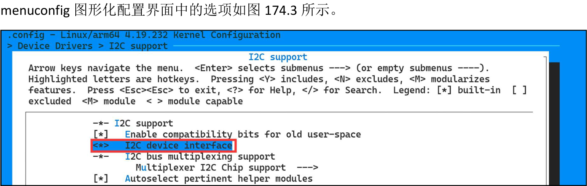

# 第174章 应用程序中使用i2c总线通信步骤讲解

本章学习在应用程序中如何使用i2c 进行通信。
## 174.1 ioctl 命令讲解
在应用程序中可以通过ioctl 函数控制i2c 控制器从而对i2c 设备进行操作。ioctl 函数介绍如下所示：函数原型：int ioctl(int fd, unsigned int cmd, unsigned long args);头文件：#include <sys/ioctl.h>函数作用：用于向设备发送控制和配置命令。参数含义：fd：是用户程序打开设备时返回的文件描述符cmd：是用户程序对设备的控制命令args：应用程序向驱动程序下发的参数，如果传递的参数为指针类型，则可以接收驱动向用户空间传递的数据我们重点看在操作i2c 控制器时ioctl 函数的函数参数cmd 都有哪些控制命令。i2c 控制器的控制命令cmd 定义在include/uapi/linux/i2c-dev.h 文件中，具体内容如代码清单所示。代码清单174.1
```c
#define i2c_RETRIES0x0701//设置重试次数,即当从设备没有响应时要重新轮询的次数
#define i2c_TIMEOUT0x0702//设置超时时间，单位为10 毫秒
#define i2c_SLAVE0x0703//使用此从机地址
#define i2c_SLAVE_FORCE 0x0706//强制使用此从机地址
#define i2c_TENBIT0x0704//0 表示7 位地址，非0 表示10 位地址
#define i2c_FUNCS0x0705 //获取适配器功能掩码
#define i2c_RDWR0x0707//执行合并读写传输(只有一个STOP 信号)
#define i2c_PEC0x0708 //使用PEC(校验码)进行SMBus 传输
#define i2c_SMBUS0x0720//执行SMBus 传输
```
Linux 提供了9 个ioctl 控制命令，在本章的读写实验中通过命令i2c_RDWR 进行数据传输。在使用i2c_RDWR 命令时，需要向ioctl 函数的第三个函数参数传递一个i2c_rdwr_ioctl_data 类

型的结构体，该结构体具体内容如代码清单174.2 所示。代码清单174.2
```c
struct i2c_rdwr_ioctl_data {
    /* 指向i2c_msg 结构体的指针数组*/
    struct i2c_msg __user *msgs;
    /* i2c_msg 结构体的数量*/
    __u32 nmsgs;
};
```
i2c_rdwr_ioctl_data 结构体中msgs 是一个指向i2c_msg 结构体数组的指针，用于存储一个或多个i2c 消息。nmsgs 是i2c_msg 结构体数组的长度，即i2c 消息的数量。接下来通过ft5x06_read_reg()和ft5x06_write_reg()函数讲解如何使用i2c_RDWR 命令读取ft5x06 触摸芯片的寄存器和往ft5x06 的寄存器中写数据。ft5x06_read_reg()内容如代码清单174.3 所示。代码清单174.3
```c
/**
 * @brief 从i2c 设备的寄存器中读取数据
 * @param fd 打开的i2c 设备文件描述符
 * @param slave_addr i2c 设备的从机地址
 * @param reg_addr 要读取的寄存器地址
 * @return 寄存器的值
 */
int ft5x06_read_reg(int fd, unsigned char slave_addr, unsigned char reg_addr) {
    unsigned char data;
    struct i2c_rdwr_ioctl_data i2c_msgs;
    int ret;
    //定义两个i2c_msg 结构体，第一个用于写入寄存器地址，第二个用于读取数据
    struct i2c_msg dev_msgs[] = {
        [0] = {
            .addr = slave_addr,
            .flags = 0,
            .len = sizeof(reg_addr),
            .buf = &reg_addr,
        },
        [1] = {
            .addr = slave_addr,
            .flags = i2c_M_RD, //设置读取标志
            .len = sizeof(data),
            .buf = &data,
        }
```

```c
};
i2c_msgs.msgs = dev_msgs;
i2c_msgs.nmsgs = 2; //两个i2c_msg 结构体
//调用ioctl 函数执行读取操作
ret = ioctl(fd, i2c_RDWR, &i2c_msgs);
if (ret < 0) {
    printf("read error\n");
    return ret;
}
return data;
}
```
ft5x06_write_reg()内容如代码清单174.4 所示。代码清单174.4
```c
/**
 * @brief 向i2c 设备的寄存器写入数据
 * @param fd 打开的i2c 设备文件描述符
 * @param slave_addr i2c 设备的从机地址
 * @param reg_addr 要写入的寄存器地址
 * @param data 要写入的数据
 * @param len 数据长度
 */
void ft5x06_write_reg(int fd, unsigned char slave_addr, unsigned char reg_addr, unsigned char *data, int len)
{
    unsigned char buff[256];
    struct i2c_rdwr_ioctl_data i2c_msgs;
    int ret;
    //定义一个i2c_msg 结构体, 用于写入寄存器地址和数据
    struct i2c_msg dev_msgs[] = {
        [0] = {
            .addr = slave_addr,
            .flags = 0,
            .len = len + 1,
            .buf = buff,
        }
    };
    //将寄存器地址和数据拷贝到buff 数组中
    buff[0] = reg_addr;
    memcpy(&buff[1], data, len);
```

```c
i2c_msgs.msgs = dev_msgs;
i2c_msgs.nmsgs = 1;
//调用ioctl 函数执行写入操作
ret = ioctl(fd, i2c_RDWR, &i2c_msgs);
if (ret < 0) {
    printf("write error\n");
}
}
```
ft5x06_read_reg()和ft5x06_write_reg()函数的编写思路均为先通过i2c_msg 结构体打包要通过i2c 总线传输的数据，然后构建初始化i2c_rdwr_ioctl_data 结构体中的成员。准备工作做好后通过ioctl 函数使用i2c_RDWR 命令与ft5x06 进行i2c 通信。
## 174.2 编写应用测试程序
本节将编写一个完整的应用程序与ft5x06 进行通信，本实验代码存放在网盘iTOP-RK3568开发板\07_学习教程配套资料\03_Linux 驱动配套资料\04_Linux 驱动例程\108_ft5x06_06 路径下。实验代码app.c 如代码清单174.5 所示。代码清单174.5
```c
#include <stdio.h>
#include <linux/i2c.h>
#include <linux/i2c-dev.h>
#include <sys/ioctl.h>
#include <fcntl.h>
#include <string.h>
/**
 * @brief 从i2c 设备的寄存器中读取数据
 * @param fd 打开的i2c 设备文件描述符
 * @param slave_addr i2c 设备的从机地址
 * @param reg_addr 要读取的寄存器地址
 * @return 寄存器的值
 */
int ft5x06_read_reg(int fd, unsigned char slave_addr, unsigned char reg_addr) {
    unsigned char data;
    struct i2c_rdwr_ioctl_data i2c_msgs;
    int ret;
```

```c
//定义两个i2c_msg 结构体，第一个用于写入寄存器地址，第二个用于读取数据
struct i2c_msg dev_msgs[] = {
    [0] = {
        .addr = slave_addr,
        .flags = 0,
        .len = sizeof(reg_addr),
        .buf = &reg_addr,
    },
    [1] = {
        .addr = slave_addr,
        .flags = i2c_M_RD, //设置读取标志
        .len = sizeof(data),
        .buf = &data,
    }
};
i2c_msgs.msgs = dev_msgs;
i2c_msgs.nmsgs = 2; //两个i2c_msg 结构体
//调用ioctl 函数执行读取操作
ret = ioctl(fd, i2c_RDWR, &i2c_msgs);
if (ret < 0) {
    printf("read error\n");
    return ret;
}
return data;
}
/**
* @brief 向i2c 设备的寄存器写入数据
* @param fd 打开的i2c 设备文件描述符
* @param slave_addr i2c 设备的从机地址
* @param reg_addr 要写入的寄存器地址
* @param data 要写入的数据
* @param len 数据长度
*/
void ft5x06_write_reg(int fd, unsigned char slave_addr, unsigned char reg_addr, unsigned char *data, int len)
{
unsigned char buff[256];
struct i2c_rdwr_ioctl_data i2c_msgs;
int ret;
```

```c
//定义一个i2c_msg 结构体，用于写入寄存器地址和数据
struct i2c_msg dev_msgs[] = {
    [0] = {
        .addr = slave_addr,
        .flags = 0,
        .len = len + 1,
        .buf = buff,
    }
};
//将寄存器地址和数据拷贝到buff 数组中
buff[0] = reg_addr;
memcpy(&buff[1], data, len);
i2c_msgs.msgs = dev_msgs;
i2c_msgs.nmsgs = 1;
//调用ioctl 函数执行写入操作
ret = ioctl(fd, i2c_RDWR, &i2c_msgs);
if (ret < 0) {
    printf("write error\n");
}
}
int main(int argc, char *argv[])
{
int fd;
int ID_G_THGROUP;
//打开i2c 设备文件
fd = open("/dev/i2c-1", O_RDWR);
if (fd < 0) {
    printf("open error\n");
    return fd;
}
//向0x38 地址的寄存器0x80 写入0x55
unsigned char data = 0x55;
ft5x06_write_reg(fd, 0x38, 0x80, &data, 1);
//从0x38 地址的寄存器0x80 读取数据
ID_G_THGROUP = ft5x06_read_reg(fd, 0x38, 0x80);
printf("ID_G_THGROUP is 0x%02X\n", ID_G_THGROUP);
```

```c
return 0;
}
```
## 174.3 运行测试
### 174.3.2 编译应用程序
使用aarch64-linux-gnu-gcc app.c -o app 命令交叉应用程序，如图174.1 所示。

图174.1然后将编译完成的可执行程序拷贝到开发板上。
### 174.3.3 运行测试
将本章节编译好的app 可执行文件拷贝到开发板上。使用./app 命令可执行程序，如图174.2所示。

图174.2通过图174.2 可以看出读取到的ID_G_THGROUP 变量值为0x55，此值与应用程序中代码相符合，因此可以确定与ft5x06 触摸芯片通信成功，至此在应用程序中使用i2c 实验就完成了。
## 174.4 i2c 总线通用驱动分析
应用程序中使用ioctl 函数控制i2c 设备离不开驱动的支持。这里的驱动指的是i2c 总线通用驱动i2c-dev.c。i2c 总线通用驱动存放在drivers/i2c/目录下。i2c 总线通用驱动分为i2c 客户端(i2c client)和i2c 驱动(i2c driver)。它为上层应用程序提供了通用的设备节点/dev/i2c-X(X 代表i2c 总线号)。应用程序可以直接通过打开这个设备节点/dev/i2c-X，并使用标准的I/O 操作如open()、ioctl()、read()、write() 等来与i2c 从设备进行通信。本章我们分析i2c 总线通用驱动。

### 174.4.1 使能i2c 总线通用驱动
如果进入系统之后发现在/dev 目录下没有i2c-X（X=0,1,2。。。）节点，说明内核没有使能i2c 总线通用驱动。反之则使能了i2c 总线通用驱动。i2c 总线通用驱动对应内核make

图174.3
### 174.4.2 i2c 总线通用驱动分析
从入口函数i2c_dev_init()开始分析，入口函数如代码清单174.6 所示。代码清单174.6
```c
static int __init i2c_dev_init(void)
{
    int res;
    //打印内核日志,表示i2c /dev 条目驱动已经初始化
    printk(KERN_INFO "i2c /dev entries driver\n");
    //注册字符设备驱动，主设备号为i2c_MAJOR，次设备号范围为0 到i2c_MINORS-1，设备名为"i2c"
    res = register_chrdev_region(MKDEV(i2c_MAJOR, 0), i2c_MINORS, "i2c");
    if (res)
        goto out;
    //创建一个class 对象，名称为"i2c-dev"，用于在用户空间创建设备节点
    i2c_dev_class = class_create(THIS_MODULE, "i2c-dev");
    if (IS_ERR(i2c_dev_class)) {
        res = PTR_ERR(i2c_dev_class);
        goto out_unreg_chrdev;
    }
    //将i2c_groups 数组设置为该class 的dev_groups 属性
    i2c_dev_class->dev_groups = i2c_groups;
```

```c
//注册一个总线通知函数i2cdev_notifier，用于追踪i2c 总线上新添加或删除的适配器
res = bus_register_notifier(&i2c_bus_type, &i2cdev_notifier);
if (res)
    goto out_unreg_class;
=
i2c_for_each_dev(NULL, i2cdev_attach_adapter);
return 0;
out_unreg_class:
//销毁创建的class 对象
class_destroy(i2c_dev_class);
out_unreg_chrdev:
//注销已注册的字符设备驱动
unregister_chrdev_region(MKDEV(i2c_MAJOR, 0), i2c_MINORS);
out:
//打印初始化失败的内核日志
printk(KERN_ERR "%s: Driver Initialisation failed\n", __FILE__);
return res;
}
```
代码清单174.6 第28 行调用i2cdev_attach_adapter()函数通过函数i2c_for_each_dev 遍历已经存在的i2c 控制器去注册i2c 控制器驱动，有多少个i2c 控制器就调用i2cdev_attach_adapter函数几次。i2cdev_attach_adapter()函数的具体内容如代码清单174.7 所示。代码清单174.7
```c
static int i2cdev_attach_adapter(struct device *dev, void *dummy)
{
    struct i2c_adapter *adap;
    struct i2c_dev *i2c_dev;
    int res;
    //检查设备类型是否为i2c_adapter_type，如果不是则返回
    if (dev->type != &i2c_adapter_type)
        return 0;
    adap = to_i2c_adapter(dev);
    //为i2c 控制器分配一个free 的i2c dev，并将其放入i2c_dev_list
    i2c_dev = get_free_i2c_dev(adap);
    if (IS_ERR(i2c_dev))
        return PTR_ERR(i2c_dev);
    //初始化i2c_dev 结构体中的cdev 字段，设置文件操作函数为i2cdev_fops
```

```c
cdev_init(&i2c_dev->cdev, &i2cdev_fops);
i2c_dev->cdev.owner = THIS_MODULE;
//初始化设备对象i2c_dev->dev
device_initialize(&i2c_dev->dev);
//设置设备号为主设备号i2c_MAJOR 和次设备号adap->nr
i2c_dev->dev.devt = MKDEV(i2c_MAJOR, adap->nr);
i2c_dev->dev.class = i2c_dev_class;
i2c_dev->dev.parent = &adap->dev;
i2c_dev->dev.release = i2cdev_dev_release;
//设置设备名称为"i2c-{adap->nr}"
dev_set_name(&i2c_dev->dev, "i2c-%d", adap->nr);
/添加一个字符设备i
res = cdev_device_add(&i2c_dev->cdev, &i2c_dev->dev);
if (res) {
    //如果添加失败，则释放i2c_dev 结构体
    put_i2c_dev(i2c_dev, false);
    return res;
}
//打印调试信息，表示适配器[adap->name]已注册为次设备号adap->nr
pr_debug("i2c-dev: adapter [%s] registered as minor %d\n",
         adap->name, adap->nr);
return 0;
}
```
i2cdev_attach_adapter()函数的作用是在系统总线上发现新的i2c 控制器时，为其创建对应的字符设备节点。其中代码清单174.7 第18 行i2c_dev 结构体中的cdev 字段指定的文件操作集结构体为i2cdev_fops，具体内容如代码清单174.8 所示。代码清单174.8
```c
static const struct file_operations i2cdev_fops = {
    .owner= THIS_MODULE,
    .llseek= no_llseek,
    .read= i2cdev_read,
    .write= i2cdev_write,
    .unlocked_ioctl= i2cdev_ioctl,
    .compat_ioctl = compat_i2cdev_ioctl,
    .open= i2cdev_open,
    .release= i2cdev_release,
};
```
i2cdev_fops 结构体分别实现了常用的open()、read()、write()和ioctl(函数，接下来对上述

函数的实现进行讲解，首先来看i2cdev_open()函数，函数的具体内容如代码清单174.9 所示。代码清单174.9
```c
static int i2cdev_open(struct inode *inode, struct file *file)
{
    //获取次设备号
    unsigned int minor = iminor(inode);
    //声明i2c_client 和i2c_adapter 结构体指针
    struct i2c_client *client;
    struct i2c_adapter *adap;
    //根据次设备号获取对应的i2c_adapter
    adap = i2c_get_adapter(minor);
    //如果没有找到对应的i2c_adapter，返回-ENODEV 错误
    if (!adap)
        return -ENODEV;
    /*
     * 创建一个匿名的i2c_client 结构体实例
     * 该i2c_client 实例稍后可以通过i2c_SLAVE 或i2c_SLAVE_FORCE 命令设置从设备地址
     * 但是这个i2c_client 实例永远不会被注册到设备模型或i2c 核心代码中
     * 它只是持有私有的地址信息和可能的PEC 标志
     */
    client = kzalloc(sizeof(*client), GFP_KERNEL);
    //如果内存分配失败，释放i2c_adapter 并返回-ENOMEM 错误
    if (!client) {
        i2c_put_adapter(adap);
        return -ENOMEM;
    }
    //设置i2c_client 的名称
    snprintf(client->name, i2c_NAME_SIZE, "i2c-dev %d", adap->nr);
    //将i2c_adapter 赋值给i2c_client 的adapter 字段
    client->adapter = adap;
    //将i2c_client 指针保存到file 的private_data 字段
    file->private_data = client;
    //返回成功
    return 0;
}
```
i2cdev_open()函数的作用是创建一个i2c_client 并初始化，然后通过代码file->private_data作为文件系统数据。然后来看i2c 读函数i2cdev_read()，该函数的具体内容如代码清单174.10 所示。

代码清单174.10
```c
static ssize_t i2cdev_read(struct file *file, char __user *buf, size_t count,
        loff_t *offset)
{
    //声明一个临时缓冲区指针
    char *tmp;
    //保存i2c_master_recv 的返回值
    int ret;
    //从file 的private_data 字段获取i2c_client 指针
    struct i2c_client *client = file->private_data;
    //限制最大读取字节数为8192
    if (count > 8192)
        count = 8192;
    //分配临时缓冲区
    tmp = kzalloc(count, GFP_KERNEL);
    //如果内存分配失败，返回-ENOMEM 错误
    if (tmp == NULL)
        return -ENOMEM;
    //打印调试信息
    pr_debug("i2c-dev: i2c-%d reading %zu bytes.\n",
        iminor(file_inode(file)), count);
    //使用i2c_master_recv 函数从i2c_client 设备读取数据
    ret = i2c_master_recv(client, tmp, count);
    //如果读取成功
    if (ret >= 0)
        //将读取的数据拷贝到用户空间缓冲区
        if (copy_to_user(buf, tmp, ret))
            //如果拷贝失败,返回-EFAULT 错误
            ret = -EFAULT;
    //释放临时缓冲区
    kfree(tmp);
    //返回实际读取的字节数,或者错误码
    return ret;
}
```
代码清单174.10 中第10 行代码从文件私有数据中获取到i2c _client 后通过第27 行代码调用i2c_master_recv()函数，该函数在前面i2c 子系统框架以及编写i2c 通信驱动的章节中讲解过，最后会调用i2c_transfer()函数进行i2c 数据的读取，最后在第31 行调用copy_to_user()将读取

到的数据拷贝到用户空间。然后来看i2c 写函数i2cdev_write()，该函数的具体内容如代码清单174.11 所示。代码清单174.11
```c
static ssize_t i2cdev_write(struct file *file, const char __user *buf,
        size_t count, loff_t *offset)
{
    //保存i2c_master_send 的返回值
    int ret;
    //声明一个临时缓冲区指针
    char *tmp;
    //从file 的private_data 字段获取i2c_client 指针
    struct i2c_client *client = file->private_data;
    //限制最大写入字节数为8192
    if (count > 8192)
        count = 8192;
    //分配一个临时缓冲区，并从用户空间拷贝数据到该缓冲区
    tmp = memdup_user(buf, count);
    //如果内存拷贝失败，返回错误码
    if (IS_ERR(tmp))
        return PTR_ERR(tmp);
    //打印调试信息
    pr_debug("i2c-dev: i2c-%d writing %zu bytes.\n",
        iminor(file_inode(file)), count);
    //使用i2c_master_send 函数将数据写入i2c_client 设备
    ret = i2c_master_send(client, tmp, count);
    //释放临时缓冲区
    kfree(tmp);
    //返回实际写入的字节数，或者错误码
    return ret;
}
```
代码清单174.11 中第9 行代码从文件私有数据中获取到i2c _client 后第26 行调用了i2c_master_send()函数，该函数和i2c_master_recv()函数一样，最后都会调用i2c_transfer()函数，只是参数不同，这里是将i2c 数据写入i2c 设备。最后来看i2cdev_ioctl()函数，正是因为i2cdev_ioctl()函数，才能够在应用程序中调用ioctl函数通过ioctl 命令控制i2c 设备，该函数的具体内容如代码清单174.12 所示。代码清单174.12

```c
static long i2cdev_ioctl(struct file *file, unsigned int cmd, unsigned long arg)
{
    //从file 的private_data 字段获取i2c_client 指针
    struct i2c_client *client = file->private_data;
    //声明一个无符号长整型变量，用于保存设备功能
    unsigned long funcs;
    //打印调试信息
    dev_dbg(&client->adapter->dev, "ioctl, cmd=0x%02x, arg=0x%02lx\n",
        cmd, arg);
    //根据不同的ioctl 命令进行处理
    switch (cmd) {
    case i2c_SLAVE:
    case i2c_SLAVE_FORCE:
        //检查从设备地址是否合法
        if ((arg > 0x3ff) ||
            (((client->flags & i2c_M_TEN) == 0) && arg > 0x7f))
            return -EINVAL;
        //如果是i2c_SLAVE 命令，检查地址是否被占用
        if (cmd == i2c_SLAVE && i2cdev_check_addr(client->adapter, arg))
            return -EBUSY;
        //设置从设备地址
        client->addr = arg;
        return 0;
    case i2c_TENBIT:
        //设置10 位地址模式
        if (arg)
            client->flags |= i2c_M_TEN;
        else
            client->flags &= ~i2c_M_TEN;
        return 0;
    case i2c_PEC:
        //设置PEC 标志
        if (arg)
            client->flags |= i2c_CLIENT_PEC;
        else
            client->flags &= ~i2c_CLIENT_PEC;
        return 0;
    case i2c_FUNCS:
        //获取i2c 控制器的功能
        funcs = i2c_get_functionality(client->adapter);
        //将结果写入用户空间的地址
        return put_user(funcs, (unsigned long __user *)arg);
```

```c
case i2c_RDWR: {
    //处理i2c_RDWR 命令
    struct i2c_rdwr_ioctl_data rdwr_arg;
    struct i2c_msg *rdwr_pa;
    //从用户空间拷贝参数结构体
    if (copy_from_user(&rdwr_arg,
            (struct i2c_rdwr_ioctl_data __user *)arg,
            sizeof(rdwr_arg)))
        return -EFAULT;
    //检查参数合法性
    if (!rdwr_arg.msgs || rdwr_arg.nmsgs == 0)
        return -EINVAL;
    //限制最大消息数为i2c_RDWR_IOCTL_MAX_MSGS
    if (rdwr_arg.nmsgs > i2c_RDWR_IOCTL_MAX_MSGS)
        return -EINVAL;
    //将用户空间的消息数组复制到内核空间
    rdwr_pa = memdup_user(rdwr_arg.msgs,
            rdwr_arg.nmsgs * sizeof(struct i2c_msg));
    if (IS_ERR(rdwr_pa))
        return PTR_ERR(rdwr_pa);
    //调用i2cdev_ioctl_rdwr()函数进行i2c 读写操作
    return i2cdev_ioctl_rdwr(client, rdwr_arg.nmsgs, rdwr_pa);
}
case i2c_SMBUS: {
    //处理i2c_SMBUS 命令
    struct i2c_smbus_ioctl_data data_arg;
    //从用户空间拷贝参数结构体
    if (copy_from_user(&data_arg,
            (struct i2c_smbus_ioctl_data __user *) arg,
            sizeof(struct i2c_smbus_ioctl_data)))
        return -EFAULT;
    //调用i2cdev_ioctl_smbus()函数进行SMBus 读写操作
    return i2cdev_ioctl_smbus(client, data_arg.read_write,
            data_arg.command,
            data_arg.size,
            data_arg.data);
}
case i2c_RETRIES:
    //设置i2c 控制器的重试次数
```

```c
if (arg > INT_MAX)
    return -EINVAL;
client->adapter->retries = arg;
break;
case i2c_TIMEOUT:
//设置i2c 控制器的超时时间
if (arg > INT_MAX)
    return -EINVAL;
//用户空间设置的单位是10 ms
client->adapter->timeout = msecs_to_jiffies(arg * 10);
break;
default:
//不支持的ioctl 命令
return -ENOTTY;
}
return 0;
}
```
当应用程序使用过i2c_RDWR 命令用来进行i2c 数据的读写时，会执行代码清单174.12 第45-72 行代码，而这部分的重点在72 行调用i2cdev_ioctl_rdwr()函数进行i2c 读写操作，i2cdev_ioctl_rdwr()函数最终也是调用了i2c_transfer()函数进行的读写。其他ioctl 命令分析同理。
## 174.5 使用read()和write()函数进行i2c 通信
i2c 总线通用驱动中的i2cdev_ioctl()函数、i2cdev_read()函数和i2cdev_write()函数最终都会调用i2c_transfer()函数，所以在应用程序中不使用ioctl 函数通过ioctl 命令进行i2c 通信，直接在应用程序中使用read()函数和write()函数也可以使用i2c 进行通信，本小节编写对应的测试应用程序。本实验代码存放在网盘iTOP-RK3568 开发板\07_学习教程配套资料\03_Linux 驱动配套资料\04_Linux 驱动例程\109_ft5x06_07 路径下。实验代码app.c 如代码清单174.13 所示。代码清单174.13
```c
#include <stdio.h>
#include <sys/ioctl.h>
#include <sys/types.h>
#include <sys/stat.h>
#include <fcntl.h>
#include <string.h>
```

```c
#include <linux/i2c.h>
#include <linux/i2c-dev.h>
#include <unistd.h>
/*
 * 从i2c 设备读取寄存器值
 * @param fd: i2c 设备文件句柄
 * @param reg_addr: 要读取的寄存器地址
 */
void ft5x06_read_reg(int fd, unsigned char reg_addr) {
    unsigned char rd_data[1];
    rd_data[0] = reg_addr;
    write(fd, rd_data, 1);
    read(fd, rd_data, 1);
    printf("reg value is %x\n", rd_data[0]);
}
/*
 * 向i2c 设备写入寄存器值
 * @param fd: i2c 设备文件句柄
 * @param reg_addr: 要写入的寄存器地址
 * @param data: 要写入的数据
 */
void ft5x06_write_reg(int fd, unsigned char reg_addr, unsigned char data) {
    unsigned char wr_data[2];
    wr_data[0] = reg_addr;
    wr_data[1] = data;
    write(fd, wr_data, 2);
}
int main(int argc, char *argv[]) {
    int fd;
    //打开i2c 设备文件
    fd = open("/dev/i2c-1", O_RDWR);
    if (fd < 0) {
        printf("open error\n");
        return fd;
    }
    //设置从设备地址为0x38
    ioctl(fd, i2c_SLAVE_FORCE, 0x38);
    //向寄存器0x80 写入数据0x66
```

```c
ft5x06_write_reg(fd, 0x80, 0x66);
//读取寄存器0x80 的值
ft5x06_read_reg(fd, 0x80);
return 0;
}
```
## 174.6 运行测试
### 174.6.1 编译应用程序
使用aarch64-linux-gnu-gcc app.c -o app 命令交叉应用程序，如图174.4 所示。

图174.4然后将编译完成的可执行程序拷贝到开发板上。
### 174.6.2 运行测试
将本章节编译好的app 可执行文件拷贝到开发板上。使用./app 命令可执行程序，如图174.5所示。

图174.5由图174.5 可以看到读取到的变量值为0x66，表示应用程序中的写函数和读函数已经正常工作，实验完成。

