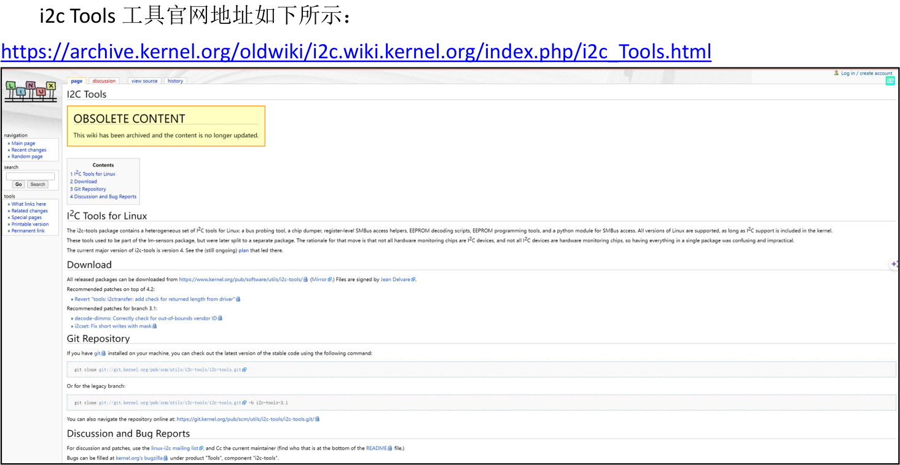
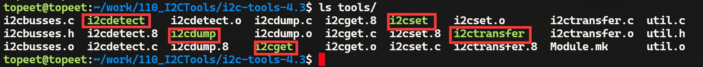
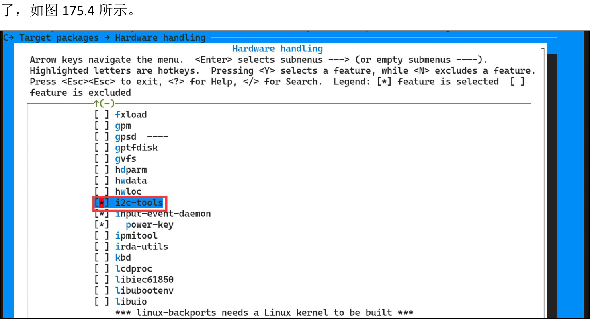
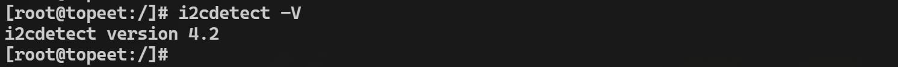
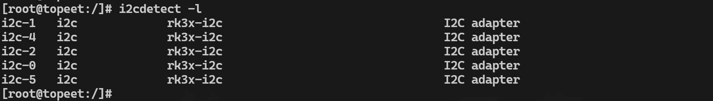
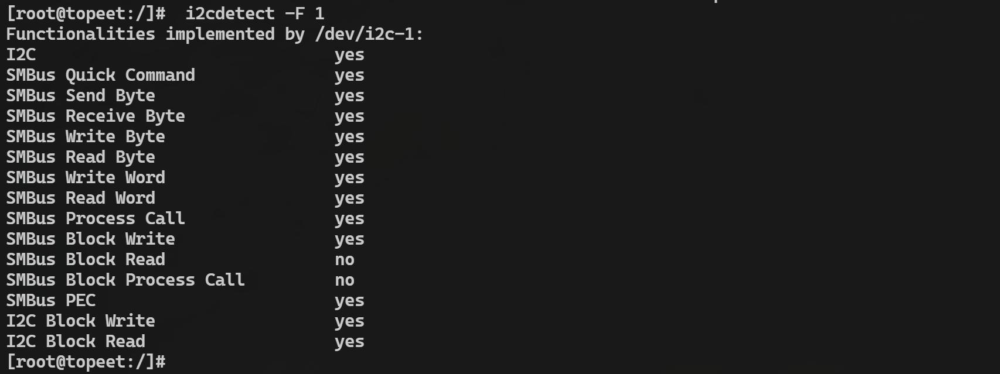
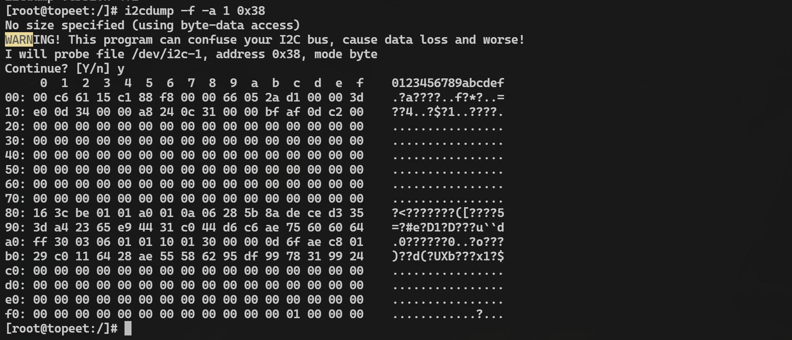
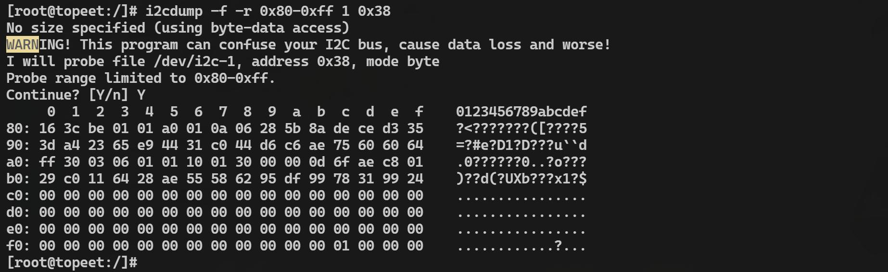
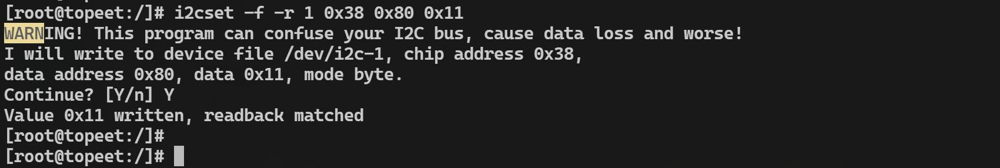
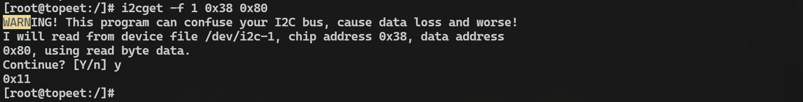

# 第175章 i2c Tools工具讲解

i2c Tools是一套用于访问和调试i2c外设的命令行工具集合。可以帮助开发人员便捷地与i2c设备进行交互。
## 175.1 i2c Tools 工具的下载和安装
注：如果使用的是迅为提供的镜像默认已经安装了i2c Tools 工具，可以跳过本小节。

图175.1在官网中提供了两种源码下载方法，为了方便起见迅为已经将下载好的源码压缩包存放在网盘iTOP-RK3568 开发板\07_学习教程配套资料\03_Linux 驱动配套资料\04_Linux 驱动例程\110_i2cTools 路径下。然后将该源码包拷贝到虚拟机ubuntu 上并解压，解压完成会得到一个名为i2c-tools-4.3 目录，在该目录中存放的是i2c-tool 源码，如图175.2 所示。


图175.2然后进入i2c-tools-4.3 目录使用以下命令进行编译i2c-tool 工具。(这里的编译器路径要以实际情况为准)
```c
make CC=/home/topeet/Linux/linux_sdk/prebuilts/gcc/linux-x86/aarch64/gcc-linaro-6.3.1-2017.05-x86_64_aarc
h64-linux-gnu/bin/aarch64-linux-gnu-gcc \
AR=/home/topeet/Linux/linux_sdk/prebuilts/gcc/linux-x86/aarch64/gcc-linaro-6.3.1-2017.05-x86_64_aarch64-lin
ux-gnu/bin/aarch64-linux-gnu-ar \
USE_STATIC_LIB=1
```
编译完成会i2c-tools-4.3 目录下的tools 目录下生成对应的可执行文件，具体如图175.3 所示。

图175.3上述可执行文件即编译好的i2c-tools 工具。除了以上交叉编译的方法还有更简单的方法，如果使用的是buildroot 系统，只需要在文件系统的make menuconfig 图形界面中勾选i2c Tools 工具重新编译即可，迅为源码默认已经勾选

图175.4如果使用的是ubuntu 或者Debian 系统只需要使用sudo apt install i2c-tools 命令进行安装即

可。
## 175.2 i2c Tools 工具的使用
1. i2cdetect：扫描i2c 总线设备（1）i2cdetect -V：输出版本信息，运行结果如图175.5 所示。

图175.5（2）i2cdetect -l：列出所有可用的i2c 总线，运行结果如图175.6 所示。

图175.6（3）i2cdetect -F：查看指定总线支持的功能。例如使用“i2cdetect -F 1”命令将列出总线1 上设备支持的功能，运行结果如图175.7 所示。

图175.7（4）i2cdetect -a -y [bus]：扫描指定总线上地址为0x00~0xFF 的所有设备地址，常用于查找连接的i2c 设备。例如使用“i2cdetect -a -y 1”命令将扫描i2c1 总线上地址为0x00~0xFF 的所有设备，运行结果如图175.8 所示，其中0x38 地址处显示为UU，这表示该地址对应的器件已被驱动占用，若器件未被驱动占用，此处会显示实际器件地址，若对应地址未扫描到实际器件，则显示为--。


图175.82.i2cdump：读取设备寄存器值（1）i2cdump -V：查看版本号，运行结果如图175.9 所示。

图175.9（2）i2cdump -f -a [bus] [addr]：强制读取指定设备的地址从0x00~0xFF 范围内所有寄存器的值。例如使用“i2cdump -f -a 1 0x38”命令读取设备地址为0x38 的i2c 设备中从0x00 到0xFF 的寄存器的值，其中-f 选项用于强制使用设备地址，而-a 选项用于读取从0x00~0xFF 地址范围的寄存器的值，运行结果如图175.10 所示。

图175.10（3）i2cdump -f -r [start-end] [bus] [addr]：读取指定地址范围内的寄存器值。例如使用“i2cdump-f -r 0x80-0xff 1 0x38”命令可以读取设备地址为0x38 的i2c 设备的0x80 到0xff 范围内的寄存器值。-r 选项用于指定要读取的寄存器地址范围，运行结果如图175.11 所示。


图175.113.i2cset：向寄存器写入数据i2cset -f [bus] [addr] [reg] [value]：向指定设备的某个寄存器写入数据。例如使用“i2cset -f 10x38 0x80 0x11”命令，表示向i2c1 总线上地址为0x38 的设备的寄存器0x80 写入值0x11，运行结果如图175.12 所示。

图175.124.i2cget：读取单个寄存器值i2cget -f [bus] [addr] [reg]：读取指定设备中某个寄存器的值。例如使用“i2cget -f 1 0x38 0x80”命令表示强制从i2c1 总线上地址为0x38 的设备中，读取寄存器0x80 的值，运行结果如图175.13所示。

图175.135.i2ctransfer：支持读写操作i2ctransfer 是一个更加强大和灵活的i2c 操作工具，与之前介绍的i2cset 和i2cget 命令相比，它可以在单个命令中完成读写操作。（1）写操作例如使用“i2ctransfer 1 w2@0x38 0x80 0x22”命令可以向i2c 总线编号为1、设备地址为

