# 第176章 使用GPIO模拟i2c驱动

0x38 的设备的寄存器0x80 写入数据0x22。其中w2 表示写入两个字节的数据，分别为寄存器地址和写入值，运行过程如图175.14 所示。
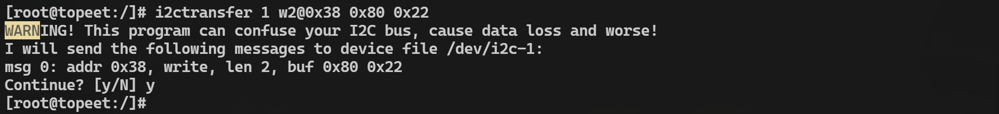
图175.14（2）读操作例如使用“i2ctransfer 1 w1@0x38 0x80 r1”命令可以读取i2c 总线编号为1、设备地址为0x38的设备的0x80 寄存器的值。该命令首先写入1 字节寄存器地址（0x80），然后读取1 字节数据。r1 表示读取一个字节，运行结果如图175.15 所示。
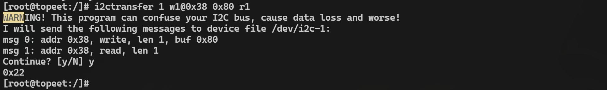
图175.15

i2c 总线可以分为硬件i2c 和软件i2c 两种方式。在之前的章节中，我们使用的都是硬件i2c，即依赖处理器内部的专用i2c 控制器来完成时序控制，无需手动编写时序代码。这种方式通信稳定、效率高，适合大多数应用场景。而本章将会介绍软件i2c 的实现方法，即使用GPIO 模拟i2c 总线时序，适用于没有空闲i2c 控制器或需临时扩展i2c 接口的情况。为便于对比，本章仍以前面实验中使用的i2c1 总线为例，演示软件i2c 的使用流程。
## 176.1 设备树的修改
在使用软件i2c 之前，需要先禁用硬件i2c1 控制器，避免资源冲突。具体操作如下：首先打开topeet_rk3568_lcds.dtsi 设备树文件，找到俩处引用i2c1 节点的地方，将i2c1 的status 属性设置为disabled，设置完成如图176.1、176.2 所示。
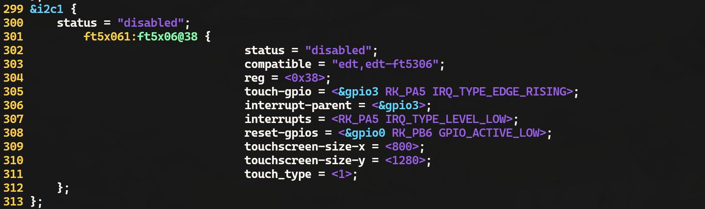
图176.1
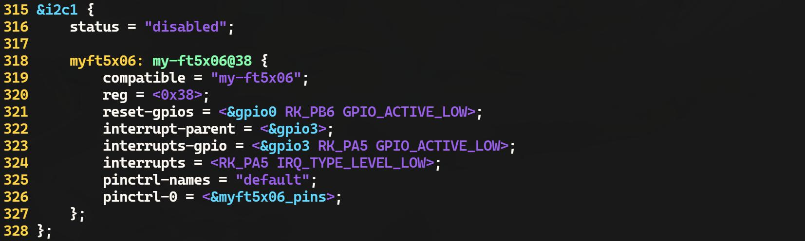
图176.2

然后重新编译内核源码，得到boot.img 镜像并烧写到开发板上，为了方便起见迅为已经将编译好的内核镜像放到了网盘iTOP-RK3568开发板\07_学习教程配套资料\03_Linux驱动配套资料\04_Linux 驱动程序\111_soft_i2c\01_内核镜像目录下。将该镜像烧写到开发板之后使用ls /dev/i2c-*命令查看i2c 节点，如果没有i2c-1 节点则证明已经修改成功，如图176.3 所示。
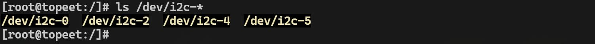
图176.3然后使用cat /sys/kernel/debug/pinctrl/pinctrl-rockchip-pinctrl/pinmux-pins 命令查看引脚复用，如图176.4 所示。
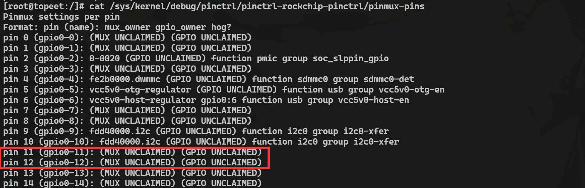
图176.4由图176.4 可以看到i2c1 控制器对应的的两个引脚GPIO0_B3、GPIO0_B4 从以前的i2c 接口变成了GPIO 接口。
## 176.2 编写驱动程序
在本节中将编写模拟i2c 的驱动程序，编写完成的驱动程序存在网盘iTOP-RK3568 开发板\07_学习教程配套资料\03_Linux 驱动配套资料\04_Linux 驱动程序\111_soft_i2c\02_module 路径下。
### 176.2.1 编写驱动框架
首先编写软件i2c 驱动程序框架，在驱动程序框架中申请GPIO0_B3 和GPIO0_B4 两个GPIO，并初始化为高电平，编写完成的驱动程序如代码清单176.1 所示。

代码清单176.1
```c
#include <linux/init.h>
#include <linux/module.h>
#include <linux/gpio/consumer.h>
#include <linux/gpio.h>
//定义i2c 总线的时钟线和数据线对应的GPIO 引脚编号
#define i2c_SCL 11
#define i2c_SDA 12
//声明两个GPIO 描述符变量，用于保存SCL 和SDA 引脚的描述符
struct gpio_desc *i2c_scl_desc;
struct gpio_desc *i2c_sda_desc;
//驱动初始化函数
static int ft5x06_driver_init(void)
{
    //将GPIO 编号转换为GPIO 描述符
    i2c_scl_desc = gpio_to_desc(i2c_SCL);
    if (i2c_scl_desc == NULL) {
        printk("gpio_to_desc error for SCL pin\n");
        return -1;
    }
    i2c_sda_desc = gpio_to_desc(i2c_SDA);
    if (i2c_sda_desc == NULL) {
        printk("gpio_to_desc error for SDA pin\n");
        return -1;
    }
    //将GPIO 引脚设置为输出模式，并初始化为高电平
    gpiod_direction_output(i2c_scl_desc, 1);
    gpiod_direction_output(i2c_sda_desc, 1);
    return 0;
}
//驱动退出函数
static void ft5x06_driver_exit(void)
{
    //释放GPIO 描述符
    gpiod_put(i2c_scl_desc);
    gpiod_put(i2c_sda_desc);
```

```c
}
//注册驱动初始化和退出函数
module_init(ft5x06_driver_init);
module_exit(ft5x06_driver_exit);
MODULE_LICENSE("GPL");
```
驱动程序框架重点在ft5x06_driver_init()驱动初始化函数，代码清单181.1 第17-28 行使用gpio_to_desc()函数将i2c_SCL、i2c_SDA 两个GPIO 编号转换为GPIO 描述符。第31-32 行使用gpiod_direction_output()函数将GPIO 引脚设置为输出模式并初始化为高电平。
### 176.2.2 编写起始和终止信号代码
本实现使用GPIO 模拟起始信号和终止信号时序，起始信号和终止信号通信时序图如图176.5 所示。
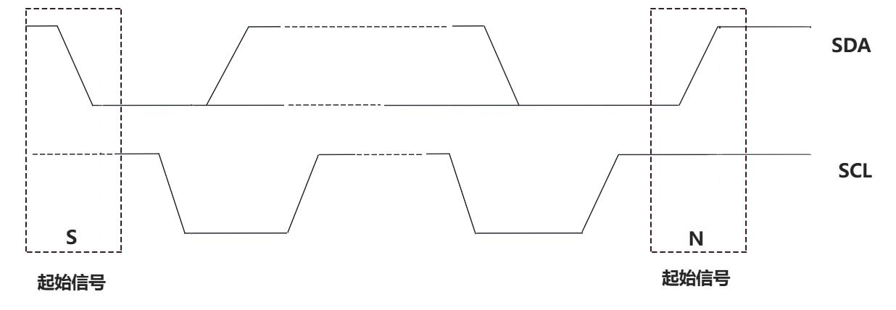
图176.5起始信号为SDA 线从高电平到低电平的跳变，同时SCL 线保持高电平。终止信号为为SDA线从低电平到高电平的跳变，同时SCL 线保持高电平。然后根据上述时序图编写起始信号i2c_start()和终止信号i2c_stop()函数，编写完成的驱动程序如代码清单176.2 所示。代码清单176.2
```c
#include <linux/init.h>
#include <linux/module.h>
#include <linux/gpio/consumer.h>
#include <linux/gpio.h>
#include <linux/delay.h>
#include <linux/jiffies.h>
//定义i2c 总线的时钟线和数据线对应的GPIO 引脚编号
```

```c
#define i2c_SCL 11
#define i2c_SDA 12
//声明两GPIO 描述符变量，用于保存SCL 和SDA 引脚的描述符
struct gpio_desc *i2c_scl_desc;
struct gpio_desc *i2c_sda_desc;
// i2c 起始信号函数
void i2c_start(void)
{
    //将SCL 和SDA 引脚设置为输出模式，并初始化为高电平
    //这是i2c 总线的空闲状态
    gpiod_direction_output(i2c_scl_desc, 1);
    gpiod_direction_output(i2c_sda_desc, 1);
    mdelay(1); //延时1 毫秒
    //将SDA 引脚设置为低电平，保持SCL 为高电平
    //这将产生i2c 总线的起始信号
    gpiod_direction_output(i2c_sda_desc, 0);
    mdelay(1); //延时1 毫秒
    //将SCL 引脚设置为低电平
    //起始信号建立完成
    gpiod_direction_output(i2c_scl_desc, 0);
    mdelay(1); //延时1 毫秒
}
// i2c 终止信号函数
void i2c_stop(void)
{
    //将SCL 和SDA 引脚设置为低电平
    gpiod_direction_output(i2c_scl_desc, 0);
    gpiod_direction_output(i2c_sda_desc, 0);
    mdelay(1); //延时1 毫秒
    //将SCL 引脚设置为高电平
    gpiod_direction_output(i2c_scl_desc, 1);
    mdelay(1); //延时1 毫秒
    //将SDA 引脚设置为高电平
    //这将产生i2c 总线的停终止信号
    gpiod_direction_output(i2c_sda_desc, 1);
    mdelay(1); //延时1 毫秒
}
```

```c
//驱动初始化函数
static int ft5x06_driver_init(void)
{
    //将GPIO 编号转换为GPIO 描述符
    i2c_scl_desc = gpio_to_desc(i2c_SCL);
    if (i2c_scl_desc == NULL) {
        printk("gpio_to_desc error for SCL pin\n");
        return -1;
    }
    i2c_sda_desc = gpio_to_desc(i2c_SDA);
    if (i2c_sda_desc == NULL) {
        printk("gpio_to_desc error for SDA pin\n");
        return -1;
    }
    //将GPIO 引脚设置为输出模式,并初始化为高电平
    //这是i2c 总线的空闲状态
    gpiod_direction_output(i2c_scl_desc, 1);
    gpiod_direction_output(i2c_sda_desc, 1);
    i2c_start();
    i2c_stop();
    return 0;
}
//驱动退出函数
static void ft5x06_driver_exit(void)
{
    //释放GPIO 描述符
    gpiod_put(i2c_scl_desc);
    gpiod_put(i2c_sda_desc);
}
//注册驱动初始化和退出函数
module_init(ft5x06_driver_init);
module_exit(ft5x06_driver_exit);
MODULE_LICENSE("GPL");
```

### 176.2.3 编写发送和接收应答信号函数
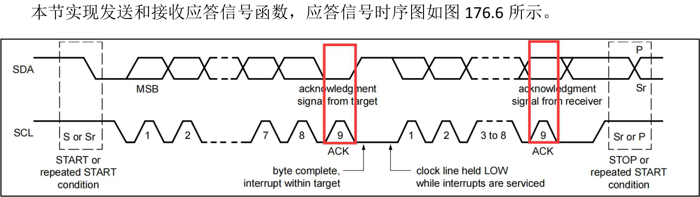
图176.6当发送设备在第9 个时钟脉冲期间释放SDA 线时，接收设备可以拉低SDA 线并在该时钟高电平期间保持稳定，表示应答信号。如果在第9 个时钟脉冲期间SDA 线保持高电平不被拉低，则表示非应答信号。根据时序图编写接收应答或非应答函数和发送应答信号函数，如代码清单176.3 所示。代码清单176.3
```c
#include <linux/init.h>
#include <linux/module.h>
#include <linux/gpio/consumer.h>
#include <linux/gpio.h>
#include <linux/delay.h>
#include <linux/jiffies.h>
//定义i2c 总线的时钟线和数据线对应的GPIO 引脚编号
#define i2c_SCL 11
#define i2c_SDA 12
// 声明两个GPIO 描述符变量，用于保存SCL 和SDA 引脚的描述符
struct gpio_desc *i2c_scl_desc;
struct gpio_desc *i2c_sda_desc;
// i2c 起始信号函数
void i2c_start(void)
{
    //将SCL 和SDA 引脚设置为输出模式，并初始化为高电平
    //这是i2c 总线的空闲状态
    gpiod_direction_output(i2c_scl_desc, 1);
    gpiod_direction_output(i2c_sda_desc, 1);
    mdelay(1); //延时1 毫秒
```

```c
//将SDA 引脚设置为低电平，保持SCL 为高电平
//这将产生i2c 总线的起始信号条件
gpiod_direction_output(i2c_sda_desc, 0);
mdelay(1); //延时1 毫秒
//将SCL 引脚设置为低电平
//起始信号建立完成
gpiod_direction_output(i2c_scl_desc, 0);
mdelay(1); //延时1 毫秒
}
// i2c 终止信号函数
void i2c_stop(void)
{
//将SCL 和SDA 引脚设置为低电平
gpiod_direction_output(i2c_scl_desc, 0);
gpiod_direction_output(i2c_sda_desc, 0);
mdelay(1); //延时1 毫秒
//将SCL 引脚设置为高电平
gpiod_direction_output(i2c_scl_desc, 1);
mdelay(1); //延时1 毫秒
//将SDA 引脚设置为高电平
//这将产生i2c 总线的停止条件
gpiod_direction_output(i2c_sda_desc, 1);
mdelay(1); //延时1 毫秒
}
//发送ACK 信号
void i2c_send_ack(int ack) {
//设置SDA 线为输出模式
gpiod_direction_output(i2c_sda_desc, 0);
if (ack) {
    //发送ACK 信号，SDA 线拉低
    gpiod_direction_output(i2c_sda_desc, 0);
} else {
    //发送NACK 信号，SDA 线拉高
    gpiod_direction_output(i2c_sda_desc, 1);
}
//拉高SCL 线1ms，然后拉低
```

```c
gpiod_direction_output(i2c_scl_desc, 1);
mdelay(1);
gpiod_direction_output(i2c_scl_desc, 0);
}
//接收ACK 信号
int i2c_recv_ack(void) {
int value = 0;
//设置SDA 线为输入模式
gpiod_direction_input(i2c_sda_desc);
//拉高SCL 线1ms
gpiod_direction_output(i2c_scl_desc, 1);
mdelay(1);
//读取SDA 线的电平状态
if (gpiod_get_value(i2c_sda_desc)) {
    value = 1; //接收到NACK 信号
} else {
    value = 0; //接收到ACK 信号
}
//拉低SCL 线
gpiod_direction_output(i2c_scl_desc, 0);
//设置SDA 线为输出模式并拉高
gpiod_direction_output(i2c_sda_desc, 1);
return value;
}
//驱动初始化函数
static int ft5x06_driver_init(void)
{
//将GPIO 编号转换为GPIO 描述符
i2c_scl_desc = gpio_to_desc(i2c_SCL);
if (i2c_scl_desc == NULL) {
    printk("gpio_to_desc error for SCL pin\n");
    return -1;
}
i2c_sda_desc = gpio_to_desc(i2c_SDA);
if (i2c_sda_desc == NULL) {
```

```c
printk("gpio_to_desc error for SDA pin\n");
return -1;
}
//将GPIO 引脚设置为输出模式，并初始化为高电平
//这是i2c 总线的空闲状态
gpiod_direction_output(i2c_scl_desc, 1);
gpiod_direction_output(i2c_sda_desc, 1);
i2c_start();
i2c_stop();
return 0;
}
//驱动退出函数
static void ft5x06_driver_exit(void)
{
//释放GPIO 描述符
gpiod_put(i2c_scl_desc);
gpiod_put(i2c_sda_desc);
}
//注册驱动初始化和退出函数
module_init(ft5x06_driver_init);
module_exit(ft5x06_driver_exit);
MODULE_LICENSE("GPL");
```
### 176.2.4 编写发送和接收数据函数
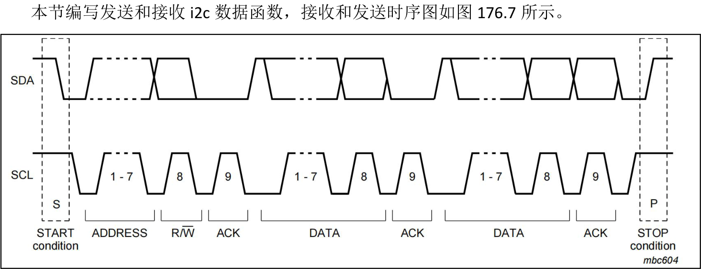
图176.7

起始信号后的首字节前7 位为从设备地址，最后1 位是读写方向位，读写方向位为0 表示写操作，读写方向位为1 表示读操作，当SCL 为高电平时候，通过SDA 线发送或者接收数据。发送和接收数据函数如代码清单176.4 所示。代码清单176.4
```c
#include <linux/init.h>
#include <linux/module.h>
#include <linux/gpio/consumer.h>
#include <linux/gpio.h>
#include <linux/delay.h>
#include <linux/jiffies.h>
//定义i2c 总线的时钟线和数据线对应的GPIO 引脚编号
#define i2c_SCL 11
#define i2c_SDA 12
//声明两个GPIO 描述符变量，用于保存SCL 和SDA 引脚的描述符
struct gpio_desc *i2c_scl_desc;
struct gpio_desc *i2c_sda_desc;
// i2c 起始信号函数
void i2c_start(void)
{
    //将SCL 和SDA 引脚设置为输出模式，并初始化为高电平
    //这是i2c 总线的空闲状态
    gpiod_direction_output(i2c_scl_desc, 1);
    gpiod_direction_output(i2c_sda_desc, 1);
    mdelay(1); //延时1 毫秒
    //将SDA 引脚设置为低电平，保持SCL 为高电平
    //这将产生i2c 总线的起始信号条件
    gpiod_direction_output(i2c_sda_desc, 0);
    mdelay(1); //延时1 毫秒
    //将SCL 引脚设置为低电平
    //起始信号建立完成
    gpiod_direction_output(i2c_scl_desc, 0);
    mdelay(1); //延时1 毫秒
}
// i2c 终止信号函数
void i2c_stop(void)
```

```c
{
    //将SCL 和SDA 引脚设置为低电平
    gpiod_direction_output(i2c_scl_desc, 0);
    gpiod_direction_output(i2c_sda_desc, 0);
    mdelay(1); //延时1 毫秒
    //将SCL 引脚设置为高电平
    gpiod_direction_output(i2c_scl_desc, 1);
    mdelay(1); //延时1 毫秒
    //将SDA 引脚设置为高电平
    //这将产生i2c 总线的停止条件
    gpiod_direction_output(i2c_sda_desc, 1);
    mdelay(1); //延时1 毫秒
}
//发送ACK 信号
void i2c_send_ack(int ack) {
    //设置SDA 线为输出模式
    gpiod_direction_output(i2c_sda_desc, 0);
    if (ack) {
        //发送ACK 信号，SDA 线拉低
        gpiod_direction_output(i2c_sda_desc, 0);
    } else {
        //发送NACK 信号，SDA 线拉高
        gpiod_direction_output(i2c_sda_desc, 1);
    }
    //拉高SCL 线1ms,然后拉低
    gpiod_direction_output(i2c_scl_desc, 1);
    mdelay(1);
    gpiod_direction_output(i2c_scl_desc, 0);
}
//接收ACK 信号
int i2c_recv_ack(void) {
    int value = 0;
    //设置SDA 线为输入模式
    gpiod_direction_input(i2c_sda_desc);
    //拉高SCL 线1ms
    gpiod_direction_output(i2c_scl_desc, 1);
```

```c
mdelay(1);
//读取SDA 线的电平状态
if (gpiod_get_value(i2c_sda_desc)) {
    value = 1; //接收到NACK 信号
} else {
    value = 0; //接收到ACK 信号
}
//拉低SCL 线
gpiod_direction_output(i2c_scl_desc, 0);
//设置SDA 线为输出模式并拉高
gpiod_direction_output(i2c_sda_desc, 1);
return value;
}
void i2c_send_data(int data) {
int i;
int value;
//设置SCL 线为输出模式并拉低
gpiod_direction_output(i2c_scl_desc, 0);
//发送8 位数据
for (i = 0; i < 8; i++) {
    //获取当前位的值
    value = (data << i) & 0x80;
    //根据当前位的值设置SDA 线
    if (value) {
        gpiod_direction_output(i2c_sda_desc, 1);
    } else {
        gpiod_direction_output(i2c_sda_desc, 0);
    }
    //拉高SCL 线1ms,然后拉低
    gpiod_direction_output(i2c_scl_desc, 1);
    mdelay(1);
    gpiod_direction_output(i2c_scl_desc, 0);
    mdelay(1);
}
}
```

```c
int i2c_recv_data(void) {
    int i;
    int temp = 0;
    int data = 0;
    //设置SDA 线为输入模式
    gpiod_direction_input(i2c_sda_desc);
    mdelay(1);
    //接收8 位数据
    for (i = 0; i < 8; i++) {
        //拉低SCL 线1ms
        gpiod_direction_output(i2c_scl_desc, 0);
        mdelay(1);
        //拉高SCL 线1ms
        gpiod_direction_output(i2c_scl_desc, 1);
        mdelay(1);
        //读取SDA 线的电平状态
        data = gpiod_get_value(i2c_sda_desc);
        //根据当前位的值更新接收数据
        if (data) {
            temp = (temp << 1) | data;
        } else {
            temp = (temp << 1) & ~data;
        }
    }
    //拉低SCL 线
    gpiod_direction_output(i2c_scl_desc, 0);
    mdelay(1);
    //设置SDA 线为输出模式并拉高
    gpiod_direction_output(i2c_sda_desc, 1);
    return temp;
}
//驱动初始化函数
static int ft5x06_driver_init(void)
```

```c
{
    //将GPIO 编号转换为GPIO 描述符
    i2c_scl_desc = gpio_to_desc(i2c_SCL);
    if (i2c_scl_desc == NULL) {
        printk("gpio_to_desc error for SCL pin\n");
        return -1;
    }
    i2c_sda_desc = gpio_to_desc(i2c_SDA);
    if (i2c_sda_desc == NULL) {
        printk("gpio_to_desc error for SDA pin\n");
        return -1;
    }
    //将GPIO 引脚设置为输出模式,并初始化为高电平
    //这是i2c 总线的空闲状态
    gpiod_direction_output(i2c_scl_desc, 1);
    gpiod_direction_output(i2c_sda_desc, 1);
    return 0;
}
// 驱动退出函数
static void ft5x06_driver_exit(void)
{
    // 释放GPIO 描述符
    gpiod_put(i2c_scl_desc);
    gpiod_put(i2c_sda_desc);
}
// 注册驱动初始化和退出函数
module_init(ft5x06_driver_init);
module_exit(ft5x06_driver_exit);
MODULE_LICENSE("GPL");
```
### 176.2.5 编写ft5x06 寄存器读写函数
本节使用上一节实现的发送和接收函数编写ft5x06 的寄存器读写函数，并测试使用软件i2c是否可以成功与ft5x06 触摸芯片进行通信，实验代码ft5x06_driver.c 如代码清单176.5 所示。代码清单176.5
```c
#include <linux/init.h>
```

```c
#include <linux/module.h>
#include <linux/gpio/consumer.h>
#include <linux/gpio.h>
#include <linux/delay.h>
#include <linux/jiffies.h>
//定义i2c 总线的时钟线和数据线对应的GPIO 引脚编号
#define i2c_SCL 11
#define i2c_SDA 12
//声明两个GPIO 描述符变量，用于保存SCL 和SDA 引脚的描述符
struct gpio_desc *i2c_scl_desc;
struct gpio_desc *i2c_sda_desc;
// i2c 起始信号函数
void i2c_start(void)
{
    //将SCL 和SDA 引脚设置为输出模式,并初始化为高电平
    //这是i2c 总线的空闲状态
    gpiod_direction_output(i2c_scl_desc, 1);
    gpiod_direction_output(i2c_sda_desc, 1);
    mdelay(1); //延时1 毫秒
    //将SDA 引脚设置为低电平，保持SCL 为高电平
    //这将产生i2c 总线的起始信号条件
    gpiod_direction_output(i2c_sda_desc, 0);
    mdelay(1); //延时1 毫秒
    //将SCL 引脚设置为低电平
    //起始信号建立完成
    gpiod_direction_output(i2c_scl_desc, 0);
    mdelay(1); //延时1 毫秒
}
// i2c 终止信号函数
void i2c_stop(void)
{
    //将SCL 和SDA 引脚设置为低电平
    gpiod_direction_output(i2c_scl_desc, 0);
    gpiod_direction_output(i2c_sda_desc, 0);
    mdelay(1); //延时1 毫秒
    //将SCL 引脚设置为高电平
```

```c
gpiod_direction_output(i2c_scl_desc, 1);
mdelay(1); //延时1 毫秒
//将SDA 引脚设置为高电平
//这将产生i2c 总线的停止条件
gpiod_direction_output(i2c_sda_desc, 1);
mdelay(1); //延时1 毫秒
}
//发送ACK 信号
void i2c_send_ack(int ack) {
//设置SDA 线为输出模式
gpiod_direction_output(i2c_sda_desc, 0);
if (ack) {
    //发送ACK 信号，SDA 线拉低
    gpiod_direction_output(i2c_sda_desc, 0);
} else {
    //发送NACK 信号，SDA 线拉高
    gpiod_direction_output(i2c_sda_desc, 1);
}
//拉高SCL 线1ms,然后拉低
gpiod_direction_output(i2c_scl_desc, 1);
mdelay(1);
gpiod_direction_output(i2c_scl_desc, 0);
}
//接收ACK 信号
int i2c_recv_ack(void) {
int value = 0;
//设置SDA 线为输入模式
gpiod_direction_input(i2c_sda_desc);
//拉高SCL 线1ms
gpiod_direction_output(i2c_scl_desc, 1);
mdelay(1);
//读取SDA 线的电平状态
if (gpiod_get_value(i2c_sda_desc)) {
    value = 1; //接收到NACK 信号
} else {
    value = 0; //接收到ACK 信号
```

```c
}
//拉低SCL 线
gpiod_direction_output(i2c_scl_desc, 0);
//设置SDA 线为输出模式并拉高
gpiod_direction_output(i2c_sda_desc, 1);
return value;
}
void i2c_send_data(int data) {
int i;
int value;
//设置SCL 线为输出模式并拉低
gpiod_direction_output(i2c_scl_desc, 0);
//发送8 位数据
for (i = 0; i < 8; i++) {
    //获取当前位的值
    value = (data << i) & 0x80;
    //根据当前位的值设置SDA 线
    if (value) {
        gpiod_direction_output(i2c_sda_desc, 1);
    } else {
        gpiod_direction_output(i2c_sda_desc, 0);
    }
    //拉高SCL 线1ms，然后拉低
    gpiod_direction_output(i2c_scl_desc, 1);
    mdelay(1);
    gpiod_direction_output(i2c_scl_desc, 0);
    mdelay(1);
}
}
int i2c_recv_data(void) {
int i;
int temp = 0;
int data = 0;
//设置SDA 线为输入模式
```

```c
gpiod_direction_input(i2c_sda_desc);
mdelay(1);
//接收8 位数据
for (i = 0; i < 8; i++) {
    //拉低SCL 线1ms
    gpiod_direction_output(i2c_scl_desc, 0);
    mdelay(1);
    //拉高SCL 线1ms
    gpiod_direction_output(i2c_scl_desc, 1);
    mdelay(1);
    //读取SDA 线的电平状态
    data = gpiod_get_value(i2c_sda_desc);
    //根据当前位的值更新接收数据
    if (data) {
        temp = (temp << 1) | data;
    } else {
        temp = (temp << 1) & ~data;
    }
}
//拉低SCL 线
gpiod_direction_output(i2c_scl_desc, 0);
mdelay(1);
//设置SDA 线为输出模式并拉高
gpiod_direction_output(i2c_sda_desc, 1);
return temp;
}
// ft5x06 触摸屏写寄存器函数
void ft5x06_write_reg(int addr, int reg, int value) {
int ack;
//开始i2c 通信
i2c_start();
//发送触摸屏设备地址(写操作)
i2c_send_data(addr << 1 | 0x00);
ack = i2c_recv_ack();
```

```c
if (ack) {
    printk("send write + addr error\n");
    goto end;
}
//发送寄存器地址
i2c_send_data(reg);
ack = i2c_recv_ack();
if (ack) {
    printk("send reg error\n");
    goto end;
}
//发送要写入的值
i2c_send_data(value);
ack = i2c_recv_ack();
if (ack) {
    printk("send value error\n");
}
end:
//结束i2c 通信
i2c_stop();
}
//ft5x06 触摸屏读寄存器函数
int ft5x06_read_reg(int addr, int reg) {
int ack;
int data;
//开始i2c 通信
i2c_start();
//发送触摸屏设备地址(写操作)
i2c_send_data(addr << 1 | 0x00);
ack = i2c_recv_ack();
if (ack) {
    printk("send write + addr error\n");
    goto end;
}
//发送要读取的寄存器地址
i2c_send_data(reg);
ack = i2c_recv_ack();
```

```c
if (ack) {
    printk("send reg error\n");
    goto end;
}
//重新开始i2c 通信，发送读操作地址
i2c_start();
i2c_send_data(addr << 1 | 0x01);
ack = i2c_recv_ack();
if (ack) {
    printk("send read + addr error\n");
    goto end;
}
//读取寄存器值
data = i2c_recv_data();
printk("data is %d\n", data);
//发送ACK 以结束读操作
i2c_send_ack(0);
end:
//结束i2c 通信
i2c_stop();
return data;
}
//驱动初始化函数
static int ft5x06_driver_init(void)
{
//将GPIO 编号转换为GPIO 描述符
i2c_scl_desc = gpio_to_desc(i2c_SCL);
    if (i2c_scl_desc == NULL) {
    printk("gpio_to_desc error for SCL pin\n");
    return -1;
}
i2c_sda_desc = gpio_to_desc(i2c_SDA);
if (i2c_sda_desc == NULL) {
    printk("gpio_to_desc error for SDA pin\n");
    return -1;
}
```

```c
//将GPIO 引脚设置为输出模式,并初始化为高电平
//这是i2c 总线的空闲状态
gpiod_direction_output(i2c_scl_desc, 1);
gpiod_direction_output(i2c_sda_desc, 1);
ft5x06_write_reg(0x38,0x80,0x33);
ft5x06_read_reg(0x38,0x80);
return 0;
}
//驱动退出函数
static void ft5x06_driver_exit(void)
{
//释放GPIO 描述符
gpiod_put(i2c_scl_desc);
gpiod_put(i2c_sda_desc);
}
//注册驱动初始化和退出函数
module_init(ft5x06_driver_init);
module_exit(ft5x06_driver_exit);
MODULE_LICENSE("GPL");
```
## 176.3 运行测试
### 176.3.1 编译驱动程序
在ft5x06_driver.c 代码同一目录下创建Makefile 文件，如图176.8 所示。
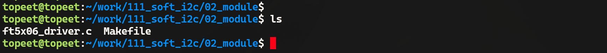
图176.8Makefile 文件内容如代码清单176.6 所示。代码清单176.6
```c
export ARCH=arm64#设置平台架构
export CROSS_COMPILE=aarch64-linux-gnu-#交叉编译器前缀
obj-m += ft5x06_driver.o#此处要和你的驱动源文件同名
KDIR :=/home/topeet/Linux/linux_sdk/kernel#这里是你的内核目录
PWD ?= $(shell pwd)
all:
```

```c
make -C $(KDIR) M=$(PWD) modules#make 操作
clean:
make -C $(KDIR) M=$(PWD) clean#make clean 操作
```
在存放ft5x06_driver.c 和Makefile 文件目录下使用make 命令编译驱动程序，编译完成如图176.9 所示。
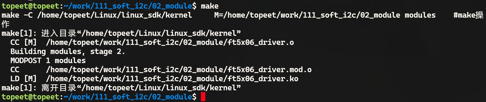
图176.9编译完生成ft5x06_driver.ko 目标文件，如图176.10 所示。
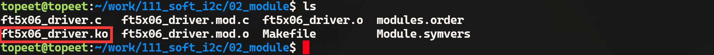
图176.10
### 176.3.2 运行测试
将本章节编译完成的ft5x06_driver.ko 驱动文件拷贝到开发板上，然后使用insmodft5x06_driver.ko 命令加载驱动，加载完成如图176.11 所示。
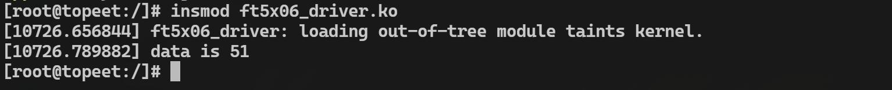
图176.11由图176.11 可以看到打印的值为51，换算成16 进制为0x33，与驱动程序中写入的值是相同的，说明使用GPIO 模拟i2c 与ft5x06 触摸芯片通信成功。

