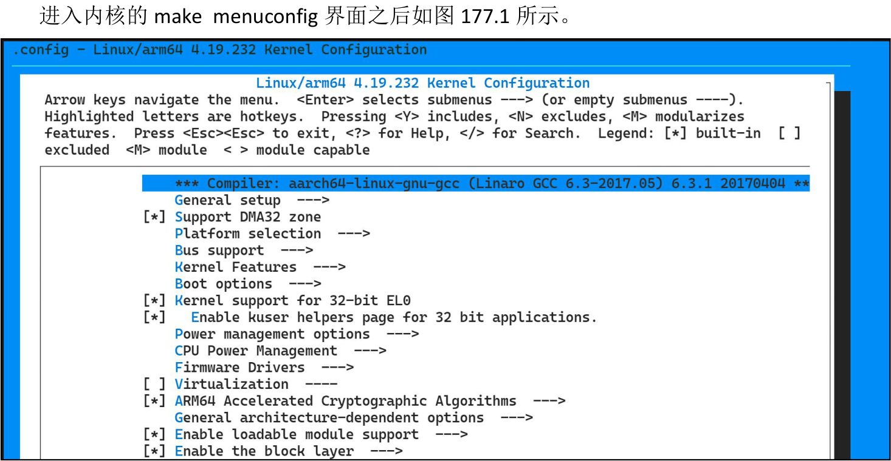
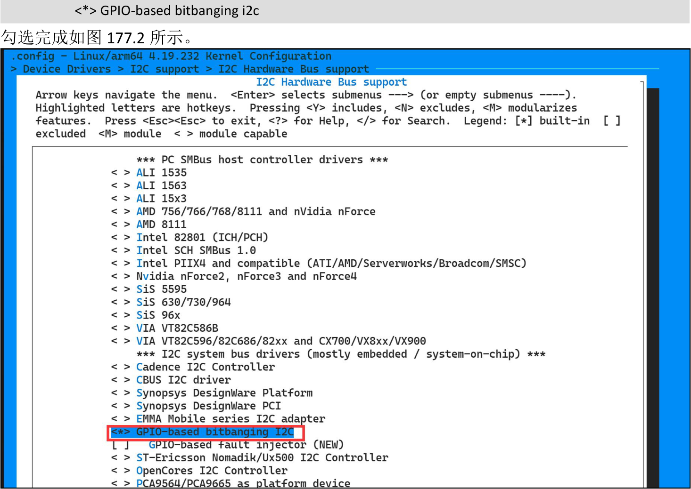
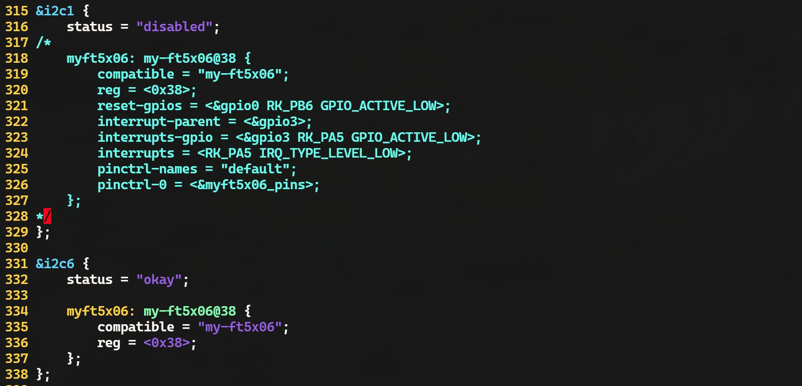
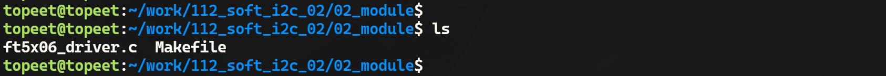
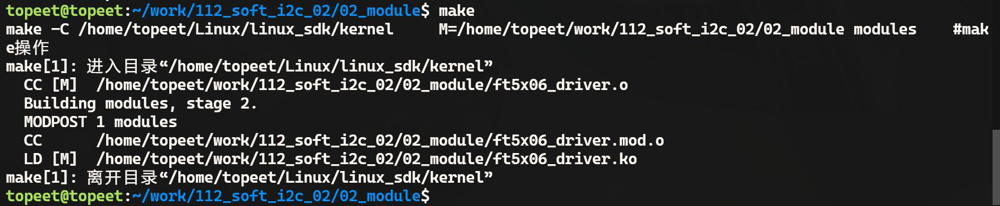
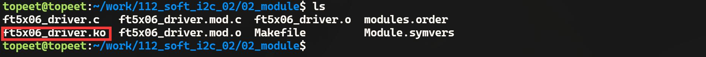
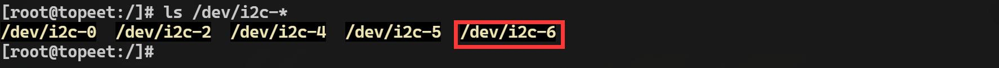
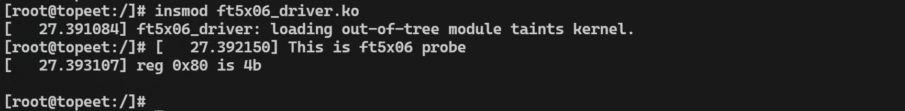

# 第177章 使用Linux中默认的模拟i2c驱动程序

实际开发中并不需要从0 开始编写软件i2c 驱动，直接使用Linux 内核已经提供的通用软件i2c 驱动即可。本章将介绍如何使用Linux 内核自带的软件i2c 驱动。
## 177.1 配置内核支持软件i2c 驱动
默认情况下内核不支持软件i2c 驱动，因此需要手动修改配置文件配置内核支持软件i2c驱动。首先进入内核源码顶层目录下，然后使用代码清单177.1 中的命令进入内核的makemenuconfig 界面。代码清单177.1
```c
export ARCH=arm64
make rockchip_linux_defconfig
make menuconfig
```

图177.1然后根据代码清单177.2 中路径勾选软件i2c 的配置选项。

代码清单177.2
```c
> Device Drivers
   > i2c support
       > i2c Hardware Bus support
```

图177.2保存退出之后使用cp .config arch/arm64/configs/rockchip_linux_defconfig 命令覆盖默认配置文件，覆盖完成如图177.3 所示。

图177.3至此，内核配置完成。
## 177.2 在设备树中配置软件i2c 引脚
使用vim kernel/arch/arm64/boot/dts/rockchip/rk3568.dtsi 命令打开rk3568.dtsi 设备树文件，添加软件i2c 的设备节点i2c6，添加内容如代码清单177.3 所示。

代码清单177.3
```c
i2c6:i2c6@gpio {
    compatible = "i2c-gpio";
    #address-cells = <1>;
    #size-cells = <0>;
    gpios = <&gpi00 RK PB4 GPIO ACTIVE_HIGH>;
             <&gpi00 RK PB3 GPIO ACTIVE_HIGH>;
    i2c-gpio,delay-us = <5>;
    status = "disabled";
};
```
代码清单182.1 第2 行的compatible 属性指定了与驱动程序匹配的字符串，即匹配模拟i2c 驱动程序。第5 行和第6 行定义了用于模拟i2c 总线的两个GPIO，并设置为高电平。第7 行的i2c-gpio,delay-us 属性定义了在两个GPIO 操作之间的延迟时间，以微秒为单位。这里设置为<5>表示5 微秒的延迟。这在模拟i2c 时序时是必需的，以确保时序符合i2c 标准。然后使用vim kernel/arch/arm64/boot/dts/rockchip/topeet_rk3568_lcds.dtsi 命令打开topeet_rk3568_lcds.dtsi 设备树文件，对该设备树文件中的i2c6 节点追加ft5x06 触摸芯片内容，添加内容如代码清单177.4 所示。代码清单177.4
```c
&i2c6 {
    status = "okay";
    myft5x06: my-ft5x06@38 {
        compatible = "my-ft5x06";
        reg = <0x38>;
    };
};
```
需要注意的是，由于前面实验中编写的设备树节点名也叫myft5x06，因此会产生命名冲突，所以需要将在前面实验中编写的myft5x06 设备树节点注释掉。修改添加完成如图177.4 所示。


图177.4修改完成后，重新编译内核源码，得到boot.img 镜像烧写到开发板上，为了方便，迅为已经将编译好的boot.img 内核镜像放到了网盘iTOP-RK3568 开发板\07_学习教程配套资料\03_Linux 驱动配套资料\04_Linux 驱动程序\112_soft_i2c_02\01_内核镜像目录下。
## 177.3 编写驱动程序
在ft5x06 触摸芯片的驱动程序中使用软件i2c 也是直接调用i2c_transfer()函数，如实验代码ft5x06_driver.c。其代码如代码清单177.5 所示。本实验代码存储在网盘iTOP-RK3568开发板\07_学习教程配套资料\03_Linux驱动配套资料\04_Linux 驱动程序\112_soft_i2c_02\02_module 路径下。代码清单177.5
```c
#include <linux/init.h>
#include <linux/module.h>
#include <linux/i2c.h>
#include <linux/gpio.h>
#include <linux/gpio/consumer.h>
#include <linux/interrupt.h>
#include <linux/delay.h>
//保存ft5x06 设备的i2c 客户端对象指针
struct i2c_client *ft5x06_client;
```

```c
//读取ft5x06 设备寄存器的函数
int ft5x06_read_reg(u8 reg_addr)
{
    u8 data;
    //定义两个i2c_msg 结构体，分别表示写操作和读操作
    struct i2c_msg msgs[2] = {
        [0] = {
            .addr = ft5x06_client->addr, //设备地址
            .flags = 0,//写操作
            .len = sizeof(reg_addr),
            .buf = &reg_addr,//写入要读取的寄存器地址
        },
        [1] = {
            .addr = ft5x06_client->addr,
            .flags = i2c_M_RD, //读操作
            .len = sizeof(data),
            .buf = &data,//读取到的数据存储位置
        },
    };
   //使用i2c_transfer()函数进行i2c 总线读取操作
   //如果读取失败，返回-EIO 错误码
   if (i2c_transfer(ft5x06_client->adapter, msgs, ARRAY_SIZE(msgs)) != ARRAY_SIZE(msgs)){
        return -EIO;
    }
    return data; //返回读取到的寄存器值
}
//向ft5x06 设备写入寄存器的函数
void ft5x06_write_reg(u8 reg_addr, u8 *data, u16 len)
{
    u8 buff[256];
    struct i2c_msg msgs[] = {
        [0] = {
            .addr = ft5x06_client->addr, //设备地址
            .flags = 0,//写操作
            .len = len + 1,//数据长度+ 寄存器地址长度
            .buf = buff,//数据缓冲区
        },
    };
    buff[0] = reg_addr;//写入寄存器地址
    memcpy(&buff[1], data, len); //写入数据
```

```c
//使用i2c_transfer()函数进行i2c 总线写入操作
//如果写入失，,直接返回
if (i2c_transfer(ft5x06_client->adapter, msgs, ARRAY_SIZE(msgs)) != ARRAY_SIZE(msgs)) {
    return;
}
}
// ft5x06 设备的探测函数
int ft5x06_probe(struct i2c_client *client, const struct i2c_device_id *id)
{
int value;
printk("This is ft5x06 probe\n");
ft5x06_client = client; //保存i2c 客户端对象指针
//写寄存器
ft5x06_write_reg(0x80, &(u8){0x4b}, 1);
//读寄存器
value = ft5x06_read_reg(0x80);
printk("reg 0x80 is %x\n", value);
return 0;
}
// ft5x06 设备的移除函数
//参数client 是i2c 客户端对象指针
int ft5x06_remove(struct i2c_client *client)
{
//释放中断
return 0;
}
//定义i2c_device_id 结构体数组，用于标识ft5x06 设备
static const struct i2c_device_id ft5x06_id[] = {
{ "my-ft5x06", 0 },
{ }
};
//定义i2c_driver 结构体，描述ft5x06 设备驱动
static struct i2c_driver ft5x06_driver = {
.driver = {
    .name = "my-ft5x06",
    .owner = THIS_MODULE,
```

```c
},
.probe = ft5x06_probe,
.remove = ft5x06_remove,
.id_table = ft5x06_id,
};
//驱动初始化函数
static int __init ft5x06_driver_init(void)
{
int ret;
//注册i2c 设备驱动
ret = i2c_add_driver(&ft5x06_driver);
if (ret < 0) {
    printk("i2c_add_driver is error\n");
    return ret;
}
return 0;
}
//驱动退出函数
static void __exit ft5x06_driver_exit(void)
{
//注销i2c 设备驱动
i2c_del_driver(&ft5x06_driver);
}
module_init(ft5x06_driver_init);
module_exit(ft5x06_driver_exit);
MODULE_LICENSE("GPL");
```
## 177.4 运行测试
### 177.4.1 编译驱动程序
在ft5x06_driver.c 代码同一目录下创建Makefile 文件，如图177.5 所示。

图177.5Makefile 文件内容如代码清单177.6 所示。代码清单177.6

```c
export ARCH=arm64#设置平台架构
export CROSS_COMPILE=aarch64-linux-gnu-#交叉编译器前缀
obj-m += ft5x06_driver.o#此处要和你的驱动源文件同名
KDIR :=/home/topeet/Linux/linux_sdk/kernel#这里是你的内核目录
PWD ?= $(shell pwd)
all:
    make -C $(KDIR) M=$(PWD) modules#make 操作
clean:
    make -C $(KDIR) M=$(PWD) clean#make clean 操作
```
在存放ft5x06_driver.c 和Makefile 文件目录下使用make 命令编译驱动程序，编译完成如图177.6 所示。

图177.6编译完生成ft5x06_driver.ko 目标文件，如图177.7 所示。

图177.7
### 177.4.2 运行测试
首先确保开发板烧写的是本章节编译出来的内核镜像，然后启动开发板，使用ls /dev/i2c-*命令查看i2c 设备节点，如果存在i2c-6 节点就证明软件i2c 配置成功，如图177.8 所示。

图177.8将本章节编译完成的ft5x06_driver.ko 驱动文件拷贝到开发板上，然后使用insmodft5x06_driver.ko 命令加载驱动，加载完成如图177.9 所示。

图177.9由图177.9 可以看到写入到0x80 地址的0x4b 数据就被成功读取了出来，证明使用软件i2

