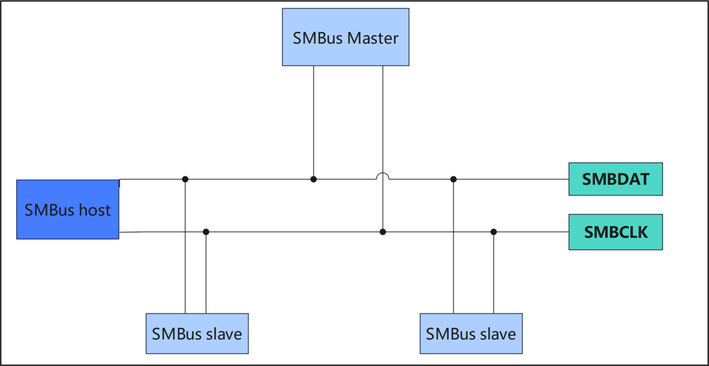

# 第178章 SMBus总线介绍

c 与ft5x06 通信成功。

本章学习SMBus 总线。
## 178.1 什么是SMBus 总线？
SMBus(System Management Bus)是由Intel 在1995 年发布的一种基于i2c 总线的串行总线协议。SMBus 与i2c 总线非常相似，它们都采用两线式串行通信。SMBus 使用SMBDAT 和SMBCLK 作为数据线和时钟线，与i2c 的SDA 和SCL 很相似，SMBus 连接方式如图178.1 所示。

图178.1SMBus 的主要特点如下所示：电气特性:(1)采用开漏输出，需要外部上拉电阻(2)电压范围：0V 到5.5V(3)最大时钟频率：100kHz通信协议:(1)主从式通信，一个主设备控制多个从设备

(2)地址空间：7 位或10 位(3)支持读/写操作(4)支持块传输和字节传输(5)支持多种事务类型，如快速命令、写字节、读字节等功能特性:(1)简单、低成本、低功耗(2)与i2c 高度兼容，可以复用i2c 硬件时序特性:(1)Start 和Stop 条件与i2c 相同(2)地址和数据传输时序也与i2c 相似，但有一些特殊的时序，如快速命令、块传输等
## 178.2 SMBus 和i2c 的区别
（1）速度范围:i2c 支持从10kHz 到3.4MHz 不等的速度范围，覆盖了更广泛的应用场景。SMBus 则只支持10kHz 到100kHz 的速度范围，主要面向低速的系统管理应用场景。（2）ACK 应答:i2c 不强制从机发送ACK 应答，这样可以提高灵活性。但如果从机没有应答，主机可能会产生错误。SMBus 要求从机必须发送ACK 应答，这可以确保主机能够检测到从机是否存在，避免误操作。（3）时间限制:SMBus 规定，从机不能将SCL 线拉低超过35ms，否则会复位正在进行的通信。i2c 没有这样的时间限制，主机和从机可以自主控制SCL 线的状态。
## 178.3 SMBus 总线软件实现
在Linux 内核中，i2c 和SMBus 共用同一套总线架构，在i2c_algorithm 结构体中可以看到SMBusb 总线的传输函数smbus_xfer()，当i2c 控制器工作在SMBus 模式时会使用该函数进行数据传输，i2c_algorithm 结构体如代码清单178.1 所示。

代码清单178.1
```c
struct i2c_algorithm {
    /* 如果i2c 控制器算法无法执行i2c 级别的访问，则应将master_xfer 设置为NULL。
       如果i2c 控制器算法可以执行SMBus 访问，则应设置smbus_xfer。
       如果设置为NULL，则将使用通用的i2c 消息来模拟SMBus 协议*/
    /* master_xfer 函数应该返回成功处理的消息数量，或者在出现错误时返回一个负值*/
    int (*master_xfer)(struct i2c_adapter *adap, struct i2c_msg *msgs,
                       int num);
    /* 用于执行SMBus 传输操作的函数指针
       adap: i2c 控制器
       addr: 从设备地址
       flags: 传输标志
       read_write: 读/写标志
       command: SMBus 命令码
       size: 传输数据的大小
       data: 用于存储传输数据的联合体*/
    int (*smbus_xfer) (struct i2c_adapter *adap, u16 addr,
                       unsigned short flags, char read_write,
                       u8 command, int size, union i2c_smbus_data *data);
    /* 用于确定适配器支持的功能的函数指针*/
    u32 (*functionality) (struct i2c_adapter *);
#if IS_ENABLED(CONFIG_i2c_SLAVE)
    /* 用于注册和注销从设备的函数指针*/
    int (*reg_slave)(struct i2c_client *client);
    int (*unreg_slave)(struct i2c_client *client);
    #endif
};
```
## 178.4 SMBus 总线API 函数
函数1：i2c_smbus_read_byte函数原型：s32 i2c_smbus_read_byte(const struct i2c_client *client)功能：从当前位置读取一个字节的数据，不设置地址参数：client：i2c 设备的客户端结构体

返回值：读取到的数据，失败返回负数
函数2：i2c_smbus_write_byte函数原型：s32 i2c_smbus_write_byte(const struct i2c_client *client, u8 value)功能：向当前位置写入一个字节的数据，不设置地址参数：client：i2c 设备的客户端结构体value：要写入的数据返回值：成功返回0，失败返回负数函数3：i2c_smbus_read_byte_data函数原型：s32 i2c_smbus_read_byte_data(const struct i2c_client *client, u8 command)功能：读取指定地址的一个字节的数据参数：client：i2c 设备的客户端结构体command：要读取的地址返回值：读取到的数据，失败返回负数函数4：i2c_smbus_write_byte_data函数原型：s32 i2c_smbus_write_byte_data(const struct i2c_client *client, u8 command, u8 value)功能：向指定地址写入一个字节的数据参数：client：i2c 设备的客户端结构体command：要写入的地址value：要写入的数据返回值：

