# 第179章 SPI总线概述

成功返回0，失败返回负数上述4 个函数是smbus 总线常用数据接收和发送函数，如果要使用smbus 总线进行通信，只需要将前面编写的驱动函数中的i2c_transfer()函数根据功能替换为上面四个函数即可。

## 179.1 SPI 总线介绍
SPI（Serial Peripheral Interface）最初是由摩托罗拉公司在上世纪80 年代末期提出和开发的一种串行通信协议，旨在解决嵌入式系统中并行总线引脚多、接线复杂、功耗高的问题。其特点如下。（1）SPI 总线使用较少的引脚数实现全双工通信嵌入式中通信模式可以分为单工、半双工和全双工，其中单工通信指信号只在一个方向上传输，仅能发送或接收，而半双工通信指信号可以在俩个方向上传输，但某一个时刻只允许发送或接收(前面讲解的单总线和i2c 都是半双工通信)，而全双工通信指数据可以同时在俩个方向上传输。SPI 只需要4 根信号线（SCLK、MOSI、MISO、CS）即可实现全双工通信。这4 根信号线介绍如下。（1）SCLK (时钟线)：由主设备提供，用于同步数据传输。（2）MOSI (主->从数据传输线)：主设备发送数据，从设备接收。（3）MISO (从->主数据传输线)：从设备发送数据，主设备接收。（4）CS (片选)：由主设备拉低，选中目标从设备。（2）SPI 总线采用同步串行通信机制串行通信是一种逐位传输数据的方式，与之相对的并行通信则允许多个数据位同时传输。在嵌入式通信中有同步和异步两种传输方式，其中同步通信是指数据传输的发送方和接收方使用相同的时钟信号。在此模式下，每个时钟周期对应一个数据位的发送或接收，因此，数据传输严格依赖于时钟信号的节奏。相对而言，异步通信不依赖于共同的时钟信号，发送方和接收方独立运行，并通过特定的协议来实现数据同步。（3）SPI 总线采用主从结构设计SPI 总线将通信设备分为主设备和从设备，主设备负责提供时钟信号和控制通信过程，从设备被动响应主设备的操作。（4）SPI 总线支持多从设备SPI 连接模式主要分为常规模式和菊花链模式。在常规模式下，每个从设备都有独立的片

选（Chip Select, CS）信号线。主设备通过拉低相应的CS 线来选择从设备进行通信，具体示意图如图179.1 所示。
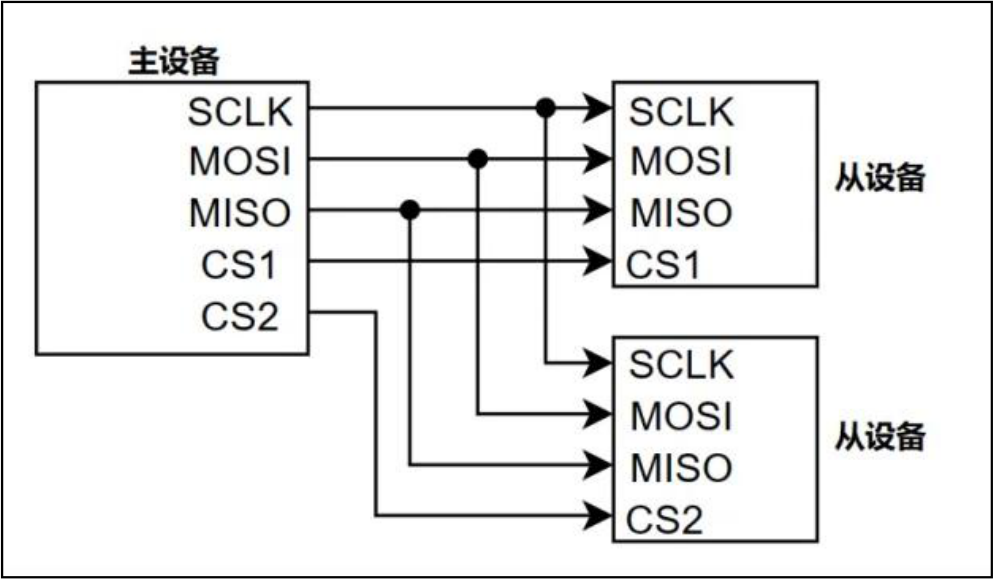
图179.1而在菊花链模式下，从设备会串联在一起，数据从主设备传输到第一个从设备，然后从第一个从设备传输到下一个从设备，从而形成链式结构，具体连接示意图如图179.2 所示。
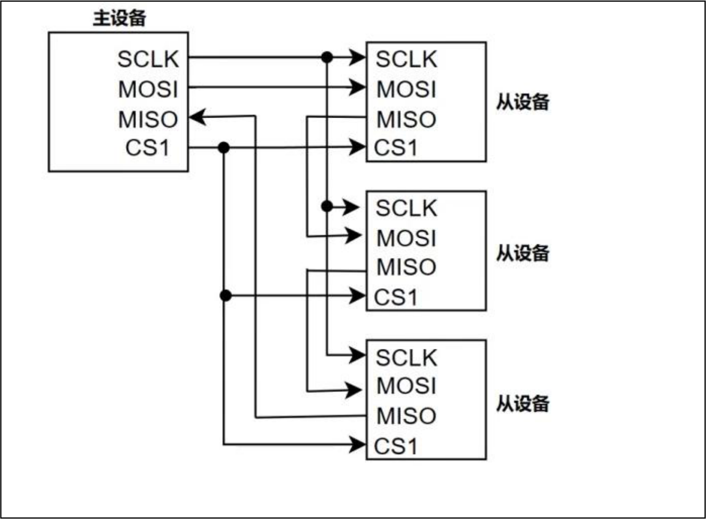
图179.2菊花链模式并不常用，因此只需要知道有这种模式即可，本篇中讲解的内容都是在常规

模式下进行的。（5）SPI 有硬件SPI 与软件SPI硬件SPI 的介绍如下所示。硬件SPI:（1）实现方式：通过专门的硬件电路来实现SPI 通信协议。（2）优点：CPU 占用低：SPI 总线由硬件电路自动完成，CPU 无需直接介入。传输速率高：可以达到几十MHz 甚至更高的通信速率。灵活配置：硬件SPI 通常提供CPOL 和CPHA 的配置选项，用于设置时钟极性和相位。（3）缺点：需要专用硬件: 需要专用的硬件SPI 接口支持，处理器成本相对较高。接口固定: 接口固定，不如软件SPI 灵活。（4）适用范围：适用于高速、大量数据传输的场合，如LCD、EEPROM 等外设的连接。软件SPI 指的是通过GPIO 口模拟SPI 的四根信号线通信时序，在硬件SPI 不够用的情况下，可以通过GPIO 来模拟软件SPI，关于软件SPI 的介绍如下所示。软件SPI:（1）实现方式：通过处理器的GPIO 引脚模拟SPI 通信协议。（2）优点：灵活性高：可以灵活选择GPIO 引脚。无专用硬件要求：不需要专用的硬件SPI 接口，适用于没有内置硬件SPI 接口的处理器。（3）缺点：CPU 占用高：需要处理器程序完成时钟信号的生成、数据的读写等全部操作。传输速率低：速度受到处理器执行程序的速度限制，通常较硬件SPI 要慢。（4）适用范围：适用于没有内置硬件SPI 接口处理器或SPI 接口不够用的场景中。
## 179.2 SPI 总线通信原理
SPI 总线在默认情况下按照先传输高位（MSB，Most Significant Bit），然后传输低位（LSB，Least Significant Bit）的顺序进行数据传输。当数据线为高电平时表示逻辑1，当数据线为低电

平时表示逻辑0，且无需应答信号，每个字节传输完后可立即传输下一个字节。SPI 总线的主设备和从设备中都有一个移位寄存器，主设备通过向移位寄存器写入一个字
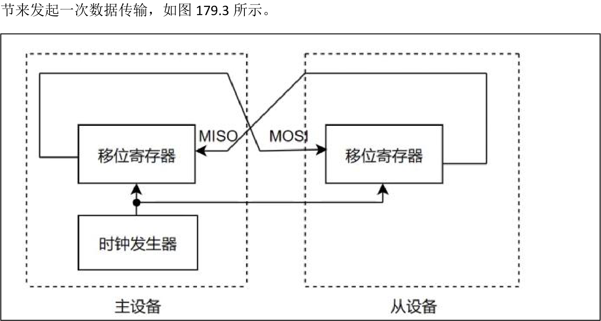
图179.3当SPI 主设备想读/写从设备时，它首先要拉低要进行通信的从设备对应的CS 线（CS 线是低电平有效），接着开始发送时钟脉冲到时钟线上，在相应的脉冲时间上，主设备把信号发送到MOSI 线实现“写”，同时可对MISO 线采样实现“读”，即全双工通信。例如主设备发送0x00，从设备中当前内容为0xFF，每个时钟周期内主设备和从设备移位寄存器中的数据如表179.1 所示。表179.1主设备从设备数据0000 00001111 1111第一个时钟周期0000 00011111 1110第二个时钟周期0000 00111111 1100...第八个时钟周期1111 11110000 0000根据表179.1 可以得到SPI 中数据传输实际上是主设备和从设备之间进行数据交换，在一个SPI 时钟周期内，收发是同时进行的，主机通过MOSI 线发送1bit 数据，从机通过该线读取

这1bit 数据；从机通过MISO 线发送1bit 数据，主机通过该线读取这1bit 数据；当移位寄存器中的内容全部移出时，相当于完成了俩个移位寄存器数据的交换。如果主设备要给从设备传输数据，主设备只需要忽略掉从设备接收到的数据即可。如果主设备要从从设备接收数据，主设备向从设备随机发送数据，从设备忽略掉从主设备接收的数据即可。
## 179.3 SPI 总线工作模式
根据SPI 总线中的时钟极性（CPOL）和相位（CPHA）两个参数可以设置4 种SPI 总线工作模式，其中CPOL 定义了时钟线空闲状态时电平，时钟线为低电平时用0 表示，时钟线为高电平时用1 表示。CPHA 定义了数据采样边沿，第一个边沿采用用0 表示，第二个边沿采用用1表示。因此CPOL 和CPHA 两者可以组合成以下4 种模式。（1）CPOL=0,CPHA=0表示时钟线空闲时为低电平，数据在时钟的第一个边沿(上升沿)被采样，时序如图179.4所示。
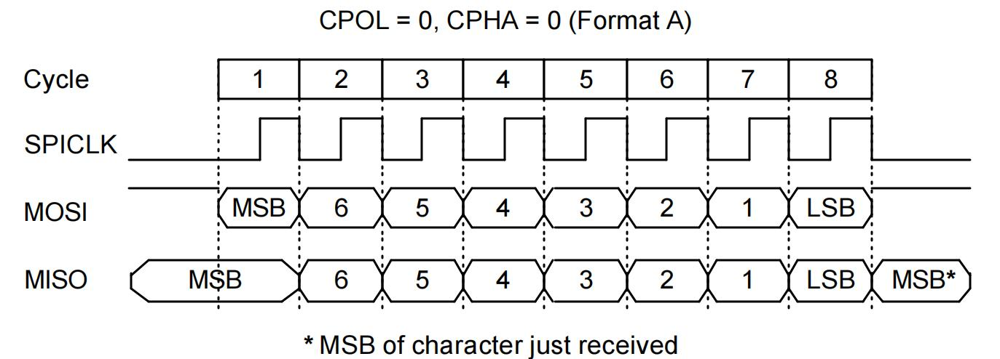
图179.4（2）CPOL=0,CPHA=1表示时钟线空闲时为低电平，数据在时钟的第二个边沿(下降沿)被采样。具体时序如图179.5 所示。

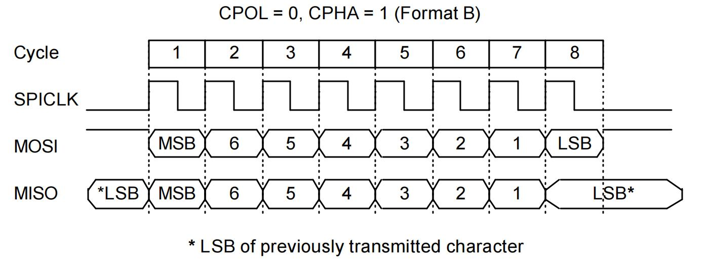
图179.5（3）CPOL=1,CPHA=0表示时钟线空闲时为高电平，数据在时钟的第一个边沿(下降沿)被采样。具体时序如图179.6 所示。
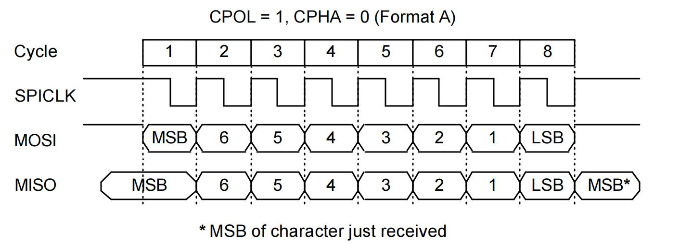
图179.6（4）CPOL=1,CPHA=1表示时钟线空闲为高电平，数据在时钟的第二个边沿(上升沿)被采样。具体时序如图179.7所示。

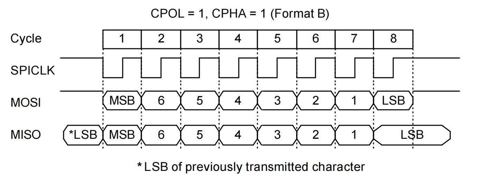
图179.7
## 179.4 介绍iTOP-RK3568 开发板上的SPI 接口
处理器的数据手册中可以找到关于SPI 接口的介绍，如图179.8 所示。
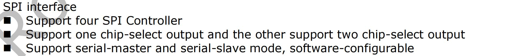
图179.8通过图179.8 可知RK3568 处理器支持4 个SPI 控制器，其中1 个控制器支持1 个片选输出其余3 个控制器各支持2 个片选输出。支持主机模式和从机模式，可通过软件进行配置切换。其中这里的4 路SPI 接口指的是硬件SPI（在SOC 上有专用的硬件SPI 电路）。RK3568 开发板上的SPI 接口具体使用情况如图179.9、179.10 所示。

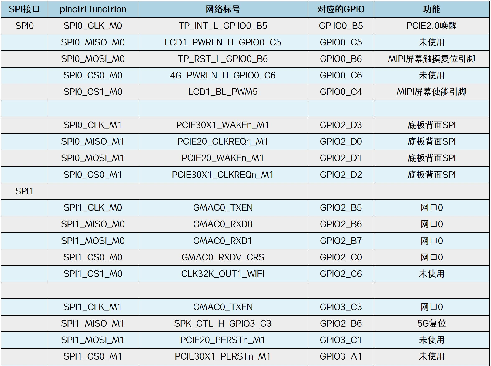
图179.9

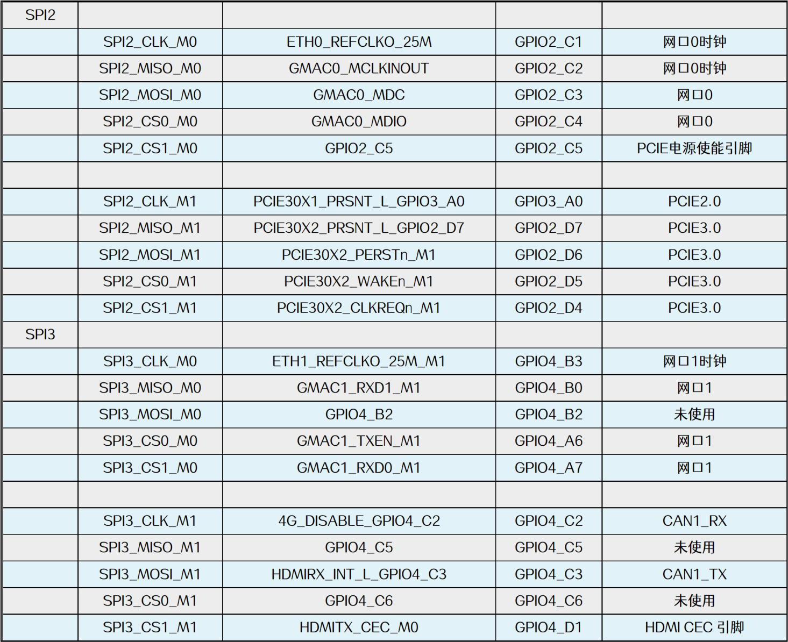
图179.10
## 179.5 mcp2515 芯片介绍
学习SPI 总线时使用的SPI 外设是迅为的CAN_RS485 模块，如图179.11 所示。

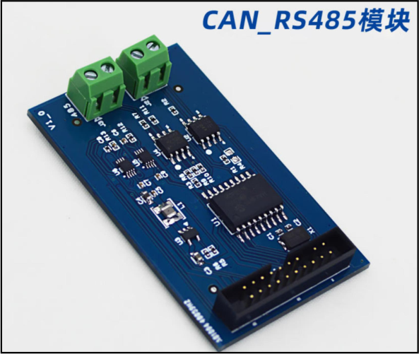
图179.11该模块可以实现SPI 转CAN 的功能，也可以实现TTL 转485 的功能，在后续的实验中只会
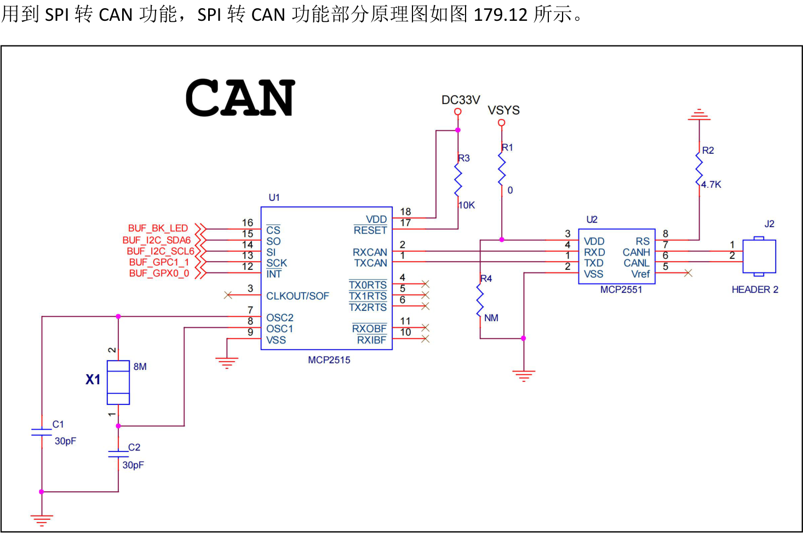
图179.12图179.12 中总共涉及到了两个芯片，分别为mcp2515 SPI 转CAN 芯片和MCP2551 CAN 收发器芯片，这里主要对mcp2515 芯片进行介绍。mcp2515 是一款SPI 转CAN 芯片，完全支持CAN V2.0B 技术规范。主要特点如下。1.完全支持CAN V2.0B：支持标准和扩展数据帧及远程帧的发送和接收。2.高效的滤波功能：内置两个验收屏蔽寄存器和六个验收滤波寄存器，可以过滤掉不需要

