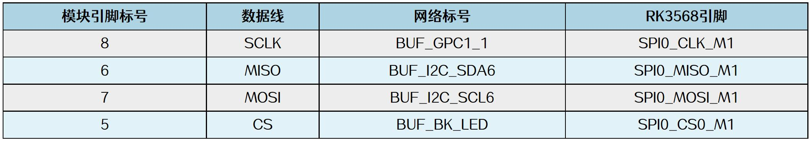
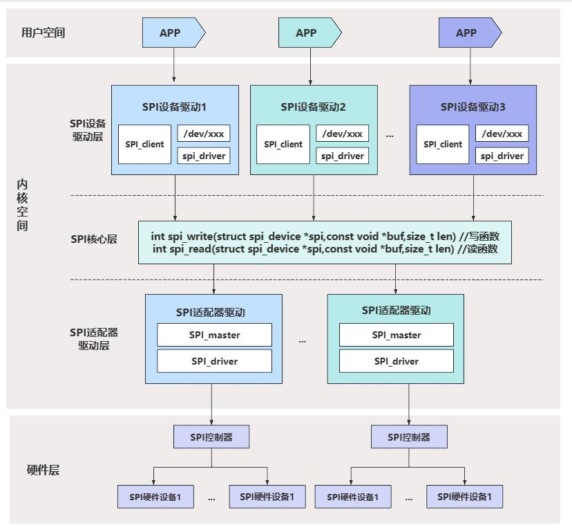

# 第180章SPI子系统框架

的报文。3.SPI 接口：通过SPI 接口与主控制器进行通信，提供高效的数据传输。4.多种操作模式：包括正常模式、休眠模式、监听模式和环回模式，以满足不同应用需求。5.自动重传：在发送失败时自动重传，确保数据传输的可靠性。6.错误检测和处理：内置错误检测和处理机制，保证数据传输的准确性。SPI 转CAN 模块原理图以及mcp2515 芯片数据手册存放在网盘iTOP-RK3568 开发板\07_学习教程配套资料\03_Linux 驱动配套资料\04_Linux 驱动程序\113_mcp2515_01 路径下。SPI 转CAN 模块与iTOP-RK3568 开发板通过iTOP-RK3568 开发板背面20pin GPIO 座子进行连接，引脚连接关系如图179.13 所示。

图179.13

本章学习SPI 子系统框架。
## 180.1 SPI 子系统框架介绍
SPI 子系统框架如图180.1 所示。

图180.1SPI 子系统框架图中用户空间可通过SPI 设备驱动层提供的设备节点操作SPI 设备。硬件层表示具体的SPI 硬件设备，所有SPI 设备均挂载在SPI 总线上。内核空间包含SPI 设备驱动层、

SPI 核心层和SPI 适配器驱动层。SPI 适配器驱动层负责控制SPI 控制器产生SPI 波形并完成数据收发，这部分驱动通常由芯片厂商工程师适配。SPI 核心层介于SPI 适配器驱动层与SPI 设备驱动层之间，对上为SPI 设备驱动层提供spi_write()和spi_read()函数以操作SPI 接口进行通信，对下向SPI 适配器驱动层提供注册SPI控制器驱动接口。SPI 设备驱动层是具体SPI 设备的驱动，SPI 设备驱动分为spi client 和spi driver 两部分。其中spi client 部分是对SPI 设备硬件资源的描述，spi driver 部分中包含对SPI 设备的具体操作，二者通过SPI 总线完成匹配。其中SPI 核心层和SPI 适配器驱动层，Linux 内核以及SOC 芯片原厂已经编写完成了，留给我们驱动工程师的部分只剩下SPI 设备驱动层相关的部分，在后面的章节中将会以编写mcp2515 SPI 转CAN 的驱动程序为例，讲解如何编写SPI 设备驱动程序。

