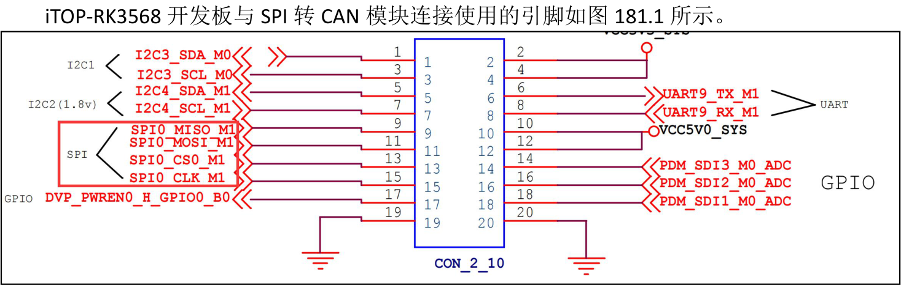
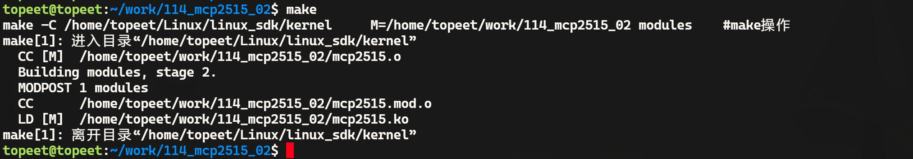
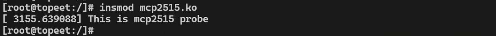

# 第181章 编写SPI设备驱动框架

SPI 设备驱动分为spi client 部分和spi driver 部分。因为最终要实现的SPI 转CAN 驱动比较复杂，因此本章我们先编写SPI 设备驱动框架，即SPI 转CAN 驱动的驱动框架。
## 181.1 编写spi client 代码

图181.1根据引脚的网络标号可知使用的SPI 总线为SPI0，即SPI0 控制器。接下来在内核源码目录下使用vimkernel/arch/arm64/boot/dts/rockchip/rk3568-evb1-ddr4-v10.dtsi命令打开rk3568-evb1-ddr4-v10.dtsi 设备树文件，在该设备树文件中通过追加的方式在SPI0 节点下添加mcp2515 节点，mcp2515 节点实际上就是SPI 设备驱动的spi client 部分。如代码清单181.1 所示。代码清单181.1
```c
&spi0 {
        status = "okay";
        pinctrl-0 = <&spi0m1_cs0&spi0m1_pins>;
        pinctrl-1 = <&spi0m1_cs0&spi0m1_pins_hs>;
        mcp2515:mcp2515@0 {
                compatible = "my-mcp2515";//与spi driver 部分要保持一致
                reg = <0>;
                spi-max-frequency = <10000000>;
                status = "okay";
    };
};
```
代码清单181.1 第7 行通过reg 属性指定片选信号为片选0。第8 行设置spi clk 输出的时钟频率是10M（RK3568 处理器最大设置不超过50M）。如果reg 属性和spi-max-frequency 不设

置在驱动加载时将无法进入probe ()初始化函数。所以这个俩个属性必要要进行设置。修改完成后，重新编译内核镜像，编译完成的内核镜像存放在网盘iTOP-RK3568 开发板\07_学习教程配套资料\03_Linux 驱动配套资料\04_Linux 驱动程序\114_mcp2515_02\02_编译完成的内核镜像路径下。将编译好的内核镜像boot.img 烧写到开发板上，启动开发板后使用cat/sys/kernel/debug/pinctrl/pinctrl-rockchip-pinctrl/pinmux-pins 命令查看引脚SPI0 复用关系，可以看到SPI0 对应的四个引脚已经被成功复用成SPI0 功能，如图181.2 所示。

图181.2
## 181.2 注册SPI 设备驱动
本节编写spi driver 部分，SPI 设备驱动的注册函数为spi_register_driver()，该宏定义位于内核源码include/linux/spi/spi.h 文件中，具体内容如代码清单181.2 所示。代码清单181.2
```c
#define spi_register_driver(driver) \
    __spi_register_driver(THIS_MODULE, driver)
```
通过代码清单181.2 可以看出，spi_register_driver()函数是对__spi_register_driver()函数的封装。该函数的实现位于drivers/spi/spi.c 文件中，其核心代码如代码清单181.3 所示。代码清单181.3
```c
int __spi_register_driver(struct module *owner, struct spi_driver *sdrv)
{
    sdrv->driver.owner = owner;
    sdrv->driver.bus = &spi_bus_type; //设置驱动结构体的bus 字段为spi_bus_type
    sdrv->driver.probe = spi_drv_probe; //设置驱动的probe 回调函数为spi_drv_probe
    sdrv->driver.remove = spi_drv_remove; //设置驱动的remove 回调函数为spi_drv_remove
    if (sdrv->shutdown)
        sdrv->driver.shutdown = spi_drv_shutdown; //设置驱动的shutdown 回调函数为spi_drv_shutdown
        return driver_register(&sdrv->driver); //调用driver_register()函数完成驱动的注册
}
```
__spi_register_driver()函数的核心作用是将SPI 设备驱动注册到内核中。它通过设置spi_driver 结构体中嵌套的device_driver 成员的相关字段（如总线类型、回调函数等），最后调用driver_register()函数将其接入到设备模型中。其中传入的参数sdrv 是一个struct spi_driver

类型的结构体，该结构体定义了SPI 驱动程序的基本框架，如代码清单181.4 所示。代码清单181.4
```c
struct spi_driver {
    const struct spi_device_id *id_table;
    int(*probe)(struct spi_device *spi);
    int(*remove)(struct spi_device *spi);
    void(*shutdown)(struct spi_device *spi);
    struct device_driver driver;
};
```
spi_driver 结构体是SPI 设备驱动的核心结构体，其中id_table 是指向支持的SPI 设备ID 列表，用于与spi client 进行匹配，匹配成功后会执行SPI 设备驱动中的probe 函数。driver 成员为嵌套的device_driver 结构体，用于接入到设备模型中。
## 181.3 编写spi driver 代码
本实验代码存放在网盘iTOP-RK3568 开发板\07_学习教程配套资料\03_Linux 驱动配套资料\04_Linux 驱动程序\114_mcp2515_02\03_module 路径下。本实验编写SPI 设备驱动程序框架。在SPI 设备驱动程序框架中注册并初始化一个SPI 设备驱动，填充probe()函数和remove()函数。实验代码mcp2515.c 如代码清单181.5 所示。代码清单181.5
```c
#include <linux/init.h>
#include <linux/module.h>
#include <linux/spi/spi.h>
// mcp2515 设备初始化回调函数
static int mcp2515_probe(struct spi_device *spi)
{
    printk("This is mcp2515 probe\n");
    return 0;
}
// mcp2515 设备移除回调函数
static int mcp2515_remove(struct spi_device *spi)
{
    return 0;
```

```c
}
// 设备树匹配表，用于与设备树中的compatible 属性匹配
static const struct of_device_id mcp2515_of_match_table[] = {
    { .compatible = "my-mcp2515" },
    {}
};
// mcp2515 设备ID 匹配表，用于总线匹配
static const struct spi_device_id mcp2515_id_table[] = {
    { "mcp2515", 0 },
    {}
};
// mcp2515 SPI 驱动结构体
static struct spi_driver spi_mcp2515 = {
    .probe = mcp2515_probe, //探测函数
    .remove = mcp2515_remove, //移除函数
    .driver = {
        .name = "mcp2515", //驱动名称
        .owner = THIS_MODULE, //所属模块
        .of_match_table = mcp2515_of_match_table, //设备树匹配表
    },
    .id_table = mcp2515_id_table, //设备ID 匹配表
};
//驱动初始化函数
static int __init mcp2515_init(void)
{
    int ret;
    //注册SPI 驱动
    ret = spi_register_driver(&spi_mcp2515);
    if (ret < 0) {
        //注册失败，打印错误信息
        printk("spi_register_driver error\n");
        return ret;
    }
    return ret;
}
//驱动退出函数
static void __exit mcp2515_exit(void)
```

```c
{
    //注销SPI 驱动
    spi_unregister_driver(&spi_mcp2515);
}
module_init(mcp2515_init);
module_exit(mcp2515_exit);
MODULE_LICENSE("GPL");
```
## 181.4 运行测试
### 181.4.1 编译驱动程序
在mcp2515.c 代码同一目录下创建Makefile 文件，如图181.3 所示。

图181.3Makefile 文件内容如代码清单181.6 所示。代码清单181.6
```c
export ARCH=arm64#设置平台架构
export CROSS_COMPILE=aarch64-linux-gnu-#交叉编译器前缀
obj-m += mcp2505.o#此处要和你的驱动源文件同名
KDIR :=/home/topeet/Linux/linux_sdk/kernel#这里是你的内核目录
PWD ?= $(shell pwd)
all:
    make -C $(KDIR) M=$(PWD) modules#make 操作
clean:
    make -C $(KDIR) M=$(PWD) clean#make clean 操作
```
在存放mcp2515.c和Makefile文件目录下使用make命令编译驱动程序，编译完成如图181.4所示。

图181.4编译成功后生成mcp2515.ko 目标文件，如图181.5 所示。


图181.5
### 181.4.2 运行测试
在进行实验之前，首先要确保开发板烧写的是我们在本章节中编译出来的boot.img。接着将本章节编译好的mcp2515.ko 驱动文件拷贝到开发板上。并使用insmod mcp2515.ko 命令加载驱动程序，操作过程如图181.6 所示。

图181.6由图181.6 可以看到成功打印了在probe()函数中的打印，说明spi 设备驱动的spi client 和spi driver，即mcp2515 的设备节点与mcp2515 的驱动程序已经匹配成功。实验成功后使用rmmod mcp2515.ko 命令卸载驱动程序，如图181.7 所示。

图181.7
## 181.5 spi client 设备节点解析流程分析
mcp2515 是SPI0 控制器的子节点，通过父子节点来表示mcp2515 挂载在SPI0 总线上。SPI0根节点定义在设备树rk3568.dtsi 文件中，如代码清单181.7 下所示。代码清单181.7
```c
spi0: spi@fe610000 {
        compatible = "rockchip,rk3066-spi";
        reg = <0x0 0xfe610000 0x0 0x1000>;
        interrupts = <GIC_SPI 103 IRQ_TYPE_LEVEL_HIGH>;
        #address-cells = <1>;
        #size-cells = <0>;
        clocks = <&cru CLK_SPI0>, <&cru PCLK_SPI0>;
        clock-names = "spiclk", "apb_pclk";
        dmas = <&dmac0 20>, <&dmac0 21>;
        dma-names = "tx", "rx";
        pinctrl-names = "default", "high_speed";
        pinctrl-0 = <&spi0m0_cs0 &spi0m0_cs1 &spi0m0_pins>;
        pinctrl-1 = <&spi0m0_cs0 &spi0m0_cs1 &spi0m0_pins_hs>;
        status = "disabled";
};
```
代码清单181.7 中compatible 属于用来表示与哪个SPI 控制器驱动进行匹配，SPI 控制器驱

动文件为drivers/spi/spi-rockchip.c。当SPI 控制器驱动与SPI 控制器对应的设备节点匹配成功后，内核将调用SPI 控制器驱动中的probe() 函数，在probe 函数中会按照devm_spi_register_controller()->spi_register_controller()的函数调用顺序注册SPI 控制器。在spi_register_controller()函数中会调用of_register_spi_devices()解析设备树SPI 控制器下的子节点。of_register_spi_devices()函数如代码清单181.8 所示。代码清单181.8
```c
static void of_register_spi_devices(struct spi_controller *ctlr)
{
    struct spi_device *spi;
    struct device_node *nc;
    //如果控制器没有设备树节点，则直接返回
    if (!ctlr->dev.of_node)
        return;
    //遍历控制器设备树节点下的每个子节点
    for_each_available_child_of_node(ctlr->dev.of_node, nc) {
        //如果该节点已被标记为已填充，则跳过该节点
        if (of_node_test_and_set_flag(nc, OF_POPULATED))
            continue;
        //为该节点注册一个SPI 设备
        spi = of_register_spi_device(ctlr, nc);
        //如果注册失败，记录警告信息并清除该节点的已填充标记
        if (IS_ERR(spi)) {
            dev_warn(&ctlr->dev, "Failed to create SPI device for %pOF\n", nc);
            of_node_clear_flag(nc, OF_POPULATED);
        }
    }
}
```
代码清单181.8 第10-24 行会遍历SPI 控制器设备树节点下的每个子节点，并通过of_register_spi_device()函数注册该SPI 子节点对应的SPI 设备，of_register_spi_device()函数具体内容如代码清单181.9 所示。代码清单181.9
```c
static struct spi_device *
of_register_spi_device(struct spi_controller *ctlr, struct device_node *nc)
```

```c
{
    struct spi_device *spi;
    int rc;
    /* 分配一个spi_device */
    spi = spi_alloc_device(ctlr);
    if (!spi) {
        dev_err(&ctlr->dev, "spi_device alloc error for %pOF\n", nc);
        rc = -ENOMEM;
        goto err_out;
    }
    /* 选择设备驱动*/
    rc = of_modalias_node(nc, spi->modalias, sizeof(spi->modalias));
    if (rc < 0) {
        dev_err(&ctlr->dev, "cannot find modalias for %pOF\n", nc);
        goto err_out;
    }
    /* 解析设备树中的SPI 信息*/
    rc = of_spi_parse_dt(ctlr, spi, nc);
    if (rc)
        goto err_out;
    /* 在设备结构中存储指向节点的指针*/
    of_node_get(nc);
    spi->dev.of_node = nc;
    spi->dev.fwnode = of_fwnode_handle(nc);
    /* 注册新设备*/
    rc = spi_add_device(spi);
    if (rc) {
        dev_err(&ctlr->dev, "spi_device register error %pOF\n", nc);
        goto err_of_node_put;
    }
    return spi;
err_of_node_put:
    of_node_put(nc);
err_out:
    spi_dev_put(spi);
    return ERR_PTR(rc);
}
```

代码清单181.9 第23 行调用了of_spi_parse_dt()函数来解析SPI 控制器设备节点下子节点中的SPI 信息，of_spi_parse_dt()函数具体内容如代码清单181.10 所示。代码清单181.10
```c
static int of_spi_parse_dt(struct spi_controller *ctlr, struct spi_device *spi,
                            struct device_node *nc)
{
    u32 value;
    int rc;
    /* 设置SPI 模式(时钟相位/极性等) */
    if (of_property_read_bool(nc, "spi-cpha"))
        spi->mode |= SPI_CPHA;
    if (of_property_read_bool(nc, "spi-cpol"))
        spi->mode |= SPI_CPOL;
    if (of_property_read_bool(nc, "spi-cs-high"))
        spi->mode |= SPI_CS_HIGH;
    if (of_property_read_bool(nc, "spi-3wire"))
        spi->mode |= SPI_3WIRE;
    if (of_property_read_bool(nc, "spi-lsb-first"))
        spi->mode |= SPI_LSB_FIRST;
    /* 设置设备的DUAL/QUAD 模式*/
    if (!of_property_read_u32(nc, "spi-tx-bus-width", &value)) {
        switch (value) {
            case 1:
                break;
            case 2:
                spi->mode |= SPI_TX_DUAL;
                break;
            case 4:
                spi->mode |= SPI_TX_QUAD;
                break;
            default:
                dev_warn(&ctlr->dev, "spi-tx-bus-width %d not supported\n", value);
                    break;
        }
    }
    if (!of_property_read_u32(nc, "spi-rx-bus-width", &value)) {
        switch (value) {
            case 1:
                break;
```

```c
case 2:
    spi->mode |= SPI_RX_DUAL;
    break;
case 4:
    spi->mode |= SPI_RX_QUAD;
    break;
default:
    dev_warn(&ctlr->dev, "spi-rx-bus-width %d not supported\n", value);
    break;
}
}
/* 如果是SPI 从设备*/
if (spi_controller_is_slave(ctlr)) {
if (strcmp(nc->name, "slave")) {
dev_err(&ctlr->dev, "%pOF is not called 'slave'\n", nc);
return -EINVAL;
}
return 0;
}
/* 获取设备地址*/
rc = of_property_read_u32(nc, "reg", &value);
if (rc) {
dev_err(&ctlr->dev, "%pOF has no valid 'reg' property (%d)\n", nc, rc);
return rc;
}
spi->chip_select = value;
/* 获取设备速度*/
rc = of_property_read_u32(nc, "spi-max-frequency", &value);
if (rc) {
dev_err(&ctlr->dev, "%pOF has no valid 'spi-max-frequency' property (%d)\n", nc, rc);
return rc;
}
spi->max_speed_hz = value;
return 0;
}
```
代码清单181.10 的第19 至50 行中，通过读取设备树属性spi-tx-bus-width 和spi-rx-bus-width，判断SPI 设备的总线传输宽度，并相应设置设备的mode 字段，以支持DUAL 或QUAD 模式传输。如果设备树节点中缺少reg 或spi-max-frequency 属性，of_spi_parse_dt()函数会返回错

