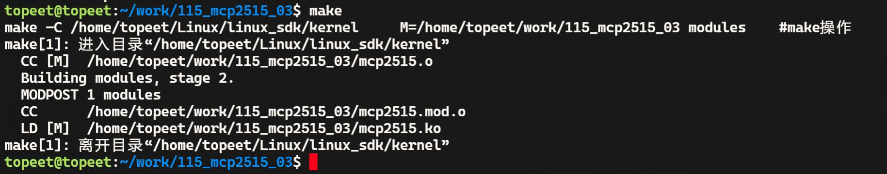

# 第182章mcp2515驱动编写：注册字符设备

误，导致of_register_spi_device()注册失败，从而无法创建对应的SPI 设备。

本章继续编写mcp2515 的驱动程序，在mcp2515 驱动程序中注册字符设备，并实现文件操作集中的read()和write()函数。
## 182.1 驱动程序编写
本实验代码存放在网盘iTOP-RK3568 开发板\07_学习教程配套资料\03_Linux 驱动配套资料\04_Linux 驱动程序\115_mcp2515_03\路径下。实验代码mcp2515.c 如代码清单182.1 所示。代码清单182.1
```c
#include <linux/init.h>
#include <linux/module.h>
#include <linux/spi/spi.h>
#include <linux/cdev.h>
#include <linux/fs.h>
#include <linux/kdev_t.h>
dev_t dev_num; //设备号
struct cdev mcp2515_cdev; //字符设备结构体
struct class *mcp2515_class; //设备类
struct device *mcp2515_device; //设备
//打开设备文件的回调函数
int mcp2515_open(struct inode *inode, struct file *file) {
    return 0; //返回成功
}
//读取设备文件的回调函数
ssize_t mcp2515_read(struct file *file, char __user *buf, size_t size, loff_t *offset) {
    return 0; //返回成功
}
//写入设备文件的回调函数
ssize_t mcp2515_write(struct file *file, const char __user *buf, size_t size, loff_t *offset) {
    return 0; //返回成功
}
```

```c
//关闭设备文件的回调函数
int mcp2515_release(struct inode *inode, struct file *file) {
    return 0; //返回成功
}
//设备文件操作集合
struct file_operations mcp2515_fops = {
    .open = mcp2515_open,
    .read = mcp2515_read,
    .write = mcp2515_write,
    .release = mcp2515_release,
};
// mcp2515 设备初始化函数
int mcp2515_probe(struct spi_device *spi) {
    int ret;
    printk("This is mcp2515_probe\n");
    spi_dev = spi; //保存SPI 设备指针
    //分配字符设备号
    ret = alloc_chrdev_region(&dev_num, 0, 1, "mcp2515");
    if (ret < 0) {
        printk("alloc_chrdev_region error\n");
    }
    //初始化字符设备
    cdev_init(&mcp2515_cdev, &mcp2515_fops);
    mcp2515_cdev.owner = THIS_MODULE;
    //添加字符设备
    ret = cdev_add(&mcp2515_cdev, dev_num, 1);
    if (ret < 0) {
        printk("cdev_add error\n");
        return -1;
    }
    //创建设备类
    mcp2515_class = class_create(THIS_MODULE, "spi_to_can");
    if (IS_ERR(mcp2515_class)) {
        printk("mcp2515_class error\n");
        return PTR_ERR(mcp2515_class);
    }
    // 创建设备
    mcp2515_device = device_create(mcp2515_class, NULL, dev_num, NULL, "mcp2515");
```

```c
if (IS_ERR(mcp2515_device)) {
    printk("mcp2515_device error\n");
    return PTR_ERR(mcp2515_device);
}
return 0; //返回成功
}
// mcp2515 SPI 设备的移除函数
static int mcp2515_remove(struct spi_device *spi) {
device_destroy(mcp2515_class, dev_num);
class_destroy(mcp2515_class);
cdev_del(&mcp2515_cdev);
unregister_chrdev_region(dev_num, 1);
return 0;
}
// mcp2515 设备匹配表，用于设备树匹配
static const struct of_device_id mcp2515_of_match_table[] = {
{ .compatible = "my-mcp2515" },
{}
};
// mcp2515 设备ID 匹配表，用于总线匹配
static const struct spi_device_id mcp2515_id_table[] = {
{ "mcp2515", 0 },
{}
};
// mcp2515 SPI 驱动结构体
static struct spi_driver spi_mcp2515 = {
.probe = mcp2515_probe, //探测函数
.remove = mcp2515_remove, //移除函数
.driver = {
    .name = "mcp2515", //驱动名称
    .owner = THIS_MODULE, //所属模块
    .of_match_table = mcp2515_of_match_table, //设备树匹配表
},
.id_table = mcp2515_id_table, //设备ID 匹配表
};
//驱动初始化函数
static int __init mcp2515_init(void)
{
```

```c
int ret;
//注册SPI 驱动
ret = spi_register_driver(&spi_mcp2515);
if (ret < 0) {
    //注册失败，打印错误信息
    printk("spi_register_driver error\n");
    return ret;
}
return ret;
}
//驱动退出函数
static void __exit mcp2515_exit(void)
{
//注销SPI 驱动
spi_unregister_driver(&spi_mcp2515);
}
module_init(mcp2515_init);
module_exit(mcp2515_exit);
MODULE_LICENSE("GPL");
```
## 182.2 运行测试
### 182.2.1 编译驱动程序
在mcp2515.c 代码同一目录下创建Makefile 文件，如图182.1 所示。

图181.1Makefile 文件内容如代码清单181.2 所示。代码清单181.2
```c
export ARCH=arm64#设置平台架构
export CROSS_COMPILE=aarch64-linux-gnu-#交叉编译器前缀
obj-m += mcp2505.o#此处要和你的驱动源文件同名
KDIR :=/home/topeet/Linux/linux_sdk/kernel#这里是你的内核目录
```

```c
PWD ?= $(shell pwd)
all:
    make -C $(KDIR) M=$(PWD) modules#make 操作
clean:
    make -C $(KDIR) M=$(PWD) clean#make clean 操作
```
在存放mcp2515.c和Makefile文件目录下使用make命令编译驱动程序，编译完成如图181.2所示。

图181.2编译成功后生成mcp2515.ko 目标文件，如图181.3 所示。

图181.3
### 182.2.2 运行测试
在进行实验之前，首先要确保开发板烧写的是在编写SPI 设备驱动框架章节中编译出来的boot.img。然后将本章节编译好的mcp2515.ko 驱动文件拷贝到开发板上。并使用insmodmcp2515.ko 命令加载驱动驱动程序，操作过程如图181.4 所示。

图181.4然后使用ls /dev/mcp2515 命令查看是否生成了mpc2515 设备节点，如图181.5 所示可以看到成功生成了/dev/mcp2515 节点。通过该设备节点就能在应用程序中通过read()、write()等系统调用函数对mcp2515 进行读写。

图181.5实验完成后使用rmmod mcp2515.ko 命令卸载驱动程序，如图181.6 所示。


