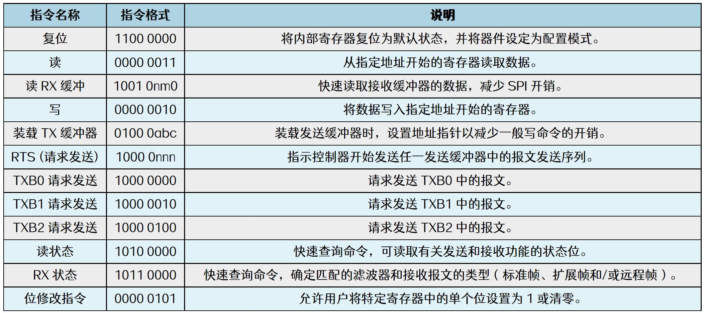

# 第183章mcp2515驱动编写：复位操作

图181.6

本章编写mcp2515 的复位函数。
## 183.1 理论分析
mcp2515 具有五种工作模式：配置模式、正常模式、休眠模式、仅监听模式和环回模式。其中只有在配置模式下才能对寄存器进行初始化和配置。当mcp2515 上电或者复位时，器件会自动进入配置模式，或者通过SPI 总线向mcp2515 发送指令也可以实现复位动作。通过SPI总线向mcp2515 发送的指令也被叫做SPI 指令。mcp2515 支持多种SPI 指令，如图183.1 所示。

图183.1通过图183.1 可知向mcp2515 发送SPI 指令就能实现复位、读、写等操作，其中复位操作对应的指令格式为11000000，在驱动中可以使用spi_write() API 函数向mcp2515 发送数据（发送SPI 指令），spi_write()函数定义在include/linux/spi/spi.h 文件中，具体内容如代码清单188.1所示。代码清单183.1
```c
static inline int
spi_write(struct spi_device *spi, const void *buf, size_t len)
{
    struct spi_transfert = {
```

```c
.tx_buf= buf,
.len= len,
};
return spi_sync_transfer(spi, &t, 1);
}
```
代码清单182.1 中spi_write()函数首先把要传输的数据封装成spi_transfer 结构体，然后调用spi_sync_transfer()函数进行SPI 传输。其中spi_write()函数传入的第一个参数为spi_device类型的结构体变量，struct spi_device 结构体是Linux 内核中用于描述SPI 设备的结构体。该结构体的具体内容如代码清单183.2 所示。代码清单183.2
```c
struct spi_device {
    struct device dev; //通用设备模型的设备结构体
    struct spi_controller *controller; //指向控制器的指针
    struct spi_controller *master; //兼容层，指向控制器的指针（与controller 相同）
    u32 max_speed_hz; //设备支持的最大速度（以赫兹为单位）
    u8 chip_select; //片选编号
    u8 bits_per_word; //每个字的位数
    u16 mode; // SPI 模式配置（包括时钟相位和极性等）
    int irq; //中断号
    void *controller_state; //控制器状态的私有数据
    void *controller_data; //控制器数据的私有数据
    char modalias[SPI_NAME_SIZE]; //设备别名
    const char *driver_override; //驱动程序覆盖
    int cs_gpio; //片选GPIO 引脚
    struct spi_statistics statistics; //统计数据
    /* mode flags */
    #define SPI_CPHA 0x01 //时钟相位
    #define SPI_CPOL 0x02 //时钟极性
    #define SPI_MODE_0 (0|0) //模式0
    #define SPI_MODE_1 (0|SPI_CPHA) //模式1
    #define SPI_MODE_2 (SPI_CPOL|0) //模式2
    #define SPI_MODE_3 (SPI_CPOL|SPI_CPHA) //模式3
    #define SPI_CS_HIGH 0x04 //片选高电平有效
    #define SPI_LSB_FIRST 0x08 //最低有效位先传输
    #define SPI_3WIRE 0x10 //三线模式
    #define SPI_LOOP 0x20 //环回模式
    #define SPI_NO_CS 0x40 //无片选信号
    #define SPI_READY 0x80 //从设备拉低以暂停
```

