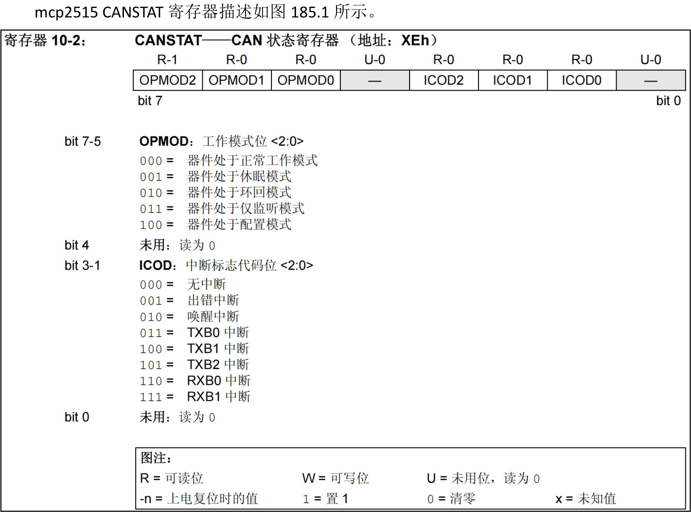
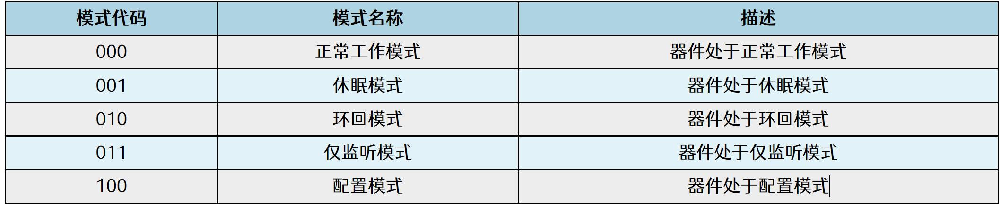

# 第185章mcp2515驱动编写：实现读寄存器函数

```c
}
```

本章编写mcp2515 的读寄存器函数，并通过读取mcp2515CANSTAT 的值确定当前SPI转CAN 模块所处的工作模式。
## 185.1 理论分析

图185.1由图185.1 可知，CANSTAT 寄存器的地址是0x0e，可以通过高三位来判断mcp2515 芯片所处的模式，所处模式与高三的位关系如图185.2 所示。


图185.2如果CANSTAT 寄存器中bit7-5 是0x0100，说明mcp2515 处于配置模式下。SPI 复位指令格式为00000011，转换为16 进制是0x03，所以只需要向mcp2515 写入0x03 即可实现复位操作，然后在读取CANSTAT 寄存器的值来判断是否复位成功。因此可以使用spi_write_then_read()先写后读函数，具体代码如代码清单185.1 所示。代码清单185.1
```c
char mcp2515_read_reg(char reg) {
    char write_buf[] = {0x03, reg};// SPI 写缓冲区写入SPI 读指令0x03
    char read_buf;// SPI 读缓冲区
    int ret;
    ret = spi_write_then_read(spi_dev, write_buf, sizeof(write_buf), &read_buf, sizeof(read_buf));//调用SPI
写读函数
    if (ret < 0) {
        printk("spi_write_then_read error\n");
        return ret;
    }
    return read_buf;
}
```
## 185.2 驱动程序编写
本实验代码存放在网盘iTOP-RK3568 开发板\07_学习教程配套资料\03_Linux 驱动配套资料\04_Linux 驱动程序\116_mcp2515_04\路径下。本实验继续编写mcp2515 的驱动程序，在mcp2515 驱动程序中添加复位函数以及读寄存器函数，并在probe()函数中对两个函数进行调用，从而验证两个函数编写的正确性。实验代码mcp2515.c 如代码清单185.2 所示。代码清单185.2
```c
#include <linux/init.h>
#include <linux/module.h>
#include <linux/spi/spi.h>
#include <linux/cdev.h>
#include <linux/fs.h>
#include <linux/kdev_t.h>
dev_t dev_num; //设备号
```

```c
struct cdev mcp2515_cdev; //字符设备结构体
struct class *mcp2515_class; //设备类
struct device *mcp2515_device; //设备
struct spi_device *spi_dev; // SPI 设备指针
// mcp2515 芯片复位函数
void mcp2515_reset(void){
    int ret;
    char write_buf[] = {0xc0}; //复位指令0x11000000 即0xc0
    ret = spi_write(spi_dev, write_buf, sizeof(write_buf)); //发送复位命令
    if(ret < 0){
        printk("spi_write is error\n"); //打印错误信息
    }
}
// mcp2515 读寄存器函数
char mcp2515_read_reg(char reg) {
    char write_buf[] = {0x03, reg};// SPI 写缓冲区写入SPI 读指令0x03
    char read_buf;// SPI 读缓冲区
    int ret;
    ret = spi_write_then_read(spi_dev, write_buf, sizeof(write_buf), &read_buf, sizeof(read_buf));//调用SPI
写读函数
    if (ret < 0) {
        printk("spi_write_then_read error\n");
        return ret;
    }
    return read_buf;
}
//打开设备文件的回调函数
int mcp2515_open(struct inode *inode, struct file *file) {
    return 0; //返回成功
}
//读取设备文件的回调函数
ssize_t mcp2515_read(struct file *file, char __user *buf, size_t size, loff_t *offset) {
    return 0; //返回成功
}
//写入设备文件的回调函数
ssize_t mcp2515_write(struct file *file, const char __user *buf, size_t size, loff_t *offset) {
```

```c
return 0; //返回成功
}
//关闭设备文件的回调函数
int mcp2515_release(struct inode *inode, struct file *file) {
return 0; //返回成功
}
//设备文件操作集合
struct file_operations mcp2515_fops = {
.open = mcp2515_open,
.read = mcp2515_read,
.write = mcp2515_write,
.release = mcp2515_release,
};
// mcp2515 设备初始化函数
int mcp2515_probe(struct spi_device *spi) {
int ret, value;
printk("This is mcp2515_probe\n");
spi_dev = spi; //保存SPI 设备指针
//分配字符设备号
ret = alloc_chrdev_region(&dev_num, 0, 1, "mcp2515");
if (ret < 0) {
    printk("alloc_chrdev_region error\n");
}
//初始化字符设备
cdev_init(&mcp2515_cdev, &mcp2515_fops);
mcp2515_cdev.owner = THIS_MODULE;
//添加字符设备
ret = cdev_add(&mcp2515_cdev, dev_num, 1);
if (ret < 0) {
    printk("cdev_add error\n");
    return -1;
}
//创建设备类
mcp2515_class = class_create(THIS_MODULE, "spi_to_can");
if (IS_ERR(mcp2515_class)) {
    printk("mcp2515_class error\n");
    return PTR_ERR(mcp2515_class);
```

```c
}
//创建设备
mcp2515_device = device_create(mcp2515_class, NULL, dev_num, NULL, "mcp2515");
if (IS_ERR(mcp2515_device)) {
    printk("mcp2515_device error\n");
    return PTR_ERR(mcp2515_device);
}
mcp2515_reset();//复位mcp2515 设备
value = mcp2515_read_reg(0x0e);//读取寄存器值
printk("value is %x\n", value);//打印读取的值
return 0; //返回成功
}
// mcp2515 SPI 设备的移除函数
static int mcp2515_remove(struct spi_device *spi) {
device_destroy(mcp2515_class, dev_num);
class_destroy(mcp2515_class);
cdev_del(&mcp2515_cdev);
unregister_chrdev_region(dev_num, 1);
return 0;
}
// mcp2515 设备匹配表,用于设备树匹配
static const struct of_device_id mcp2515_of_match_table[] = {
{ .compatible = "my-mcp2515" },
{}
};
// mcp2515 设备ID 匹配表,用于总线匹配
static const struct spi_device_id mcp2515_id_table[] = {
{ "mcp2515", 0 },
{}
};
// mcp2515 SPI 驱动结构体
static struct spi_driver spi_mcp2515 = {
.probe = mcp2515_probe, //探测函数
.remove = mcp2515_remove, //移除函数
.driver = {
    .name = "mcp2515", //驱动名称
    .owner = THIS_MODULE, //所属模块
```

```c
.of_match_table = mcp2515_of_match_table, //设备树匹配表
},
.id_table = mcp2515_id_table, //设备ID 匹配表
};
//驱动初始化函数
static int __init mcp2515_init(void)
{
int ret;
//注册SPI 驱动
ret = spi_register_driver(&spi_mcp2515);
if (ret < 0) {
//注册失败,打印错误信息
printk("spi_register_driver error\n");
return ret;
}
return ret;
}
//驱动退出函数
static void __exit mcp2515_exit(void)
{
//注销SPI 驱动
spi_unregister_driver(&spi_mcp2515);
}
module_init(mcp2515_init);
module_exit(mcp2515_exit);
MODULE_LICENSE("GPL");
```
## 185.3 运行测试
### 185.3.1 编译驱动程序
在mcp2515.c 代码同一目录下创建Makefile 文件，如图185.3 所示。

图185.3

Makefile 文件内容如代码清单185.3 所示。代码清单185.3
```c
export ARCH=arm64#设置平台架构
export CROSS_COMPILE=aarch64-linux-gnu-#交叉编译器前缀
obj-m += mcp2505.o#此处要和你的驱动源文件同名
KDIR :=/home/topeet/Linux/linux_sdk/kernel#这里是你的内核目录
PWD ?= $(shell pwd)
all:
    make -C $(KDIR) M=$(PWD) modules#make 操作
clean:
    make -C $(KDIR) M=$(PWD) clean#make clean 操作
```
在存放mcp2515.c和Makefile文件目录下使用make命令编译驱动程序，编译完成如图185.4所示。

图185.4编译成功后生成mcp2515.ko 目标文件，如图185.5 所示。

图185.5
### 185.3.2 运行测试
在进行实验之前，首先要确保开发板烧写的是在编写SPI 设备驱动框架章节中编译出来的boot.img。然后将本章节编译好的mcp2515.ko 驱动文件拷贝到开发板上。接着使用insmodmcp2515.ko 命令加载驱动程序，如图185.6 所示。

图185.6由图185.6 打印信息可以得到读取到的CANSTAT 寄存器的值为0x80，换算成二进制为10000000，其中bit7-bit5 为100，与图185.7 进行比对可以证明当前mcp2515 处在配置模式。

