# 第186章 mcp2515驱动编写：配置mcp2515寄存器

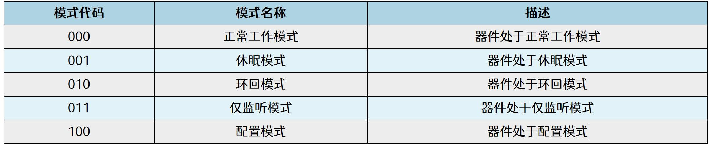
图185.7实验完成后使用rmmod mcp2515.ko 命令卸载驱动程序，如图185.8 所示。

图185.8

mcp2515 在配置模式下可以对其他寄存器进行配置，mcp2515 需要配置以下寄存器才可以正常工作。1.CNF1、CNF2 和CNF3 寄存器：用于配置波特率2.RXB0CTRL 寄存器：接收缓冲器0 控制寄存器3.CANINTE 寄存器：中断使能寄存器
## 186.1 CNF1、CNF2 和CNF3 寄存器配置
CAN 总线上的所有器件都必须使用相同的波特率，可以通过配置mcp2515 中CNF1、CNF2和CNF3 三个寄存器来配置位时间中各个段，进而设置CAN 总线的波特率。位时间（Bit Time）是指一个二进制位在总线上传输所需的时间，它由4 段组成，每段由
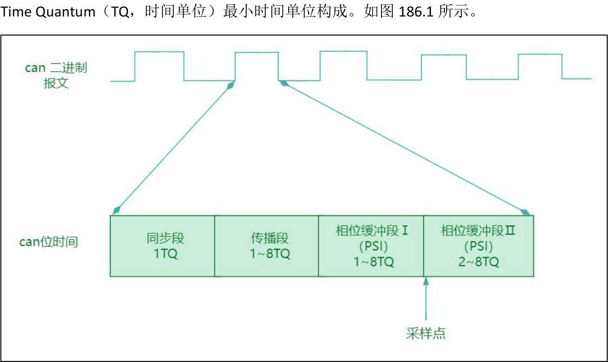
图186.1图186.1 中位时间的4 个段分别是：（1）同步段

·用于同步接收器的时钟到传输器的时钟。·持续1 个TQ。（2）传播段·用于补偿信号在总线上传输的物理延迟。·可配置为1 到8 个TQ。（3）相位缓冲段PS1·用于补偿相位错误和支持重同步跳转。·可配置为1 到8 个TQ。（4）相位缓冲段PS2·用于补偿相位错误和支持重同步跳转。·可配置为2 到8 个TQ。
在mcp2515 数据手册中给出了TQ 计算公式：TQ = 2 x (BRP + 1)/FOSC。其中FOSC 为mcp2515外设晶振频率（为方便计算可换算成周期），BRP 为CNF1 寄存器设置的预分频系数，可以任意设置，尽量满足最后的TQ 为整数即可。在SPI 转CAN 模块中所用晶振大小为8Mhz，以实现125Khz 的CAN 波特率为例讲解如何计算TQ。首先把8Mhz 换算成周期：Tosc=1/8Mhz=125ns。然后选择BRP 为0x1，根据计算公式TQ=2x2x125ns=500ns 计算一个TQ 的时间为500ns。如果波特率要到125Khz（换算成周期为8000ns），则需要8000ns/500ns=16 个TQ。那这16 个TQ 该如何分配呢？在mcp2515 的数据手册中要求时间段的设定必须满足以下要求：（1）传播段+相位缓冲段PS1 >=相位缓冲段PS2（2）传播段+相位缓冲段PS1 >= TDELAY (TDELAY 典型值为1-2 TQ)（3）相位缓冲段PS2 >同步跳转宽度SJW(SJW 最大值为4TQ，一般取1TQ 即可满足要求)根据mcp2515 的要求最终确定各个段的值为：同步段配置1 个TQ，传播段配置2 个TQ，相位缓冲段PS1 配置7 个TQ，相位缓冲段PS2 配置6 个TQ。然后来根据各个段的值确定CNF1、CNF2、CNF3 寄存器的取值。CNF1 寄存器内容如图186.2 所示。

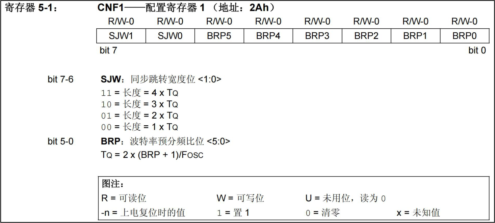
图186.2其中bit7-6 为SJW 同步跳转宽度位，即同步段。设置为1TQ 即可，而bit5-0 表示波特率预分频比位（BRP），计算TQ 的时候已经确定该值为1，所以CNF1 寄存器的值为0x01。
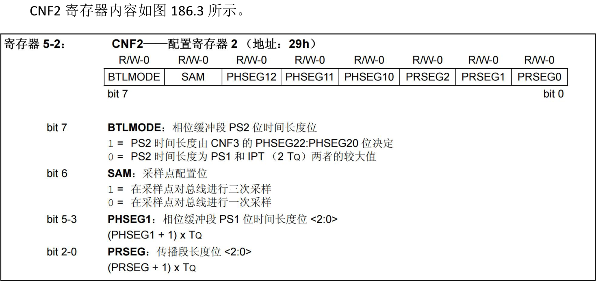
图186.3bit7 为相位缓冲段PS2 的时间长度位，设置为1 表示相位缓冲段PS2 由CNF3 寄存器决定。bit6 采样点配置位设置为0，表示进行一次采样。bit5-3 表示相位缓冲段PS1 的长度，相位缓冲段PS1 为7 个TQ，所以bit5-3 设置为6 即可，换算为二进制为110。bit2-0 表示传播段长度，需设置为2 个TQ，那bit2-0 设置为1 即可。综上CNF2 寄存器的值为10110001，换算成16 进制就为0xB1。

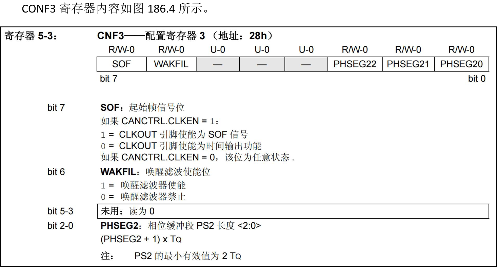
图186.4bit2-0 表示相位缓冲段PS2 长度，相位缓冲段PS2 为6 个TQ，所以bit2-0 值设置为5 即可，转换为二进制为101。其他位都设置为0。综上CNF3 寄存器要设置的值为0x05。
## 186.2 RXB0CTRL 寄存器配置
RXB0CTRL 寄存器用于设置mcp2515 中can 控制器工作模式，RXB0CTRL 寄存器如图186.5所示。

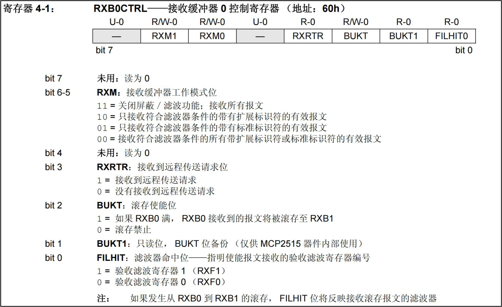
图186.5将bit6-5 设置为11，表示接收所有的报文，其他位都设置为0，所以该寄存器要设置的二进制值为01100000，换算成16 进制为0x60。
## 186.3 CANINTE 寄存器配置
中断使能寄存器CANINTE 用于配置mcp2515 中can 控制器中断，如图186.6 所示。

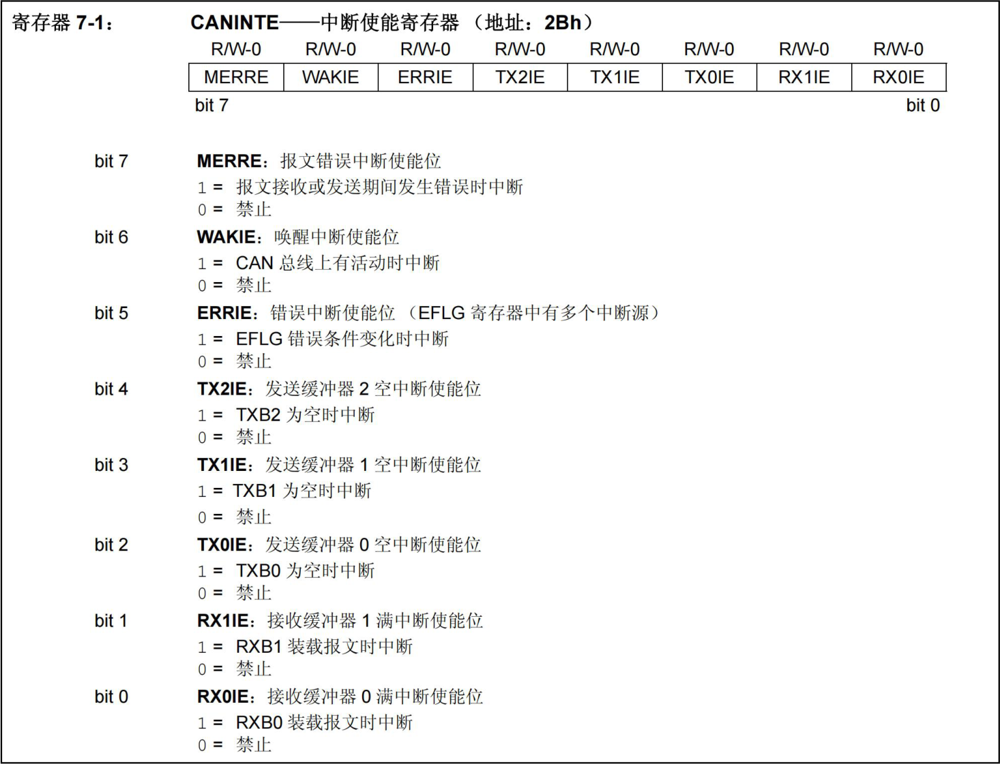
图186.6由于在RXB0CTRL 寄存器中配置的是缓冲器0，所以要使能缓冲器0 的中断，对应位bit2和bit0 设置位1，其他位设置为0 即可，最终该寄存器设置的值为0x05。
## 186.4 实现写寄存器函数
向mcp2515 写入寄存器值，需要使用SPI 写指令。

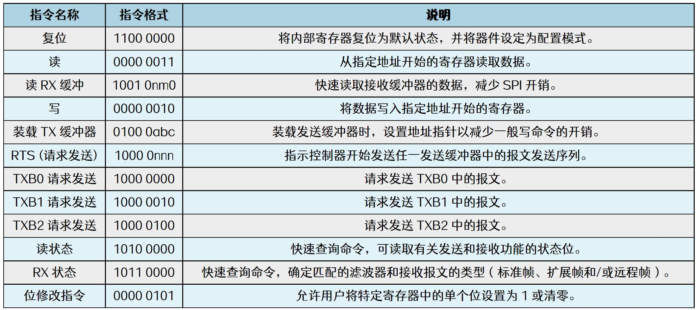
图186.7通过图186.7 mcp2515 指令表可知写指令为00000010。使用写指令实现写寄存器函数，如代码清单186.1 所示。代码清单186.1
```c
void mcp2515_write_reg(char reg, char value) {
    int ret;
    char write_buf[] = {0x02, reg, value};// SPI 写缓冲区，用于发送写寄存器命令
    ret = spi_write(spi_dev, write_buf, sizeof(write_buf));//发送SPI 写命令以及要写的寄存器和值。
    if (ret < 0) {
        printk("mcp2515_write_reg error\n");
    }
}
```
通过调用mcp2515_write_reg()写寄存器函数配置CNF1、CNF2、CNF3、RXBOCTRL 和CANINTE寄存器，如代码清单186.2 所示。代码清单186.2
```c
#define CNF1 0x2a//寄存器定义
#define CNF2 0x29
#define CNF3 0x28
#define RXB0CTRL 0x2b
#define CANINTE 0x60
mcp2515_write_reg(CNF1, 0x01);//写入寄存器配置值
mcp2515_write_reg(CNF2, 0xb1);
mcp2515_write_reg(CNF3, 0x05);
mcp2515_write_reg(RXB0CTRL , 0x60);
mcp2515_write_reg(CANINTE , 0x05);
```

## 186.5 位修改指令和屏蔽字节
位修改指令：位修改指令允许用户对寄存器中单个位（bit）进行修改，而不影响寄存器中的其他位。屏蔽字节：屏蔽字节用于确定寄存器中哪些位允许被修改。其中，屏蔽字节中为“1”的位表示对应的寄存器位可被修改，而为“0”的位表示该位禁止被更改。在允许修改的前提下，数据字节（要对寄存器进行修改的值）则决定具体的设置结果：数据字节中对应位为“1”时，表示将寄存器中的该位设置为1；为“0”时，表示将该位清零。因此屏蔽字节负责“是否允许修改”，数据字节决定“修改为何值”。如图186.8 所示。
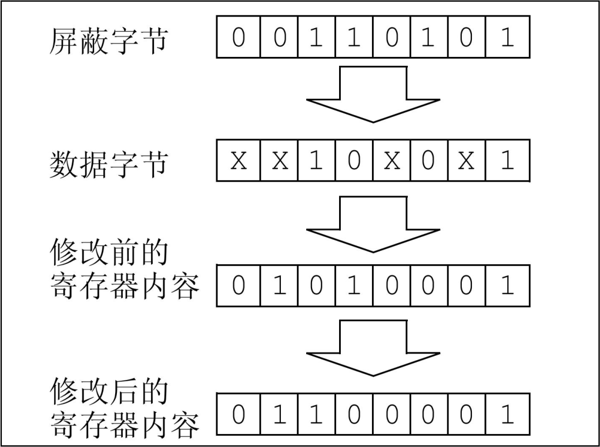
图186.8mcp2515 支持位修改指令和屏蔽字节，对应的SPI 指令如图186.9 所示。

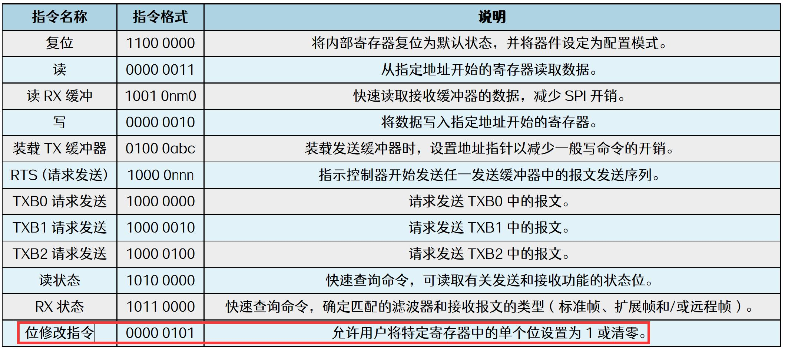
图186.9
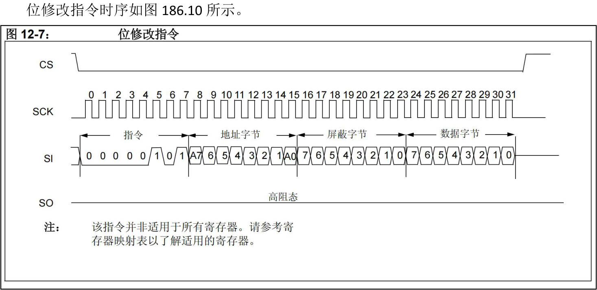
图186.10通过图186.10 可知当CS 片选信号拉低之后通过SPI 总线按照先发送位修改指令、要修改的寄存器对应的地址、屏蔽字节以及寄存器值的顺序进行位修改。编写位修改指令的函数，具体内容如代码清单186.3 所示。代码清单186.3
```c
// mcp2515 修改寄存器位函数
void mcp2515_change_regbit(char reg, char mask, char value) {
    int ret;
    char write_buf[] = { 0x05, reg, mask, value };// 写缓冲区，按照图190.9 时序图要求排列位修改指令、
要修改的寄存器对应的地址、屏蔽字节以及寄存器值。
```

