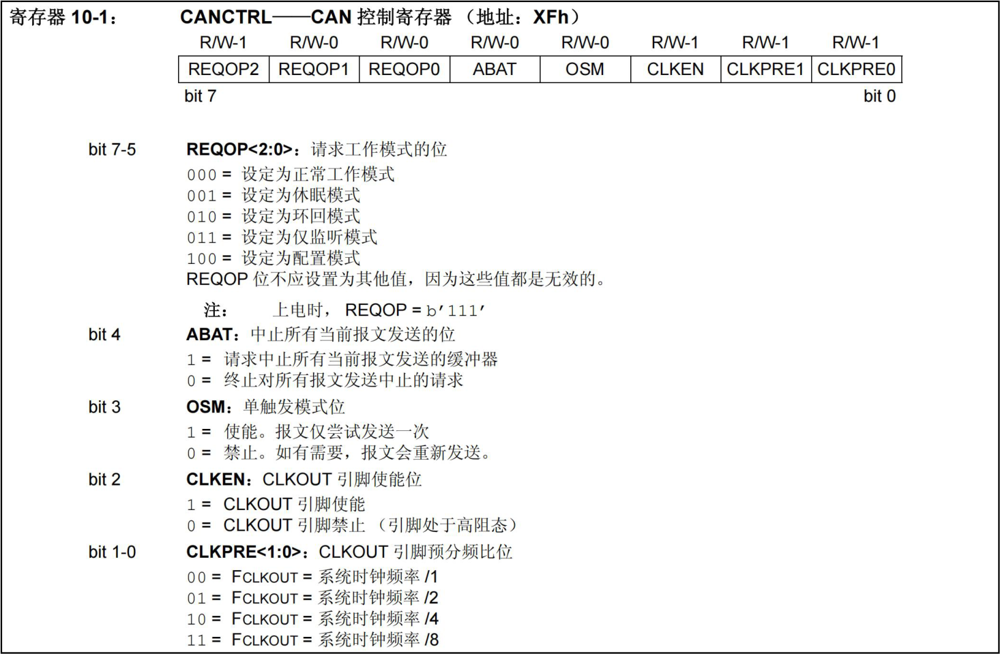
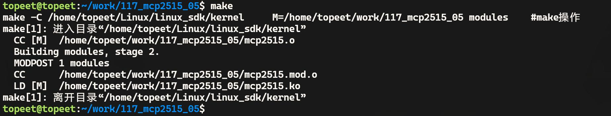

# 第187章mcp2515驱动编写：修改工作模式

```c
ret = spi_write(spi_dev, write_buf, sizeof(write_buf));
if (ret < 0) {
    printk("mcp2515_change_regbit error\n");
}
}
```
接下来举例说明如何使用位修改指令修改寄存器中的位。对RXB0CTRL 寄存器进行修改可以通过代码清单186.4 中代码进行覆盖式修改。代码清单186.4
```c
#define RXB0CTRL 0x60
mcp2515_write_reg(RXB0CTRL , 0x60);
```
如果使用位修改指令则无需对寄存器整体进行修改，只需要修改要进行修改的寄存器位即可。如如代码清单186.5 所示。代码清单186.5
```c
mcp2515_change_regbit(RXB0CTRL, 0x64, 0x60);
```
代码清单186.5 中0x64 是屏蔽字节，表示只允许修改寄存器中的第6 位和第2 位。0x60是数据字节，用于将允许修改的位设置为相应值。

mcp2515 有着五种工作模式，分别为配置模式、正常模式、休眠模式、仅监听模式和环回模式，本章设置mcp2515 的工作模式让mcp2515 运行起来。本章实验使用回环模式。
## 187.1 理论分析
mcp2515 的工作状态由CANCTRL——CAN 控制寄存器决定，CANCTRL 寄存器的具体内容如图187.1 所示。

图187.1CANCTRL 寄存器地址为0X0f，其中bit7-5 用来配置工作模式，环回模式为010，本章使用位修改函数对该寄存器进行修改，具体代码如代码清单187.1 所示。代码清单187.1
```c
#define CANCTRL 0x0f
mcp2515_change_regbit(CANCTRL, 0xe0, 0x40);
```

其中0xe0 为掩码，换算成二进制之后为11100000，表示只对高三位进行修改，修改的值为010，表示设置为回环模式。
## 187.2 驱动程序编写
本实验代码存放在网盘iTOP-RK3568 开发板\07_学习教程配套资料\03_Linux 驱动配套资料\04_Linux 驱动程序\117_mcp2515_05\路径下。本实验继续编写mcp2515 的驱动程序，将mcp2515 的工作模式设置为回环模式。实验代码mcp2515.c 如代码清单187.2 所示。代码清单187.2
```c
#include <linux/init.h>
#include <linux/module.h>
#include <linux/spi/spi.h>
#include <linux/cdev.h>
#include <linux/fs.h>
#include <linux/kdev_t.h>
#define CNF1 0x2a// 寄存器定义
#define CNF2 0x29
#define CNF3 0x28
#define RXB0CTRL 0x60
#define CANINTE 0x2b
#define CANCTRL 0xf// CAN 控制寄存器
dev_t dev_num; //设备号
struct cdev mcp2515_cdev; //字符设备结构体
struct class *mcp2515_class; //设备类
struct device *mcp2515_device; //设备
struct spi_device *spi_dev; // SPI 设备指针
// mcp2515 芯片复位函数
void mcp2515_reset(void){
    int ret;
    char write_buf[] = {0xc0}; //复位指令0x11000000 即0xc0
    ret = spi_write(spi_dev, write_buf, sizeof(write_buf)); //发送复位命令
    if(ret < 0){
        printk("spi_write is error\n"); //打印错误信息
    }
}
```

```c
// mcp2515 读寄存器函数
char mcp2515_read_reg(char reg) {
    char write_buf[] = {0x03, reg};// SPI 写缓冲区写入SPI 读指令0x03
    char read_buf;// SPI 读缓冲区
    int ret;
    ret = spi_write_then_read(spi_dev, write_buf, sizeof(write_buf), &read_buf, sizeof(read_buf));//调用SPI
写读函数
    if (ret < 0) {
        printk("spi_write_then_read error\n");
        return ret;
    }
    return read_buf;
}
//mcp2515 写寄存器函数
void mcp2515_write_reg(char reg, char value) {
    int ret;
    char write_buf[] = {0x02, reg, value};// SPI 写缓冲区，用于发送写寄存器命令
    ret = spi_write(spi_dev, write_buf, sizeof(write_buf));//发送SPI 写命令
    if (ret < 0) {
        printk("mcp2515_write_reg error\n");
    }
}
// mcp2515 修改寄存器位函数
void mcp2515_change_regbit(char reg, char mask, char value) {
    int ret;
    char write_buf[] = { 0x05, reg, mask, value };// SPI 写缓冲区，用于发送修改寄存器位命令
    ret = spi_write(spi_dev, write_buf, sizeof(write_buf));//发送SPI 写命令
    if (ret < 0) {
        printk("mcp2515_change_regbit error\n");
    }
}
//打开设备文件的回调函数
int mcp2515_open(struct inode *inode, struct file *file) {
    return 0; //返回成功
}
```

```c
//读取设备文件的回调函数
ssize_t mcp2515_read(struct file *file, char __user *buf, size_t size, loff_t *offset) {
    return 0; //返回成功
}
//写入设备文件的回调函数
ssize_t mcp2515_write(struct file *file, const char __user *buf, size_t size, loff_t *offset) {
    return 0; //返回成功
}
//关闭设备文件的回调函数
int mcp2515_release(struct inode *inode, struct file *file) {
    return 0; //返回成功
}
//设备文件操作集合
struct file_operations mcp2515_fops = {
    .open = mcp2515_open,
    .read = mcp2515_read,
    .write = mcp2515_write,
    .release = mcp2515_release,
};
// mcp2515 设备初始化函数
int mcp2515_probe(struct spi_device *spi) {
    int ret, value;
    printk("This is mcp2515_probe\n");
    spi_dev = spi; //保存SPI 设备指针
    //分配字符设备号
    ret = alloc_chrdev_region(&dev_num, 0, 1, "mcp2515");
    if (ret < 0) {
        printk("alloc_chrdev_region error\n");
    }
    //初始化字符设备
    cdev_init(&mcp2515_cdev, &mcp2515_fops);
    mcp2515_cdev.owner = THIS_MODULE;
    //添加字符设备
    ret = cdev_add(&mcp2515_cdev, dev_num, 1);
    if (ret < 0) {
        printk("cdev_add error\n");
        return -1;
```

```c
}
//创建设备类
mcp2515_class = class_create(THIS_MODULE, "spi_to_can");
if (IS_ERR(mcp2515_class)) {
    printk("mcp2515_class error\n");
    return PTR_ERR(mcp2515_class);
}
//创建设备
mcp2515_device = device_create(mcp2515_class, NULL, dev_num, NULL, "mcp2515");
if (IS_ERR(mcp2515_device)) {
    printk("mcp2515_device error\n");
    return PTR_ERR(mcp2515_device);
}
mcp2515_reset();//复位mcp2515 设备
value = mcp2515_read_reg(0x0e);//读取寄存器值
printk("value is %x\n", value);//打印读取的值
mcp2515_write_reg(CNF1, 0x01);//写入寄存器配置值
mcp2515_write_reg(CNF2, 0xb1);
mcp2515_write_reg(CNF3, 0x05);
mcp2515_write_reg(RXB0CTRL, 0x60);
mcp2515_write_reg(CANINTE, 0x05);
mcp2515_change_regbit(CANCTRL, 0xe0, 0x40);
value = mcp2515_read_reg(0x0e);//读取寄存器值
printk("value is %x\n", value);//打印读取的值
return 0; //返回成功
}
// mcp2515 SPI 设备的移除函数
static int mcp2515_remove(struct spi_device *spi) {
device_destroy(mcp2515_class, dev_num);
class_destroy(mcp2515_class);
cdev_del(&mcp2515_cdev);
unregister_chrdev_region(dev_num, 1);
return 0;
}
// mcp2515 设备匹配表,用于设备树匹配
```

```c
static const struct of_device_id mcp2515_of_match_table[] = {
    { .compatible = "my-mcp2515" },
    {}
};
// mcp2515 设备ID 匹配表,用于总线匹配
static const struct spi_device_id mcp2515_id_table[] = {
    { "mcp2515", 0 },
    {}
};
// mcp2515 SPI 驱动结构体
static struct spi_driver spi_mcp2515 = {
    .probe = mcp2515_probe, //探测函数
    .remove = mcp2515_remove, //移除函数
    .driver = {
        .name = "mcp2515", //驱动名称
        .owner = THIS_MODULE, //所属模块
        .of_match_table = mcp2515_of_match_table, //设备树匹配表
},
    .id_table = mcp2515_id_table, //设备ID 匹配表
};
//驱动初始化函数
static int __init mcp2515_init(void)
{
    int ret;
    //注册SPI 驱动
    ret = spi_register_driver(&spi_mcp2515);
    if (ret < 0) {
        //注册失败，打印错误信息
        printk("spi_register_driver error\n");
        return ret;
    }
    return ret;
}
//驱动退出函数
static void __exit mcp2515_exit(void)
{
    //注销SPI 驱动
    spi_unregister_driver(&spi_mcp2515);
```

```c
}
module_init(mcp2515_init);
module_exit(mcp2515_exit);
MODULE_LICENSE("GPL");
```
## 187.3 运行测试
### 187.3.1 编译驱动程序
在mcp2515.c 代码同一目录下创建Makefile 文件，如图187.2 所示。

图187.2Makefile 文件内容如代码清单187.3 所示。代码清单187.3
```c
export ARCH=arm64#设置平台架构
export CROSS_COMPILE=aarch64-linux-gnu-#交叉编译器前缀
obj-m += mcp2505.o#此处要和你的驱动源文件同名
KDIR :=/home/topeet/Linux/linux_sdk/kernel#这里是你的内核目录
PWD ?= $(shell pwd)
all:
    make -C $(KDIR) M=$(PWD) modules#make 操作
clean:
    make -C $(KDIR) M=$(PWD) clean#make clean 操作
```
在存放mcp2515.c和Makefile文件目录下使用make命令编译驱动程序，编译完成如图187.3所示。

图187.3编译成功后生成mcp2515.ko 目标文件，如图187.4 所示。

图187.4

