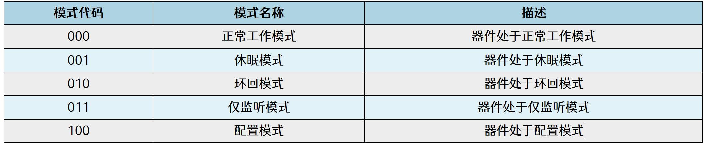
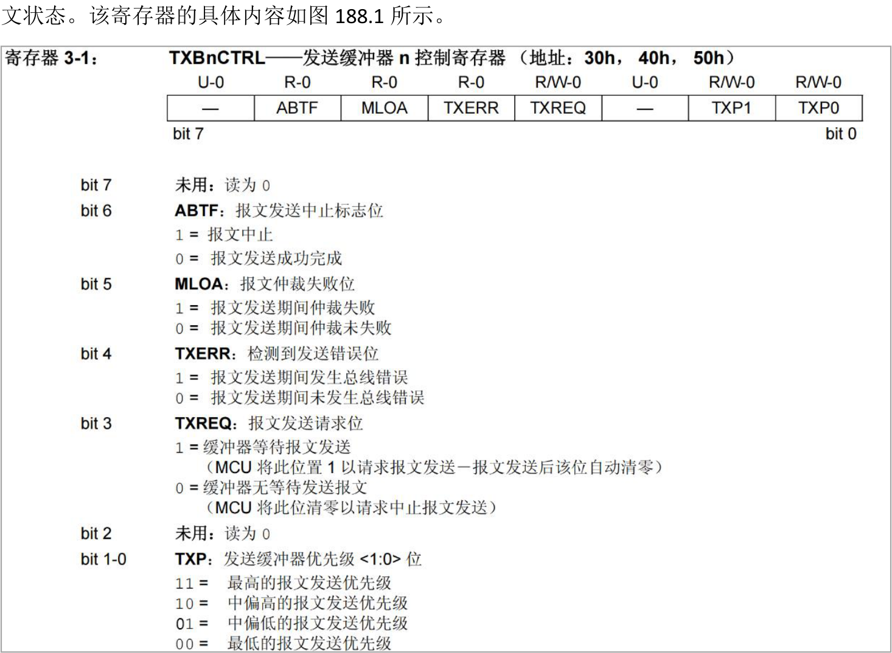
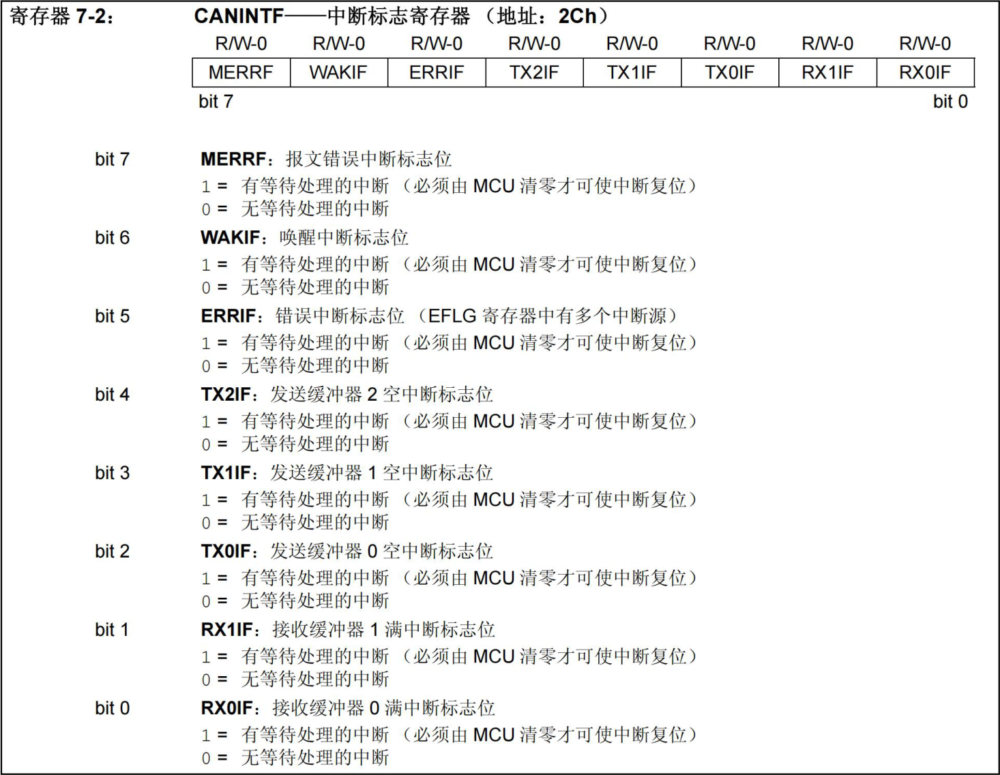
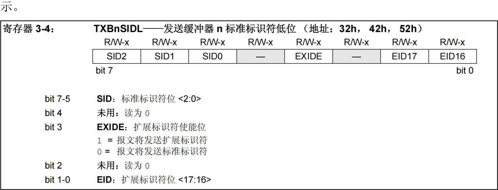
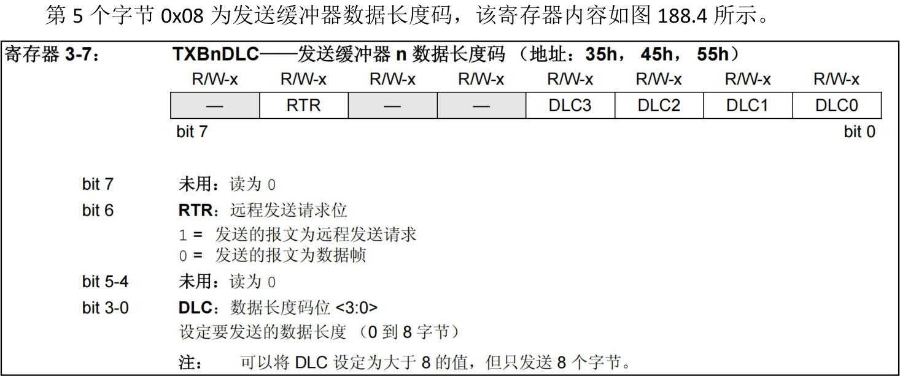

# 第188章mcp2515驱动编写：实现write和read函数

### 187.3.2 运行测试
在进行实验之前，首先要确保开发板烧写的是在SPI 设备驱动框架编写章节中编译出来的boot.img。将本章节编译好的mcp2515.ko 驱动文件拷贝到开发板上，然后使用insmodmcp2515.ko 命令进行驱动模块的加载，操作过程如图187.5 所示。

图187.5根据图187.5 中第二条打印信息可以得到读取到的CAN 状态寄存器的值为0x80，换算成二进制为10000000，即bit7-bit5 为100，然后与图187.6 进行比对，证明当前mcp2515 处在配置模式，只有在配置模式下才可以修改工作状态。

图187.6根据图187.5 第三条打印信息可以得到读取到的CAN 状态寄存器的值为0x40，换算成二进制为01000000，即bit7-bit5 为010，根据上图187.6 对比当前mcp2515 已经处在环回模式，证明工作状态已经被设置成了回环模式。实验成功后使用mmod mcp2515.ko 命令进行驱动模块的卸载，如图187.7 所示。

图187.7

本章实现mcp2515 的写函数和读函数，从而实现数据的发送和接收。
## 188.1 编写mcp2515 写函数
mcp2515 有三个发送缓冲器，每个发送缓冲器都具有14 字节的内存空间，每个发送缓冲器的控制由第一个字节TXBnCTRL 寄存器管理，该寄存器决定了何时发送报文以及发送时的报

图188.1图188.1 中发送缓冲器n 控制寄存器中n 可以是0、1、2，对应的寄存器地址分别是0x30、0x40、0x50。这里我们使用发送缓冲器0 控制寄存器，其地址是0x30。通过设置TXB0CTRL 寄存器的bit1-0 两位为11，将缓冲器优先级设置为最高，具体设置代码如代码清单188.1 所示。代码清单188.1

```c
#define TXB0CTRL 0x30//发送缓冲器0 控制寄存器地址
 mcp2515_change_regbit(TXB0CTRL, 0x03, 0x03);//只对该寄存器低两位进行修改，修改值为0x03
```
紧随TXBnCTRL 寄存器其后的13 个字节中的5 个字节用来装载标准和扩展标识符以及其他报文仲裁信息，最后的8 个字节则用于存放即将发送的报文数据，即这13 个字节是要发送的信息。当应用程序中使用write()时会执行驱动中的write()函数，因此剩余的这13 个字节数据要由用户空间所传递，这13 个字节地址是连续的。因此，可以通过如代码清单192.2 所示代码将用户空间数据依次写入对应寄存器中。代码清单188.2
```c
char w_kbuf[13] = {0};
int ret;
// 从用户空间复制数据到内核缓冲区
ret = copy_from_user(w_kbuf, buf, size);
if (ret) {
    printk("copy_from_user w_kbuf is error\n");
    return -1;
}
// 将数据写入mcp2515 寄存器
for (i = 0; i < sizeof(w_kbuf); i++) {
    mcp2515_write_reg(0x31 + i, w_kbuf[i]);
}
```
用户空间数据写完之后，需要将TXB0CTRL 寄存器的bit3 设置为1，以启动该缓冲器的报文发送过程，具体设置代码如代码清单188.3 所示。代码清单188.3
```c
#define TXB0CTRL 0x30//发送缓冲器0 控制寄存器地址
mcp2515_change_regbit(TXB0CTRL, 0x08, 0x08);//只对该寄存器bit3 进行修改，将bit3 设置为1
```
在报文发送成功后，中断标志寄存器CANINTF.TXnIF 位将会被置1，中断标志寄存器内容如图188.2 所示。


图188.2可以通过CANINTF.TXnIF 寄存器来判断报文是否发送成功，由于使用的是缓冲器0，所以这里要判断的位为bit2，判断完成之后，需要对该寄存器进行手动清零，具体判断代码如代码清单188.4 所示。代码清单188.4
```c
#define CANINTF 0x2c//中断标志寄存器地址
 //等待发送完成
while (!(mcp2515_read_reg(CANINTF) & (1 << 2)));
//清除发送完成标志
mcp2515_change_regbit(CANINTF, 0x04, 0x00);
```
至此，关于mcp2515 写函数的相关知识就总结完成了，可以将上面讲解的代码整理成一个完整的函数，具体内容如代码清单188.5 所示。代码清单188.5

```c
#define TXB0CTRL 0x30//发送缓冲器0 控制寄存器地址
#define CANINTF 0x2c//中断标志寄存器地址
//写设备操作函数
ssize_t mcp2515_write(struct file *file, const char __user *buf, size_t size, loff_t *offset) {
    char w_kbuf[13] = {0};
    int ret;
    int i;
    //设置TXB0CTRL 寄存器的部分位，将缓冲器优先级设置为最高
    mcp2515_change_regbit(TXB0CTRL, 0x03, 0x03);
    //从用户空间复制数据到内核缓冲区
    ret = copy_from_user(w_kbuf, buf, size);
    if (ret) {
        printk("copy_from_user w_kbuf is error\n");
        return -1;
    }
    //将数据写入mcp2515 寄存器
    for (i = 0; i < sizeof(w_kbuf); i++) {
        mcp2515_write_reg(0x31 + i, w_kbuf[i]);
    }
    //设置TXB0CTRL 寄存器的部分位，启动发送
    mcp2515_change_regbit(TXB0CTRL, 0x08, 0x08);
    //等待发送完成
    while (!(mcp2515_read_reg(CANINTF) & (1 << 2)));
    //清除发送完成标志
    mcp2515_change_regbit(CANINTF, 0x04, 0x00);
    return size;
}
```
## 188.2 编写mcp2515 读函数
mcp2515 具有两个接收缓冲器，当数据报文传送至某一接收缓冲器时，与该接收缓冲器对应的CANINTF.RXnIF 位将置1，因此可以通过寄存器CANINTF.RXnIF 位的值来判断是否接收完成，具体判断代码如代码清单188.6 所示。

代码清单188.6
```c
#define CANINTF 0x2c//中断标志寄存器地址
//等待接收缓冲区满标志位被设置
while (!(mcp2515_read_reg(CANINTF) & (1 << 0)));
```
接下来编写读取接收数据的相关代码。mcp2515 的接收缓冲器与发送缓冲器结构类似：前5 个字节用于存放标准/扩展标识符及相关仲裁信息，后8 个字节用于存储接收到的有效数据，且地址是连续的。以接收缓冲器0 为例，其标准标识符高位寄存器地址为0x61，因此可以通过如代码清单188.7 所示代码依次读取。代码清单188.7
```c
char r_kbuf[13] = {0};// 内核缓冲区，用于存储从设备读取的数据
int i;
//从接收缓冲区读取数据到内核缓冲区
for (i = 0; i < sizeof(r_kbuf); i++) {
    r_kbuf[i] = mcp2515_read_reg(0x61 + i);
}
```
数据传送完成之后需要对CANINTF.RXnIF 寄存器清零，并且使用copy_to_user 传输到用户空间，具体代码如代码清单188.8 所示。代码清单188.8
```c
//清除接收缓冲区满标志位
mcp2515_change_regbit(CANINTF, 0x01, 0x00);
//将内核缓冲区的数据复制到用户缓冲区
ret = copy_to_user(buf, r_kbuf, size);
if (ret) {
   printk("copy_to_user r_kbuf is error\n");
   return -1;//返回-1 表示复制数据失败
}
```
至此，关于mcp2515 读函数的相关知识就总结完成了，可以将上面讲解的代码整理成一个完整的函数，具体内容如代码清单188.9 所示。代码清单188.9
```c
#define CANINTF 0x2c//中断标志寄存器地址
//读设备操作函数，从设备读取数据到用户缓冲区
ssize_t mcp2515_read(struct file *file, char __user *buf, size_t size, loff_t *offset) {
    char r_kbuf[13] = {0};//内核缓冲区，用于存储从设备读取的数据
    int i;
```

```c
int ret;
//等待接收缓冲区满标志位被设置
while (!(mcp2515_read_reg(CANINTF) & (1 << 0)));
//从接收缓冲区读取数据到内核缓冲区
for (i = 0; i < sizeof(r_kbuf); i++) {
    r_kbuf[i] = mcp2515_read_reg(0x61 + i);
}
//清除接收缓冲区满标志位
mcp2515_change_regbit(CANINTF, 0x01, 0x00);
//将内核缓冲区的数据复制到用户缓冲区
ret = copy_to_user(buf, r_kbuf, size);
if (ret) {
    printk("copy_to_user r_kbuf is error\n");
    return -1;//返回-1 表示复制数据失败
}
return 0;//返回0 表示成功读取数据
}
```
## 188.3 实验程序编写
### 188.3.1 编写驱动程序
本实验代码存放在网盘iTOP-RK3568 开发板\07_学习教程配套资料\03_Linux 驱动配套资料\04_Linux 驱动程序\118_mcp2515_06\路径下。本实验继续编写mcp2515 驱动程序，添加mcp2515 的读函数和写函数。实验代码mcp2515.c 如代码清单188.10 所示。代码清单188.10
```c
#include <linux/init.h>
#include <linux/module.h>
#include <linux/spi/spi.h>
#include <linux/cdev.h>
#include <linux/fs.h>
#include <linux/kdev_t.h>
#include <linux/uaccess.h>
#define CNF1 0x2a
```

```c
#define CNF2 0x29
#define CNF3 0x28
#define RXB0CTRL 0x60
#define CANINTE 0x2b
#define CANCTRL 0xf
#define TXB0CTRL 0x30
#define CANINTF 0x2c
dev_t dev_num; //设备号
struct cdev mcp2515_cdev; //字符设备结构体
struct class *mcp2515_class; //设备类
struct device *mcp2515_device; //设备
struct spi_device *spi_dev; // SPI 设备指针
// mcp2515 芯片复位函数
void mcp2515_reset(void){
    int ret;
    char write_buf[] = {0xc0}; //复位指令0x11000000 即0xc0
    ret = spi_write(spi_dev, write_buf, sizeof(write_buf)); //发送复位命令
    if(ret < 0){
        printk("spi_write is error\n"); //打印错误信息
    }
}
// mcp2515 读寄存器函数
char mcp2515_read_reg(char reg) {
    char write_buf[] = {0x03, reg};// SPI 写缓冲区写入SPI 读指令0x03
    char read_buf;// SPI 读缓冲区
    int ret;
    ret = spi_write_then_read(spi_dev, write_buf, sizeof(write_buf), &read_buf, sizeof(read_buf));//调用SPI
写读函数
    if (ret < 0) {
        printk("spi_write_then_read error\n");
        return ret;
    }
    return read_buf;
}
//mcp2515 写寄存器函数
void mcp2515_write_reg(char reg, char value) {
```

```c
int ret;
char write_buf[] = {0x02, reg, value};// SPI 写缓冲区，用于发送写寄存器命令
ret = spi_write(spi_dev, write_buf, sizeof(write_buf));//发送SPI 写命令
if (ret < 0) {
    printk("mcp2515_write_reg error\n");
}
}
// mcp2515 修改寄存器位函数
void mcp2515_change_regbit(char reg, char mask, char value) {
int ret;
char write_buf[] = { 0x05, reg, mask, value };// SPI 写缓冲区，用于发送修改寄存器位命令
ret = spi_write(spi_dev, write_buf, sizeof(write_buf));//发送SPI 写命令
if (ret < 0) {
    printk("mcp2515_change_regbit error\n");
}
}
//打开设备文件的回调函数
int mcp2515_open(struct inode *inode, struct file *file) {
return 0; //返回成功
}
//读设备操作函数，从设备读取数据到用户缓冲区
ssize_t mcp2515_read(struct file *file, char __user *buf, size_t size, loff_t *offset) {
char r_kbuf[13] = {0};//内核缓冲区，用于存储从设备读取的数据
int i;
int ret;
//等待接收缓冲区满标志位被设置
while (!(mcp2515_read_reg(CANINTF) & (1 << 0)));
//从接收缓冲区读取数据到内核缓冲区
for (i = 0; i < sizeof(r_kbuf); i++) {
    r_kbuf[i] = mcp2515_read_reg(0x61 + i);
}
//清除接收缓冲区满标志位
mcp2515_change_regbit(CANINTF, 0x01, 0x00);
//将内核缓冲区的数据复制到用户缓冲区
```

```c
ret = copy_to_user(buf, r_kbuf, size);
if (ret) {
    printk("copy_to_user r_kbuf is error\n");
    return -1;//返回-1 表示复制数据失败
}
return 0;//返回0 表示成功读取数据
}
//写设备操作函数
ssize_t mcp2515_write(struct file *file, const char __user *buf, size_t size, loff_t *offset) {
char w_kbuf[13] = {0};
int ret;
int i;
//设置TXB0CTRL 寄存器的部分位，将缓冲器优先级设置为最高
mcp2515_change_regbit(TXB0CTRL, 0x03, 0x03);
//从用户空间复制数据到内核缓冲区
ret = copy_from_user(w_kbuf, buf, size);
if (ret) {
    printk("copy_from_user w_kbuf is error\n");
    return -1;
}
//将数据写入mcp2515 寄存器
for (i = 0; i < sizeof(w_kbuf); i++) {
    mcp2515_write_reg(0x31 + i, w_kbuf[i]);
}
//设置TXB0CTRL 寄存器的部分位，启动发送
mcp2515_change_regbit(TXB0CTRL, 0x08, 0x08);
//等待发送完成
while (!(mcp2515_read_reg(CANINTF) & (1 << 2)));
//清除发送完成标志
mcp2515_change_regbit(CANINTF, 0x04, 0x00);
return size;
}
//关闭设备文件的回调函数
int mcp2515_release(struct inode *inode, struct file *file) {
```

```c
return 0; //返回成功
}
//设备文件操作集合
struct file_operations mcp2515_fops = {
.open = mcp2515_open,
.read = mcp2515_read,
.write = mcp2515_write,
.release = mcp2515_release,
};
// mcp2515 设备初始化函数
int mcp2515_probe(struct spi_device *spi) {
int ret, value;
printk("This is mcp2515_probe\n");
spi_dev = spi; //保存SPI 设备指针
//分配字符设备号
ret = alloc_chrdev_region(&dev_num, 0, 1, "mcp2515");
if (ret < 0) {
    printk("alloc_chrdev_region error\n");
}
//初始化字符设备
cdev_init(&mcp2515_cdev, &mcp2515_fops);
mcp2515_cdev.owner = THIS_MODULE;
//添加字符设备
ret = cdev_add(&mcp2515_cdev, dev_num, 1);
if (ret < 0) {
    printk("cdev_add error\n");
    return -1;
}
//创建设备类
mcp2515_class = class_create(THIS_MODULE, "spi_to_can");
if (IS_ERR(mcp2515_class)) {
    printk("mcp2515_class error\n");
    return PTR_ERR(mcp2515_class);
}
//创建设备
mcp2515_device = device_create(mcp2515_class, NULL, dev_num, NULL, "mcp2515");
if (IS_ERR(mcp2515_device)) {
```

```c
printk("mcp2515_device error\n");
return PTR_ERR(mcp2515_device);
}
mcp2515_reset();//复位mcp2515 设备
value = mcp2515_read_reg(0x0e);//读取寄存器值
printk("value is %x\n", value);//打印读取的值
mcp2515_write_reg(CNF1, 0x01);//写入寄存器配置值
mcp2515_write_reg(CNF2, 0xb1);
mcp2515_write_reg(CNF3, 0x05);
mcp2515_write_reg(RXB0CTRL, 0x60);
mcp2515_write_reg(CANINTE, 0x05);
mcp2515_change_regbit(CANCTRL, 0xe0, 0x40);
value = mcp2515_read_reg(0x0e);//读取寄存器值
printk("value is %x\n", value);//打印读取的值
return 0; //返回成功
}
// mcp2515 SPI 设备的移除函数
static int mcp2515_remove(struct spi_device *spi) {
device_destroy(mcp2515_class, dev_num);
class_destroy(mcp2515_class);
cdev_del(&mcp2515_cdev);
unregister_chrdev_region(dev_num, 1);
return 0;
}
// mcp2515 设备匹配表,用于设备树匹配
static const struct of_device_id mcp2515_of_match_table[] = {
{ .compatible = "my-mcp2515" },
{}
};
// mcp2515 设备ID 匹配表,用于总线匹配
static const struct spi_device_id mcp2515_id_table[] = {
{ "mcp2515", 0 },
{}
};
// mcp2515 SPI 驱动结构体
```

```c
static struct spi_driver spi_mcp2515 = {
    .probe = mcp2515_probe, //探测函数
    .remove = mcp2515_remove, //移除函数
    .driver = {
        .name = "mcp2515", //驱动名称
        .owner = THIS_MODULE, //所属模块
        .of_match_table = mcp2515_of_match_table, //设备树匹配表
},
    .id_table = mcp2515_id_table, //设备ID 匹配表
};
//驱动初始化函数
static int __init mcp2515_init(void)
{
    int ret;
    //注册SPI 驱动
    ret = spi_register_driver(&spi_mcp2515);
    if (ret < 0) {
        //注册失败,打印错误信息
        printk("spi_register_driver error\n");
        return ret;
    }
    return ret;
}
//驱动退出函数
static void __exit mcp2515_exit(void)
{
    //注销SPI 驱动
    spi_unregister_driver(&spi_mcp2515);
}
module_init(mcp2515_init);
module_exit(mcp2515_exit);
MODULE_LICENSE("GPL");
```
### 188.3.2 编写测试APP
本实验测试APP 代码存放在网盘iTOP-RK3568 开发板\07_学习教程配套资料\03_Linux 驱动配套资料\04_Linux 驱动程序\118_mcp2515_06\路径下。

实验代码app.c 如代码清单188.11 所示。代码清单188.11
```c
#include <stdio.h>
#include <sys/types.h>
#include <sys/stat.h>
#include <fcntl.h>
#include <unistd.h>
//主函数，程序入口点
int main(int argc, char *argv[]){
    int fd;//文件描述符
    int i;//循环变量
    //写缓冲区，包含13 个字节的数据，将发送到mcp2515
    char w_buf[13]= {0x66,0x08,0x22,0x33,0x08,0x01,0x02,0x03,0x04,0x05,0x06,0x07,0x08};
    // 读缓冲区，用于接收从mcp2515 读取的数据
    char r_buf[13] = {0};
    //打开mcp2515 设备文件，获取文件描述符
    fd = open("/dev/mcp2515", O_RDWR);
    if(fd < 0){
        //打开设备文件失败，打印错误信息并返回
        printf("open /dev/mcp2515 error \n");
        return -1;
    }
    //将写缓冲区的数据写入设备
    write(fd, w_buf, sizeof(w_buf));
    //从设备读取数据到读缓冲区
    read(fd, r_buf, sizeof(r_buf));
    //打印读缓冲区的数据
    for(i = 0; i < 13; i++){
        printf("r_buf[%d] is %d\n", i, r_buf[i]);
    }
    //关闭设备文件
    close(fd);
    return 0;//返回0 表示程序正常结束
}
```
代码清单188.11 所示app 代码中第13 行初始化的w_buf 包含了向mcp2515 写入的13 个字节报文数据。该数组的前5 个字节用于设置标识符与报文控制信息，后8 个字节为实际要发

送的数据内容。其中第一个字节传输发送缓冲器标准标识符高位、第三个字节传输发送缓冲器扩展标识符高位、第四个字节传输发送缓冲器扩展标识符低位。这几个字节可以随意设置，这里设置的是0x66、0x22、0x33。第二个字节0x08 为传输发送缓冲器标准标识符低位，该寄存器的具体内容如图188.3 所

图188.3发送缓冲器标准标识符低位的bit3代表扩展标识符的使能位，这里需要设置为1进行使能，表示发送的是扩展帧，换算成16 进制为0x08。

图188.4发送缓冲器数据长度码的bit6 需要设置为0，表示发送的报文为数据帧，而发送缓冲器标准标识符低位寄存器设置的是扩展帧，所以最终发的是扩展数据帧。要发送的数据为8 个字节，所以bit3-bit0 需要设置为8，换算成16 进制为0x08。至此，关于前5 个字节内容的设置就讲解完成了，而后8 个字节为要发送的数据，这里随

意取值即可。
## 188.4 运行测试
### 188.4.1 编译驱动程序
在mcp2515.c 代码同一目录下创建Makefile 文件，如图188.5 所示。

图188.5Makefile 文件内容如代码清单188.12 所示。代码清单188.12
```c
export ARCH=arm64#设置平台架构
export CROSS_COMPILE=aarch64-linux-gnu-#交叉编译器前缀
obj-m += mcp2505.o#此处要和你的驱动源文件同名
KDIR :=/home/topeet/Linux/linux_sdk/kernel#这里是你的内核目录
PWD ?= $(shell pwd)
all:
    make -C $(KDIR) M=$(PWD) modules#make 操作
clean:
    make -C $(KDIR) M=$(PWD) clean#make clean 操作
```
在存放mcp2515.c和Makefile文件目录下使用make命令编译驱动程序，编译完成如图188.6所示。

图188.6编译成功后生成mcp2515.ko 目标文件，如图188.7 所示。

图188.7
### 188.4.2 编译应用程序
使用aarch64-linux-gnu-gcc app.c -o app 命令交叉应用程序，如图188.8 所示。


图188.8
### 188.4.3 运行测试
在进行实验之前，首先要确保开发板烧写的是在编写SPI 设备驱动章节中编译出来的boot.img。将本章节编译好的mcp2515.ko 驱动文件和app 可执行文件拷贝到开发板上。然后使用insmod mcp2515.ko 命令进行驱动模块的加载，如图188.9 所示。

图188.9然后使用./app 命令运行可执行程序，运行结果如图188.10 所示。

图188.10由图188.10 可以看到可执行程序运行之后会将传输的13 位数据依次打印出来，这里打印的是进制，换算成进制之后与传入的w_buf中数据0x66,0x08,0x22,0x33,0x08,0x01,0x02,0x03,0x04,0x05,0x06,0x07,0x08 相匹配，证明编写的mcp2515 读函数和写函数可以正常工作。实验成功后使用rmmod mcp2515.ko 命令进行驱动模块的卸载，如图188.11 所示。

图188.11

