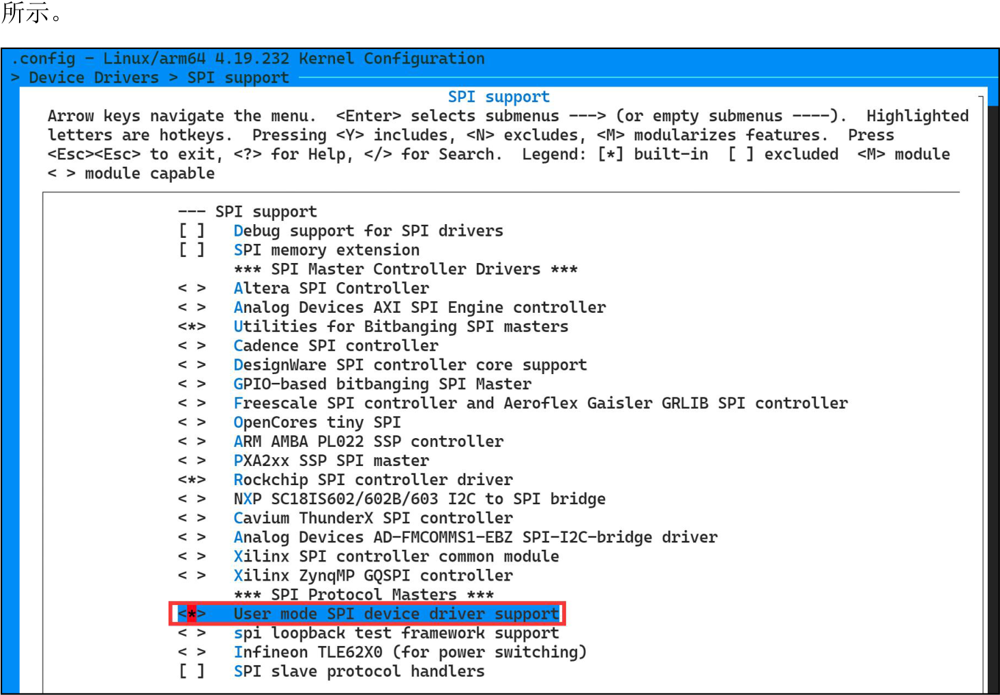
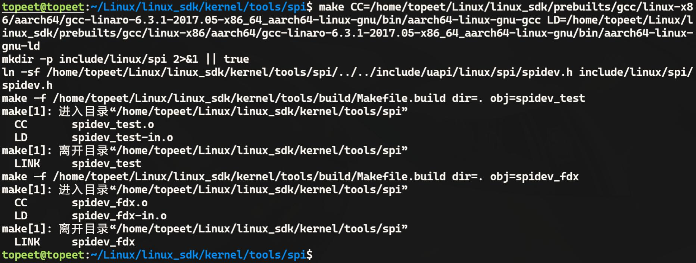
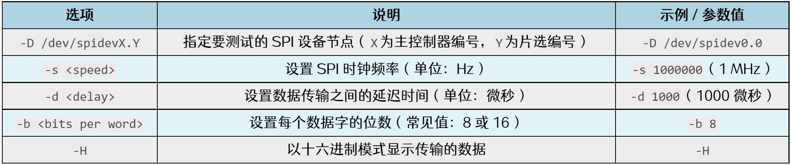
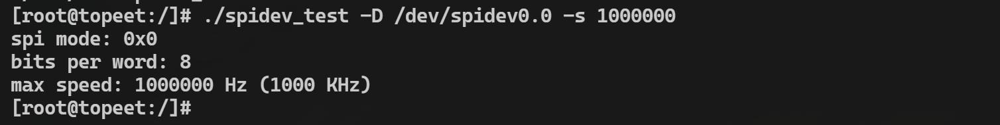
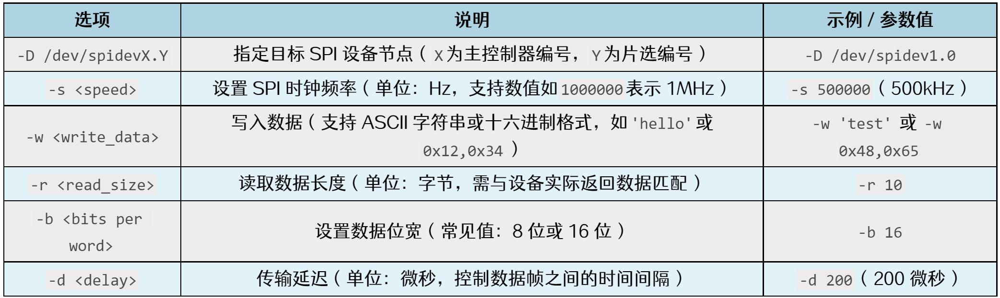

# 第189章Linux中通用SPI设备驱动

本章介绍通用SPI 设备驱动（spidev）的使用方法，并讲解如何在用户空间中通过spidev工具和ioctl 配置和访问SPI 设备。。
## 189.1 内核和设备树配置
在iTOP-RK3568 开发板的内核源码中，通用SPI 设备驱动已默认启用。通用SPI 设备驱动配置项位于内核make menuconfig 图形化配置界面Device Drivers- > SPI support 路径下，如图189.1

图189.1除了内核需要配置，设备树文件中也需要正确添加SPI 外设对应的设备节点。在之前章节中在SPI0 控制器下添加了mcp2515 的设备节点。如果想使用通用SPI 设备驱动让mcp2515 工

作起来，只需要把mcp2515 设备节点中的compatible 属性修改为rockchip,spidev 即可，如代码清单189.1 所示。
```c
&spi0 {代码清单189.1
        status = "okay";
        pinctrl-0 = <&spi0m1_cs0&spi0m1_pins>;
        pinctrl-1 = <&spi0m1_cs0&spi0m1_pins_hs>;
        mcp2515:mcp2515@0 {
                compatible = "rockchip,spidev";
                reg = <0>;
                spi-max-frequency = <10000000>;
                status = "okay";
    };
};
```
本章依旧使用mcp2515 作为实验外设，按照本节的方法使能内核与设备树以后，重新编译内核并将编译好的内核烧写到开发板上。为了方便起见，作者已经编译好的内核镜像放到了网盘iTOP-RK3568 开发板\07_学习教程配套资料\03_Linux 驱动配套资料\04_Linux 驱动程序\119_mcp2515_07\01_编译好的内核镜像路径下。开发板启动之后，如果存在/dev/spidev0.0 设备节点，则证明设备树及内核配置正确，如图189.2 所示。

图189.2其中spidev0.0 节点名中的0.0 表示mcp2515 挂载在SPI0 总线上，并且是连接在SPI0 总线上的第0 个设备。0.0 对应的格式为x.y。x 表示设备挂载在哪个SPI 总线下。y 表示连接在该SPI 总线上的设备编号，设备编号从0 开始。内核支持通用SPI 设备驱动以后就可以在应用层中使用spidev 工具和通过ioctl()函数操作挂载在spi 总线下的spi 设备。
## 189.2 spidev 工具组使用
spidev 工具组是Linux 系统中用于测试和调试SPI 设备的命令行工具集合，spidev 工具组中

的spidev_test 和spidev_fdx 工具主要用于验证SPI 设备的通信功能、参数配置和数据传输特性。spidev 工具组源码位于内核源码kernel/tools/spi 目录下，如图189.3 所示。

图189.3使用以下命令对该工具进行交叉编译（因为编译器使用的是绝对路径，因此需根据自己交叉编译器实际路径来修改编译命令）。
```c
make
CC=/home/topeet/Linux/linux_sdk/prebuilts/gcc/linux-x86/aarch64/gcc-linaro-6.3.1-2017.05-x86_64_aarch64-lin
ux-gnu/bin/aarch64-linux-gnu-gcc
LD=/home/topeet/Linux/linux_sdk/prebuilts/gcc/linux-x86/aarch64/gcc-linaro-6.3.1-2017.05-x86_64_aarch64-lin
ux-gnu/bin/aarch64-linux-gnu-ld
```
如图189.4 所示。

图189.4编译好的可执行文件如图189.5 所示。

图189.5可执行文件spidev_fdx 和spidev_test 即spidev 工具组工具。将可执行文件拷贝到开发板上即可使用spidev 工具。1.spidev_test 工具的使用。spidev_test 工具的核心功能包括验证设备连通性、执行基本读写操作以及测试传输参数配

置。主要选项和参数如图189.6 所示。

图189.6示例1：读取设备信息通过“spidev_test -D /dev/spidevX.Y -s 1000000”命令，使用1MHz 的时钟频率从SPI 设备读取数据，其中X 是SPI 控制器的编号，Y 是SPI 设备的编号，X.Y 后续不在赘述，运行结果如图189.7 所示。

图189.7示例2：写入和读取数据通过“spidev_test -D /dev/spidevX.Y -s 1000000 -b 8 -d 1000 -H -p 'hello'”命令向SPI设备写入字符串hello，并以十六进制模式显示设备的响应数据。其中“-b 8”表示指定每个字的位数为8，“-d 1000”表示设置1000 微秒的延迟，运行结果如图189.8 所示。

图189.8示例3：连续传输通过“spidev_test -D /dev/spidevX.Y -s 1000000 -b 8 -p 'abcdefgh'”命令连续发送字节'abcdefgh'到SPI 设备，运行结果如图189.9 所示。

图189.92.spidev_fdx 工具的使用

spidev_fdx 是一个用于全双工SPI 通信测试的命令行工具，主要选项和参数如图189.10 所示。

图189.10示例1：发送和接收数据通过“spidev_fdx -D /dev/spidevX.Y -s 1000000 -w 'hello' -r 5”命令向SPI 设备写入字符串'hello'，并从设备读取5 个字节的响应数据。示例2：设置时钟频率和延迟通过“spidev_fdx -D /dev/spidevX.Y -s 500000 -d 200 -w 'abcdef' -r 10”命令将SPI 时钟频率设置为500kHz，数据写入延迟为200 微秒，向设备写入字符串'abcdef'，然后读取10 个字节的响应数据。
## 189.3 应用程序中如何使用SPI
在应用程序中可以通过ioctl 命令获取和配置SP，实现SPI 数据的发送和接收，ioctl 命令定义在头文件/usr/include/linux/spi/spidev.h 中，如代码清单189.2 所示。
```c
#define SPI_IOC_RD_MODE代码清单189.2_IOR(SPI_IOC_MAGIC, 1, __u8)//读取SPI 模式
#define SPI_IOC_WR_MODE_IOW(SPI_IOC_MAGIC, 1, __u8)//写入SPI 模式
#define SPI_IOC_RD_LSB_FIRST_IOR(SPI_IOC_MAGIC, 2, __u8)//读取SPI 低位优先
#define SPI_IOC_WR_LSB_FIRST_IOW(SPI_IOC_MAGIC, 2, __u8)//写入SPI 低位优先
#define SPI_IOC_RD_BITS_PER_WORD_IOR(SPI_IOC_MAGIC, 3, __u8)//读取SPI 每字位数
#define SPI_IOC_WR_BITS_PER_WORD_IOW(SPI_IOC_MAGIC, 3, __u8)//写入SPI 每字位数
#define SPI_IOC_RD_MAX_SPEED_HZ_IOR(SPI_IOC_MAGIC, 4, __u32) //读取SPI 最大速度（Hz）
#define SPI_IOC_WR_MAX_SPEED_HZ_IOW(SPI_IOC_MAGIC, 4, __u32) //写入SPI 最大速度（Hz）
```

```c
#define SPI_IOC_RD_MODE32_IOR(SPI_IOC_MAGIC, 5, __u32) //读取SPI 模式（32 位）
#define SPI_IOC_WR_MODE32_IOW(SPI_IOC_MAGIC, 5, __u32) //写入SPI 模式（32 位）
```
通过ioctl 命令对SPI 设备进行初始化，如代码清单189.3 所示。
```c
int fd;// SPI 设备文件描述符代码清单189.3
int mode = SPI_MODE_0;// SPI 模式
int bits = 8;//每字比特数
int speed = 10000000;//最大SPI 总线速度（Hz）
int spi_init(void){
    int ret;
    //打开SPI 设备文件
    fd = open("/dev/spidev0.0", O_RDWR);
    if(fd < 0){
        printf("打开/dev/spidev0.0 错误\n");
        return -1;
    }
    /*
     * 设置SPI 模式
     */
    ret = ioctl(fd, SPI_IOC_WR_MODE32, &mode);
    if (ret == -1)
        printf("无法设置SPI 模式\n");
    ret = ioctl(fd, SPI_IOC_RD_MODE32, &mode);
    if (ret == -1)
        printf("无法获取SPI 模式\n");
    /*
     * 设置每字比特数
     */
    ret = ioctl(fd, SPI_IOC_WR_BITS_PER_WORD, &bits);
    if (ret == -1)
        printf("无法设置每字比特数\n");
    ret = ioctl(fd, SPI_IOC_RD_BITS_PER_WORD, &bits);
    if (ret == -1)
        printf("无法获取每字比特数\n");
    /*
```

```c
* 设置最大传输速度
*/
ret = ioctl(fd, SPI_IOC_WR_MAX_SPEED_HZ, &speed);
if (ret == -1)
   printf("无法设置最大传输速度\n");
ret = ioctl(fd, SPI_IOC_RD_MAX_SPEED_HZ, &speed);
if (ret == -1)
   printf("无法获取最大传输速度\n");
printf("SPI 模式: 0x%x\n", mode);
printf("每字比特数: %d\n", bits);
printf("最大速度: %d Hz (%d KHz)\n", speed, speed / 1000);
return 0;
}
```
通过ioctl 命令设置SPI 的模式、比特数以及最大传输速度，并进行SPI 通信，如代码清单189.4 所示。
```c
/*代码清单189.4
 * 执行SPI 数据传输.
 * 参数:
 *fd - SPI 设备文件描述符
 *tx - 发送缓冲区
 *rx - 接收缓冲区
 *len - 数据长度
 * 返回0 表示成功，-1 表示失败.
 */
int transfer(int fd, char *tx, char *rx, int len)
    int ret;
{
    struct spi_ioc_transfer tr = {
        .tx_buf = (unsigned long)tx,
        .rx_buf = (unsigned long)rx,
        .len = len,
        .delay_usecs = delay,
        .speed_hz = speed,
        .bits_per_word = bits,
    };
    ret = ioctl(fd, SPI_IOC_MESSAGE(1), &tr);
    if (ret < 1){
```

```c
printf("无法发送SPI 消息\n");
return -1;
return 0;
}
}
```
在应用程序中使用ioctl 命令通过通用SPI 设备驱动的设备节点操作mcp2515，其代码如代码如代码清单189.5 所示。编写好的应用程序存放在网盘iTOP-RK3568开发板\07_学习教程配套资料\03_Linux驱动配套资料\04_Linux 驱动程序\119_mcp2515_07\02_app 目录下。
```c
#include <stdio.h>代码清单189.5
#include <sys/ioctl.h>
#include <linux/spi/spidev.h>
#include <sys/types.h>
#include <sys/stat.h>
#include <fcntl.h>
#include <string.h>
#define RESET0xc0//复位命令
#define CANSTAT 0x0e// CAN 状态寄存器地址
#define READ0x03//读命令
#define CANCTRL 0x0f// CAN 控制寄存器地址
#define WRITE0x02//写命令
int fd;// SPI 设备文件描述符
int mode = SPI_MODE_0;// SPI 模式
int bits = 8;//每字比特数
int speed = 10000000;//最大SPI 总线速度（Hz）
int delay;//延迟时间（微秒）
/*
 * 初始化SPI 通信.
 * 返回0 表示成功，-1 表示失败.
 */
int spi_init(void){
    int ret;
    //打开SPI 设备文件
    fd = open("/dev/spidev0.0", O_RDWR);
    if(fd < 0){
```

```c
printf("打开/dev/spidev0.0 错误\n");
return -1;
}
/*
* 设置SPI 模式
*/
ret = ioctl(fd, SPI_IOC_WR_MODE32, &mode);
if (ret == -1)
printf("无法设置SPI 模式\n");
ret = ioctl(fd, SPI_IOC_RD_MODE32, &mode);
if (ret == -1)
printf("无法获取SPI 模式\n");
/*
* 设置每字比特数
*/
ret = ioctl(fd, SPI_IOC_WR_BITS_PER_WORD, &bits);
if (ret == -1)
printf("无法设置每字比特数\n");
ret = ioctl(fd, SPI_IOC_RD_BITS_PER_WORD, &bits);
if (ret == -1)
printf("无法获取每字比特数\n");
/*
* 设置最大传输速度
*/
ret = ioctl(fd, SPI_IOC_WR_MAX_SPEED_HZ, &speed);
if (ret == -1)
printf("无法设置最大传输速度\n");
ret = ioctl(fd, SPI_IOC_RD_MAX_SPEED_HZ, &speed);
if (ret == -1)
printf("无法获取最大传输速度\n");
printf("SPI 模式: 0x%x\n", mode);
printf("每字比特数: %d\n", bits);
printf("最大速度: %d Hz (%d KHz)\n", speed, speed / 1000);
return 0;
}
```

```c
/*
 * 执行SPI 数据传输.
 * 参数:
 *fd - SPI 设备文件描述符
 *tx - 发送缓冲区
 *rx - 接收缓冲区
 *len - 数据长度
 * 返回0 表示成功，-1 表示失败.
 */
int transfer(int fd, char *tx, char *rx, int len)
    int ret;
{
    struct spi_ioc_transfer tr = {
        .tx_buf = (unsigned long)tx,
        .rx_buf = (unsigned long)rx,
        .len = len,
        .delay_usecs = delay,
        .speed_hz = speed,
        .bits_per_word = bits,
    };
    ret = ioctl(fd, SPI_IOC_MESSAGE(1), &tr);
    if (ret < 1){
        printf("无法发送SPI 消息\n");
        return -1;
    return 0;
    }
}
int main(int argc, char *argv[]){
    char reset_cmd[1] = {RESET};//复位命令数组
    char rd_canstat[2] = {READ, CANSTAT};//读CAN 状态寄存器命令数组
    char canstat[4] = {0};//存储CAN 状态的缓冲区
    char wr_canctrl[] = {WRITE, CANCTRL, 0x00};//写CAN 控制寄存器命令数组
    //初始化SPI 通信
    spi_init();
    //执行SPI 数据传输
    // 1. 发送复位命令
    transfer(fd, reset_cmd, NULL, sizeof(reset_cmd));
    // 2. 读取CAN 状态
```

