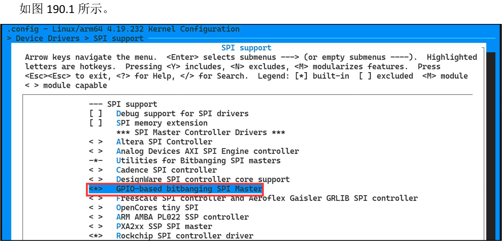
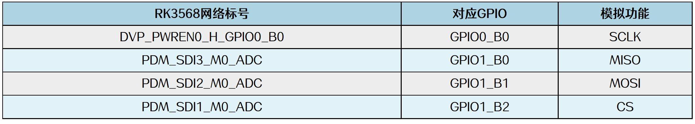

# 第190章 如何在Linux中使用模拟SPI

```c
transfer(fd, rd_canstat, canstat, sizeof(canstat));
printf("CAN 状态为%x\n", canstat[2]);
//清空canstat 缓冲区
memset(canstat, 0, sizeof(canstat));
// 3. 写入CAN 控制
transfer(fd, wr_canctrl, NULL, sizeof(wr_canctrl));
// 4. 再次读取CAN 状态
transfer(fd, rd_canstat, canstat, sizeof(canstat));
printf("CAN 状态为%x\n", canstat[3]);
return 0;
}
```
## 189.4 运行测试
### 189.4.1 编译应用程序
使用aarch64-linux-gnu-gcc app.c -o app 命令交叉编译应用程序，如图189.11 所示。

图189.11
### 189.4.2 运行测试
将本章节编译好的内核镜像boot.img 烧写到开发板上并启动开发板，然后将本章节编译好的app 可执行文件拷贝到开发板上，使用./app 命令运行可执行程序app，如图189.12 所示。

图189.12在应用程序app 中，首先会向mcp2515 发送复位指令。执行后，终端打印的第一条CAN状态寄存器值为0x80，表示mcp2515已成功进入配置模式。随后，打印的第二条状态值为0x00，表明mcp2515 已切换至正常工作模式。

当硬件SPI 资源不足或需临时扩展SPI 接口时，可以使用GPIO 引脚来模拟SPI 协议进行通信，与i2c 协议相比，SPI 通信协议比较简单，如没有起始信号、应答信号和终止信号等信号，所以本章不介绍从零编写模拟SPI 的时序代码，而是直接使用Linux 源码中已经写好的模拟spi驱动程序。
## 190.1 内核和设备树配置
在内核make menuconfi 图形化配置界面中，按照代码清单194.1 中路径把模拟SPI 驱动程序对应的配置选中。代码清单190.1
```c
Device Drivers --->
    [*]SPI support -->
        <*> GPIO-based bitbanging SPI Master //选中
```

图190.1软件SPI 使用iTOP-RK3568 开发板背面20pinGPIO 底座中的GPIO0_B0、GPIO1_B0、GPIO1_B1和GPIO1_B2 等四个GPIO，对应关系表如图190.2 所示。


图190.2接下来，在设备树中添加模拟SPI 节点。首先在rk3568-evb1-ddr4-v10.dtsi 设备树文件的根节点下添加软件SPI 控制器节点spi5，具体内容如代码清单190.2 所示。
```c
spi5: spi@gpiol {代码清单190.2
    compatible = "spi-gpio";
    #address-cells = <1>;
    gpio-sck = <&gpio0 RK_PB0_GPIO_ACTIVE_LOW>;
    gpio-miso = <&gpio1 RK_PB0_GPIO_ACTIVE_LOW>;
    gpio-mosi = <&gpio1 RK_PB1_GPIO_ACTIVE_LOW>;
    cs-gpios = <&gpio1 RK_PB2_GPIO_ACTIVE_LOW>;
    num-chipselects = <1>;
    pinctrl-names = "default";
    pinctrl-0 = <&spi5_gpios>;
    status = "disabled";
};
```
然后通过对pinctrl 节点追加的方式添加spi5_gpios 复用配置节点，追加内容如代码清单190.3 所示。
```c
spi5_gpios: gpios {代码清单190.3
    rockchip,pins = <0 RK_PB0 0 &pcfg_pull_none>,
                     <1 RK_PB0 0 &pcfg_pull_none>,
                     <1 RK_PB1 0 &pcfg_pull_none>,
                     <1 RK_PB2 0 &pcfg_pull_none>,
    >;
};
```
修改之前编写的mcp2515 节点，修改之后的内容如代码清单190.4 所示。代码清单190.4
```c
status = "okay";
&spi5 {
mcp2515:mcp2515@0 {
        compatible = "rockchip,spidev";
        reg = <0>;
```

