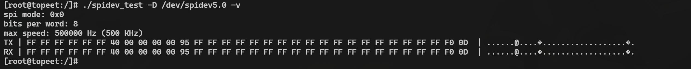
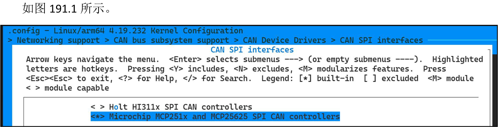
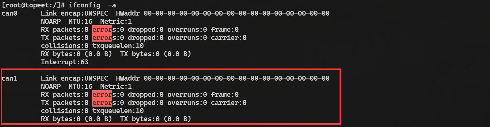

# 第191章 实践：移植官方mcp2515驱动

```c
spi-max-frequency = <10000000>;
status = "okay";
};
};
```
修改完成之后，然后重新编译内核镜像，编译完成的内核镜像存放在网盘iTOP-RK3568 开发板\07_学习教程配套资料\03_Linux 驱动配套资料\04_Linux 驱动程序\120_soft_spi\01_修改好的内核路径下。
## 190.2 运行测试
首先要确保开发板烧写的是上一小节编译出来的内核镜像，开发板启动之后，使用ls/dev/spidev5.0 命令查看是否存在spidev5.0 节点，如图190.3 所示。

图190.3如图190.3 所示，若能看到/dev/spidev5.0 节点，说明软件SPI 驱动加载成功。接着将开发板背面GPIO 座子上的GPIO1_B0（MISO）与GPIO1_B1（MOSI）两个引脚短接做回环测试，短接完成后在开发板终端执行./spidev_test -D /dev/spidev5.0 -v 命令，执行成功如图190.4 所示。

图190.4由图190.4 可以看到TX 和RX 收发的数据是一样，证明回环测试通过，模拟SPI 通信正常。

本章讲解如何移植官方mcp2515 驱动。
## 191.1 内核和设备树配置
mcp2515 驱动程序已默认集成进Linux 内核中，对应源码路径为kernel/drivers/net/can/spi/mcp251x.c，因此只需要在内核make menuconfig 图形化配置界面中将mcp2515 驱动对应的选项上即可。配置项路径如下如代码清单191.1 所示。代码清单191.1
```c
> Networking support
      > CAN bus subsystem support
        > CAN Device Drivers
          > CAN SPI interfaces
             <*> Microchip MCP251x and MCP25625 SPI CAN controllers
```

图191.1然后在rk3568-evb1-ddr4-v10.dtsi 设备树中添加如代码清单191.2 所示节点。代码清单191.2
```c
&spi0 {
    status = "okay";
    pinctrl-0 = <&spi0m1_cs0&spi0m1_pins>;
    pinctrl-1 = <&spi0m1_cs0&spi0m1_pins_hs>;
    mcp2515: mcp2515@0 {
        compatible = "microchip,mcp2515";
        reg = <0>;
        spi-max-frequency = <10000000>;
        interrupt-parent = <&gpio0>;
        interrupts = <RK_PB0 IRQ_TYPE_EDGE_FALLING>;
```

```c
pinctrl-names = "default";
pinctrl-0 = <&mcp2515_int>;
clocks = <&clk8m>;
status = "okay";
};
clk8m: clk8m {
   compatible = "fixed-clock";
   #clock-cells = <0>;
   clock-frequency = <8000000>;
};
};
```
接着在arch/arm64/boot/dts/rockchip/rk3568.dtsi 设备树的pinctrl 节点下添加如代码清单191.3 所示内容。代码清单191.3
```c
mcp2515-gpio{
        mcp2515_int:mcp2515-int {
            rockchip,pins = <0 RK_PB0 RK_FUNC_GPIO &pcfg_pull_none>;
        };
};
```
保存修改配置，重新编译内核镜像，修改好的设备树以及编译好的内核镜像存放在网盘
\121_mcp2515_08 路径下。
## 191.2 运行测试
首先需要确保开发板烧写的是上一小节修改编译出来的内核镜像，系统启动之后输入ifconfig -a 命令查看是否有can 设备节点，通过191.2 可以看到生成的can1 设备。

图191.2然后按顺序输入以下命令进行回环测试。
```c
ip link set can1 down
```

```c
ip link set can1 type can bitrate 250000
ip link set can1 type can loopback on
ip link set up can1
candump can1 -L &
cansend can1 123#1122334455667788
```
如图191.3、191.4 所示。

图191.3

图191.4通过191.4 可知发送和接收的数据是一样的，说明回环测试成功，mcp2515 驱动移植成功。

