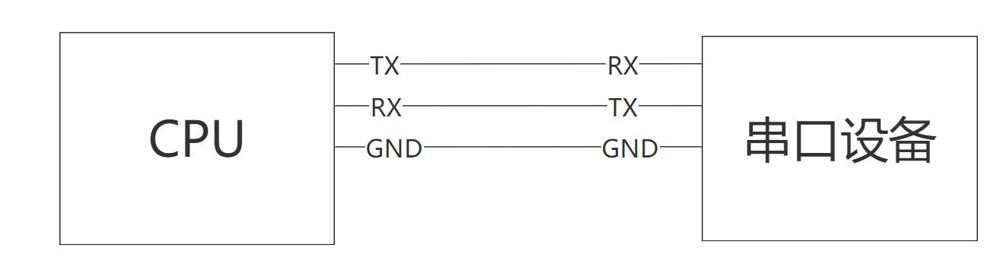
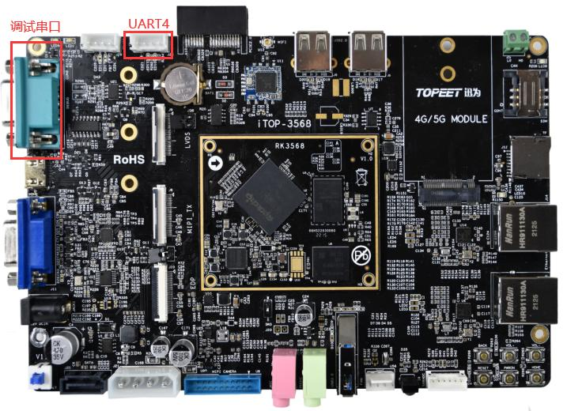
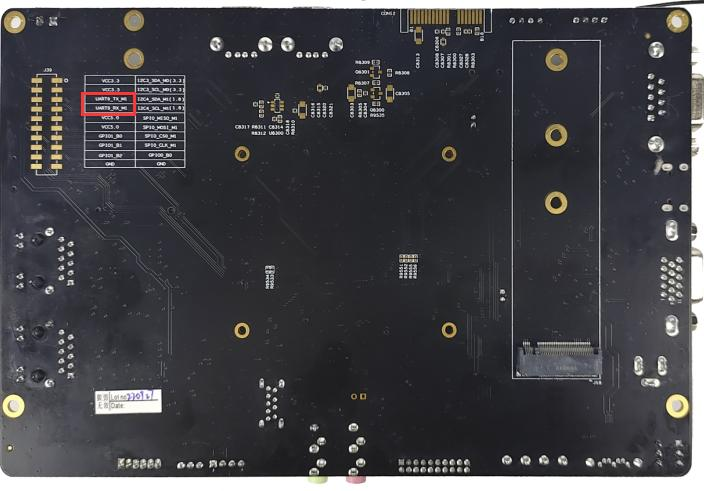
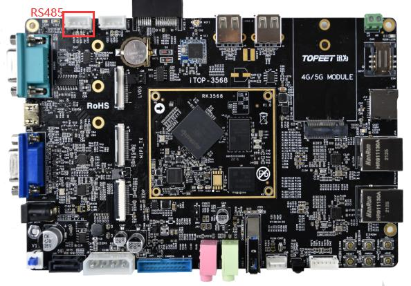
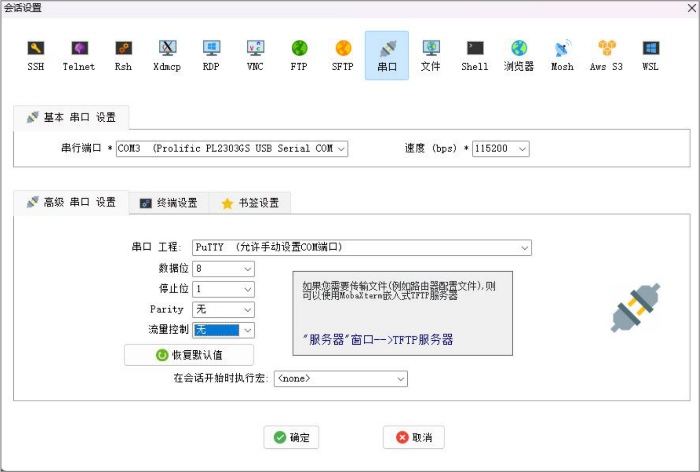
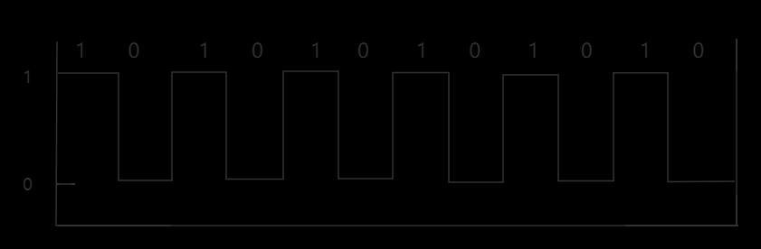

# 第192章 串口简介

本章学习串口的基础知识。
## 192.1 什么是串口
串口又称串行通信接口或COM 接口，是计算机与串行通信接口设备之间进行数据通信的异步全双工接口。典型的串口通信只需要3 根线，分别是地线（GND），发送线（TX），接收线（RX），如图192.1 所示。

图192.1串口在实际工作中会经常使用，比如在嵌入式Linux 下使用调试串口登录Linux 系统查看输出日志。串口也可以和外部模块通信，如GPS 模块。根据串口电平的不同，串口接口分为TTL 电平接口、RS232 电平接口和RS485 电平接口。在迅为iTOP-RK3568 开发板上有引出TTL 电平接口、RS232 电平接口和RS485 电平接口，TTL电平接口、RS232 电平接口如图192.2 所示，绿色的db9 座子为RS232 电平调试串口，UART4为TTL 电平串口。

图192.2在开发板背面的20pin 座子上还有一组TTL 电平串口——串口9，如图192.3 所示。

图192.3RS485 电平接口如图192.4 所示。

图192.4
## 192.2 波特率与比特率
在串口通信中有个重要的参数是波特率（Baud Rate），为了确保数据的准确收发，通信双方必须预先协商相同的波特率。常见的标准波特率包括9600、115200 等。如使用调试串口调试开发板时候，在串口终端软件MobaXterm 中设置波特率为115200，数据位设置为8，停止位设置为1，校验位设置为无，流量控制设置为无。如图192.5 所示。

图192.5串口终端软件MobaXterm 波特率设置成115200 的原因是因为iTOP-RK3568 开发板中配置的串口波特率是115200。串口通信的双方必须保证相同的波特率才可以正常通信。数据位设置为8，停止位设置为1，校验位设置为无，流量控制设置成无的原因亦是如此。波特率指的是码元速率。在数字信道中，一个脉冲信号就是一个码元，如下图192.6 所示。码元速率表示在1 秒内能发送多少码元或脉冲信号。

图192.6

