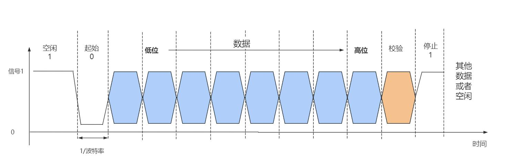
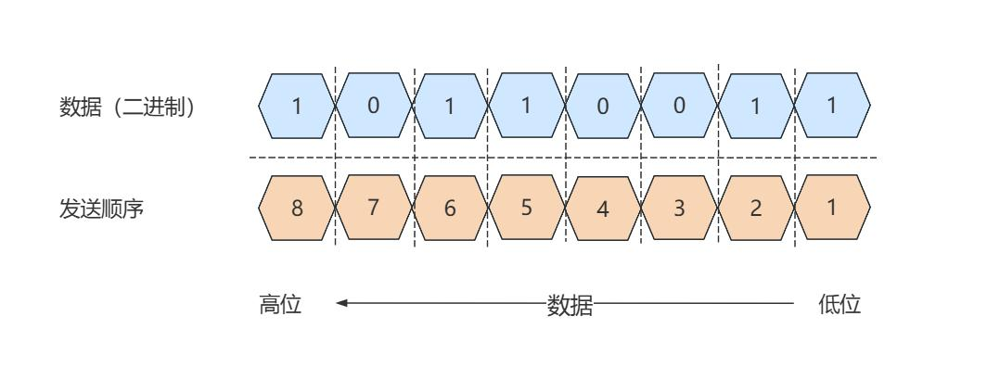
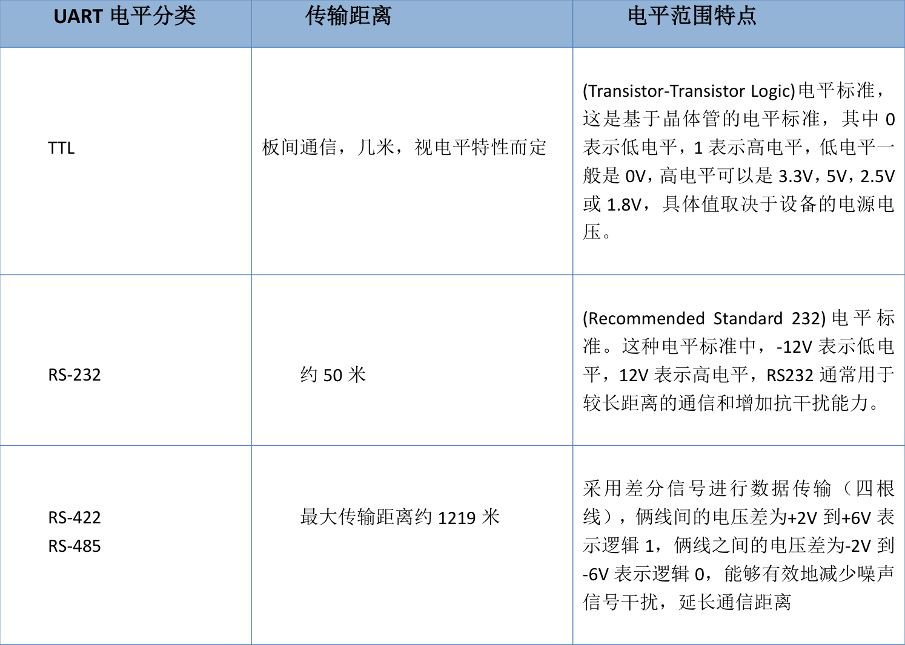
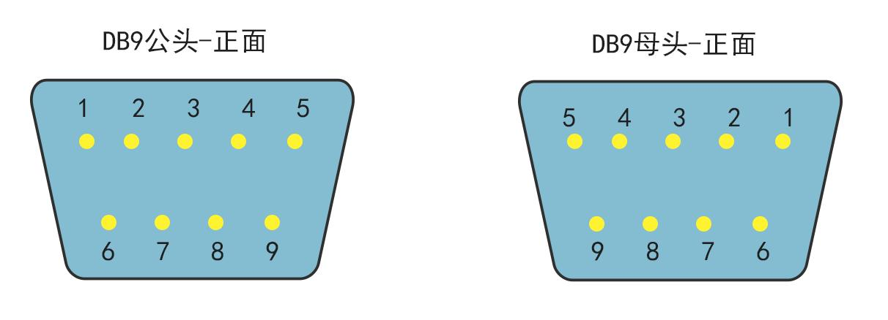
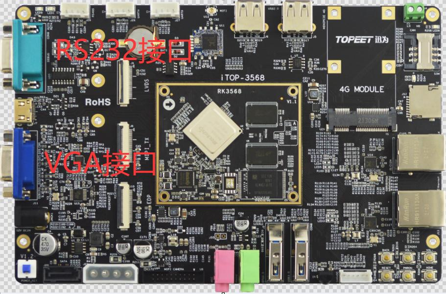
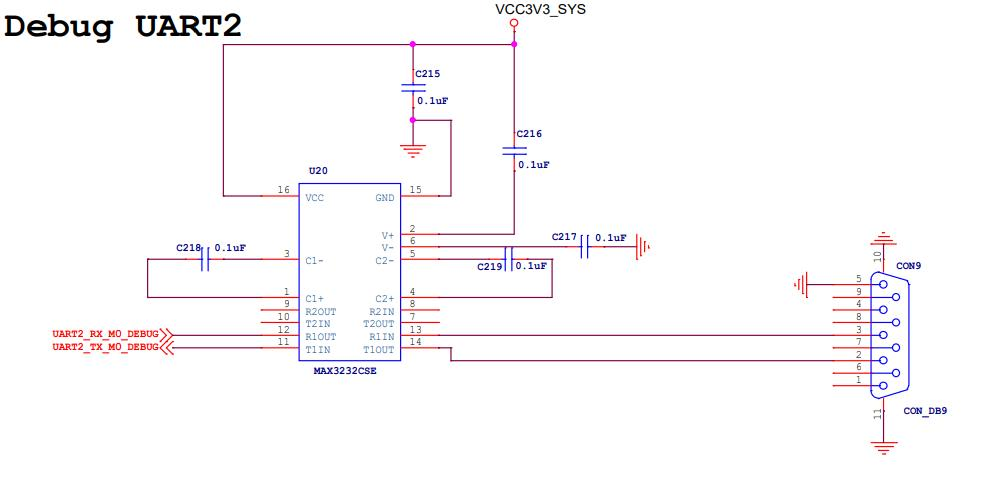
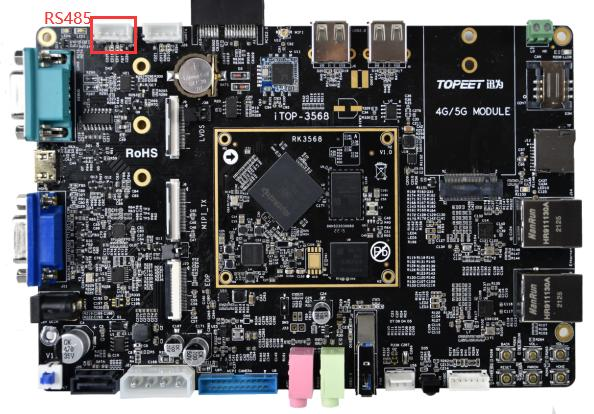
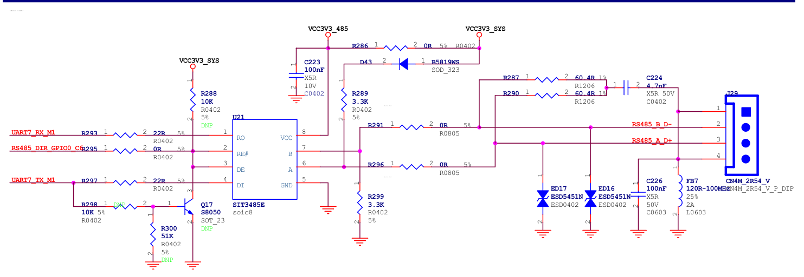
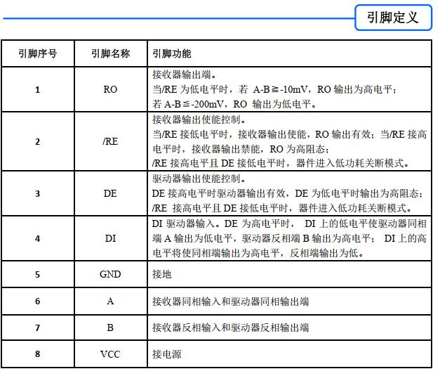
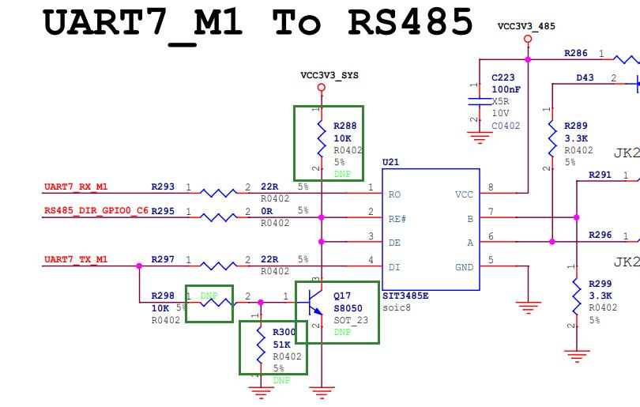

# 第194章串口通信接口类型

图193.1由图193.1 可以看出，在空闲状态下线路保持高电平，起始位通过将线路拉低并维持1 个比特时长来标志数据传输开始。接下来，数据位按照最低有效位优先的顺序依次发送，如图193.2 所示。校验位作为可选位，用于验证传输数据的准确性，常见的校验方式包括奇校验、偶校验、0 校验和1 校验。停止位为高电平，线路恢复空闲状态，表示一帧数据结束。

图193.2
本章了解串口通信的接口类型。

## 194.1 接口电平介绍
在串口的通信协议中规定了收发的时序，即“先发起始位，再发数据位，校验位，最后发停止位”，但是并没有规定高电平指的是多少伏，低电平指的是多少伏，以及物理接口是什么样子。串口通信中常见的接口电平标准包括TTL、RS232、RS485/RS422，不同标准需搭配专用电平转换芯片使用。处理器原生串口接口通常输出TTL 电平，但其电平参数（如电压范围）可能因芯片型号或厂商存在差异（例如3.3V 与5V TTL），因此如果不注意串口电平大小直接连接串口设备可能导致设备不兼容或损坏。因此，跨设备通信时需要确定通信双方电平，必要时需通过电平转换芯片实现信号匹配。常见串口接口电平介绍如表194.1 所示：表194.1

因为处理器原生的接口直接为ttl 电平，而RS232 和RS485 电平需要经过电平转换芯片进行转换，所以我们重点介绍表198.1 中的RS232 和RS485。

## 194.2.RS232 介绍
RS232 是由美国电子工业协会在1970 年制定的串行通信标准。该标准规定了串口通信的物理接口（DB9 接口）和引脚定义，还对信号的电平加以规定。DB9 接口如图194.1 所示。

图194.1
### 194.2.1 DB9 接口介绍
DB9 接口包含9 个引脚，每个引脚都有特定的功能。下面是DB9 接口的引脚说明。Pin 1 - DCD (Data Carrier Detect):数据载波检测。指示远程设备是否准备好进行通信。Pin 2 - RXD (Receive Data):接收数据。从远程设备接收数据流。Pin 3 - TXD (Transmit Data):发送数据。向远程设备发送数据流。Pin 4 - DTR (Data Terminal Ready):数据终端就绪。指示数据终端设备（如计算机）准备好进行通信。Pin 5 - GND (Ground):地线。电气接地，用于电路的参考和屏蔽。Pin 6 - DSR (Data Set Ready):数据集准备好。指示远程设备准备好接收和发送数据。Pin 7 - RTS (Request to Send):请求发送。发送方使用此信号请求开始发送数据。Pin 8 - CTS (Clear to Send):清除发送。接收方使用此信号表示准备好接收数据。Pin 9 - RI (Ring Indicator):铃信号指示器。指示远程设备发送了铃响信号。一般情况下只使用DB9 接口中的RXD、TXD 和GND 进行串口通信，其他引脚悬空。需要注意的是，RS232 通信本质上也是串口协议，因此与之前讲解的串口协议相同。RS232只是规定了串口的物理接口和电平特性。另外，请注意不要将iTOP-RK3568 开发板上的RS232 的物理接口，即DB9 接口与VGA 接口混淆，它们是完全不同的接口标准。DB9 接口和VGA 接口如图194.2 所示。

图194.2
### 194.2.2 电平特性
（1）逻辑电平范围逻辑1：-3V~-15V（表示空闲、停止位或数据“1”）逻辑0：+3V~+15V（表示起始位或数据“0”）电压绝对值需≥3V 才能被识别。（2）标准下最大传输距离约15 米（波特率≤9600bps），高波特率时距离缩短，RS232 抗干扰能力弱于RS485/422。在iTOP-RK3568 开发板上调试串口为DB9 接口，即采用RS232 与调试终端进行串口通信。
的串口，原理图如图194.3 所示。

图194.3
## 194.3 RS485 介绍
RS485 是由美国电子工业协会（EIA）于1983 年发布的串行通信接口标准。该标准旨在提供一种可靠的工业控制环境中的通信协议。RS485 是一种常用的差分串行通信接口标准，主要用于多节点、长距离的工业数据传输。RS 因其长距离通信能力、优异的抗干扰性能和多站能力，成为许多工业和商业应用中首选的串行通信接口标准。在iTOP-RK3568 开发板上也有RS485 接口，如图194.4 所示：

图194.4
### 194.3.1 电平特性
RS485 的电平特性如下所述：（1）RS485 使用差分信号进行数据传输，即数据信号是相对于两条信号线（通常标记为A 线和B 线）之间的电压差来表示的。（2）逻辑“ 1”以两线间的电压差为+(2~6)V 表示；逻辑“ 0”以两线间的电压差为-(2~6)V 表示。（3）RS485 发送器具有较强的驱动能力，能够推动较长的通信线路和多个接收器。接收器能够处理较大的输入电流，以确保信号的可靠接收。（4）RS485 支持多个设备（最多32 个）在同一条总线上进行通信。支持长达1200 米的通信距离，在特定情况下甚至可以更长。RS485 的电平特性非常适合于工业环境中的长距离和高抗干扰要求的数据通信应用。在
平上串口接口，原理图如下图194.5 所示。因此RS485 通信本质上也是串口协议。

图194.5需要注意的是RS485 是半双工通信，在原理图197.10 中通过GPIO0_C6 引脚控制RS485接口当前是接口数据还是发送数据。接下来我们分析RS485 是如何通过GPIO0_C6 引脚实现半双工通信。
### 194.3.2 非自收发电路介绍
原理图194.5 中通过SIT3485E 芯片实现RS485 通信，SIT3485E 芯片引脚如图图194.6 所示。

图194.6其中/RE 和DE 引脚是实现自收发的关键引脚，官方描述的相对晦涩，简单来说。通过/RE和DE 来控制是接收数据还是发送数据，在原理图194.10 中/RE 和DE 引脚连接到了GPIO0_C6

引脚上，当/RE 开启DE 关闭时接收数据。反之DE 开启/RE 关闭时发送数据。即如果GPIO0_C6输出低电平，/RE 开启DE 关闭，此时可以接收数据，不能发送数据。如果GPIO0_C6 输出高电平，/RE 关闭DE 开启，此时不能接收数据，可以发送数据。因此在软件编程时需要控制GPIO0_C6 引脚的高低电平来控制RS485 是发送还是接收数据从而实现半双工通信。
## 194.4 自收发485 电路介绍
自收发指的是通过硬件电路自动切换RS485 是接收还是发送数据，因为无需软件通过GPIO引脚控制接收还是发送，所以软件代码兼容性更好。非自收发指的是通过软件控制GPIO 高低电平进而控制是接收还是发送数据。
发电路。具体的修改方式是将原理图194.7 中R295 去掉，并将原理图194.15 中标记为DNP 的元件全部焊接，即不通过GPIO0_C6 引脚控制是接收还是发送，而是硬件自动实现控制接收还是发送。

图194.7为什么硬件可以自动实现控制接收还是发送呢。

