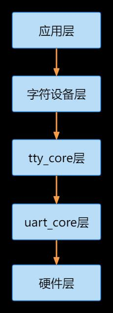
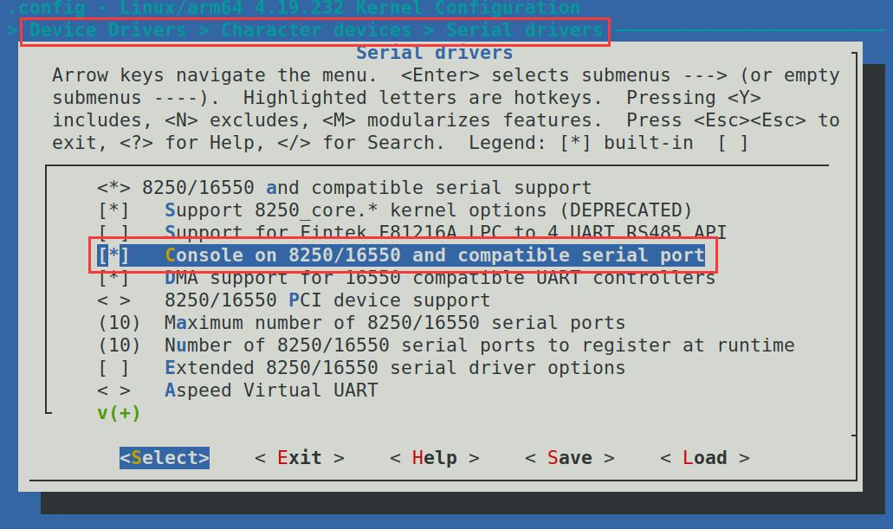

# 第195章 串口子系统框架

根据串口协议可知UART7_TX_M1 在空闲时为高电平，此时原理图194.15 中的Q17 的基极也为高电平，Q17 导通，因此/RE 和DE 为低电平，此时RS485 处于接收数据模式。当UART7_TX_M1 从空闲状态被拉低开始发送数据时，Q17 的基极为低电平，Q17 截止，因此/RE 和DE 为高电平，此时RS485 处于发送数据模式，并可以发送数据0，当发送数据1的时候会切换接收模式，此时RS485 接口A、B 引脚呈高阻态（等效于断路），但是由于A 线通过上拉电阻保持高电平，B 线通过下拉电阻保持低电平，恰好形成表示数据1 的差分信号（A高B 低），数据1 便被发送了出去。所以自收发电路是通过串口协议与硬件电路的互相配合实现了自动切换接收和发送的功能。

本章学习串口子系统框架。
## 195.1 串口子系统框架
串口子系统框架是Linux 内核中专门用于处理串口设备的模块化框架，如图195.1 所示。

图195.1接下来依次介绍每个层级的作用：（1）应用层：位于最顶层，应用层包括用户空间的串口应用程序，如串口通信工具minicom等。（2）字符设备层：位于应用层的下方，负责将用户空间的串口读写请求传递给内核空间的tty_core 层。字符设备层将串口设备看作一个特殊的字符设备，通过字符设备接口来进行操作。（3）tty_core 层：位于字符设备层的下方，是串口设备的通用处理层。在Linux 内核中用于管理串口设备，如数据传输，控制，缓冲管理等。（4）uart_core 层：位于tty_core 层的下方，提供了串口设备的底层驱动接口，如负责控制串口数据的发送和接收、中断处理、时钟管理等底层操作。

（5）硬件层：位于最底层，硬件层是串口硬件的驱动程序，
## 195.2 iTOP-RK3568 开发板串口驱动介绍
在iTOP-RK3568 开发板中串口驱动使用的是8250 通用串口驱动，驱动文件如代码清单195.1 所示。代码清单195.1drivers/tty/serial/8250/8250_core.c# 8250 串口驱动核心drivers/tty/serial/8250/8250_dw.c# Synopsis DesignWare 8250 串口驱动drivers/tty/serial/8250/8250_dma.c# 8250 串口DMA 驱动drivers/tty/serial/8250/8250_port.c# 8250 串口端口操作drivers/tty/serial/8250/8250_early.c# 8250 串口early console 驱动8250 通用串口驱动在内核menuconfig 配置路径如图195.2 所示。

图195.2内核支持8250 通用串口驱动以后，如果想使用串口还需要配置对应串口的设备节点。以
备树文件，串口9 控制器的设备树节点如代码清单195.2 所示：代码清单195.2

```c
uart9: serial@fe6d0000 {
        compatible = "rockchip,rk3568-uart", "snps,dw-apb-uart";
        reg = <0x0 0xfe6d0000 0x0 0x100>;
        interrupts = <GIC_SPI 125 IRQ_TYPE_LEVEL_HIGH>;
        clocks = <&cru SCLK_UART9>, <&cru PCLK_UART9>;
        clock-names = "baudclk", "apb_pclk";
        reg-shift = <2>;
        reg-io-width = <4>;
        dmas = <&dmac0 18>, <&dmac0 19>;
        pinctrl-names = "default";
        pinctrl-0 = <&uart9m0_xfer>;
        status = "disabled";
};
```
第2 行代码compatible ：指定匹配驱动的字符串，其中使用rockchip,rk3568-uart 和snps,dw-apb-uart 字符串进行匹配。第3 行代码reg：指定串口设备的地址和大小，0xfe6d0000 是串口设备的基地址，0x100 表示地址空间的大小。第4 行代码interrupts：指定串口设备的中断信息，包括中断类型和中断号。第5 行代码clocks：指定串口设备所使用的时钟源，包括波特率时钟和APB 时钟。第6 行代码clock-names：指定时钟源的名称，用于与时钟源的具体配置相匹配。第7行代码reg-shift：表示地址偏移量的位数，即每个寄存器的偏移量是按字节还是按字（byte）。第8 行代码reg-io-width：表示对设备地址和数据的访问宽度，这里是4 表示4 字节宽度。第9 行代码dmas：指定串口设备使用的DMA 控制器以及DMA 通道号，用于数据传输的DMA操作。第10 行代码dma-names:可选值为“tx”“rx”“!tx”“!rx”。其中“tx”表示打开tx dma、“rx”表示打开rx dma、“!tx”表示关闭tx dma、“!rx”表示关闭rx dma第11 行代码pinctrl-names 和pinctrl-0：用于串口设备的管脚复用控制，可选参数为如下所示。&uart9m0_xfer 配置tx 和rx 引脚为iomux group 0&uart9m1_xfer 配置tx 和rx 引脚为iomux group 1&uart9m0_ctsn 和&uart1m0_rtsn 配置硬件自动流控cts 和rts 引脚为iomux group 0&uart9m1_ctsn 和&uart1m1_rtsn 配置硬件自动流控cts 和rts 引脚为iomux group 1第12 行代码status：表示串口设备的状态，这里是"disabled" 表示设备当前处于禁用状态。

