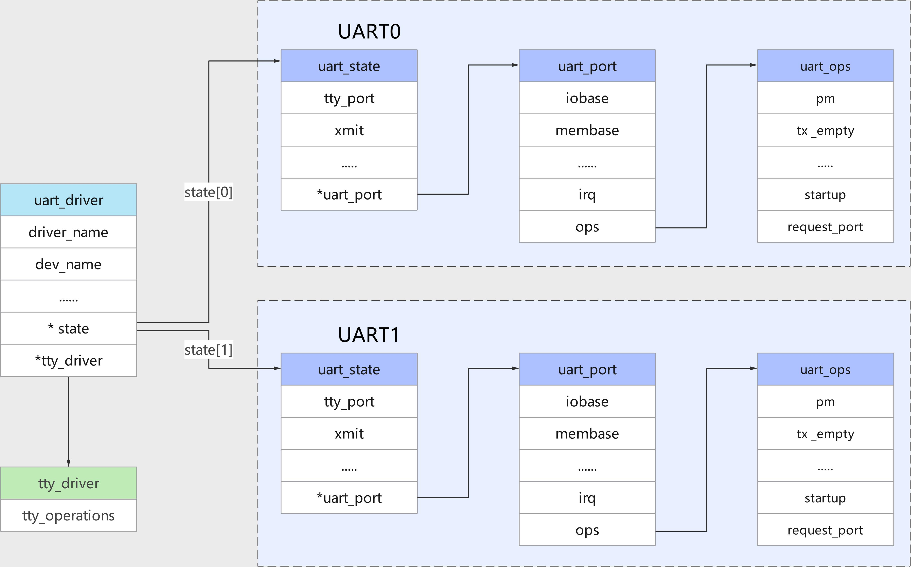

# 第196章uart_driver注册流程分析

如果设置为“okay”表示打开设备。
本章分析uart_driver 注册流程。
## 196.1 关键结构体介绍
uart_driver 注册流程中涉及到的关键结构体之间的关系如下图196.1 所示：

图196.1接下来我们依次学习一下这几个结构体。struct uart_driver 结构体本身并不包含底层UART 硬件的操作方法，它是所有串口设备驱动的抽象和封装。起到了连接硬件设备驱动和TTY 驱动的作用。struct uart_driver 定义在内核源码include/linux/serial_core.h 文件中，结构体定义如代码清单196.1 所示：代码清单196.1
```c
struct uart_driver {
    struct module*owner;// 模块所有者
    const char*driver_name;// 驱动程序名称
```

```c
const char*dev_name;// 设备名称
intmajor;// 设备分配的主设备号
intminor;// 设备分配的次设备号
intnr;// 设备的唯一标识符
struct console*cons;// 控制台的指针
struct uart_state*state;// 指向UART 驱动程序状态的指针
struct tty_driver*tty_driver;// 指向TTY 驱动程序的指针
};
```
struct uart_driver 结构体中的tty_driver 结构体代表上层（连接tty 驱动），它会在调用uart_register_driver()函数时赋值。uart_state 结构体代表下层（连接硬件设备），也是在调用uart_register_driver()函数时创建。uart_state 结构体中的uart_port 成员在调用uart_add_one_port()时被赋值。uart_port 用来描述单个UART 端口以及操作方法。代码清单196.1 中第9 行代码，struct uart_state 定义在kernel/include/linux/serial_core.h文件中，用于表示UART 驱动程序的状态。通过struct uart_driver 中的state 成员指针，可以访问和操作与UART 设备状态有关的数据。struct uart_state 如代码清单196.2 所示：代码清单196.2
```c
struct uart_state {
    struct tty_portport;// tty 端口结构体
    enum uart_pm_statepm_state;//UART 电源管理状态
    struct circ_bufxmit;//待发送数据的循环缓冲区
    atomic_trefcount;//引用计数
    wait_queue_head_t remove_wait;//等待队列头用于移除操作
    struct uart_port*uart_port;//UART 端口结构体指针
};
```
代码清单196.2中第7行代码struct uart_port定义在kernel/include/linux/serial_core.h，structuart_port 定义如代码清单196.3 所示：代码清单196.3
```c
struct uart_port {
     spinlock_tlock;/* port lock */
     unsigned longiobase;/* io 端口基地址（物理）*/
     unsigned char __iomem*membase;/* io 内存基地址（虚拟）*/
     unsigned int(*serial_in)(struct uart_port *, int);
     void(*serial_out)(struct uart_port *, int, int);
     unsigned intirq;/* 中断号*/
     unsigned longirqflags;/* 中断标志*/
     unsigned intuartclk;/* 串口时钟*/
     unsigned intfifosize;/* 串口缓冲区大小*/
```

```c
unsigned charx_char;/* xon/xoff char */
unsigned charregshift;/* 寄存器位移*/
unsigned chariotype;/* IO 访问方式*/
unsigned charunused1;
unsigned intread_status_mask;/* 关心Rx error status */
unsigned intignore_status_mask;/* 忽略Rx error status */
struct uart_state*state;/* pointer to parent state */
struct uart_icounticount;/* 串口信息计数器*/
struct console*cons;/* struct console, if any */
#if defined(CONFIG_SERIAL_CORE_CONSOLE) || defined(SUPPORT_SYSRQ)
unsigned longsysrq;/* sysrq timeout */
#endif
upf_tflags;
unsigned intmctrl;/* 当前的Moden 设置*/
unsigned inttimeout;/* character-based timeout */
unsigned inttype;/* 端口类型*/
const struct uart_ops*ops;/* 串口端口操作函数*/
unsigned intcustom_divisor;
unsigned intline;/* 端口索引*/
resource_size_tmapbase;/* io 内存物理基地址*/
struct device*dev;/* 父设备*/
unsigned charhub6;/* this should be in the 8250 driver */
unsigned charsuspended;
unsigned charunused[2];
void*private_data;/* generic platform data pointer */
};
```
代码清单196.3 中第31 行代码，struct uart_ops 是串口操作函数，定义如代码清单196.4所示。代码清单196.4
```c
struct uart_ops {
    unsigned int(*tx_empty)(struct uart_port *);// 检查发送缓冲区是否为空的函数指针
    void(*set_mctrl)(struct uart_port *, unsigned int mctrl); // 设置modem 控制信号的函数指针
    unsigned int(*get_mctrl)(struct uart_port *);// 获取modem 控制信号的函数指针
    void(*stop_tx)(struct uart_port *);// 停止发送函数指针
    void(*start_tx)(struct uart_port *);// 启动发送函数指针
    void(*throttle)(struct uart_port *);// 限流函数指针
    void(*unthrottle)(struct uart_port *);// 解除限流函数指针
```

```c
void(*send_xchar)(struct uart_port *, char ch);// 发送特殊字符函数指针
void(*stop_rx)(struct uart_port *);// 停止接收函数指针
void(*enable_ms)(struct uart_port *);// 启用RTS/CTS(硬件流控)函数指针
void(*break_ctl)(struct uart_port *, int ctl);// 控制发送BREAK 信号函数指针
int(*startup)(struct uart_port *);// 启动函数指针
void(*shutdown)(struct uart_port *);// 关闭函数指针
void(*flush_buffer)(struct uart_port *);// 刷新缓冲区函数指针
void(*set_termios)(struct uart_port *, struct ktermios *new,
                    struct ktermios *old);// 设置终端信息函数指针
void(*set_ldisc)(struct uart_port *, struct ktermios *);// 设置行规则函数指针
void(*pm)(struct uart_port *, unsigned int state,unsigned int oldstate);// 电源管理函数指针
const char*(*type)(struct uart_port *);// 获取端口类型的函数指针
void(*release_port)(struct uart_port *);// 释放端口函数指针
int(*request_port)(struct uart_port *);// 请求端口函数指针
void(*config_port)(struct uart_port *, int);// 配置端口函数指针
int(*verify_port)(struct uart_port *, struct serial_struct *);// 验证端口函数指针
int(*ioctl)(struct uart_port *, unsigned int, unsigned long);// 控制操作函数指针
#ifdef CONFIG_CONSOLE_POLL
int(*poll_init)(struct uart_port *);// 轮询初始化函数指针
void(*poll_put_char)(struct uart_port *, unsigned char);// 轮询发送字符函数指针
int(*poll_get_char)(struct uart_port *);// 轮询获取字符函数指针
#endif
};
```
代码清单196.4 中包含了一系列函数指针，这些函数指针定义了对UART 端口进行操作的接口。每个函数指针对应一个特定的操作，例如发送数据、设置控制信号、启动或停止传输等。通过struct uart_ops 结构体，上层应用程序或驱动程序可以调用这些函数指针来操作UART 端口，实现数据传输和控制操作。
## 196.2 uart_driver 注册流程分析
本小节对uart_driver 注册流程进行分析。
打开kernel/drivers/tty/serial/8250/8250_core.c 文件，找到如代码清单196.5 所示代码。
代码清单196.5
```c
#ifdef CONFIG_ROCKCHIP_THUNDER_BOOT
    rootfs_initcall(serial8250_init);
```

```c
#else
    module_init(serial8250_init);
#endif
    module_exit(serial8250_exit);
```
代码清单196.5 中根据是否定义了CONFIG_ROCKCHIP_THUNDER_BOOT 宏来选择不同的初始化方式。但是无论哪种方式初始化函数均为serial8250_init()函数，serial8250_init()函数如代码清单196.6 所示：代码清单196.6
```c
static int __init serial8250_init(void)
{
        int ret;
        // 检查是否有UART 端口被定义，如果没有则返回-ENODEV 错误
        if (nr_uarts == 0)
            return -ENODEV;
        // 初始化串口端口的ISA 总线驱动程序
        serial8250_isa_init_ports();
        // 打印串口驱动信息，包括端口数量和IRQ 共享状态
        pr_info("Serial: 8250/16550 driver, %d ports, IRQ sharing %sabled\n",
                nr_uarts, share_irqs ? "en" : "dis");
    #ifdef CONFIG_SPARC
        // 如果是SPARC 架构，注册串口设备的次设备号
        ret = sunserial_register_minors(&serial8250_reg, UART_NR);
    #else
        // 否则，在当前平台上注册UART 驱动程序
        serial8250_reg.nr = UART_NR;
        ret = uart_register_driver(&serial8250_reg);
    #endif
        if (ret)
            goto out;
        // 初始化PNP 设备（如果存在）
        ret = serial8250_pnp_init();
        if (ret)
            goto unreg_uart_drv;
        // 分配ISA 平台设备结构体并注册
        serial8250_isa_devs = platform_device_alloc("serial8250", PLAT8250_DEV_LEGACY);
```

```c
if (!serial8250_isa_devs) {
    ret = -ENOMEM;
    goto unreg_pnp;
}
// 将平台设备添加到系统
ret = platform_device_add(serial8250_isa_devs);
if (ret)
    goto put_dev;
// 注册串口端口
serial8250_register_ports(&serial8250_reg, &serial8250_isa_devs->dev);
// 注册平台驱动程序
ret = platform_driver_register(&serial8250_isa_driver);
if (ret == 0)
    goto out;
....
}
```
代码清单196.6 中第10 行代码serial8250_isa_init_ports()函数用于初始化串口端的ISA 总线驱动8250 串口，主要实现了请求端口，添加和注册串口端口。代码清单196.6中第22行调用uart_register_driver(&serial8250_reg)向系统注册uart_driver，也就是struct serial8250_reg 结构体。struct serial8250_reg 结构体如代码清单196.7 所示。代码清单196.7
```c
static struct uart_driver serial8250_reg = {
    .owner= THIS_MODULE,
    .driver_name= "serial",//驱动名称
    .dev_name= "ttyS",//设备节点前缀（/dev/ttyS*）
    .major= TTY_MAJOR,//主设备号
    .minor= 64,//次设备号起始值
    .cons= SERIAL8250_CONSOLE,//支持的串口数量
};
```
代码清单196.6 中第33 行代码调用platform_device_alloc()函数分配平台设备，设备名称为serial8250，第40 行代码将平台设备注册到平台总线上。代码清单196.6 中第45 行代码调用serial8250_register_ports()函数注册串口端口，接着第48 行代码调用platform_driver_register()函数注册名为“serial8250”的平台驱动，平台驱动与

上个步骤分配的平台设备自动匹配，触发probe 函数。代码清单196.6 中的重要代码讲解完毕，接下来我们重点分析一下uart_register_driver()函数，此函数实现在/driver/tty/serial/serial_core.c 文件中，函数实现如代码清单196.8 所示。代码清单196.8
```c
int uart_register_driver(struct uart_driver *drv)
{
    struct tty_driver *normal;
    int i, retval;
    BUG_ON(drv->state);
    //根据串口的个数，为每一个串口申请对应的uart_state 类型的内存空间
    drv->state = kcalloc(drv->nr, sizeof(struct uart_state), GFP_KERNEL);
    if (!drv->state)
        goto out;
    //申请tty_driver 类型的内存
    normal = alloc_tty_driver(drv->nr);
    if (!normal)
        goto out_kfree;
    drv->tty_driver = normal;
    //设置tty_driver 的各成员变量
    normal->driver_name= drv->driver_name;
    normal->name= drv->dev_name;
    normal->major= drv->major;
    normal->minor_start= drv->minor;
    normal->type= TTY_DRIVER_TYPE_SERIAL;
    normal->subtype= SERIAL_TYPE_NORMAL;
    normal->init_termios= tty_std_termios;
    normal->init_termios.c_cflag = B9600 | CS8 | CREAD | HUPCL | CLOCAL;
    normal->init_termios.c_ispeed = normal->init_termios.c_ospeed = 9600;
    normal->flags= TTY_DRIVER_REAL_RAW | TTY_DRIVER_DYNAMIC_DEV;
    normal->driver_state= drv;
    //设置其ops 成员为uart_ops
    tty_set_operations(normal, &uart_ops);
    /*
     * 初始化uart_state
     */
    for (i = 0; i < drv->nr; i++) {
        struct uart_state *state = drv->state + i;
        struct tty_port *port = &state->port;
```

```c
tty_port_init(port);
port->ops = &uart_port_ops;
}
//注册tty_driver
retval = tty_register_driver(normal);
if (retval >= 0)
return retval;
for (i = 0; i < drv->nr; i++)
tty_port_destroy(&drv->state[i].port);
put_tty_driver(normal);
out_kfree:
kfree(drv->state);
out:
return -ENOMEM;
}
```
在上述代码清单中第12 行代码调用alloc_tty_driver()函数申请tty_driver 类型的内存，第17 行到28 行设置了tty_driver 的各成员变量，第30 行设置其ops 成员为uart_ops。第35-41行初始化uart_state。代码清单196.8 中代码第43 行调用了tty_register_driver()函数将驱动注册到TTY 子系统，tty_register_driver()函数实现如代码清单196.9 所示。代码清单196.9
```c
int tty_register_driver(struct tty_driver *driver)
{
    int error;
    int i;
    dev_t dev;
    struct device *d;
        //检查driver->major 是否为0。
    if (!driver->major) { //driver->major 为0
        //动态分配主设备号
        error = alloc_chrdev_region(&dev, driver->minor_start,
                          driver->num, driver->name);
        if (!error) {
             driver->major = MAJOR(dev);
             driver->minor_start = MINOR(dev);
        }
    } else {//driver->major 不为0，表示主设备号已指定
        dev = MKDEV(driver->major, driver->minor_start); //使用MKDEV 宏构造设备号
        //注册指定的设备号区域
```

```c
error = register_chrdev_region(dev, driver->num, driver->name);
}
if (error < 0)
goto err;
//如果驱动程序标志包含TTY_DRIVER_DYNAMIC_ALLOC，则动态添加字符设备
if (driver->flags & TTY_DRIVER_DYNAMIC_ALLOC) {
error = tty_cdev_add(driver, dev, 0, driver->num);
if (error)
    goto err_unreg_char;
}
//使用互斥锁保护TTY 驱动列表，将新驱动添加到列表中
mutex_lock(&tty_mutex);
list_add(&driver->tty_drivers, &tty_drivers);
mutex_unlock(&tty_mutex);
//如果驱动程序标志不包含TTY_DRIVER_DYNAMIC_DEV，则逐个注册设备。
if (!(driver->flags & TTY_DRIVER_DYNAMIC_DEV)) {
for (i = 0; i < driver->num; i++) {
    //注册每个设备
    d = tty_register_device(driver, i, NULL);
    if (IS_ERR(d)) {
        error = PTR_ERR(d);
        goto err_unreg_devs;
    }
}
}
//调用proc_tty_register_driver 将驱动注册到proc 文件系统。
proc_tty_register_driver(driver);
//设置驱动程序标志TTY_DRIVER_INSTALLED
driver->flags |= TTY_DRIVER_INSTALLED;
return 0;
err_unreg_devs:
for (i--; i >= 0; i--)
tty_unregister_device(driver, i);
mutex_lock(&tty_mutex);
list_del(&driver->tty_drivers);
mutex_unlock(&tty_mutex);
err_unreg_char:
unregister_chrdev_region(dev, driver->num);
err:
return error;
```

