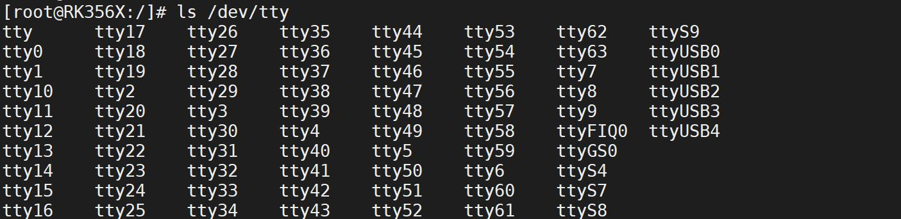
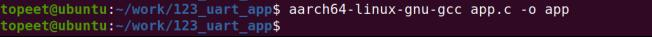
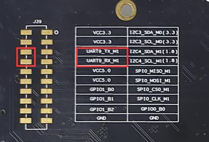
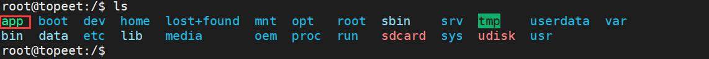
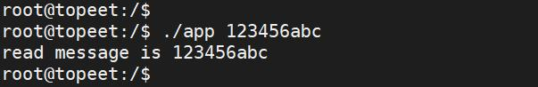

# 第198章 串口应用编程

在众多串口通信系统中，8250 通用串口驱动的广泛应用使得开发过程中无须再编写串口驱动程序，可直接在应用程序中通过标准文件接口和ioctl 调用对串口进行操作。本章学习串口应用编程。
## 198.1 串口设备节点介绍
在嵌入式设备的Linux 系统中，串口设备通常以字符设备节点形式存在。串口设备节点命名多以tty 为前缀。开发板启动后，可通过ls /dev/tty*命令查看已创建的串口设备节点（如下图198.1 所示）：

图198.1上图中串口设备节点有以下3 种类型。（1）dev/ttyX（X 是一个数字编号，譬如0、1、2、3 等）设备节点：tty 是teletype 的简称，在Linux 中，/dev/ttyX 代表虚拟控制台终端，Linux 内核在初始化时生/dev/tty1~/dev/tty63共63 个虚拟控制台终端。（2）串口设备节点：在iTOP-3568 开发板上引出UART2、UART4、UART7、UART9 四个串口，其中UART2 为串口调试终端，对应的设备节点为/dev/ttyFIQ0，其他三个串口UART4、UART7、UART9 对应的设备节点分别为/dev/ttyS4、/dev/ttyS7、/dev/ttyS9。（3）基于USB 的虚拟串口：ttyGS0 以及ttyUSBX（X 是一个数字编号，譬如0、1、2、3 等）都是USB 的虚拟串口，其中ttyGS0 为usb gadget 虚拟串口，在系统启动之后可以在windows 终端通过adb shell 命令进入开发板控制台。ttyUSBX 在这里为4G 模块的虚拟串口。

## 198.2 termios 结构体介绍
struct termios 结构体是Linux 内核中用于终端I/O 控制的结构体，用于配置终端设备的输入输出模式等属性。定义于<termios.h>头文件，结构体定义代码清单198.1 所示：代码清单198.1
```c
struct termios {
    tcflag_t c_iflag;// 输入模式标志
    tcflag_t c_oflag;// 输出模式标志
    tcflag_t c_cflag;// 控制模式标志
    tcflag_t c_lflag;// 本地模式标志
    cc_t c_cc[NCCS];// 控制字符数组
};
```
代码清单198.1 中的结构体关键成员介绍如下。（1）tcflag_t c_iflag：c_iflag 是struct termios 结构体中的输入模式标志位，用于控制终端设备对输入数据的预处理方式。c_iflag 中最常用的标志如表198.1 所示。表198.1成员对应成员的含义IGNBRK忽略输入终止条件BRKINT当检测到输入终止条件时发送SIGINT 信号IGNPAR忽略帧错误和奇偶校验错误PARMRK对奇偶校验错误做出标记INPCK对接收到的数据执行奇偶校验ISTRIP将所有接收到的数据裁剪为7 比特位、也就是去除第八位INLCR将接收到的NL（换行符）转换为CR（回车符）IGNCR忽略接收到的CR（回车符）ICRNL将接收到的CR（回车符）转换为NL（换行符）IUCLC将接收到的大写字符映射为小写字符IXON启动输出软件流控
（3）tcflag_t c_oflag：c_oflag 是struct termios 结构体中的输出模式标志位，用于控制终端设备的输出数据处理方式。当应用程序向终端（如串口、屏幕）发送数据时，内核会根据c_oflag 的配置对数据进行转换。c_oflag 中常用的宏定义如下表198.2 所示：
表198.2
成员对应成员的含义OPOST启用输出处理功能，如果不设置该标志则其他标志都被忽略OLCUC将输出字符中的大写字符转换成小写字符

ONLCR将输出中的换行符（NL '\n'）转换成回车符（CR '\r'）OCRNL将输出中的回车符（CR '\r'）转换成换行符（NL '\n'）ONOCR在第0 列不输出回车符（CRONLRET不输出回车符OFILL发送填充字符以提供延时OFDEL如果设置该标志，则表示填充字符为DEL 字符，否则为NULL 字符
（4）tcflag_t c_cflag：在struct termios 结构体中，c_cflag 用于控制终端设备的硬件特性（如数据传输格式与流控）。尤其对串口设备而言，该字段至关重要——可直接配置波特率、数据位、校验位、停止位等核心硬件参数。通过设置c_cflag 成员的标志位，即可完成对终端控制模式的配置，常用标志如表198.3 所示：表198.3c_cflag 支持的常量名称CBAUD波特率的位掩码B00 波特率(放弃DTR)B18001800 波特率B24002400 波特率B48004800 波特率B96009600 波特率B1920019200 波特率B3840038400 波特率B5760057600 波特率B115200115200 波特率CSIZE数据位的位掩码CS55 个数据位CS66 个数据位CS77 个数据位CS88 个数据位CSTOPB2 个停止位(不设则是1 个停止位)CREAD接收使能PARENB校验位使能PARODD使用奇校验而不使用偶校验HUPCL最后关闭时挂线(放弃DTR)CLOCAL本地连接(不改变端口所有者)LOBLK块作业控制输出CNET_CTSRTS硬件流控制使能
（5）tcflag_t c_lflag：c_iflag 是struct termios 结构体中的本地模式标志位，主要影响用户与终

端的实时交互方式（如输入缓冲、字符回显、信号触发等），适用于字符终端、命令行工具等场景。可用于c_iflag 成员的标志如下表198.4 所示：表198.4c_iflag 支持的常量名称INPCK奇偶校验使能IGNPAR忽略奇偶校验错误PARMRK奇偶校验错误掩码ISTRIP除去奇偶校验位IXON启动出口硬件流控IXOFF启动入口软件流控IXANY允许字符重新启动流控IGNBRK忽略中断情况BRKINT当发生中断时发送SIGINT 信号INLCR将NL 映射到CRIGNCR忽略CRICRNL将CR 映射到NLICANON启用规范模式
（5）cc_t c_cc[NCCS]：cc_t c_cc[NCCS]包含了特殊控制字符数组，特殊控制字符是一些字符组合，如Ctrl+C、Ctrl+Z 等，当用户键入这样的组合键，终端会采取特殊处理方式。struct termios结构体中c_cc 数组将各种特殊字符映射到对应的支持函数。每个字符位置（数组下标）由对应的宏定义的，如下表198.5 所示表198.5c_cc 支持的常量名称VKILL删除行，对应键为CTRL+UVEOF位于文件结尾，对应键为CTRL+DVEOL位于行尾，对应键为Carriage return(CR)VEOL2位于第二行尾，对应键为Line feed(LF)VMIN指定了最少读取的字符数VTIME指定了读取每个字符的等待时间VINTR中断控制，对应键为CTRL+CVQUIT退出操作，对应键为CRTL+ZVERASE删除操作，对应键为Backspace(BS)
## 198.3 常用串口控制函数介绍
（1）tcgetattr()函数

读取终端设备的当前属性（如波特率、输入输出模式等）并保存到struct termios 结构体中。该函数的原型如代码清单198.2 所示：代码清单198.2
```c
int tcsetattr(int fd, int optional_actions, const struct termios *termios_p);
```
该函数详细介绍如下：函数参数：fd：文件描述符。optional_actions：表示对属性的设置动作，可以选择以下几个值：TCSANOW：立即改变属性。TCSADRAIN：等待输出完成后改变属性。TCSAFLUSH：清空输入和输出缓冲区，然后改变属性。termios_p：是一个指向struct termios 结构体的指针，包含了要设置的终端属性。函数返回值：成功返回0，失败返回-1.（2）tcsetattr()函数tcsetattr()函数在Linux 系统中用于设置终端设备属性的函数，常用于配置串口设备的参数。该函数的原型如代码清单198.3 所示：代码清单198.3
```c
int tcsetattr(int fd, int optional_actions, const struct termios *termios_p);
```
该函数详细介绍如下：函数参数：fd：文件描述符。optional_actions：表示属性设置的动作选项，可以是以下值之一：TCSANOW：立即改变属性。TCSADRAIN：等待输出缓冲区数据发送完毕后再改变属性。TCSAFLUSH：清空输入输出缓冲区后再改变属性。termios_p：是一个指向struct termios 结构体的指针，包含了要设置的终端属性，包括波特率、数据位、停止位、校验位、流控制等。
（3）cfgetispeed()函数和cfgetospeed()函数

这俩个函数用于获取终端设备的输入和输出波特率。这两个函数原型如代码清单180.4 所示：代码清单198.4
```c
cfgetispeed(const struct termios *termios_p)
cfgetospeed(const struct termios *termios_p)
```
该函数详细介绍如下：函数参数：参数termios_p 是一个指向struct termios 结构体的指针，包含了终端设备的属性信息。函数返回值：返回值为表示输入波特率的整数值（波特率常用的单位是波特/秒）。（4）cfsetispeed()函数和cfsetospeed()函数这俩个函数分别用于设置输入波特率和输出波特率。这两个函数原型如代码清单198.5 所示。代码清单198.5
```c
cfsetispeed(struct termios *termios_p, speed_t speed);
cfsetospeed(struct termios *termios_p, speed_t speed);
```
该函数详细介绍如下：函数参数：参数termios_p 是指向struct termios 结构体的指针，包含了终端设备的属性信息。参数speed 是指定的输入波特率值。函数返回值：
成功返回0，失败返回-1。（5）tcflush()函数tcflush()函数用于清空终端的输入缓冲区、输出缓冲区或两者，避免残留数据干扰后续操作。。tcflush()函数原型如代码清单198.6 所示。代码清单198.6
```c
tcflush(int fd, int queue_selector)
```
该函数详细介绍如下：函数参数：参数fd 是指向已打开的终端设备文件描述符的指针，用于标识要操作的终端设备。

参数queue_selector 是刷新缓冲区的方式，可以是以下值之一：TCIFLUSH：刷新输入缓冲区，丢弃未读取的数据。TCOFLUSH：刷新输出缓冲区，丢弃未发送的数据。TCIOFLUSH：同时刷新输入输出缓冲区。（6）tcflow()函数tcflow()函数用于暂停或恢复终端的输入/输出数据流，常用于流控场景（如XON/XOFF 协议）。tcflow()函数原型如代码清单198.7 所示。代码清单198.7
```c
tcflow(int fd, int action)
```
该函数详细介绍如下：函数参数：参数fd 是指向已打开的终端设备文件描述符的指针，用于标识要操作的终端设备。参数action 可以指定以下值之一：TCOOFF：暂停数据的传输，停止发送数据。TCOON：恢复数据的传输，继续发送数据。TCIOFF：暂停数据的传输，停止接收数据。TCION：恢复数据的传输，继续接收数据。
## 198.4 串口应用程序编写
### 198.4.1 设置串口的波特率
在编写串口应用程序时，设置串口波特率是必须的步骤之一，它决定了数据传输的速率。在Linux 中，设置波特率使用cfsetspeed()函数。如果要将波特率设置为115200，示例代码如代码清单198.8 所示。代码清单198.8
```c
struct termios options;
// 获取当前终端配置
tcgetattr(fd, &options);
// 设置波特率为115200
```

```c
cfsetspeed(&options, B115200);
// 将新的终端配置写入终端
tcsetattr(fd, TCSANOW, &options);
```
### 198.4.2 设置数据位大小
在串口通讯中，数据位指的是每个字符（byte）中实际包含的数据位数。通常情况下，一个字符包含8 个位（即8 个0 或1），但有时也可能为7 个位或其他值。在编写串口应用程序时，需要使用struct termios 结构体中的c_cflag 成员变量来设置数据位大小。具体来说，需要将c_cflag 成员变量中与数据位相关的位清零，然后再根据需要设置相应的值。清零操作使用按位与（&）运算符和位运算中的“非”运算符（~），具体步骤如代码清单198.9 所示：代码清单198.9
```c
new_cfg.c_cflag &= ~CSIZE; // 将数据位相关的比特位清零
```
其中，CSIZE 是一个宏定义，表示数据位的位掩码。宏定义通常定义在termios.h 头文件中，其取值如代码清单198.10 所示。代码清单198.10
```c
#define CSIZE0x00000300//字符长度掩码
```
代码清单202.9 中通过清零操作，将数据位相关的位全部置为0。接下来，可以使用按位或（|）运算符和宏定义来设置具体的数据位数，如代码清单198.11 所示：代码清单198.11
```c
new_cfg.c_cflag |= CS8;// 将数据位数设置为8 位
```
此时，CS8 宏定义将会被解释为一个包含8 位的位掩码，通过按位或运算，将其设置到c_cflag 成员变量中，从而完成数据位的设置。
### 198.4.3 设置奇偶校验位
在Linux 系统中，通过termios 结构体的c_cflag 成员配置奇偶校验位，核心依赖PARENB（奇偶校验使能）和PARODD（奇校验标志）两个标志位，具体设置方法如代码清单198.12 所示。代码清单198.12
```c
//奇校验代码示例
options.c_cflag |= PARENB;// 启用奇偶校验
```

```c
options.c_cflag |= PARODD;// 设置为奇校验（PARODD=1）
options.c_cflag &= ~CSTOPB;// 1 个停止位
options.c_cflag &= ~CSIZE;// 清除数据位掩码
options.c_cflag |= CS7;// 设置7 位数据位
tcsetattr(fd, TCSANOW, &options);
//偶校验代码示例
options.c_cflag |= PARENB;// 启用奇偶校验
options.c_cflag &= ~PARODD;// 清除PARODD，设置偶校验
options.c_cflag &= ~CSIZE;// 清除数据位掩码
options.c_cflag |= CS7;// 设置7 位数据位
tcsetattr(fd, TCSANOW, &options);
//无校验代码示例
struct termios options;
tcgetattr(fd, &options);// 获取当前串口配置
options.c_cflag &= ~PARENB;// 清除PARENB，禁用奇偶校验
```
### 198.4.4 设置停止位
在串口通信中，停止位用于指定每个数据帧的结束位置。在传输一个完整的数据字节后，通常需要一个或多个停止位，以便接收端能够确定一个数据帧的结束。停止位的数量通常为1位或2 位，其中1 位停止位被广泛使用，而2 位停止位则较少使用。在Linux 中，通过在struct termios 结构体中设置c_cflag 成员变量的CSTOPB 标志位来控制停止位的数量。当CSTOPB 为0 时，仅使用1 位停止位；当CSTOPB 为1 时，则使用2 位停止位。例如，代码清单198.13 中将串口的停止位设置为1 位。代码清单198.13
```c
new_cfg.c_cflag &= ~CSTOPB; // 设置停止位为1 位
```
## 198.5 串口应用编程
接下来编写串口应用程序。本实验代码存放在网盘iTOP-RK3568 开发板\07_学习教程配套资料\03_Linux 驱动配套资料\04_Linux 驱动例程\123_uart_app 路径下。实验代码app.c 如代码清单198.14 所示。代码清单198.14

```c
#include <stdio.h>
#include <termios.h>
#include <string.h>
#include <fcntl.h>
#include <unistd.h>
/* 设置串口参数的函数*/
int set_uart(int fd, int speed, int bits, char check, int stop) {
        struct termios newtio, oldtio;
        // 步骤一：保存原来的串口配置
        if(tcgetattr(fd, &oldtio) != 0) {
            printf("tcgetattr oldtio error\n");
            return -1;
        }
        bzero(&newtio, sizeof(newtio));
        // 步骤二：设置控制模式标志
        newtio.c_cflag |= CLOCAL | CREAD;
        newtio.c_cflag &= ~CSIZE;
        // 步骤三：设置数据位
        switch(bits) {
            case 7:
                newtio.c_cflag |= CS7;
                break;
            case 8:
                newtio.c_cflag |= CS8;
                break;
        }
        // 步骤四：设置奇偶校验位
        switch(check) {
            case 'O': // 偶校验位
                newtio.c_cflag |= PARENB;
                newtio.c_cflag |= PARODD;
                newtio.c_iflag |= (INPCK | ISTRIP);
                break;
            case 'E': // 奇校验位
                newtio.c_cflag |= PARENB;
                newtio.c_cflag &= ~PARODD;
                newtio.c_iflag |= (INPCK | ISTRIP);
                break;
```

```c
case 'N': // 无校验
    newtio.c_cflag &= ~PARENB;
    break;
}
// 步骤五：设置波特率
switch(speed) {
case 9600:
    cfsetispeed(&newtio, B9600);
    cfsetospeed(&newtio, B9600);
    break;
case 115200:
    cfsetispeed(&newtio, B115200);
    cfsetospeed(&newtio, B115200);
    break;
}
// 步骤六：设置停止位
switch(stop) {
case 1:
    newtio.c_cflag &= ~CSTOPB; // 1 位停止位
    break;
case 2:
    newtio.c_cflag |= CSTOPB; // 2 位停止位
    break;
}
// 步骤七：刷新输入队列
tcflush(fd, TCIFLUSH);
// 步骤八：设置配置立刻生效
if (tcsetattr(fd, TCSANOW, &newtio) != 0) {
printf("tcsetattr newtio error\n");
return -2;
}
return 0;
}
int main(int argc, char *argv[]) {
int fd;
char buf[128];
int count;
```

```c
// 步骤九：打开串口设备
fd = open("/dev/ttyS9", O_RDWR | O_NOCTTY | O_NDELAY);
if (fd < 0) {
    printf("open error \n");
    return -1;
}
// 设置串口参数
set_uart(fd, 115200, 8, 'N', 1);
// 写入数据
write(fd, argv[1], strlen(argv[1]));
sleep(1);
// 读取数据
count = read(fd, buf, sizeof(buf));
buf[count] = '\0';
// 输出读取的数据
printf("read message is %s\n", buf);
// 关闭串口设备
close(fd);
return 0;
}
```
## 198.6 运行测试
### 198.6.1 编译应用程序
使用aarch64-linux-gnu-gcc app.c -o app 命令交叉编译应用程序，编译成功如图198.1 所示

图198.1

### 198.6.2 运行测试
#### 198.6.2.1 串口硬件连接
本实验使用的串口是串口9，串口9 在iTOP-RK3568 开发板底板的背面，使用杜邦线将下图198.2 中的UART9_TX_M1 和UART9_RX_M1 连接起来做回环测试。

图198.2
#### 1986.2.2 运行测试
将编译完成的可执行程序app 拷贝到开发板上，如下图198.3 所示：

图198.3然后输入./app 123456abc 命令运行应用程序，如下图198.4 所示。

图198.4由上图198.4 可以看出，运行程序之后，从串口设备中读取到了数据并将其输出，说明回环测试成功。

