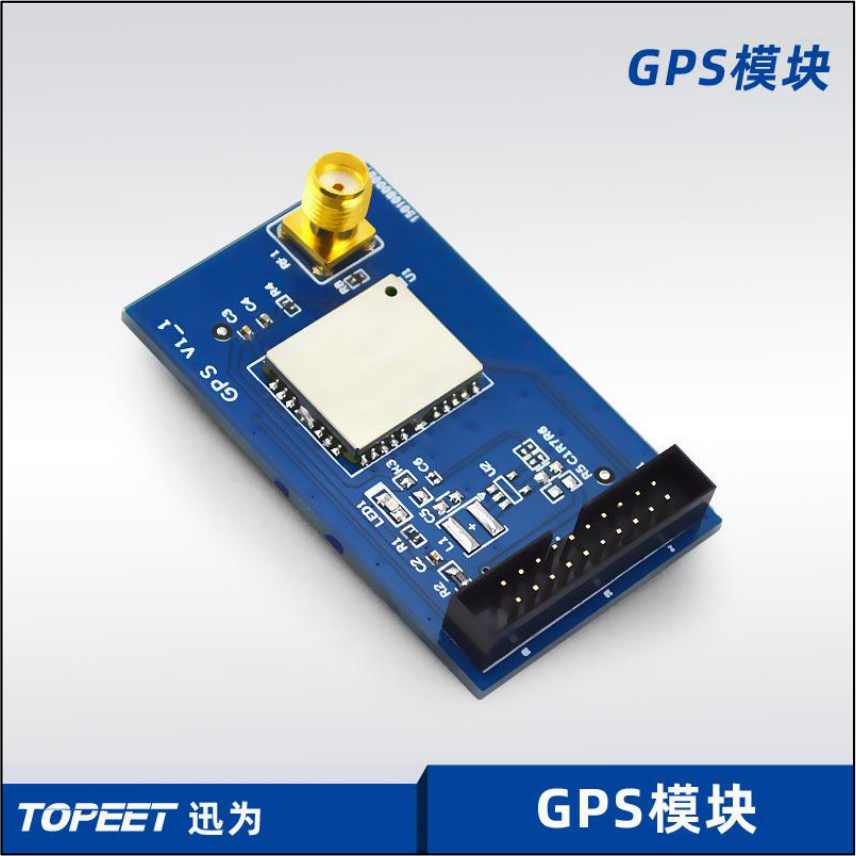
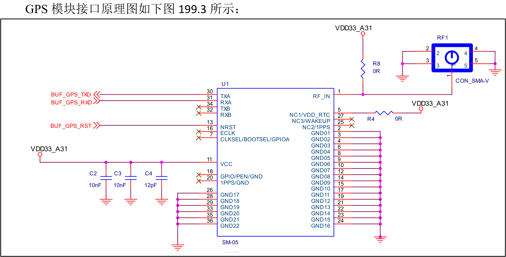
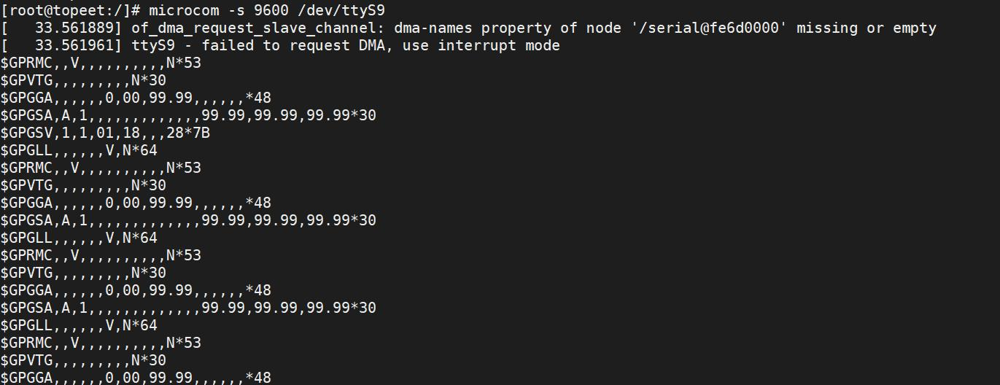
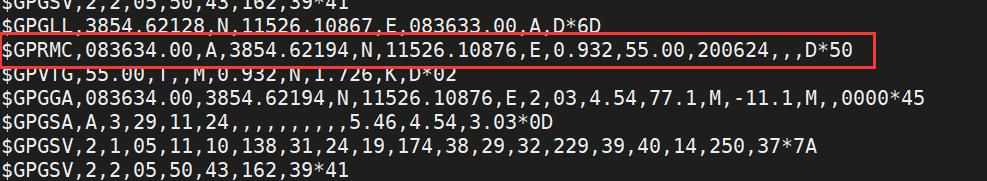
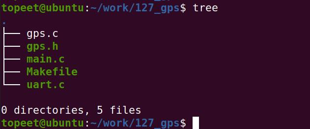
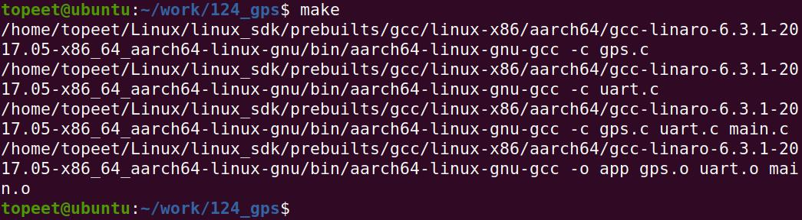
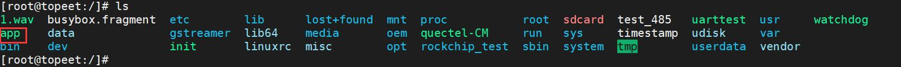
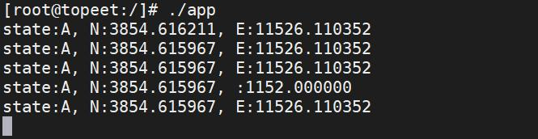

# 第199章 GPS模块编程

## 199.1 GPS 模块简介
全球卫星导航系统是一种利用卫星技术为全球用户提供精确时间和位置信息的系统。目前卫星系统有美国的GPS（全球定位系统）和俄罗斯的GLONASS（全球导航卫星系统）。除此之外，欧盟的伽利略卫星导航系统、中国的北斗卫星导航系统和印度的纳维克卫星导航系统也在逐步建设和发展中。如果设备需要使用卫星定位功能，设备需要使用定位模块接收卫星信号，本次实验使用的定位模块是迅为的GPS 模块。如下图199.1 所示：

图199.1GPS 模块的天线如下图199.2 所示（天线要放在户外避免收不到卫星信号）：


图199.2
## 199.2 GPS 模块硬件连接

图199.3上图199.3 中，BUF_GPS_RST 接口悬空不接，表199.1 为GPS 模块和iTOP-RK3568 开发板背后20pinGPIO 引脚连接示意表。表199.1GPS 模块引GPS 模块引脚名称连接到的开发连接到的开发板的引脚名称脚编号板的引脚编号BUF_GPS_TXDUART9_RX_M1BUF_GPS_RXDUART9_TX_M1GND19/20GNDVDD33_A312/4VCC3V3_SYS通过表199.1 可知，GPS 模块与iTOP-RK3568 开发板通过串口接口连接。注意！GPS 模块连接好之后，天线要放到户外！

## 199.3 GPS 数据帧介绍
连接好GPS 模块后，在开发板调试终端中使用microcom -s 9600 /dev/ttyS9 命令直接获取坐标信息，如图199.4 所示。

图199.4图199.4 中数据信息介绍如下。GPRMC (Recommended Minimum Specific GPS/Transit data)：GPRMC 数据类型提供了位置、速度、航向等最基本的GPS 定位信息。GPVTG (Track Made Good and Ground Speed)：GPVTG 数据类型提供了航向角和地面速度信息。GPGGA (Global Positioning System Fix Data)：GPGGA 数据类型包括了定位解、时间、位置准确度、海拔等位置信息。GPGSA (GPS DOP and Active Satellites)：GPGSA 数据类型包括了DOP 值和当前卫星定位状态。它用于提供GPS 卫星测量数据中可用卫星数量、解算出的位置几何因子DOP 等信息。GPGSV (GPS Satellites in View)：GPGSV 数据类型提供了现时可视卫星的信息，包括卫星的PRN、仰角、方位角、信号强度等信息。GPGLL (Geographic Position - Latitude/Longitude)：GPGLL 数据类型提供了经度和纬度信息。编写串口应用程序与GPS 模块进行通信我们只需要关注GPRMC 这条信息即可，如图199.5所示：


图199.5GPRMC 是一种常见的GPS 数据帧格式，用于GPS 设备之间或者GPS 设备与其他设备之间传输GPS 位置信息。GPRMC 数据帧中包含的信息如下表199.2 所示。表199.2字段含义详细解释字段0：$GPRMC消息ID是一种GPS 数据帧格式字段1: 083634.00UTC 时间格式为hhmmss.sss，表示数据记录时的UTC 时间(格林威治时间)，格林威治时间换成北京时间需要叫8 小时。字段2：A状态指示表示数据的有效性，通常是'A'表示有效，'V'表示无效字段3: 3854.62194纬度格式为ddmm.mmmm，表示纬度信息。字段4：N纬度半球表示纬度的半球，可能是北半球（N）或南半球（S）字段5:11526.10876经度格式为dddmm.mmmm，表示经度信息字段6：E经度半球表示经度的半球，可能是东经（E）或西经（W）字段7: 0.932地面速率（节）表示设备当前的地面速率，以节为单位字段8：55.00地面航向表示设备当前的地面航向，以真北为参考，以度为单位字段9:200624UTC 日期格式为ddmmyy，表示UTC 日期。字段10: 空磁偏角可选项，表示磁北与真北之间的偏角。字段11：空磁偏角方向可选项，表示磁偏角的方向，可能是东（E）或西（W）字段12：空模式指示表示定位模式，通常是'A'表示自主定位，'D'表示差分定位。字段13：D*50校验值
## 199.4 GPS 应用编程
本节编写串口应用程序与GPS 模块进行通信。本实验代码存放在iTOP-RK3568 开发板\07_学习教程配套资料\03_Linux 驱动配套资料\04_Linux 驱动例程\124_gps 路径下。首先新建图199.6 所示的文件结构。，


图199.6在uart.c 文件编写的set_uart()函数用于设置串口的基本参数，如波特率，奇偶校验位等，uart.c 文件内容如代码清单199.1 所示：代码清单199.1
```c
#include <stdio.h>
#include <termios.h>
#include <string.h>
#include <fcntl.h>
#include <unistd.h>
/* 设置串口参数的函数*/
int set_uart(int fd, int speed, int bits, char check, int stop) {
        struct termios newtio, oldtio;
        // 步骤一：保存原来的串口配置
        if(tcgetattr(fd, &oldtio) != 0) {
            printf("tcgetattr oldtio error\n");
            return -1;
        }
        bzero(&newtio, sizeof(newtio));
        // 步骤二：设置控制模式标志
        newtio.c_cflag |= CLOCAL | CREAD;
        newtio.c_cflag &= ~CSIZE;
        // 步骤三：设置数据位
        switch(bits) {
            case 7:
                newtio.c_cflag |= CS7;
```

```c
break;
case 8:
newtio.c_cflag |= CS8;
break;
}
// 步骤四：设置奇偶校验位
switch(check) {
case 'O': // 偶校验位
newtio.c_cflag |= PARENB;
newtio.c_cflag |= PARODD;
newtio.c_iflag |= (INPCK | ISTRIP);
break;
case 'E': // 奇校验位
newtio.c_cflag |= PARENB;
newtio.c_cflag &= ~PARODD;
newtio.c_iflag |= (INPCK | ISTRIP);
break;
case 'N': // 无校验
newtio.c_cflag &= ~PARENB;
break;
}
// 步骤五：设置波特率
switch(speed) {
case 9600:
cfsetispeed(&newtio, B9600);
cfsetospeed(&newtio, B9600);
break;
case 115200:
cfsetispeed(&newtio, B115200);
cfsetospeed(&newtio, B115200);
break;
}
// 步骤六：设置停止位
switch(stop) {
case 1:
newtio.c_cflag &= ~CSTOPB; // 1 位停止位
break;
case 2:
newtio.c_cflag |= CSTOPB; // 2 位停止位
break;
}
```

```c
// 步骤七：刷新输入队列
tcflush(fd, TCIFLUSH);
// 步骤八：设置配置立刻生效
if (tcsetattr(fd, TCSANOW, &newtio) != 0) {
    printf("tcsetattr newtio error\n");
    return -2;
}
return 0;
}
```
在gps.c 文件中编写get_gps_data()函数对GPRMC 数据帧格式进行解析并将经纬度通过printf 函数打印出来。如代码清单199.2 所示：代码清单199.2
```c
#include <stdio.h>
#include <termios.h>
#include <string.h>
#include <sys/types.h>
#include <sys/stat.h>
#include <fcntl.h>
#include <unistd.h>
#include "gps.h"
// 函数：get_gps_data
// 描述：从数据缓冲区解析GPS 数据，并填充到结构体中
// 参数：
//- buff: 指向包含GPS 数据的缓冲区的指针
//- gps_data: 指向结构体gprmc_data 的指针，用于存储解析后的GPS 数据
// 返回值：无
void get_gps_data(char *buff, struct gprmc_data *gps_data) {
    char *p = NULL;
        // 在缓冲区中查找以"$GPRMC" 开头的位置
        p = strstr(buff, "$GPRMC");
//使用sscanf 函数从字符串p 开始按指定格式解析数据，并存储到gps_data 结构体中对应的成员变量中
        sscanf(p, "$GPRMC,%d.00,%c,%f,%c,%f,%c,%c,%f, ,%d,,,%c,%*c",
               &(gps_data->time),// UTC 时间（hhmmss）
               &(gps_data->state),// 状态（A=有效，V=无效）
               &(gps_data->latitude),// 纬度（ddmm.mmmm 格式）
               &(gps_data->NS),// 纬度半球（N=北半球，S=南半球）
               &(gps_data->longitude),// 经度（dddmm.mmmm 格式）
               &(gps_data->EW), // 经度半球（E=东经，W=西经）
```

```c
&(gps_data->speed),// 地面速率（节）
&(gps_data->date), // UTC 日期（ddmmyy）
&(gps_data->mode));// 模式指示（A=自主定位，D=差分定位）
// 打印解析后的部分GPS 数据，用于验证解析是否正确（可选）
printf("state:%c, %c:%f, %c:%f\n", gps_data->state, gps_data->NS,
gps_data->latitude, gps_data->EW, gps_data->longitude);
}
```
在gps.h 把文GPRMC 数据帧格式封装成struct gprmc_data 结构体。并声明set_uart()和get_gps_data()函数，如代码清单199.3 所示。代码清单199.3
```c
#ifndef __GPS_H__
#define __GPS_H__
// 定义结构体gprmc_data，用于存储解析后的GPS 数据
struct gprmc_data {
        char id;// 数据标识（未使用）
        int time;// UTC 时间（hhmmss.sss 格式）
        char state;// 状态指示（A=有效，V=无效）
        float latitude;// 纬度（ddmm.mmmm 格式）
        char NS;// 纬度半球（N=北半球，S=南半球）
        float longitude; // 经度（dddmm.mmmm 格式）
        char EW;// 经度半球（E=东经，W=西经）
        float speed;// 地面速率（节）
        int date;// UTC 日期（ddmmyy 格式）
        char mode;// 模式指示（A=自主定位，D=差分定位）
        char check;// 校验位（未使用）
};
// 声明函数原型：设置串口参数
extern int set_uart(int fd, int speed, int bits, char check, int stop);
// 声明函数原型：解析GPS 数据
extern void get_gps_data(char *buff, struct gprmc_data *gps_data);
#endif
```
在main.c 文件中编写业务代码，通过串口与GPS 模块通信获取经纬度信息，如代码清单199.4所示：代码清单199.4
```c
#include <stdio.h>
#include <termios.h>
```

```c
#include <string.h>
#include <sys/types.h>
#include <sys/stat.h>
#include <fcntl.h>
#include <unistd.h>
#include "gps.h"
int main() {
        int fd;// 文件描述符
        char buf[128];// 读取数据的缓冲区
        int count;// 读取数据的字节数
        struct gprmc_data data;// 存储解析后的GPS 数据的结构体
        // 步骤一：打开串口设备
        fd = open("/dev/ttyS9", O_RDWR | O_NOCTTY | O_NDELAY);
        if (fd < 0) {
            printf("open error \n");// 打开失败提示
            return -1;// 返回错误码
        }
        // 步骤二：设置串口参数
        set_uart(fd, 9600, 8, 'N', 1);
        sleep(2);// 等待设备初始化
        // 步骤三：循环读取GPS 数据
        while (1) {
            count = read(fd, buf, sizeof(buf));// 从串口读取数据
            memset(&data, 0, sizeof(data));// 清空存储数据的结构体
            get_gps_data(buf, &data);// 解析GPS 数据
            sleep(2);// 等待下一次读取
        }
        // 步骤四：关闭串口设备
        close(fd);
        return 0;
    }
```

## 199.5 运行测试
### 199.5.1 编译应用程序
首先进行应用程序的编译，因为测试APP 是要在开发板上运行的，所以需要aarch64-linux-gnu-gcc 来编译。先来编写Makefile 文件，Makefile 文件内容如代码清单199.5 所示（注意交叉编译器所在的绝对路径要根据自己的环境实际填写）：代码清单199.5
```c
# 定义交叉编译器路径
CC=/home/topeet/Linux/linux_sdk/prebuilts/gcc/linux-x86/aarch64/gcc-linaro-6.3.1-2017.05-x86_64_aarch64-
linux-gnu/bin/aarch64-linux-gnu-gcc
# 生成可执行文件app
app: gps.o uart.o main.o
$(CC) -o app gps.o uart.o main.o
# 编译gps 模块
gps.o: gps.c gps.h
$(CC) -c gps.c
# 编译uart 模块
uart.o: uart.c
$(CC) -c uart.c
# 编译主程序入口main 模块
main.o: uart.o gps.o gps.h
$(CC) -c gps.c uart.c main.c
# 清除编译生成的目标文件和可执行文件
clean:
rm -f app *.o
```
然后输入make 命令编译应用程序，如下图199.7 所示：

图199.7编译完成的可执行程序如下图199.8 所示：


图199.8
### 199.5.2 运行测试
将GPS 模块连接到开发板背面的串口9 上，连接方法请看本章GPS 模块硬件连接小节。然后将上个小节编译完成的可执行程序app 拷贝到开发板的根目录下，如下图199.9 所示：

图199.9输入./app 命令运行应用程序，如下图199.10 所示。

图199.10上图199.10 中打印了GPS 模块获取的位置信息，接收到的纬度为N3854.616211，经度为E11526.110352。实际的纬度和经度应该缩小100 倍，纬度为N38.54616211，经度为E115.26110352。可以通过网址https://www.toolnb.com/tools/getbaidupoint.html 根据经纬度查询对应的位置，如果查询位置和实际位置相差不大，说明实验成功。如果相差巨大，可以尝试把GPS 模块天线放在户外重新进行测试。

