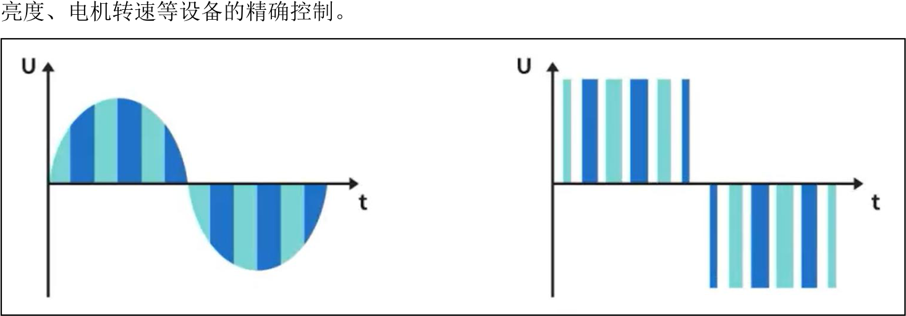
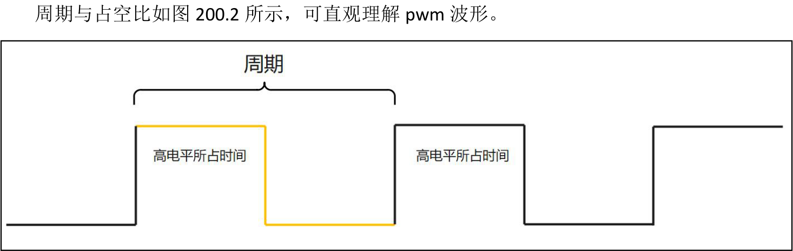
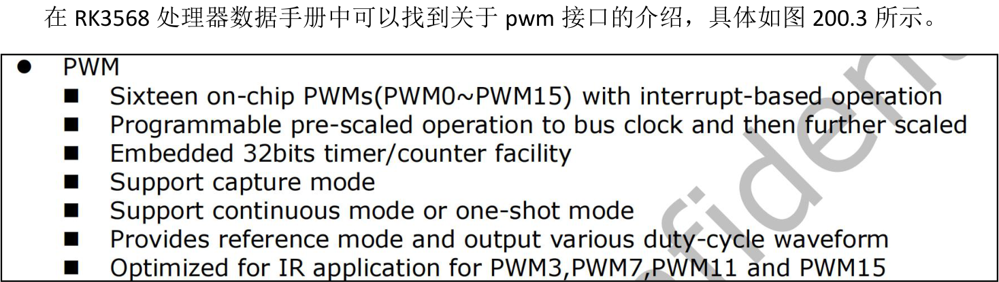
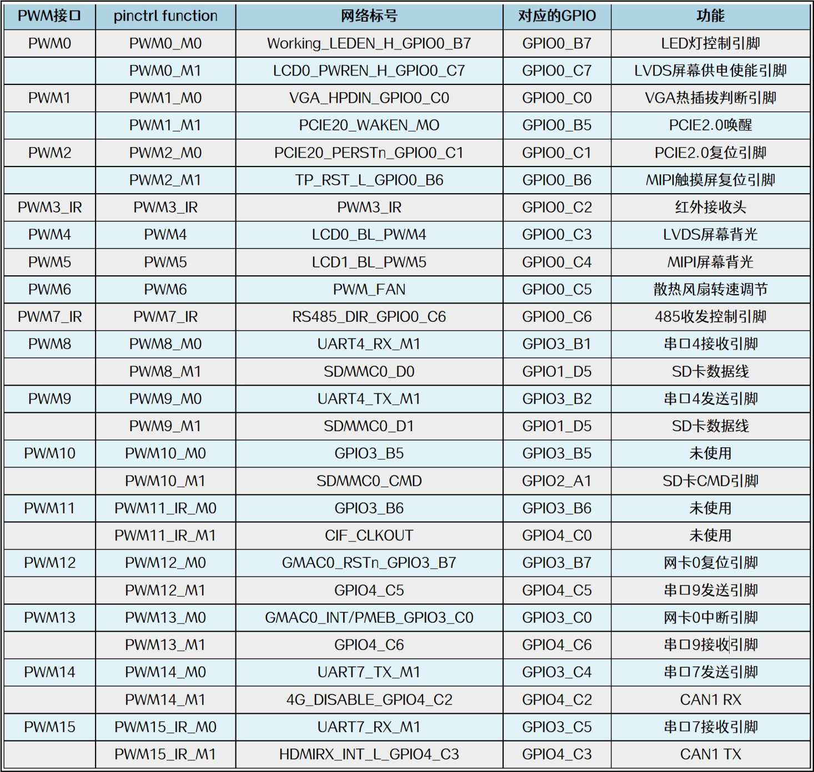

# 第200章 初步认识pwm

## 200.1 pwm 基础知识
pwm（Pulse Width Modulation，脉宽调制）是一种通过数字信号控制模拟信号的技术。其核心原理是通过调节脉冲信号的高电平时间占比来控制输出强度，根据“面积等效原理”，即使脉冲信号的宽度和幅度不同，只要脉冲面积（脉冲宽度×脉冲幅度）相同，惯性设备的响应基本一致，如图200.1 所示。因此，pwm 可以在数字域模拟出连续电压。从而实现对LED

图200.1pwm 有两个关键参数分别是周期和占空比。周期(T)：指一个完整的高低电平循环所需要的时间。其倒数为频率（f），单位为Hz。例如周期为20ms，则频率为50Hz（即每秒50 个周期）。占空比(Duty Cycle)：是指高电平持续时间占周期的百分比。例如周期为20ms，高电平所占的时间为10ms，那占空比就是50%。

图200.2
## 200.2 iTOP-RK3568 开发板pwm 接口介绍

图200.3通过图200.3 可知芯片内置16 路pwm 通道，可以独立控制和输出pwm 波形。并支持中断驱动，可以灵活响应中断事件。pwm 通道采用可编程的预分频器，可以先对总线时钟进行分频，然后再进行二次分频。pwm 通道内置了32 位的定时/计数器功能。pwm 通道支持捕获模式，可以捕获外部输入信号的脉冲宽度等信息。pwm 通道支持连续输出模式和一次性输出模式。pwm 通道提供参考模式，可以输出各种占空比的波形。pwm3、pwm7、pwm11 和pwm15这4 路pwm 通道经过优化，适用于红外应用。上面的16 路pwm 都属于硬件pwm，即由专门的pwm 硬件模块来实现pwm 输出，关于硬件pwm 的介绍如下所示。硬件pwm:（1）实现方式：硬件pwm 是由专门的pwm 硬件模块实现pwm 输出的方式。（2）优点:·CPU 占用低，pwm 输出由硬件模块自动完成，无需CPU 介入。·pwm 输出频率和分辨率高，可以达到高达MHz 级的频率和ns 级的分辨率。·输出波形稳定可靠，不易受CPU 负载的影响。（3）缺点:·需要专门的硬件pwm 模块，处理器成本较高。·pwm 输出引脚受限，只能在预定义的引脚上输出。
解iTOP-RK3568 开发板上的pwm 接口使用情况。

图200.4当硬件pwm 不够用的时候，可以使用GPIO 来模拟实现pwm，也可以称之为软件pwm，关于软件pwm 的介绍如下所示：软件pwm:（1）实现方式：软件pwm 是通过软件编程实现pwm 输出的方式。利用定时器中断在软件中控制输出引脚的高低电平切换时间，从而生成pwm 波形。（2）优点:·灵活性强，可以在任意GPIO 引脚上生成pwm 波形。·成本低，处理器不需要硬件pwm 模块。

（3）缺点:·CPU 占用较高，因为需要在中断服务程序或者循环中实时控制引脚电平。·pwm 输出的频率和分辨率受CPU 主频和中断响应时间的影响，无法实现高频高分辨率。·对CPU 性能和实时性要求较高。
## 200.3 SG90 舵机介绍
学习pwm 使用的实验外设是SG90 舵机。SG90 舵机是一种广泛应用于机器人、遥控飞机、遥控汽车等领域的小型伺服电机。它以其小巧的尺寸、轻便的重量、低功耗和高性价比而备受青睐，外观类型如图200.5 所示。

图200.5（1）工作原理SG90 舵机通过脉宽调制（pwm）信号来控制位置。其pwm 信号周期固定为20ms，通过高电平持续时间决定舵机的转动角度，如0.5ms 对应0°，2.5ms 对应180°。即通过改变高电平的持续时间，可以控制舵机在0°～180°范围内转动，具体控制关系如图200.6 所示。

