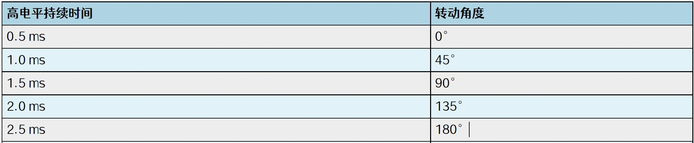
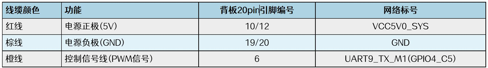
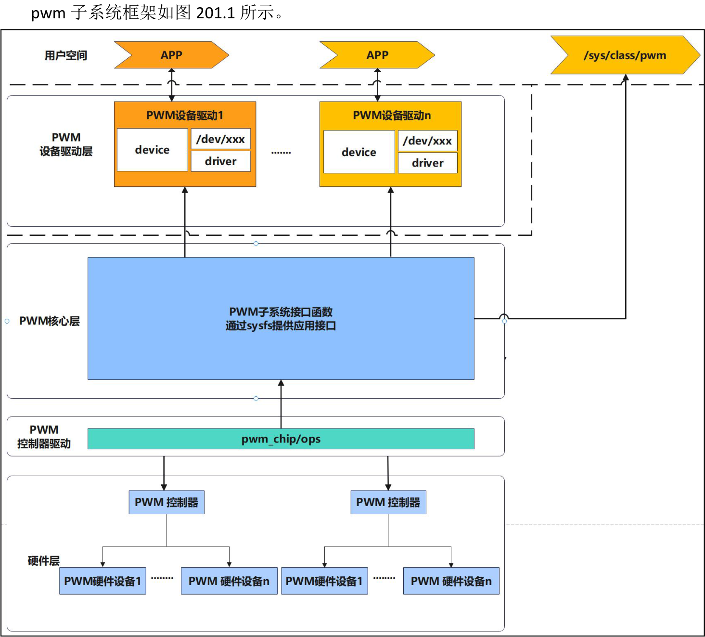

# 第201章 pwm子系统框架

图200.6（2）硬件连接SG90 舵机有三根不同颜色的线，其中红色和棕色为电源线，分别表示电源的正极和负极，而橙线为信号线，用于连接处理器的pwm 输出引脚，SG90 舵机与iTOP-RK3568 开发板连接方法如图200.7 所示。

图200.7

本章学习pwm 子系统框架。
## 201.1 pwm 子系统框架介绍

图201.1在pwm 子系统框架中，用户空间可通过设备节点或sysfs 接口控制pwm 信号输出；硬件层对应具体的pwm 控制器和其输出通道。内核空间则划分为三层，分别为pwm 设备驱动层、pwm 核心层和pwm 适配器驱动层。我们重点看这三层。

pwm 适配器驱动层该层负责与底层pwm 控制器直接交互，从而生成pwm 波形。通常由芯片厂商实现，需提供pwm_chip 结构体的各类回调函数，如启停控制、周期设置、占空比调节等。该层屏蔽了硬件差异，使上层逻辑与硬件解耦，提升了系统的可移植性与扩展性。pwm 核心层核心层位于适配器驱动与设备驱动之间，统一管理系统中的pwm 资源。它向设备驱动层提供标准API，包括pwm_enable()、pwm_disable()、pwm_config()等函数。同时，该层也支持sysfs 接口，允许用户通过文件系统配置pwm，sysfs 常用接口路径包括：·/sys/class/pwm/pwmX/period：设置pwm 周期·/sys/class/pwm/pwmX/duty_cycle：设置占空比·/sys/class/pwm/pwmX/polarity：配置极性·/sys/class/pwm/pwmX/enable：启用或禁用输出pwm 设备驱动层设备驱动层负责具体pwm 设备的功能实现，主要包含以下核心结构：·pwm_device：表示一个pwm 通道，记录通道号、所属控制器等信息；·pwm_driver：注册并实现特定设备驱动，调用核心层提供的接口完成控制逻辑；·/dev/xxx 设备节点：面向用户空间应用提供访问入口，应用程序可通过打开、读写等操作控制pwm。

