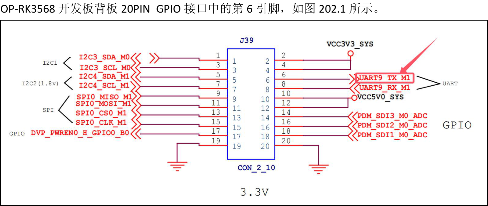
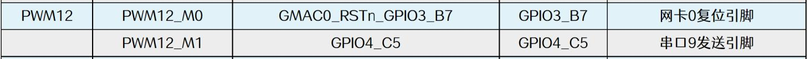
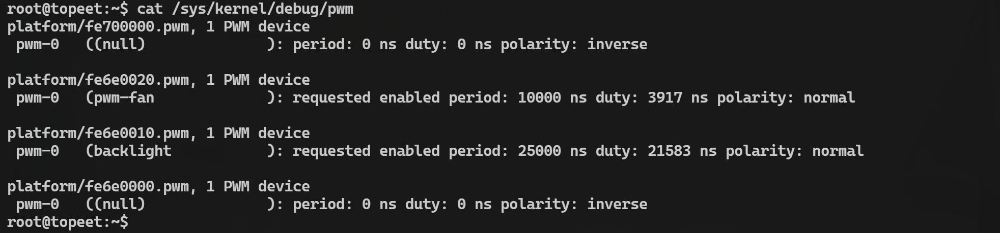
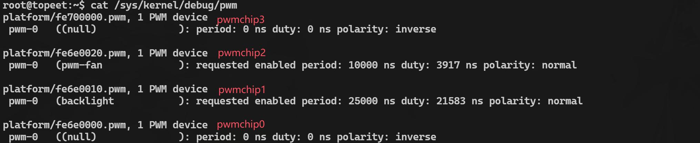
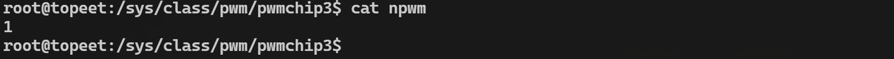
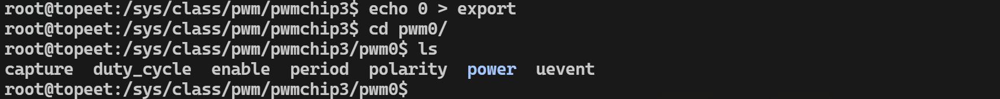
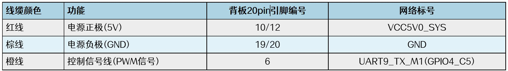

# 第202章 使用sysfs接口操作pwm

操作pwm 可以使用pwm 子系统的API 函数操作pwm 和使用sysfs 接口操作pwm，本章节先学习第二种方法使用sysfs 接口操作pwm。
## 202.1 配置pwm 设备树
通过sysfs 接口操作pwm，首先需要将相关的IO 引脚配置为pwm 功能。此处选用的是iT

图202.1根据pwm 引脚复用表可知，该引脚默认复用为UART9 的TX 功能（pwm12_M1 对应），如图202.2 所示。

图202.2因此，需要在设备树中禁用UART9 并启用pwm12 功能。在iTOP-RK3568 开发板的内核源码下使用vim kernel/arch/arm64/boot/dts/rockchip/rk3568-evb1-ddr4-v10-linux.dts 命令打开设备树文件，找到uart9 节点，将其status 属性从okay 修改为disabled，修改完成如图202.3 所示。


图202.3然后在该节点下面填充pwm12 节点，填充内容如代码清单202.1 所示。
```c
&pwm12 {代码清单202.1
    status = "okay";
    pinctrl-0 = <&pwm12m1_pins>;
};
```
烧写完成后，启动进入系统，使用cat /sys/kernel/debug/pwm 命令确认pwm 是否配置成功，如图202.4 所示。

图202.4若输出中出现与pwm12 对应的寄存器地址fe700000，说明设备树配置正确，配置成功如图202.4 所示。配置成功后便可使用sysfs 操作pwm。
## 202.2 使用sysfs 操作pwm
pwm 控制器在系统中会被挂载至/sys/class/pwm/目录下，如图202.5 所示。

图202.5由图202.5 可见，在该目录中有pwmchip0~pwmchip3 多个控制器对应的目录，这些目录与pwm 的对应关系如图202.6 所示。


图202.6通过pwm12 的寄存器可以确定pwm12 对应目录为pwmchip3，因此进入pwmchip3 目录。如图202.7 所示。

图202.7在pwmchip3 目录下总共有七个文件分别为device、export、npwm、power、subsystem、uevent 和unexport。需要关注的是export、npwm 以及unexport 这三个属性文件，下面一一进行介绍：1.npwm：显示此控制器下可用通道数。如图202.8 所示。

图202.82.export：导出通道号。如导出通道号0 会在/sys/class/pwm/pwmchipN/目录下创建pwm0目录。使用echo 0 > export 命令导出0 号通道，如图206.9 所示。通道号一般是0，因为瑞芯微处理器的PWM 每个chip 只有一个通道。

图202.9导出通道后，用户可以通过/sys/class/pwm/pwmchipN/pwmM（N 和M=0，1，2...）目录下的属性控制具体的pwm 信号，属性文件如图202.10 所示。

图202.10

主要属性文件介绍如下：·polarity：用于查看pwm 信号极性，属性值为normal 表示pwm 信号为正极性，即高电平为有效信号。属性值为inversed 表示pwm 信号为负极性，即低电平为有效信号。·period：该属性必须在pwm 使能前配置，用以设置pwm 周期，单位为纳秒。·duty_cycle：设置高电平持续时间，即占空比。·enable：写入1 表示使能pwm 输出，写入0 表示停止输出。3.unexport：写入相同通道号以删除对应目录并释放资源（只写）。譬如使用echo 0 > unexport 命令删除通道号0 对应的目录，如图202.11 所示。

图202.11至此对于sysfs 控制pwm 要用到的文件就讲解完成了，然后通过sysfs 控制SG90 舵机，先按照图202.12 所示的连接方式把SG90 舵机连接到iTOP-RK3568 开发板上。

图202.12通过代码清单202.2 所示命令让舵机转动135 度。代码清单202.2
```c
#导出pwm12 所在的pwmchip3 控制器的通道0
echo 0 > /sys/class/pwm/pwmchip3/export
#设置pwm 周期为20 ms
echo 20000000 > /sys/class/pwm/pwmchip3/pwm0/period
#设置pwm 高电平持续时间为2 ms
echo 2000000 > /sys/class/pwm/pwmchip3/pwm0/duty_cycle
#设置pwm 极性为正极性（normal）
echo normal > /sys/class/pwm/pwmchip3/pwm0/polarity
#启用pwm 输出
echo 1 > /sys/class/pwm/pwmchip3/pwm0/enable
```
而如果想要让舵机转动其他度数，只需要修改高电平持续时间即可，至此，对于使用sysf

