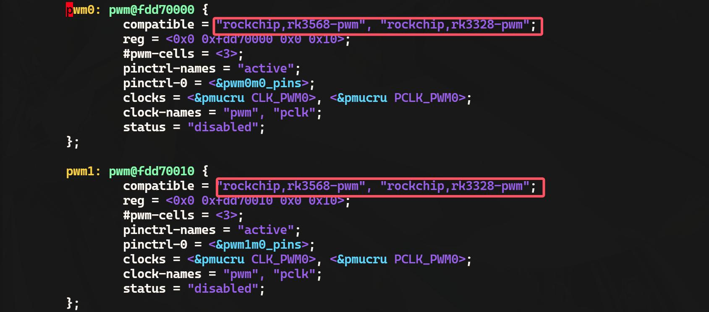

# 第203章 pwm控制器注册流程分析

s 操作pwm 就演示完成了。
本章分析pwm 控制器注册流程。
## 203.1 pwm 控制器注册流程分析
打开iTOP-RK3568 开发板内核源码下的rk3568.dtsi 设备树文件，找到pwm 控制器相关节点。pwm 控制器节点如图203.1 所示。

图203.1根据pwm 节点的compatible 属性值，可定位到pwm 控制器对应的驱动程序为drivers/pwm/pwm-rockchip.c，找到pwm-rockchip.c 驱动程序中的probe()函数，probe()函数如代码清单203.1 所示。
```c
static int rockchip_pwm_probe(struct platform_device *pdev)代码清单203.1
    const struct of_device_id *id;//设备树匹配ID
{
                                    //pwm 芯片结构体
    struct resource *r;//资源信息
    struct rockchip_pwm_chip *pc;
    int ret, count;//返回值和计数变量
    //检查设备树匹配
```

```c
id = of_match_device(rockchip_pwm_dt_ids, &pdev->dev);
if (!id)
    return -EINVAL;
//分配pwm 芯片结构体
pc = devm_kzalloc(&pdev->dev, sizeof(*pc), GFP_KERNEL);
if (!pc)
    return -ENOMEM;
//获取内存资源并映射IO 地址
r = platform_get_resource(pdev, IORESOURCE_MEM, 0);
pc->base = devm_ioremap(&pdev->dev, r->start, resource_size(r));
if (IS_ERR(pc->base))
    return PTR_ERR(pc->base);
//获取pwm 总线时钟
pc->clk = devm_clk_get(&pdev->dev, "pwm");
if (IS_ERR(pc->clk)) {
    pc->clk = devm_clk_get(&pdev->dev, NULL);
    if (IS_ERR(pc->clk)) {
        ret = PTR_ERR(pc->clk);
        if (ret != -EPROBE_DEFER)
            dev_err(&pdev->dev, "Can't get bus clk: %d\n", ret);
        return ret;
    }
}
//获取APB 时钟
count = of_count_phandle_with_args(pdev->dev.of_node, "clocks", "#clock-cells");
if (count == 2)
    pc->pclk = devm_clk_get(&pdev->dev, "pclk");
    pc->pclk = pc->clk;
else
if (IS_ERR(pc->pclk)) {
    ret = PTR_ERR(pc->pclk);
    if (ret != -EPROBE_DEFER)
        dev_err(&pdev->dev, "Can't get APB clk: %d\n", ret);
    return ret;
}
//使能总线时钟
ret = clk_prepare_enable(pc->clk);
if (ret) {
```

```c
dev_err(&pdev->dev, "Can't prepare enable bus clk: %d\n", ret);
return ret;
}
//使能APB 时钟
ret = clk_prepare(pc->pclk);
if (ret) {
dev_err(&pdev->dev, "Can't prepare APB clk: %d\n", ret);
goto err_clk;
}
//获取引脚控制器
pc->pinctrl = devm_pinctrl_get(&pdev->dev);
if (IS_ERR(pc->pinctrl)) {
dev_err(&pdev->dev, "Get pinctrl failed!\n");
return PTR_ERR(pc->pinctrl);
}
//获取引脚控制器的活动状态
pc->active_state = pinctrl_lookup_state(pc->pinctrl, "active");
if (IS_ERR(pc->active_state)) {
dev_err(&pdev->dev, "No active pinctrl state\n");
return PTR_ERR(pc->active_state);
}
//设置驱动数据
platform_set_drvdata(pdev, pc);
//初始化pwm 芯片结构体
pc->data = id->data;
pc->chip.dev = &pdev->dev;
pc->chip.ops = &rockchip_pwm_ops;
pc->chip.base = -1;
pc->chip.npwm = 1;
pc->clk_rate = clk_get_rate(pc->clk);
//如果支持极性设置, 则使用带有极性的of_pwm_xlate 函数
if (pc->data->supports_polarity) {
pc->chip.of_xlate = of_pwm_xlate_with_flags;
pc->chip.of_pwm_n_cells = 3;
}
//检查是否为中心对齐模式
pc->center_aligned =
```

```c
device_property_read_bool(&pdev->dev, "center-aligned");
//添加pwm 芯片
ret = pwmchip_add(&pc->chip);
if (ret < 0) {
dev_err(&pdev->dev, "pwmchip_add() failed: %d\n", ret);
goto err_pclk;
}
//如果pwm 未启用, 则禁用总线时钟
if (!pwm_is_enabled(pc->chip.pwms))
clk_disable(pc->clk);
return 0;
err_pclk:
clk_unprepare(pc->pclk);
err_clk:
clk_disable_unprepare(pc->clk);
return ret;
}
```
在代码清单203.1 第4 行创建了一个struct rockchip_pwm_chip 类型的指针变量，它主要用于描述Rockchip 系列SoC 上的pwm 控制器的硬件特性和配置信息，rockchip_pwm_chip 结构体如代码清单203.2 所示。
```c
struct rockchip_pwm_chip {代码清单203.2
    struct pwm_chip chip; //通用pwm 控制器芯片接口
    struct clk *clk; //pwm 控制器的主时钟
    struct clk *pclk;//pwm 控制器的外设时钟
    struct pinctrl *pinctrl;//pwm 控制器的引脚复用控制器
    struct pinctrl_state *active_state; //pwm 控制器当前使用的引脚状态
    const struct rockchip_pwm_data *data; //特定于Rockchip SoC 的pwm 控制器配置信息
    void __iomem *base;//pwm 控制器寄存器空间的内核虚拟地址
    unsigned long clk_rate; //pwm 控制器当前使用的时钟频率
    bool vop_pwm_en; //标识VOP (视频输出处理器) 是否也使能了pwm 功能
    bool center_aligned;//标识pwm 控制器是否支持中心对齐模式
    bool oneshot; //标识pwm 控制器是否支持单次触发模式
};
```
代码清单203.2 第二行的struct pwm_chip 结构体是pwm 子系统中对pwm 控制器的一种抽象和封装。它将pwm 控制器的基本信息和操作函数集中到一个结构体中，方便pwm 框架进

行管理和调用，该结构体定义在include/linux/pwm.h 文件中，具体内容如代码清单203.3 所示。
```c
struct pwm_chip {代码清单203.3
    struct device *dev;//pwm 控制器所属的设备
    struct list_head list;//pwm 控制器所在的全局链表
                                  //pwm 控制器的操作函数集
    int base;//pwm 控制器的寄存器基地址偏移
    const struct pwm_ops *ops;
    unsigned int npwm;//pwm 控制器提供的pwm 通道数量
    struct pwm_device *pwms;//pwm 通道设备数组
    struct pwm_device * (*of_xlate)(struct pwm_chip *pc,const struct of_phandle_args *args);
    unsigned int of_pwm_n_cells;//设备树中pwm 属性描述所需的属性数量
};
```
代码清单203.3 第四行表示pwm 控制器的操作函数集，具体内容如代码清单203.4 所示。
```c
struct pwm_ops {代码清单203.4
    int (*request)(struct pwm_chip *chip, struct pwm_device *pwm);
    void (*free)(struct pwm_chip *chip, struct pwm_device *pwm);
    int (*config)(struct pwm_chip *chip, struct pwm_device *pwm,
               int duty_ns, int period_ns);
    int (*config_extend)(struct pwm_chip *chip, struct pwm_device *pwm,
               u64 duty_ns, u64 period_ns);
    int (*set_polarity)(struct pwm_chip *chip, struct pwm_device *pwm,
                 enum pwm_polarity polarity);
    int (*capture)(struct pwm_chip *chip, struct pwm_device *pwm,
                struct pwm_capture *result, unsigned long timeout);
    int (*enable)(struct pwm_chip *chip, struct pwm_device *pwm);
    void (*disable)(struct pwm_chip *chip, struct pwm_device *pwm);
    int (*get_output_type_supported)(struct pwm_chip *chip,
             struct pwm_device *pwm);
    int (*set_output_type)(struct pwm_chip *chip, struct pwm_device *pwm,
             enum pwm_output_type output_type);
    int (*set_output_pattern)(struct pwm_chip *chip,
             struct pwm_device *pwm,
             struct pwm_output_pattern *output_pattern);
    int (*apply)(struct pwm_chip *chip, struct pwm_device *pwm,
             struct pwm_state *state);
    void (*get_state)(struct pwm_chip *chip, struct pwm_device *pwm,
               struct pwm_state *state);
    #ifdef CONFIG_DEBUG_FS
    void (*dbg_show)(struct pwm_chip *chip, struct seq_file *s);
    #endif
    struct module *owner;
```

```c
};
```
然后回到drivers/pwm/pwm-rockchip.c 文件中找到rockchip_pwm_ops 操作集，可以发现瑞芯微原厂只实现了两个函数，具体内容如代码清单203.5 所示。
```c
static const struct pwm_ops rockchip_pwm_ops = {代码清单203.5
    .get_state = rockchip_pwm_get_state,
    .apply = rockchip_pwm_apply,
    .owner = THIS_MODULE,
    };
```
第100 行调用了pwmchip_add()函数将pwm 控制器添加到pwm 子系统中，pwmchip_add()函数定义在drivers/pwm/core.c 文件中，具体内容如代码清单203.6 所示。
```c
int pwmchip_add(struct pwm_chip *chip)代码清单203.6
    return pwmchip_add_with_polarity(chip, pwm_POLARITY_NORMAL);
{
}
int pwmchip_add_with_polarity(struct pwm_chip *chip,
                               enum pwm_polarity polarity)
    struct pwm_device *pwm;
{
    unsigned int i;
    int ret;
    //检查chip 结构体的有效性
    if (!chip || !chip->dev || !chip->ops || !chip->npwm)
        return -EINVAL;
    //检查pwm_ops 结构体的有效性
    if (!pwm_ops_check(chip->ops))
        return -EINVAL;
    //获取全局pwm_lock 互斥锁
    mutex_lock(&pwm_lock);
    //为chip 分配pwm 设备索引号
    ret = alloc_pwms(chip->base, chip->npwm);
```

```c
if (ret < 0)
    goto out;
//动态分配chip->npwm 个pwm_device 结构体
chip->pwms = kcalloc(chip->npwm, sizeof(*pwm), GFP_KERNEL);
if (!chip->pwms) {
    ret = -ENOMEM;
    goto out;
}
//保存分配的pwm 设备索引号
chip->base = ret;
//初始化每个pwm 设备
for (i = 0; i < chip->npwm; i++) {
    pwm = &chip->pwms[i];
    pwm->chip = chip;
    pwm->pwm = chip->base + i;
    pwm->hwpwm = i;
    pwm->state.polarity = polarity;
    pwm->state.output_type = pwm_OUTPUT_FIXED;
    //如果chip->ops->get_state 存在，则获取当前pwm 设备的状态
    if (chip->ops->get_state)
        chip->ops->get_state(chip, pwm, &pwm->state);
    //将pwm 设备添加到全局pwm 设备树中
    radix_tree_insert(&pwm_tree, pwm->pwm, pwm);
}
//标记分配的pwm 设备为已使用
bitmap_set(allocated_pwms, chip->base, chip->npwm);
//将pwm 控制器添加到全局pwm 控制器链表
INIT_LIST_HEAD(&chip->list);
list_add(&chip->list, &pwm_chips);
ret = 0;
//如果内核开启了Device Tree 支持，则注册pwm 控制器到Device Tree
if (IS_ENABLED(CONFIG_OF))
    of_pwmchip_add(chip);
```

```c
out:
    //释放全局pwm_lock 互斥锁
    mutex_unlock(&pwm_lock);
    //如果添加成功，则在sysfs 中导出pwm 控制器
    if (!ret)
        pwmchip_sysfs_export(chip);
    return ret;
}
```
pwmchip_add()函数的主要作用是初始化一个新的pwm 控制器，并调用list_add()函数将其添加到pwm 子系统中。至此，对于pwm 控制器的注册流程就讲解完成了。

