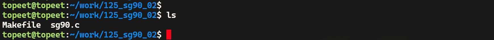
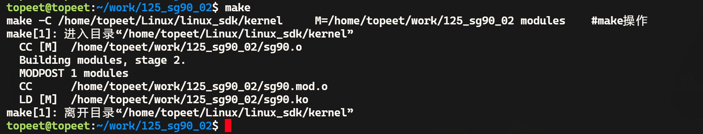
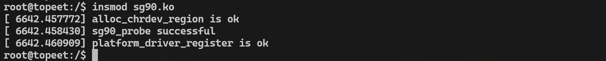
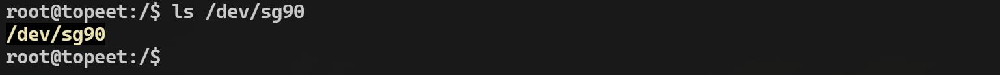
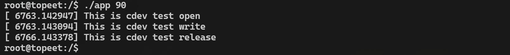
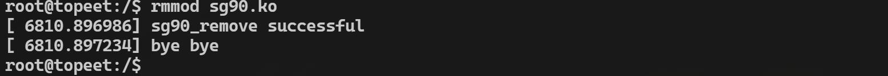

# 第204章 SG90舵机驱动实验

本章节将会讲解pwm 的第二种控制方式：使用pwm 子系统API 对pwm 进行控制。
## 204.1 pwm 子系统API 讲解
在驱动程序中，可以通过pwm API 函数操作pwm，常有API 函数有以下几个。1. pwm_config：用于配置pwm 信号的占空比和周期。int pwm_config(struct pwm_device *pwm, int duty_ns, int period_ns);参数*pwm 是指向pwm 设备结构体的指针。duty_ns 表示占空比，单位是纳秒。period_ns表示周期，单位是纳秒。2. pwm_set_polarity：设置pwm 信号的极性（正极性或负极性）。int pwm_set_polarity(struct pwm_device *pwm, enum pwm_polarity polarity);参数*pwm 是指向pwm 设备结构体的指针。polarity 是极性参数，可以是pwm_POLARITY_NORMAL/INVERSED（正/负极性）。3. pwm_enable：使能pwm 输出。int pwm_enable(struct pwm_device *pwm);参数*pwm 是指向pwm 设备结构体的指针。4. pwm_disable：关闭pwm 输出。void pwm_disable(struct pwm_device *pwm);参数*pwm: 指向pwm 设备结构体的指针。5. devm_of_pwm_get：从设备树中获取pwm 设备结构体。struct pwm_device *devm_of_pwm_get(struct device *dev, struct device_node *np, constchar *con_id);参数*dev 是指向当前设备的结构体的指针，*np 是指向设备树节点的指针，*con_id 通过设备树节点中pwm-names 属性值查找从哪个设备获取pwm，如果只使用了一个pwm 该参数可以设置成NULL。

## 204.2 编写SG90 舵机设备节点
在使用sysfs 控制pwm 的章节中已经编写过pwm12 的设备节点，因此本节使用pwm12 控制SG90 舵机，在rk3568-evb1-ddr4-v10-linux.dts 设备树根节点中添加代码清单204.1 所示内容。
```c
sg90 {代码清单204.1
    compatible = "sg90";
    pwms = <&pwm12 0 20000000 1>;
};
```
其中compatible 用于指定设备的兼容性字符串，内核会根据这个字符串来匹配驱动程序。pwms 属性用来配置pwm 控制器的信息。&pwm12 表示引用pwm12 控制器，0 表示使用pwm12 控制器的第0 通道，20000000 表示pwm 周期，单位为纳秒，即设置周期为20ms，最后的1 为极性，表示正极性，即pwm 信号的高电平为有效。节点添加完成后，重新编译内核源码，得到boot.img 内核镜像烧写到开发板即可，为了方便起见，迅为已经将修改编译完成的内核镜像存放到了网盘iTOP-RK3568 开发板\07_学习教程配套资料\03_Linux 驱动配套资料\04_Linux 驱动程序\125_sg90_02\01_修改完成的设备树内核目录下。
## 204.3 实验程序编写
### 204.3.1 编写驱动程序
本实验代码存放在网盘iTOP-RK3568 开发板\07_学习教程配套资料\03_Linux 驱动配套资料\04_Linux 驱动程序\125_sg90_02\01_module 路径下。本实验编写SG90 舵机驱动程序，SG90 舵机驱动程序通过平台总线与SG90 设备节点进行匹配，匹配成功后在probe()函数中注册字符设备并创建设备节点。在字符设备的文件操作集中的opne()函数中通过pwm 子系统的API 函数初始化pwm，在文件操作集中的write()函数中通过pwm 子系统的API 函数控制pwm 波形从而调整舵机角度。在文件操作集中的release()函数中通过pwm 子系统的API 函数释放pwm。实验代码sg90.c 如代码清单204.2 所示。
```c
#include <linux/module.h>代码清单204.2
#include <linux/init.h>
#include <linux/moduleparam.h>
```

```c
#include <linux/fs.h>
#include <linux/kdev_t.h>
#include <linux/cdev.h>
#include <linux/device.h>
#include <linux/platform_device.h>
#include <linux/of.h>
#include <linux/uaccess.h>
#include <linux/pwm.h>
dev_t dev_num;
struct cdev cdev_test;
struct class *class;
struct device *device;
struct pwm_device *sg90_pwm_device;
//打开设备时的回调函数
static int cdev_test_open(struct inode *inode, struct file *file) {
    printk("This is cdev test open\n");
    pwm_config(sg90_pwm_device, 500000, 20000000); //设置初始脉冲宽度为0.5ms, 周期为20ms
    pwm_set_polarity(sg90_pwm_device, pwm_POLARITY_NORMAL);//设置pwm 极性为正极性
    pwm_enable(sg90_pwm_device);//启动pwm 输出，使舵机归中位
    return 0;
}
//写入设备时的回调函数
static ssize_t cdev_test_write(struct file *file, const char __user *buf, size_t size, loff_t *off) {
    int ret;
    unsigned char data[1];
    printk("This is cdev test write\n");
    //从用户空间拷贝数据到内核空间
    ret = copy_from_user(data, buf, size);
    if (ret) {
        printk("copy_from_user failed\n");
        return -EFAULT;
    //更新pwm 参数:脉冲宽度根据用户输入的数据调整
    }
    // data[0]范围为0-180，转换为脉冲宽度范围0.5ms-2.5ms
    //500000 表示最小脉冲宽度0.5 ms。100000/9 则是把舵机的总可调脉冲增量（从0.5ms 到2.5ms，
2ms= 2000000ns）均分到180°上，每度脉冲宽度增量= 2000000ns/180 = 100000/9。所以500000 +
data[0]*100000/9 就能做到角度到脉冲宽度（0.5ms-2.5 ms）的线性映射
    pwm_config(sg90_pwm_device, 500000 + data[0] * 100000 / 9, 20000000);
    return size;
}
```

```c
//释放设备时的回调函数
static int cdev_test_release(struct inode *inode, struct file *file) {
    printk("This is cdev test release\n");
    pwm_config(sg90_pwm_device, 500000, 20000000);//回到初始的pwm 参数配置
    pwm_disable(sg90_pwm_device);//停止pwm
    return 0;
}
//定义字符设备操作函数集合
static struct file_operations cdev_test_ops = {
    .owner = THIS_MODULE,
    .open = cdev_test_open,
    .write = cdev_test_write,
    .release = cdev_test_release,
};
//设备探测函数
static int sg90_probe(struct platform_device *pdev) {
    int ret;
    //获取pwm 设备
    sg90_pwm_device = devm_pwm_get(&pdev->dev, NULL);
    if (IS_ERR(sg90_pwm_device)) {
        printk("Failed to get pwm device\n");
        return PTR_ERR(sg90_pwm_device);
    }
    //申请设备号
    ret = alloc_chrdev_region(&dev_num, 0, 1, "alloc_name");
    if (ret < 0) {
        printk("alloc_chrdev_region is error\n");
        return ret;
    printk("alloc_chrdev_region is ok\n");
    }
    //初始化字符设备
    cdev_init(&cdev_test, &cdev_test_ops);
    cdev_test.owner = THIS_MODULE;
    ret = cdev_add(&cdev_test, dev_num, 1);//添加字符设备
    class = class_create(THIS_MODULE, "test");//创建设备类
    /*创建节点/dev/sg90，应用层通过向此节点写入角度数据即可控制舵机动作*/
```

```c
device = device_create(class, NULL, dev_num, NULL, "sg90");
printk("sg90_probe successful\n");
return 0;
}
//设备移除函数
static int sg90_remove(struct platform_device *pdev) {
device_destroy(class, dev_num);//删除设备
class_destroy(class);//删除设备类
cdev_del(&cdev_test);//删除字符设备
unregister_chrdev_region(dev_num, 1);//释放设备号
printk("sg90_remove successful\n");
return 0;
}
//设备树匹配表
static const struct of_device_id sg90_of_device_id[] = {
{.compatible = "sg90"},
{},
MODULE_DEVICE_TABLE(of, sg90_of_device_id);
};
//定义平台驱动
static struct platform_driver sg90_platform_driver = {
.driver = {
    .name = "sg90",
    .of_match_table = sg90_of_device_id,
.probe = sg90_probe,
},
.remove = sg90_remove,
};
//模块初始化函数
static int __init modulecdev_init(void) {
int ret;
//注册平台驱动
ret = platform_driver_register(&sg90_platform_driver);
if (ret) {
    printk("platform_driver_register is error\n");
    return ret;
}
```

```c
printk("platform_driver_register is ok\n");
return 0;
}
//模块退出函数
static void __exit modulecdev_exit(void) {
//注销平台驱动
platform_driver_unregister(&sg90_platform_driver);
printk("bye bye\n");
}
//声明模块许可证和作者
module_init(modulecdev_init);
module_exit(modulecdev_exit);
MODULE_LICENSE("GPL");
MODULE_AUTHOR("topeet");
```
### 204.3.2 编写测试APP
本实验测试APP 代码存放在网盘iTOP-RK3568 开发板\07_学习教程配套资料\03_Linux 驱动配套资料\04_Linux 驱动程序\125_sg90_02\03_app 路径下。通过该应用程序可以设置舵机转到的角度。实验代码app.c 如代码清单204.3 所示。
```c
#include <fcntl.h>代码清单204.3
#include <unistd.h>
#include <stdlib.h>
#include <stdio.h>
int main(int argc, char *argv[]) {
    // argc 表示命令行参数的数量，包括程序名本身
    // argv 是一个字符串数组，存储了各个命令行参数
    int fd;//文件描述符，用于标识打开的设备文件
    unsigned char buf[1];//存储要写入设备的单个字节数据
    //如果命令行参数个数小于2，说明缺少要写入的值，打印用法并返回错误
    if (argc < 2) {
        printf("Usage: %s <value>\n", argv[0]);
        return -1;
```

```c
}
//以只写方式打开设备文件"/dev/sg90"
fd = open("/dev/sg90", O_WRONLY);
if (fd < 0) {//打开设备文件失败，输出错误信息并返回错误
    perror("open");
    return -1;
}
//将命令行参数转换为整数，存储在buf[0]中
buf[0] = (unsigned char)atoi(argv[1]);
//将buf 中的1 个字节数据写入打开的设备文件
if (write(fd, buf, 1) != 1) {//写入失败，输出错误信息，关闭文件并返回错误
    perror("write");
    close(fd);
    return -1;
}
//延迟3 秒，模拟设备操作
sleep(3);
//关闭设备文件
close(fd);
return 0;//程序执行成功
}
```
## 204.4 运行测试
### 204.4.1 编译驱动程序
在sg90.c 代码同一目录下创建Makefile 文件，如图204.1 所示。

图204.1Makefile 文件内容如代码清单204.4 所示。代码清单204.4
```c
export ARCH=arm64#设置平台架构
export CROSS_COMPILE=aarch64-linux-gnu-#交叉编译器前缀
obj-m += sg90.o#此处要和你的驱动源文件同名
KDIR :=/home/topeet/Linux/linux_sdk/kernel#这里是你的内核目录
PWD ?= $(shell pwd)
```

```c
all:
    make -C $(KDIR) M=$(PWD) modules#make 操作
clean:
    make -C $(KDIR) M=$(PWD) clean#make clean 操作
```
在存放sg90.c 和Makefile 文件目录下使用make 命令编译驱动程序，编译完成如图204.2所示。

图204.2编译成功后生成sg90.ko 目标文件，如图204.3 所示。

图204.3
### 204.4.2 编译应用程序
使用aarch64-linux-gnu-gcc app.c -o app 命令交叉应用程序，如图204.4 所示。

图204.4
### 204.4.3 运行测试
在进行实验之前，首先要确保开发板烧写的是我们在本章节中编译出来的boot.img。将本章节编译好的sg90.ko 驱动文件和app 可执行文件拷贝到开发板上。使用insmodsg90.ko 命令进行驱动模块的加载，如图204.5 所示。

图204.5驱动加载成功之后会在/dev 目录下生成名为sg90 的设备节点，如图204.6 所示。

图204.6

然后使用./app 90 命令运行可执行程序app，这里的90 代表舵机转动的角度，可以填写0-180 中的任意值，运行结果如图204.7 所示。

图204.7如果实验成功可以观察到舵机旋转了90 度，实验完成使用rmmod sg90.ko 命令卸载驱动程序，如图208.8 所示。

图204.8至此，SG90 舵机驱动实验就完成了。

