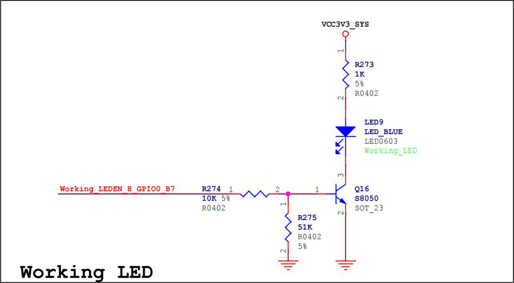
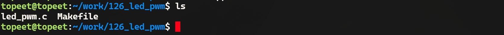
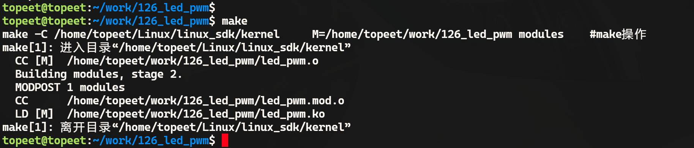
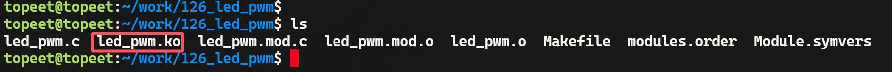
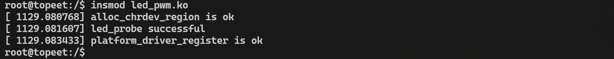
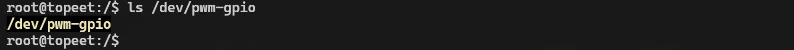
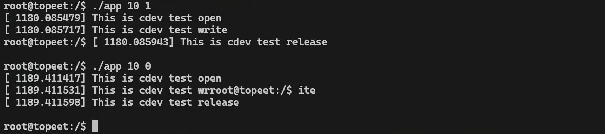
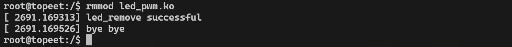
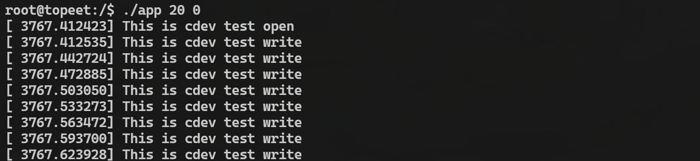

# 第205章 模拟pwm

当硬件pwm 不够用的时候，可以使用GPIO 来模拟实现pwm，也可以称之为软件pwm，软件pwm 利用定时器中断在软件中控制输出引脚的高低电平切换时间，从而生成pwm 波形。本章通过模拟pwm 来实现LED 灯光亮度的调节。
## 205.1 高精度定时器介绍
软件pwm 的实现需要依靠定时器中断来实现，而普通定时器通常在100Hz 到1000Hz 之间，只能提供毫秒级别的精度，对于模拟pwm 来说精度还不够。所以模拟pwm 需要使用高精度定时器。高精度定时器使用struct hrtimer 结构体表示，如代码清单205.1 所示。
```c
struct hrtimer {代码清单205.1
    struct list_headnode;//定时器在时钟基准列表中的节点
    ktime_t_softexpires;//软到期时间，实际到期时间可能稍晚
    enum hrtimer_restart(*function)(struct hrtimer *); //定时器到期时的回调函数
    unsigned longstate;//定时器的状态标志
    struct hrtimer_clock_base*base; //定时器所属的时钟基准
};
```
高精度定时器工作流程如下。（1）初始化定时器使用hrtimer_init() 函数初始化一个struct hrtimer 对象。（2）设置定时器使用hrtimer_start()或者hrtimer_set() 函数设置定时器的到期时间。可以指定绝对时间或相对时间。（3）定时器到期处理当系统时钟发生中断时，会调用hrtimer_interrupt() 函数。hrtimer_interrupt() 会遍历时钟基准的定时器链表，检查是否有到期的定时器。对于已到期的定时器，调用其回调函数（function）处理到期事件。如果定时器尚未到期，则更新下一个到期定时器的唤醒时间。

（4）定时器管理hrtimer_cancel() 函数用于取消一个正在运行的定时器。hrtimer_forward() 函数用于前滚定时器，即根据当前时间重新计算定时器的到期时间。hrtimer_start_range_ns() 函数用于设置定时器的到期时间范围，以提高定时器的精度。
## 205.2.高精度定时器API 讲解
1.hrtimer_init() 函数用于初始化一个高精度定时器（struct hrtimer）。函数原型:void hrtimer_init(struct hrtimer *timer, clockid_t clockid, enum hrtimer_mode mode);函数参数:（1）struct hrtimer *timer: 这是指向hrtimer 结构体的指针。hrtimer 结构体包含了定时器的状态、回调函数以及其他相关数据。（2）clockid_t clock_id: 指定定时器使用的时钟。常见的值包括：·CLOCK_MONOTONIC: 系统级的单调时钟，从某个未指定的时间点开始，不能被设置。·CLOCK_REALTIME: 系统级的实时时钟。·CLOCK_BOOTTIME: 类似于CLOCK_MONOTONIC，但包括挂起时间。·CLOCK_TAI: 国际原子时。（3）enum hrtimer_mode mode: 指定定时器的模式。模式包括：·HRTIMER_MODE_ABS: 绝对模式，定时器将在绝对时间触发。·HRTIMER_MODE_REL: 相对模式，定时器将在相对时间后触发。·HRTIMER_MODE_PINNED: 定时器绑定到特定的CPU。·HRTIMER_MODE_SOFT: 使用软中断上下文。2.hrtimer_set()函数在高分辨率定时器中用于设置定时器的到期时间。函数原型：void hrtimer_set(struct hrtimer *timer, ktime_t time, const enum hrtimer_mode mode);参数说明:（1）struct hrtimer *timer：指向要设置的hrtimer 结构体的指针。（2）ktime_t time：定时器到期时间，可以是绝对时间或相对时间。（3）enum hrtimer_mode mode：定时器模式，指定是相对模式(HRTIMER_MODE_REL) 还

是绝对模式(HRTIMER_MODE_ABS)。3.ktime_set()函数用于设置定时时间。定时时间为秒和纳秒组合。函数原型：ktime_t ktime_set(const long secs, const unsigned long nsecs)；参数说明:（1）const long secs：秒数。（2）const unsigned long nsecs：纳秒数。使用示例：定时1ms 如代码清单205.2 所示。
```c
struct hrtimer my_timer;代码清单205.2
ktime_t ktime = ktime_set(0, 1000000); //设置定时时间为1 毫秒
hrtimer_set(&my_timer, ktime, HRTIMER_MODE_REL); //设置定时器为相对模式
```
hrtimer_start()函数用于启动高分辨率定时器，会将定时器添加到内核的定时器队列中。函数原型:int hrtimer_start(struct hrtimer *timer, ktime_t time, const enum hrtimer_mode mode);参数说明:（1）struct hrtimer *timer：指向要启动的hrtimer 结构体的指针。（2）ktime_t time：定时器到期时间，可以是绝对时间或相对时间。（3）enum hrtimer_mode mode：定时器模式，指定是相对模式还是绝对模式。返回值:成功返回0，失败返回负数。使用示例:定时1ms 并启动定时器如代码清单205.3 所示。
```c
struct hrtimer my_timer;代码清单205.3
ktime_t ktime = ktime_set(0, 1000000); //设置时间为1 毫秒
hrtimer_start(&my_timer, ktime, HRTIMER_MODE_REL); //启动定时器
```
4.hrtimer_forward()函数用于将定时器的到期时间向前推进一个指定的时间间隔。该函数通常在定时器回调函数中使用，以实现周期性定时器。函数原型:

ktime_t hrtimer_forward(struct hrtimer *timer, ktime_t now, ktime_t interval);参数说明:struct hrtimer *timer：指向要推进的hrtimer 结构体的指针。ktime_t now：当前时间。ktime_t interval：推进的时间间隔。返回值:返回定时器新的到期时间。使用示例:定时时间到达以后再次定时1ms 如代码清单205.4 所示。
```c
enum hrtimer_restart my_timer_callback(struct hrtimer *timer)代码清单205.4
    ktime_t now = hrtimer_cb_get_time(timer);
{
    ktime_t interval = ktime_set(0, 1000000); // 1 毫秒
    hrtimer_forward(timer, now, interval); //推进定时器
    return HRTIMER_RESTART;
}
```
hrtimer_cancel()函数用于取消已经启动的高分辨率定时器。如果定时器正在等待超时，则将其从队列中移除。函数原型:int hrtimer_start(struct hrtimer *timer, ktime_t time, const enum hrtimer_mode mode);参数说明:struct hrtimer *timer：指向要取消的hrtimer 结构体的指针。返回值:如果定时器正在活动中，返回1。如果定时器已经停止，返回0。
## 205.3 编写LED 设备节点


图205.1在内核源码中该引脚被LED 子系统使用用于控制LED 灯。由于本章将通过模拟pwm 方式控制该LED，因此需要对设备树中的默认配置进行调整，在内核源码目录下使用vim kernel/arch/arm64/boot/dts/rockchip/rk3568-evb.dtsi 命令打开设备树，找到根节点下的leds 节点并注释，注释完成如图205.2 所示。

图205.2然后在原有leds 节点下方位置，添加代码清单205.5 所示设备树内容。
```c
leds {代码清单205.5
    compatible = "pwm-leds";
    led-gpios = <&gpio0 RK_PB7 GPIO_ACTIVE_HIGH>;
};
```
修改完成后，重新编译内核源码，得到boot.img 内核镜像，烧写到开发板即可，为了方便起见，迅为已经将修改编译完成的内核镜像存放到了网盘iTOP-RK3568 开发板\07_学习教程配

套资料\03_Linux 驱动配套资料\04_Linux 驱动程序\126_led_pwm\01_编译完成的内核镜像目录下。
## 205.4 实验程序编写
### 205.4.1 编写驱动程序
本实验代码存放在网盘iTOP-RK3568 开发板\07_学习教程配套资料\03_Linux 驱动配套资料\04_Linux 驱动程序\126_led_pwm\02_module 路径下。本节使用高精度定时器API 函数通过控制GPIO 的高低电平实现模拟pwm 功能，从而实现控制LED 灯的亮度。实验代码led_pwm.c 如代码清单205.6 所示。
```c
#include <linux/module.h>代码清单205.6
#include <linux/init.h>
#include <linux/moduleparam.h>
#include <linux/fs.h>
#include <linux/kdev_t.h>
#include <linux/cdev.h>
#include <linux/device.h>
#include <linux/platform_device.h>
#include <linux/of.h>
#include <linux/uaccess.h>
#include <linux/pwm.h>
#include <linux/gpio/consumer.h>
#include <linux/hrtimer.h>
#include <linux/slab.h>
dev_t dev_num;
struct cdev cdev_test;
struct class *class;
struct device *device;
//定义pwm LED 数据结构体
struct pwm_led_data {
    int sum_count;// pwm 周期总脉冲数
    int high_count;// pwm 高电平持续脉冲数
    struct gpio_desc *gpiod;// GPIO 描述符
    struct hrtimer pwm_timer;//高分辨率定时器
    ktime_t time;//定时器时间间隔
```

```c
};
//声明pwm LED 数据结构体指针
struct pwm_led_data *data;
// pwm 定时器回调函数
enum hrtimer_restart pwm_timer_func(struct hrtimer *timer) {
    static int timer_count = 0;//定时器计数器
    struct pwm_led_data *mydata = container_of(timer, struct pwm_led_data, pwm_timer);
    //如果计数器达到总脉冲数，将GPIO 设为高电平
    if (timer_count == mydata->sum_count) {
        gpiod_set_value(mydata->gpiod, 1);
        timer_count = 0;
    //如果计数器达到高电平持续脉冲数，将GPIO 设为低电平
    }
    if (timer_count == mydata->high_count) {
        gpiod_set_value(mydata->gpiod, 0);
    timer_count++;
    }
    //如果高电平持续脉冲数为0，则计数器重置为0
    if (mydata->high_count == 0) {
        timer_count = 0;
    }
    //将定时器向前移动time 时间间隔，并重新启动
    hrtimer_forward(timer, hrtimer_cb_get_time(timer), mydata->time);
    return HRTIMER_RESTART;
}
//字符设备打开回调函数
static int cdev_test_open(struct inode *inode, struct file *file) {
    printk("This is cdev test open\n");
    return 0;
}
//字符设备写入回调函数
static ssize_t cdev_test_write(struct file *file, const char __user *buf, size_t size, loff_t *off) {
    int ret;
    int kbuf[2];
    printk("This is cdev test write\n");
    //从用户空间拷贝数据到内核空间
    ret = copy_from_user(kbuf, buf, size);
    if (ret != 0) {
```

```c
printk("copy_from_user failed\n");
return -EFAULT;
//更新pwm LED 数据结构体
}
data->sum_count = kbuf[0];
data->high_count = kbuf[1];
return size;
}
//字符设备释放回调函数
static int cdev_test_release(struct inode *inode, struct file *file) {
printk("This is cdev test release\n");
return 0;
}
//字符设备操作函数集
static struct file_operations cdev_test_ops = {
.owner = THIS_MODULE,
.open = cdev_test_open,
.write = cdev_test_write,
.release = cdev_test_release,
};
//平台设备探测回调函数
static int led_probe(struct platform_device *pdev) {
int ret;
//分配pwm LED 数据结构体内存
data = kmalloc(sizeof(struct pwm_led_data), GFP_KERNEL);
if (!data) {
printk("kmalloc failed\n");
return -ENOMEM;
//初始化pwm LED 数据结构体
}
data->sum_count = 20;
data->high_count = 10;
//动态分配设备号
ret = alloc_chrdev_region(&dev_num, 0, 1, "alloc_name");
if (ret < 0) {
printk("alloc_chrdev_region is error\n");
kfree(data);
return ret;
}
```

```c
printk("alloc_chrdev_region is ok\n");
//初始化字符设备
cdev_init(&cdev_test, &cdev_test_ops);
cdev_test.owner = THIS_MODULE;
ret = cdev_add(&cdev_test, dev_num, 1);//向内核注册字符设备
if (ret) {
    printk("cdev_add is error\n");
    unregister_chrdev_region(dev_num, 1);
    kfree(data);
    return ret;
}
class = class_create(THIS_MODULE, "test");//创建设备类
if (IS_ERR(class)) {
    printk("class_create is error\n");
    cdev_del(&cdev_test);
    unregister_chrdev_region(dev_num, 1);
    kfree(data);
    return PTR_ERR(class);
}
device = device_create(class, NULL, dev_num, NULL, "pwm-gpio");//创建设备节点
if (IS_ERR(device)) {
    printk("device_create is error\n");
    class_destroy(class);
    cdev_del(&cdev_test);
    unregister_chrdev_region(dev_num, 1);
    kfree(data);
    return PTR_ERR(device);
}
data->gpiod = gpiod_get(&pdev->dev, "led", GPIOD_OUT_HIGH);//获取GPIO 描述符
if (IS_ERR(data->gpiod)) {
    printk("gpiod_get is error\n");
    device_destroy(class, dev_num);
    class_destroy(class);
    cdev_del(&cdev_test);
    unregister_chrdev_region(dev_num, 1);
    kfree(data);
    return PTR_ERR(data->gpiod);
gpiod_set_value(data->gpiod, 1);//将GPIO 设为高电平
}
```

```c
//初始化高分辨率定时器
data->time = ktime_set(0, 1000000);// 1 ms
hrtimer_init(&data->pwm_timer, CLOCK_MONOTONIC, HRTIMER_MODE_REL);
data->pwm_timer.function = pwm_timer_func;
hrtimer_start(&data->pwm_timer, data->time, HRTIMER_MODE_REL);//启动高分辨率定时器
printk("led_probe successful\n");
return 0;
}
//平台设备移除回调函数
static int led_remove(struct platform_device *pdev) {
hrtimer_cancel(&data->pwm_timer);//停止高分辨率定时器
gpiod_put(data->gpiod);//释放GPIO 描述符
device_destroy(class, dev_num);//删除设备节点
class_destroy(class);//删除设备类
cdev_del(&cdev_test);//从内核注销字符设备
unregister_chrdev_region(dev_num, 1);//释放设备号
kfree(data);//释放pwm LED 数据结构体内存
printk("led_remove successful\n");
return 0;
}
//设备树匹配表
static const struct of_device_id led_of_device_id[] = {
{.compatible = "pwm-leds"},
{},
MODULE_DEVICE_TABLE(of, led_of_device_id);
};
//平台设备驱动结构体
static struct platform_driver led_platform_driver = {
.driver = {
    .name = "pwm-leds",
    .of_match_table = led_of_device_id,
.probe = led_probe,
},
.remove = led_remove,
};
//模块初始化函数
static int __init modulecdev_init(void) {
int ret;
```

```c
//注册平台设备驱动
ret = platform_driver_register(&led_platform_driver);
if (ret) {
    printk("platform_driver_register is error\n");
    return ret;
printk("platform_driver_register is ok\n");
}
return 0;
}
//模块退出函数
static void __exit modulecdev_exit(void) {
//注销平台设备驱动
platform_driver_unregister(&led_platform_driver);
printk("bye bye\n");
}
//模块初始化和退出函数注册
module_init(modulecdev_init);
module_exit(modulecdev_exit);
//模块许可证、作者和描述信息
MODULE_LICENSE("GPL");
MODULE_AUTHOR("topeet");
```
### 205.4.2 编写测试APP
本实验测试APP 代码存放在网盘iTOP-RK3568 开发板\07_学习教程配套资料\03_Linux 驱动配套资料\04_Linux 驱动程序\126_led_pwm\03_app 路径下。通过该应用程序可以设置模拟pwm 的周期和占空比，实验代码app.c 如代码清单205.7 所示。
```c
#include <stdio.h>代码清单205.7
#include <sys/types.h>
#include <sys/stat.h>
#include <fcntl.h>
#include <unistd.h>
#include <stdlib.h>
```

```c
int main(int argc, char *argv[]) {
    int fd; //文件描述符
    int buf[2]; //缓冲区，存放两个整数值
    //检查命令行参数个数是否正确
    if (argc != 3) {
        fprintf(stderr, "Usage: %s <sum_count> <high_count>\n", argv[0]);
        return -1;
    }
    //打开pwm GPIO 设备文件
    fd = open("/dev/pwm-gpio", O_WRONLY);
    if (fd < 0) {
        perror("open error");
        return -1;
    }
    //将命令行参数转换为整数，存入缓冲区
    buf[0] = atoi(argv[1]);
    buf[1] = atoi(argv[2]);
    //将缓冲区的数据写入pwm GPIO 设备
    if (write(fd, buf, sizeof(buf)) != sizeof(buf)) {
        perror("write error");
        close(fd);
        return -1;
    }
    //关闭设备文件
    close(fd);
    return 0;
}
```
## 205.5 运行测试
### 205.5.1 编译驱动程序
在led_pwm.c 代码同一目录下创建Makefile 文件，如图205.3 所示。

图205.3

Makefile 文件内容如代码清单205.8 所示。代码清单205.8
```c
export ARCH=arm64#设置平台架构
export CROSS_COMPILE=aarch64-linux-gnu-#交叉编译器前缀
obj-m += led_pwm.o#此处要和你的驱动源文件同名
KDIR :=/home/topeet/Linux/linux_sdk/kernel#这里是你的内核目录
PWD ?= $(shell pwd)
all:
    make -C $(KDIR) M=$(PWD) modules#make 操作
clean:
    make -C $(KDIR) M=$(PWD) clean#make clean 操作
```
在存放led_pwm.c和Makefile文件目录下使用make命令编译驱动程序，编译完成如图205.4所示。

图205.4编译成功后生成led_pwm.ko 目标文件，如图205.5 所示。

图205.5
### 205.5.2 编译应用程序
使用aarch64-linux-gnu-gcc app.c -o app 命令交叉应用程序，如图205.6 所示。

图205.6
### 205.5.3 运行测试
在进行实验之前，首先要确保开发板烧写的是我们在本章节中编译出来的boot.img。将本章节编译好的led_pwm.ko 驱动文件和app 可执行文件拷贝到开发板上。使用insmodled_pwm.ko 命令进行驱动模块的加载，如图205.7 所示。


图205.7驱动加载成功之后会在/dev 目录下生成名为pwm-gpio 的设备节点，如图205.8 所示。

图205.8然后分别使用./app 10 1 和./app 10 0 命令对模拟pwm 进行测试，其中第一个数字10 表示周期，第二个数字表示占空比，运行结果如图205.9 所示。

图205.9如果模拟pwm 驱动编写成功可以观察到第一个命令输入之后，LED 灯的亮度会发生变化，输入第二个命令之后LED 灯会熄灭。实验完成使用rmmod led_pwm.ko 命令进行驱动模块的卸载，如图205.10 所示。

图205.10
## 205.6 呼吸灯实验
本实验测试APP 代码存放在网盘iTOP-RK3568 开发板\07_学习教程配套资料\03_Linux 驱动配套资料\04_Linux 驱动程序\126_led_pwm\04_呼吸灯路径下。上节验证了通过模拟pwm 设置pwm 的周期和占空比可以控制LED 灯亮暗。因此本节中将在此基础上实现LED 呼吸灯效果。呼吸灯指的是LED 灯的亮度会像呼吸一样从亮到暗缓慢变化，或者从暗到亮缓慢变化。注：呼吸灯既可使用软件pwm 实现，也可使用硬件pwm 实现，这里只是为了加深大家对软件pwm 的理解，并非硬件pwm 无法实现。实现呼吸灯无需修改驱动，只需在测试程序中添加占空比循环变化逻辑。修改后的应用程

序如代码清单205.9 所示。
```c
#include <stdio.h>代码清单205.9
#include <stdlib.h>
#include <unistd.h>
#include <fcntl.h>
int main(int argc, char *argv[]) {
    int fd;
    int buf[2];
    int i;
    //检查参数个数
    if (argc != 3) {
        printf("Usage: %s <duty_cycle> <period>\n", argv[0]);
        return -1;
    }
    //打开/dev/pwm-gpio 设备
    fd = open("/dev/pwm-gpio", O_WRONLY);
    if (fd < 0) {
        printf("Error opening /dev/pwm-gpio\n");
        return -1;
    }
    //设置pwm 参数
    buf[0] = atoi(argv[1]);//占空比
    buf[1] = atoi(argv[2]);//周期
    //进入循环
    while (1) {
        //递增占空比
        for (i = 0; i <= buf[0]; i++) {
            buf[1] = i;
            write(fd, buf, sizeof(buf));
            usleep(30000);//延迟30 毫秒
        }
        //递减占空比
        for (i = buf[0]; i > 0; i--) {
            buf[1] = i;
            write(fd, buf, sizeof(buf));
            usleep(30000);//延迟30 毫秒
```

```c
}
}
//关闭设备
close(fd);
return 0;
}
```
然后将编译完成的可执行程序拷贝到开发板上，重新加载led_pwm.ko 驱动并使用./app 200 运行刚刚编译的app 程序，如图205.11 所示。

图205.11这里设置的周期为20ms，高电平时间设置为0，然后程序每隔30ms 修改一次PMW 波形中高电平时间的，高电平时间先从0 增长到20ms，然后再依次降低到0，从而实现呼吸灯效果。

