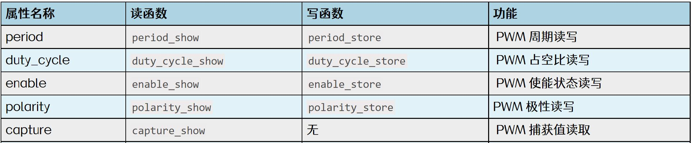

# 第206章 sysyfs操作pwm原理讲解

本章讲解sysyfs 操作pwm 的原理。
## 206.1 pwm 的sysyfs 接口分析
在内核源码drivers/pwm/core.c 文件中的pwmchip_add()函数负责将pwm 控制器添加到pwm 子系统中，pwmchip_add()函数内容如代码清单206.1 所示。
```c
int pwmchip_add(struct pwm_chip *chip)代码清单206.1
    return pwmchip_add_with_polarity(chip, pwm_POLARITY_NORMAL);
{
}
int pwmchip_add_with_polarity(struct pwm_chip *chip,
                               enum pwm_polarity polarity)
    struct pwm_device *pwm;
{
    unsigned int i;
    int ret;
    //检查chip 结构体的有效性
    if (!chip || !chip->dev || !chip->ops || !chip->npwm)
        return -EINVAL;
    //检查pwm_ops 结构体的有效性
    if (!pwm_ops_check(chip->ops))
        return -EINVAL;
    //获取全局pwm_lock 互斥锁
    mutex_lock(&pwm_lock);
    //为chip 分配pwm 设备索引号
    ret = alloc_pwms(chip->base, chip->npwm);
    if (ret < 0)
        goto out;
```

```c
//动态分配chip->npwm 个pwm_device 结构体
chip->pwms = kcalloc(chip->npwm, sizeof(*pwm), GFP_KERNEL);
if (!chip->pwms) {
    ret = -ENOMEM;
    goto out;
}
//保存分配的pwm 设备索引号
chip->base = ret;
//初始化每个pwm 设备
for (i = 0; i < chip->npwm; i++) {
    pwm = &chip->pwms[i];
    pwm->chip = chip;
    pwm->pwm = chip->base + i;
    pwm->hwpwm = i;
    pwm->state.polarity = polarity;
    pwm->state.output_type = pwm_OUTPUT_FIXED;
    //如果chip->ops->get_state 存在，则获取当前pwm 设备的状态
    if (chip->ops->get_state)
        chip->ops->get_state(chip, pwm, &pwm->state);
    //将pwm 设备添加到全局pwm 设备树中
    radix_tree_insert(&pwm_tree, pwm->pwm, pwm);
}
//标记分配的pwm 设备为已使用
bitmap_set(allocated_pwms, chip->base, chip->npwm);
//将pwm 控制器添加到全局pwm 控制器链表
INIT_LIST_HEAD(&chip->list);
list_add(&chip->list, &pwm_chips);
ret = 0;
//如果内核开启了Device Tree 支持，则注册pwm 控制器到Device Tree
if (IS_ENABLED(CONFIG_OF))
    of_pwmchip_add(chip);
out:
//释放全局pwm_lock 互斥锁
mutex_unlock(&pwm_lock);
```

```c
//如果添加成功，则在sysfs 中导出pwm 控制器
if (!ret)
    pwmchip_sysfs_export(chip);
return ret;
}
```
在代码清单206.1 的第76 行调用了pwmchip_sysfs_export()函数，该函数负责在sysfs 中导出pwm 控制器，该函数定义在drivers/pwm/sysfs.c 文件中，具体内容如代码清单206.2 所示。
```c
void pwmchip_sysfs_export(struct pwm_chip *chip)代码清单206.2
    struct device *parent;
{
    /*
     * 如果device_create() 失败,pwm_chip 仍然可以被内核使用,只是没有被导出到sysfs。
     */
    parent = device_create(&pwm_class, chip->dev, MKDEV(0, 0), chip,
                    "pwmchip%d", chip->base);
    if (IS_ERR(parent)) {
        dev_warn(chip->dev,
             "device_create failed for pwm_chip sysfs export\n");
    }
}
```
代码清单206.2 第8 行的device_create() 函数用于创建sysfs 文件系统中的设备节点，在这里创建名为pwmchip%d 的设备节点，也就是在/sys/class/pwm 文件夹下的目录，如图206.1 所示。

图206.1device_create() 函数的第一个参数为pwm_class，它在驱动初始化时通过class_register()注册，如代码清单206.3 所示。
```c
static int __init pwm_sysfs_init(void)代码清单206.3
    return class_register(&pwm_class);
{
}
```
其中pwm_class 是一个内核中struct class 类型的实例，用于定义pwm 设备在sysfs 中的类

结构，pwm_class 类具体定义如代码清单206.4 所示。
```c
static struct class pwm_class = {代码清单206.4
    .name = "pwm",//pwm 设备类的名称为"pwm"
    .owner = THIS_MODULE, //指定此类由当前内核模块拥有
    .dev_groups = pwm_chip_groups, //指定pwm 设备类包含的属性组
};
```
其中.dev_groups 成员指向一个属性组数组pwm_chip_groups，该数组定义了挂载在/sys/class/pwm/路径下的属性节点，具体内容如代码清单206.5 所示。
```c
static struct attribute *pwm_chip_attrs[] = {代码清单206.5
    &dev_attr_export.attr,//export 属性，用于导出一个新的pwm 通道
    &dev_attr_unexport.attr,//unexport 属性，用于取消导出一个pwm 通道
    &dev_attr_npwm.attr,//npwm 属性，用于获取pwm 芯片所支持的pwm 通道数量
    NULL, //数组结束标志
};
```
这些属性会在sysfs 中自动创建对应的文件节点，用户空间可通过读取/写入这些节点与pwm 控制器进行交互。内核会根据属性名匹配相应的show()/store()方法，实现对应的功能逻辑。下面是具体的说明:dev_attr_export.attr 属性对应的读写函数是export_store()，export_store()用于处理用户通过sysfs 接口导出pwm 通道的请求，export_store()函数内容如代码清单206.6 所示。
```c
static ssize_t export_store(struct device *parent,代码清单206.6
                            struct device_attribute *attr,
                            const char *buf, size_t len)
    //从父设备获取pwm 芯片对象
{
    struct pwm_chip *chip = dev_get_drvdata(parent);
    struct pwm_device *pwm;
    unsigned int hwpwm; //要导出的pwm 通道号
    int ret;
    //将用户输入的pwm 通道号转换为整数
    ret = kstrtouint(buf, 0, &hwpwm);
    if (ret < 0)
        return ret;
    //检查要导出的pwm 通道号是否超出pwm 芯片的支持范围
```

```c
if (hwpwm >= chip->npwm)
    return -ENODEV;
//请求使用指定的pwm 通道
pwm = pwm_request_from_chip(chip, hwpwm, "sysfs");
if (IS_ERR(pwm))
    return PTR_ERR(pwm);
//将pwm 通道导出到sysfs 文件系统
ret = pwm_export_child(parent, pwm);
if (ret < 0)
    pwm_put(pwm); //如果导出失败，释放pwm 通道
//返回写入的字节数，或者负错误码
return ret ? : len;
}
```
其中pwm_export_child()函数同样定义在drivers/pwm/sysfs.c 文件中，具体内容如代码清单206.7 所示。
```c
static int pwm_export_child(struct device *parent, struct pwm_device *pwm)代码清单206.7
    struct pwm_export *export;
{
    int ret;
    //检查pwm 设备是否已经被导出
    if (test_and_set_bit(pwmF_EXPORTED, &pwm->flags))
        return -EBUSY;
    //分配pwm_export 结构体
    export = kzalloc(sizeof(*export), GFP_KERNEL);
    if (!export) {
        clear_bit(pwmF_EXPORTED, &pwm->flags);
        return -ENOMEM;
    }
    //初始化pwm_export 结构体
    export->pwm = pwm;
    mutex_init(&export->lock);
    export->child.release = pwm_export_release;
    export->child.parent = parent;
```

```c
export->child.devt = MKDEV(0, 0);
export->child.groups = pwm_groups;
dev_set_name(&export->child, "pwm%u", pwm->hwpwm);
//注册sysfs 设备节点
ret = device_register(&export->child);
if (ret) {
    clear_bit(pwmF_EXPORTED, &pwm->flags);
    put_device(&export->child);
    export = NULL;
    return ret;
}
return 0;
}
```
其中pwm 属性组结构体定义如代码清单206.8 所示。代码清单206.8
```c
static struct attribute *pwm_attrs[] = {
    &dev_attr_period.attr,//周期属性
    &dev_attr_duty_cycle.attr,//占空比属性
#ifdef CONFIG_pwm_ROCKCHIP_ONESHOT
    &dev_attr_oneshot_count.attr,//单次脉冲计数属性
#endif
    &dev_attr_enable.attr,//使能属性
    &dev_attr_polarity.attr,//极性属性
    &dev_attr_capture.attr,//捕获属性
    NULL//属性列表结束标志
};
```
在该数组中包含了pwm 设备在sysfs 文件系统中可以导出的各种属性，这些属性会在pwm 设备的sysfs 子目录中创建对应的文件，如图206.2 所示。用户可以通过读写这些文件来控制和监控pwm 通道的行为。

图206.2这些属性也有着各自对应的读写函数，具体对应关系如图206.3 所示。


图206.3如果在源码中深究图206.3 中的函数会发现，通过sysfs 操作pwm 也是调用了pwm 子系统的API 操作函数来完成对pwm 的设置，如图206.3 中读函数都会调用pwm_get_state()这个API 函数获取pwm 属性，写函数都会调用pwm_apply_state()这个API 函数来设置pwm 属性。。

