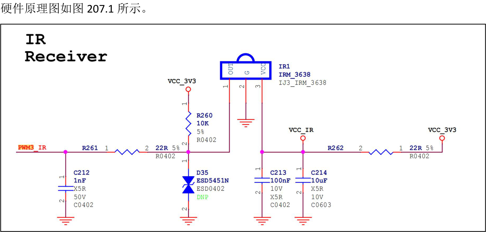
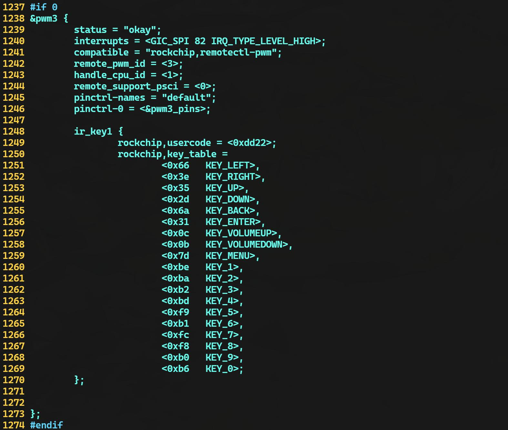
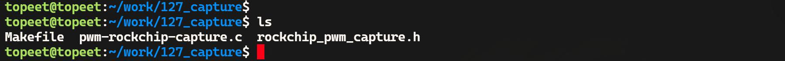
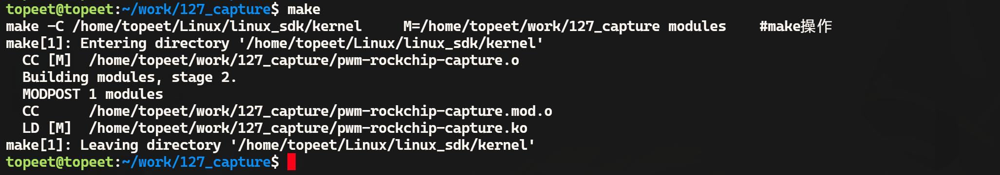
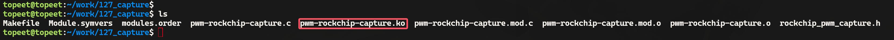
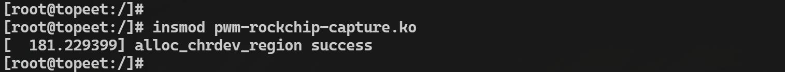
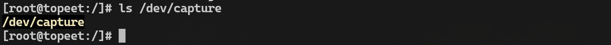
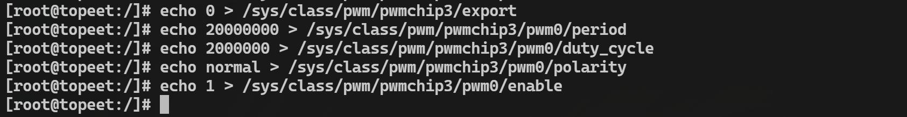
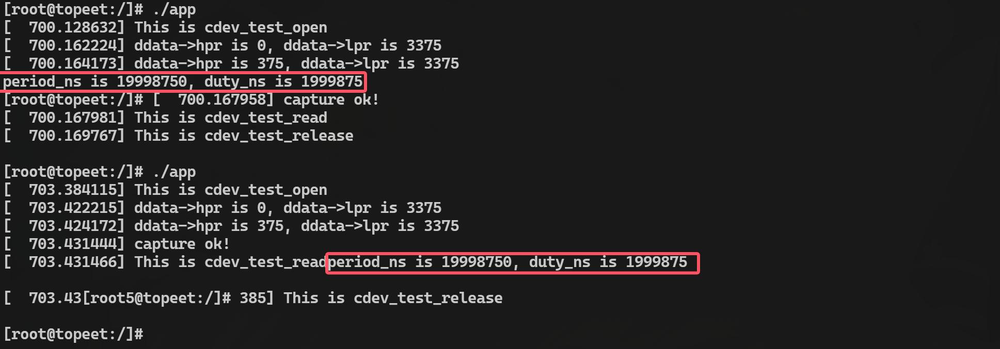

# 第207章 pwm输入捕获驱动实验

瑞芯微的SDK 中没有实现pwm 输入捕获功能，如果想在RK3568 处理器上实现pwm 的输入捕获，就需要自己来实现pwm 输入捕获的驱动，本章将学习如何编写pwm 输入捕获的驱动程序。
## 207.1 配置设备树
RK3568 处理器pwm 接口只有pwm3、pwm7、pwm11 和pwm15 这4 路pwm 通道可以进行输入捕获，在本章节将使用pwm3 进行输入捕获演示，默认情况下pwm3 被用作红外接收功能，

图207.1所以需要将设备树中红外的节点注释掉，在内核源码目录下使用vim kernel/arch/arm64/boot/dts/rockchip/rk3568-evb.dtsi 命令打开rk3568-evb.dtsi 设备树，找到并注释掉原有的pwm3节点配置，即红外节点，注释完成如图207.2 所示。


图207.2然后在下面添加pwm3 输入捕获的节点，如代码清单207.1 所示。
```c
&pwm3 {代码清单207.1
    status = "okay";
    compatible = "pwm-capture";
    pinctrl-names = "default";
    pwm-channel = <3>;
};
```
至此，关于输入捕获相关的设备树节点就修改添加完成了，修改完成之后，重新编译内核得到boot.img，烧写到开发板即可。为了方便起见，迅为已经将编译完成的内核镜像放到了网盘iTOP-RK3568 开发板\07_学习教程配套资料\03_Linux 驱动配套资料\04_Linux 驱动程序\127_capture\01_修改好的内核镜像

目录下。
## 207.2 寄存器头文件说明
由于输入捕获驱动的编写涉及到大量寄存器的操作，为了方便使用和讲解，迅为将pwm输入捕获要用到的寄存器和初始化函数整合到了头文件当中，头文件存放在网盘iTOP-RK3568开发板\07_学习教程配套资料\03_Linux 驱动配套资料\04_Linux 驱动程序\127_capture\02_输入捕获头文件路径下。在后续的函数分析中会用到该头文件中的内容。
## 207.3 实验程序编写
### 207.3.1 编写驱动程序
本实验代码存放在网盘iTOP-RK3568开发板\07_学习教程配套资料\03_Linux驱动配套资料\04_Linux 驱动程序\127_capture\03_module 路径下。实验代码如代码清单207.2 所示。
```c
#include <linux/module.h>代码清单207.2
#include <linux/init.h>
#include <linux/moduleparam.h>
#include <linux/fs.h>
#include <linux/kdev_t.h>
#include <linux/cdev.h>
#include <linux/device.h>
#include <linux/platform_device.h>
#include <linux/of.h>
#include <linux/pwm.h>
#include <linux/uaccess.h>
#include <linux/clk.h>
#include <linux/irq.h>
#include <linux/interrupt.h>
#include <linux/delay.h>
#include "rockchip_pwm_capture.h"
//打开字符设备的回调函数
static int cdev_test_open(struct inode *inode, struct file *file) {
    struct rkxx_capture_drvdata *ddata;
```

```c
struct pwm_capture_cdev *pcdev;
printk("This is cdev_test_open\n");
//从inode 中获取设备数据
pcdev = container_of(inode->i_cdev, struct pwm_capture_cdev, cdev_test);
ddata = container_of(pcdev, struct rkxx_capture_drvdata, pwm_cdev);
if (!ddata) {
    printk(KERN_ERR "Failed to get device data\n");
    return -ENODEV;
}
//将设备数据保存到文件私有数据中
file->private_data = ddata;
return 0;
}
//读取字符设备的回调函数
static ssize_t cdev_test_read(struct file *file, char __user *buf, size_t size, loff_t *off) {
struct rkxx_capture_drvdata *ddata;
int val, i, ret;
ddata = file->private_data;
if (!ddata) {
    printk(KERN_ERR "Device data is NULL\n");
    return -EINVAL;
}
//初始化捕获数据
ddata->lpr = 0;
ddata->hpr = 0;
ddata->state = RMC_IDLE1;
//启用pwm
val = readl_relaxed(ddata->base + pwm_REG_CTRL);
val = (val & 0xFFFFFFFE) | pwm_ENABLE;
writel_relaxed(val, ddata->base + pwm_REG_CTRL);
//等待数据捕获完成
for (i = 0; i < 100; i++) {
    msleep(1);
```

```c
if (ddata->state == RMC_DONE && ddata->hpr && ddata->lpr) {
    printk("capture ok!\n");
    break;
}
}
//禁用pwm
val = readl_relaxed(ddata->base + pwm_REG_CTRL);
val = (val & 0xFFFFFFFE) | pwm_DISABLE;
writel_relaxed(val, ddata->base + pwm_REG_CTRL);
if (ddata->hpr == 0 || ddata->lpr == 0) {
printk(KERN_ERR "Failed to capture pwm data\n");
    return -EIO;
}
//计算周期和占空比
ddata->data.period_ns = (ddata->lpr + ddata->hpr) * ddata->pwm_freq_nstime;
ddata->data.duty_ns = ddata->hpr * ddata->pwm_freq_nstime;
//将数据拷贝到用户空间
ret = copy_to_user(buf, &ddata->data, size);
if (ret) {
printk(KERN_ERR "Failed to copy data to user space\n");
return -EFAULT;
}
printk("This is cdev_test_read\n");
ddata->state = RMC_IDLE;
return size;
}
//释放字符设备的回调函数
static int cdev_test_release(struct inode *inode, struct file *file) {
printk("This is cdev_test_release\n");
return 0;
}
//字符设备操作函数结构体
static struct file_operations cdev_test_ops = {
.owner = THIS_MODULE,
.open = cdev_test_open,
```

```c
.read = cdev_test_read,
.release = cdev_test_release
};
//pwm 捕获中断处理函数
irqreturn_t rk_pwm_capture(int irq, void *dev_id) {
struct rkxx_capture_drvdata *ddata = dev_id;
unsigned int channel = ddata->pwm_channel;
int val, lpr, hpr;
val = readl_relaxed(ddata->base + pwm_REG_INTSTS(channel));
if ((val & pwm_CH_INT(channel)) == 0) {
    return IRQ_NONE;
}
//根据极性读取lpr 或hpr
if ((val & pwm_CH_POL(channel)) == 0) {
    if (ddata->state != RMC_DONE) {
        lpr = readl_relaxed(ddata->base + pwm_REG_LPR);
        ddata->lpr = lpr;
    }
    if (ddata->state != RMC_DONE) {
} else {
        hpr = readl_relaxed(ddata->base + pwm_REG_HPR);
        ddata->hpr = hpr;
    }
}
//清除中断状态
writel_relaxed(pwm_CH_INT(channel), ddata->base + pwm_REG_INTSTS(channel));
//状态机处理
switch (ddata->state) {
case RMC_IDLE1:
    ddata->hpr = 0;
    ddata->lpr = 0;
    ddata->state = RMC_IDLE2;
case RMC_IDLE2:
    break;
    ddata->hpr = 0;
    ddata->lpr = 0;
    ddata->state = RMC_GETDATA;
case RMC_GETDATA:
    break;
```

```c
printk("ddata->hpr is %d, ddata->lpr is %d\n", ddata->hpr, ddata->lpr);
if (ddata->hpr && ddata->lpr) {
    ddata->state = RMC_DONE;
}
break;
default:
break;
}
return IRQ_HANDLED;
}
//驱动探测函数
int capture_probe(struct platform_device *pdev)
int ret;
{
struct rkxx_capture_drvdata *ddata;
struct resource *r;
struct clk *clk;
struct clk *p_clk;
struct device_node *np = pdev->dev.of_node;
int pwm_channel;
int irq;
struct pwm_capture_cdev *pcdev;
int freq;
//分配驱动数据结构
ddata = devm_kzalloc(&pdev->dev, sizeof(struct rkxx_capture_drvdata), GFP_KERNEL);
if (!ddata) {
dev_err(&pdev->dev, "Failed to allocate memory for driver data\n");
return -ENOMEM;
ddata->state = RMC_IDLE;
}
//获取资源
r = platform_get_resource(pdev, IORESOURCE_MEM, 0);
ddata->base = devm_ioremap_resource(&pdev->dev, r);
if (IS_ERR(ddata->base)) {
dev_err(&pdev->dev, "Failed to map memory resource\n");
return PTR_ERR(ddata->base);
ddata->dev = pdev->dev;
}
//获取时钟
```

```c
clk = devm_clk_get(&pdev->dev, "pwm");
if (IS_ERR(clk)) {
    dev_err(&pdev->dev, "Failed to get pwm clock\n");
    return PTR_ERR(clk);
ddata->clk = clk;
}
p_clk = devm_clk_get(&pdev->dev, "pclk");
if (IS_ERR(p_clk)) {
    dev_err(&pdev->dev, "Failed to get peripheral clock\n");
    return PTR_ERR(p_clk);
ddata->p_clk = p_clk;
}
//从设备树中读取pwm 通道
ret = of_property_read_u32(np, "pwm-channel", &pwm_channel);
if (ret) {
    dev_err(&pdev->dev, "Failed to get pwm channel from device tree\n");
    return ret;
pwm_channel %= 4;
}
ddata->pwm_channel = pwm_channel;
//获取中断号
irq = platform_get_irq(pdev, 0);
if (irq < 0) {
    dev_err(&pdev->dev, "Failed to get IRQ\n");
    return irq;
ddata->irq = irq;
}
//设置驱动数据
platform_set_drvdata(pdev, ddata);
//请求中断
ret = devm_request_irq(&pdev->dev, irq, rk_pwm_capture, IRQF_NO_SUSPEND, "rk_pwm_capture_irq",
ddata);
if (ret) {
    dev_err(&pdev->dev, "Failed to request IRQ\n");
    return ret;
}
// 启用时钟
ret = clk_prepare_enable(ddata->clk);
```

```c
if (ret) {
    dev_err(&pdev->dev, "Failed to enable pwm clock\n");
    return ret;
}
ret = clk_prepare_enable(ddata->p_clk);
if (ret) {
    clk_disable_unprepare(ddata->clk);
    dev_err(&pdev->dev, "Failed to enable peripheral clock\n");
    return ret;
}
//计算pwm 频率
freq = clk_get_rate(ddata->clk) / 64;
ddata->pwm_freq_nstime = 1000000000 / freq;
//注册字符设备
pcdev = &ddata->pwm_cdev;
ret = alloc_chrdev_region(&pcdev->dev_num, 0, 1, "alloc_name");
if (ret < 0) {
    dev_err(&pdev->dev, "alloc_chrdev_region error\n");
    goto err_alloc_chrdev;
printk("alloc_chrdev_region success\n");
}
pcdev->cdev_test.owner = THIS_MODULE;
cdev_init(&pcdev->cdev_test, &cdev_test_ops);
ret = cdev_add(&pcdev->cdev_test, pcdev->dev_num, 1);
if (ret) {
    dev_err(&pdev->dev, "Failed to add cdev\n");
    goto err_cdev_add;
}
//创建设备类
pcdev->class = class_create(THIS_MODULE, "test");
if (IS_ERR(pcdev->class)) {
    ret = PTR_ERR(pcdev->class);
    dev_err(&pdev->dev, "Failed to create class\n");
    goto err_class_create;
}
//创建设备
pcdev->device = device_create(pcdev->class, NULL, pcdev->dev_num, NULL, "capture");
if (IS_ERR(pcdev->device)) {
```

```c
ret = PTR_ERR(pcdev->device);
dev_err(&pdev->dev, "Failed to create device\n");
goto err_device_create;
}
rk_pwm_capture_init(ddata->base, ddata->pwm_channel);
return 0;
err_device_create:
class_destroy(pcdev->class);
err_class_create:
cdev_del(&pcdev->cdev_test);
err_cdev_add:
unregister_chrdev_region(pcdev->dev_num, 1);
err_alloc_chrdev:
clk_disable_unprepare(ddata->p_clk);
clk_disable_unprepare(ddata->clk);
return ret;
}
//驱动移除函数
int capture_remove(struct platform_device *pdev)
struct rkxx_capture_drvdata *ddata = platform_get_drvdata(pdev);
{
struct pwm_capture_cdev *pcdev = &ddata->pwm_cdev;
device_destroy(pcdev->class, pcdev->dev_num);
class_destroy(pcdev->class);
cdev_del(&pcdev->cdev_test);
unregister_chrdev_region(pcdev->dev_num, 1);
clk_disable_unprepare(ddata->p_clk);
clk_disable_unprepare(ddata->clk);
return 0;
}
//设备树匹配表
const struct of_device_id capture_of_device_id[] = {
{.compatible = "pwm-capture"},
{}
};
```

```c
//平台驱动结构体
struct platform_driver capture_platform_driver = {
    .driver = {
        .name = "pwm-capture",
        .of_match_table = capture_of_device_id,
    .probe = capture_probe,
    },
    .remove = capture_remove,
};
//模块初始化函数
static int __init modulecdev_init(void)
    return platform_driver_register(&capture_platform_driver);
{
}
//模块退出函数
static void __exit modulecdev_exit(void)
    platform_driver_unregister(&capture_platform_driver);
{
}
module_init(modulecdev_init);
module_exit(modulecdev_exit);
MODULE_LICENSE("GPL");
MODULE_AUTHOR("topeet");
```
### 207.3.2 probe 函数讲解
capture_probe()函数负责对平台设备进行初始化，包括资源分配、时钟获取、读取配置、注册字符设备、创建设备类等步骤，具体内容如代码清单207.3 所示。
```c
int capture_probe(struct platform_device *pdev)代码清单207.3
    int ret;
{
    struct rkxx_capture_drvdata *ddata;
    struct resource *r;
    struct clk *clk;
    struct clk *p_clk;
    struct device_node *np = pdev->dev.of_node;
```

```c
int pwm_channel;
int irq;
struct pwm_capture_cdev *pcdev;
int freq;
//分配驱动数据结构
ddata = devm_kzalloc(&pdev->dev, sizeof(struct rkxx_capture_drvdata), GFP_KERNEL);
if (!ddata) {
    dev_err(&pdev->dev, "Failed to allocate memory for driver data\n");
    return -ENOMEM;
ddata->state = RMC_IDLE;
}
//获取资源
r = platform_get_resource(pdev, IORESOURCE_MEM, 0);
ddata->base = devm_ioremap_resource(&pdev->dev, r);
if (IS_ERR(ddata->base)) {
    dev_err(&pdev->dev, "Failed to map memory resource\n");
    return PTR_ERR(ddata->base);
ddata->dev = pdev->dev;
}
//获取时钟
clk = devm_clk_get(&pdev->dev, "pwm");
if (IS_ERR(clk)) {
    dev_err(&pdev->dev, "Failed to get pwm clock\n");
    return PTR_ERR(clk);
ddata->clk = clk;
}
p_clk = devm_clk_get(&pdev->dev, "pclk");
if (IS_ERR(p_clk)) {
    dev_err(&pdev->dev, "Failed to get peripheral clock\n");
    return PTR_ERR(p_clk);
ddata->p_clk = p_clk;
}
//从设备树中读取pwm 通道
ret = of_property_read_u32(np, "pwm-channel", &pwm_channel);
if (ret) {
    dev_err(&pdev->dev, "Failed to get pwm channel from device tree\n");
    return ret;
pwm_channel %= 4;
}
```

```c
ddata->pwm_channel = pwm_channel;
//获取中断号
irq = platform_get_irq(pdev, 0);
if (irq < 0) {
    dev_err(&pdev->dev, "Failed to get IRQ\n");
    return irq;
ddata->irq = irq;
}
//设置驱动数据
platform_set_drvdata(pdev, ddata);
//请求中断
ret = devm_request_irq(&pdev->dev, irq, rk_pwm_capture, IRQF_NO_SUSPEND,
"rk_pwm_capture_irq", ddata);
if (ret) {
    dev_err(&pdev->dev, "Failed to request IRQ\n");
    return ret;
}
//启用时钟
ret = clk_prepare_enable(ddata->clk);
if (ret) {
    dev_err(&pdev->dev, "Failed to enable pwm clock\n");
    return ret;
}
ret = clk_prepare_enable(ddata->p_clk);
if (ret) {
    clk_disable_unprepare(ddata->clk);
    dev_err(&pdev->dev, "Failed to enable peripheral clock\n");
    return ret;
}
//计算pwm 频率
freq = clk_get_rate(ddata->clk) / 64;
ddata->pwm_freq_nstime = 1000000000 / freq;
//注册字符设备
pcdev = &ddata->pwm_cdev;
ret = alloc_chrdev_region(&pcdev->dev_num, 0, 1, "alloc_name");
if (ret < 0) {
    dev_err(&pdev->dev, "alloc_chrdev_region error\n");
```

```c
goto err_alloc_chrdev;
printk("alloc_chrdev_region success\n");
}
pcdev->cdev_test.owner = THIS_MODULE;
cdev_init(&pcdev->cdev_test, &cdev_test_ops);
ret = cdev_add(&pcdev->cdev_test, pcdev->dev_num, 1);
if (ret) {
dev_err(&pdev->dev, "Failed to add cdev\n");
goto err_cdev_add;
}
//创建设备类
pcdev->class = class_create(THIS_MODULE, "test");
if (IS_ERR(pcdev->class)) {
ret = PTR_ERR(pcdev->class);
dev_err(&pdev->dev, "Failed to create class\n");
goto err_class_create;
}
//创建设备
pcdev->device = device_create(pcdev->class, NULL, pcdev->dev_num, NULL, "capture");
if (IS_ERR(pcdev->device)) {
ret = PTR_ERR(pcdev->device);
dev_err(&pdev->dev, "Failed to create device\n");
goto err_device_create;
}
rk_pwm_capture_init(ddata->base, ddata->pwm_channel);
return 0;
err_device_create:
class_destroy(pcdev->class);
err_class_create:
cdev_del(&pcdev->cdev_test);
err_cdev_add:
unregister_chrdev_region(pcdev->dev_num, 1);
err_alloc_chrdev:
clk_disable_unprepare(ddata->p_clk);
clk_disable_unprepare(ddata->clk);
return ret;
}
```
首先，驱动通过devm_kzalloc()函数分配私有数据结构以保存核心状态信息。随后，利用p

latform_get_resource()函数与devm_ioremap_resource()函数映射设备寄存器地址，获取pwm 与PCLK 时钟并开启使能，同时根据时钟频率计算pwm 的时间参数。驱动还解析设备树中的pwm-channel 属性来配置通道。接着使用platform_get_irq()函数与devm_request_irq()函数完成中断的申请与处理函数绑定。然后通过alloc_chrdev_region()、cdev_add()、class_create()和device_create()等函数将设备以/dev/capture 的形式导出至用户空间。最后调用rk_pwm_capture_init()函数完成控制器初始化，确保pwm 捕获功能可以正常启动与运行。其中rk_pwm_capture_init()函数定义在rockchip_pwm_capture.h 头文件当中，会在下个小节对rk_pwm_capture_init()函数进行讲解。
### 207.3.3 pwm 模式初始化函数解决
rk_pwm_capture_init()函数的主要作用是将pwm 的工作方式设置为输入捕获模式，该函数的具体内容如代码清单207.4 所示。
```c
/* 初始化pwm 捕获*/代码清单207.4
static void rk_pwm_capture_init(void __iomem *pwm_base, uint pwm_id)
    int val;
{
    /* 禁用pwm */
    val = readl_relaxed(pwm_base + pwm_REG_CTRL);
    val = (val & 0xFFFFFFFE) | pwm_DISABLE;
    writel_relaxed(val, pwm_base + pwm_REG_CTRL);
    /* 设置为捕获模式*/
    val = readl_relaxed(pwm_base + pwm_REG_CTRL);
    val = (val & 0xFFFFFFF9) | pwm_MODE_CAPTURE;
    writel_relaxed(val, pwm_base + pwm_REG_CTRL);
    /* 设置分频值*/
    val = readl_relaxed(pwm_base + pwm_REG_CTRL);
    val = (val & 0xFF0001FF) | pwm_DIV64;
    writel_relaxed(val, pwm_base + pwm_REG_CTRL);
    /* 启用中断*/
    rk_pwm_int_ctrl(pwm_base, pwm_id, pwm_INT_ENABLE);
```

```c
/* 这里可以启用pwm 捕获（注释掉的代码）*/
/*
val = readl_relaxed(pwm_base + pwm_REG_CTRL);
val = (val & 0xFFFFFFFE) | pwm_ENABLE;
writel_relaxed(val, pwm_base + pwm_REG_CTRL);
*/
}
```
为确保配置过程的安全性，函数首先清除控制寄存器中的使能位，通过写入pwm_DISABLE以禁用pwm 功能，从而避免在模式切换过程中发生误触发。禁用后，驱动将控制寄存器的模式字段置为pwm_MODE_CAPTURE，从而将pwm 的工作方式切换为输入捕获，使其具备采集上升沿、下降沿等边沿时序的能力。为了适应不同频率的输入信号，函数将pwm 控制器的时钟分频参数设为pwm_DIV64，这决定了捕获时钟的时间精度，是影响最终测量结果精度与范围的关键因素。之后通过调用rk_pwm_int_ctrl()函数传入pwm_INT_ENABLE 参数使能pwm 捕获相关中断，为后续中断驱动的信号处理建立响应机制。
### 207.3.4 pwm 捕获中断处理函数分析
当pwm 设备捕获到外部信号时，它会触发一个中断，并由rk_pwm_capture()函数来处理，在该中断服务函数中读取捕获到的外部信号周期数据，更新设备状态，并执行相应的状态机逻辑，具体代码如代码清单207.5 所示。
```c
// pwm 捕获中断处理函数代码清单207.5
irqreturn_t rk_pwm_capture(int irq, void *dev_id) {
    struct rkxx_capture_drvdata *ddata = dev_id;
    unsigned int channel = ddata->pwm_channel;
    int val, lpr, hpr;
    val = readl_relaxed(ddata->base + pwm_REG_INTSTS(channel));
    if ((val & pwm_CH_INT(channel)) == 0) {
        return IRQ_NONE;
    }
    //根据极性读取lpr 或hpr
    if ((val & pwm_CH_POL(channel)) == 0) {
        if (ddata->state != RMC_DONE) {
            lpr = readl_relaxed(ddata->base + pwm_REG_LPR);
            ddata->lpr = lpr;
```

```c
}
if (ddata->state != RMC_DONE) {
} else {
    hpr = readl_relaxed(ddata->base + pwm_REG_HPR);
    ddata->hpr = hpr;
}
}
//清除中断状态
writel_relaxed(pwm_CH_INT(channel), ddata->base + pwm_REG_INTSTS(channel));
//状态机处理
switch (ddata->state) {
case RMC_IDLE1:
ddata->hpr = 0;
ddata->lpr = 0;
ddata->state = RMC_IDLE2;
case RMC_IDLE2:
break;
ddata->hpr = 0;
ddata->lpr = 0;
ddata->state = RMC_GETDATA;
case RMC_GETDATA:
break;
printk("ddata->hpr is %d, ddata->lpr is %d\n", ddata->hpr, ddata->lpr);
if (ddata->hpr && ddata->lpr) {
    ddata->state = RMC_DONE;
}
break;
default:
break;
}
return IRQ_HANDLED;
}
```
状态机处理逻辑：根据设备当前的状态（ddata->state）执行不同的操作，在RMC_IDLE1和RMC_IDLE2 状态下，函数重置高周期和低周期的值，并更新状态。进入RMC_GETDATA 状态后，等待完整的高低电平数据都被采集，一旦hpr 和lpr 都非零，说明完整的pwm 周期数据已捕获，状态推进到RMC_DONE。

### 207.3.5 读函数分析
cdev_test_read()函数是一个字符设备驱动的读取回调函数，用于在用户空间程序读取设备文件时，从内核空间向用户空间传递数据，在该函数中会启用pwm、等待pwm 数据捕获、计算周期和占空比，并将捕获到的结果拷贝到用户空间，该函数的详细内容如代码清单207.6 所示。
```c
//读取字符设备的回调函数代码清单207.6
static ssize_t cdev_test_read(struct file *file, char __user *buf, size_t size, loff_t *off) {
    struct rkxx_capture_drvdata *ddata;
    int val, i, ret;
    ddata = file->private_data;
    if (!ddata) {
        printk(KERN_ERR "Device data is NULL\n");
        return -EINVAL;
    }
    //初始化捕获数据
    ddata->lpr = 0;
    ddata->hpr = 0;
    ddata->state = RMC_IDLE1;
    //启用pwm
    val = readl_relaxed(ddata->base + pwm_REG_CTRL);
    val = (val & 0xFFFFFFFE) | pwm_ENABLE;
    writel_relaxed(val, ddata->base + pwm_REG_CTRL);
    //等待数据捕获完成
    for (i = 0; i < 100; i++) {
        msleep(1);
        if (ddata->state == RMC_DONE && ddata->hpr && ddata->lpr) {
            printk("capture ok!\n");
            break;
        }
    }
    //禁用pwm
    val = readl_relaxed(ddata->base + pwm_REG_CTRL);
    val = (val & 0xFFFFFFFE) | pwm_DISABLE;
    writel_relaxed(val, ddata->base + pwm_REG_CTRL);
```

```c
if (ddata->hpr == 0 || ddata->lpr == 0) {
    printk(KERN_ERR "Failed to capture pwm data\n");
    return -EIO;
}
//计算周期和占空比
ddata->data.period_ns = (ddata->lpr + ddata->hpr) * ddata->pwm_freq_nstime;
ddata->data.duty_ns = ddata->hpr * ddata->pwm_freq_nstime;
//将数据拷贝到用户空间
ret = copy_to_user(buf, &ddata->data, size);
if (ret) {
    printk(KERN_ERR "Failed to copy data to user space\n");
    return -EFAULT;
}
printk("This is cdev_test_read\n");
ddata->state = RMC_IDLE;
return size;
}
```
### 207.3.6 编写测试APP
本实验测试APP 代码存放在网盘iTOP-RK3568 开发板\07_学习教程配套资料\03_Linux 驱动配套资料\04_Linux 驱动程序\127_capture\04_app 路径下。通过该应用程序可以获取捕获到的pwm 周期和占空比，实验代码如代码清单207.7 所示。
```c
#include <stdio.h>代码清单207.7
#include <sys/types.h>
#include <sys/stat.h>
#include <fcntl.h>
#include <unistd.h>
#include <stdlib.h>
//定义pwm 数据结构体
struct pwm_data {
    int period_ns;//pwm 周期，单位纳秒
```

```c
int duty_ns;//pwm 占空比，单位纳秒
};
int main(int argc, char *argv[]) {
int fd;
struct pwm_data data;
//打开pwm 捕获设备文件
fd = open("/dev/capture", O_RDONLY);
if (fd < 0) {
    printf("打开设备文件失败\n");
    return -1;
}
//读取pwm 捕获数据
if (read(fd, &data, sizeof(data)) != sizeof(data)) {
    printf("读取数据失败\n");
    close(fd);
    return -1;
}
//打印pwm 捕获数据
printf("period_ns is %d, duty_ns is %d\n", data.period_ns, data.duty_ns);
//关闭设备文件
close(fd);
return 0;
}
```
## 207.4 运行测试
### 207.4.1 编译驱动程序
在pwm-rockchip-capture.c 和rockchip_pwm_capture.h 文件的同一目录下创建Makefile 文件，如图207.3 所示。

图207.3Makefile 文件内容如代码清单207.8 所示。代码清单207.8

```c
export ARCH=arm64#设置平台架构
export CROSS_COMPILE=aarch64-linux-gnu-#交叉编译器前缀
obj-m += pwm-rockchip-capture.o#此处要和你的驱动源文件同名
KDIR :=/home/topeet/Linux/linux_sdk/kernel#这里是你的内核目录
PWD ?= $(shell pwd)
all:
    make -C $(KDIR) M=$(PWD) modules#make 操作
clean:
    make -C $(KDIR) M=$(PWD) clean#make clean 操作
```
在存放pwm-rockchip-capture.c 和Makefile 文件目录下使用make 命令编译驱动程序，编译完成如图207.5 所示。

图207.5编译成功后生成pwm-rockchip-capture.ko 目标文件，如图207.6 所示。

图207.6
### 207.4.2 编译应用程序
使用aarch64-linux-gnu-gcc app.c -o app 命令交叉应用程序，如图207.7 所示。

图207.7
### 207.4.3 运行测试
在进行实验之前，首先要确保开发板烧写的是我们在本章节中编译出来的boot.img。然后进行硬件连接，输入捕获用到的是pwm3，即红外接收器所使用的引脚，而除了该引脚之外还需要一个pwm 输出引脚作为参照，这里选择前面测试的pwm12，即开发板背面20pinGPIO 座子的第六脚，将他们使用杜邦线连接到一起。将本章节编译好的pwm-rockchip-capture.ko 驱动文件和app 可执行文件拷贝到开发板上。使用insmod pwm-rockchip-capture.ko 命令进行驱动模块的加载，如图207.8 所示。


图207.8驱动加载成功之后会在/dev 目录下生成名为capture 的设备节点，如图207.9 所示。

图207.9然后使用代码清单207 所示命令通过sysfs 子系统设置pwm12 的周期和占空比以及使能pwm，如图207.9 所示。代码清单207.9
```c
# 导出pwm
echo 0 > /sys/class/pwm/pwmchip3/export
# 设置pwm 周期为20 ms
echo 20000000 > /sys/class/pwm/pwmchip3/pwm0/period
# 设置pwm 高电平持续时间为2 ms
echo 2000000 > /sys/class/pwm/pwmchip3/pwm0/duty_cycle
# 设置pwm 极性为正极性（normal）
echo normal > /sys/class/pwm/pwmchip3/pwm0/polarity
# 启用pwm 输出
echo 1 > /sys/class/pwm/pwmchip3/pwm0/enable
```
设置过程如图207.10 所示。

图207.10接着使用./app 命令运行测试应用程序，运行结果如图207.11 所示。


图207.11由图207.11 打印信息可以得到捕获到的pwm 周期为19998750，高电平时间为1999875，与参考输出pwm12 的周期和占空比相同（有略微误差是正常现象），至此，关于pwm 输入捕获驱动实验就完成了。

