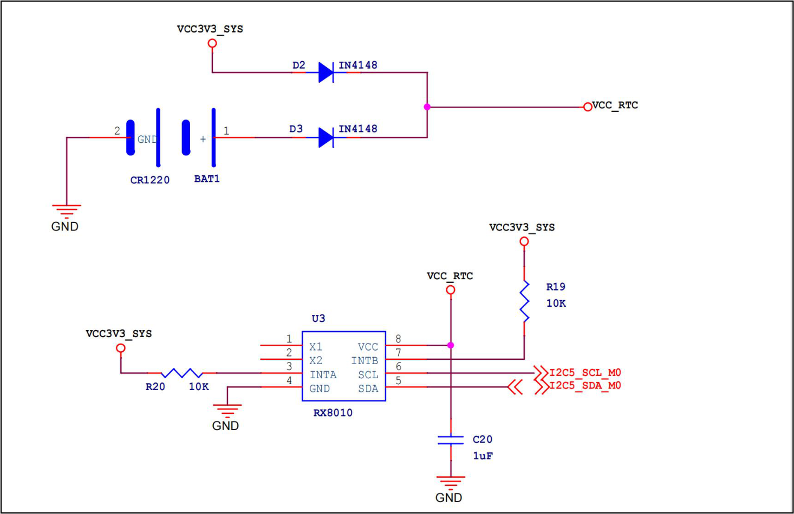
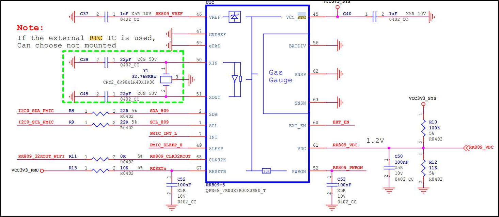
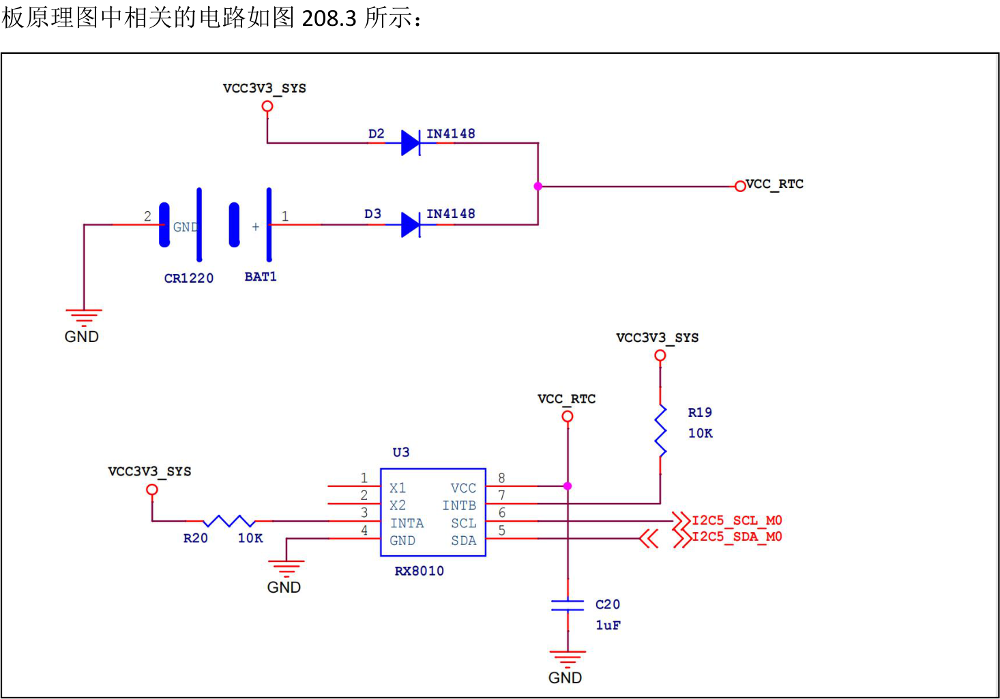
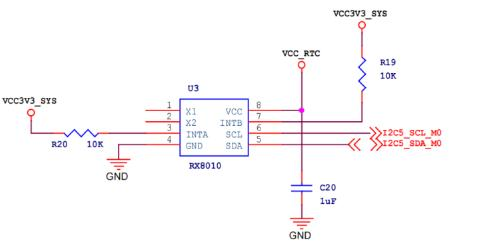

# 第208章 RTC概述

本章将会对RTC 进行介绍，包括其功能特性、应用场景、内部RTC 和外部RTC 的对比，以及对iTOP-RK3568 开发版上的RTC 电路。
## 208.1 RTC 介绍
RTC（Real-Time Clock）即实时时钟，用于在电子系统中提供精确的时间信息，而且在设备关闭或断电的情况下，通过纽扣电池RTC 也能持续运行并保证时间的准确性。RTC 的应用场景：（1）电子时钟：如电脑、手机、智能手表等设备中的时钟功能。（2）嵌入式系统：在工业控制、物联网设备中，RTC 用于记录事件发生的时间。（3）数据记录：在需要时间戳的场景中，RTC 提供准确的时间信息。（4）定时任务：用于定时唤醒设备或执行特定操作。RTC 特点：（1）低功耗：RTC 通常设计为低功耗运行，适合长时间使用。（2）高精度：能够提供较为精确的时间信息，误差较小。（3）独立性：即使主系统关闭，RTC 也能独立运行。
## 208.2 内部RTC 和外部RTC
实时时钟有外部RTC 和内部RTC 两种。外部RTC 是独立于主控芯片的专用RTC 芯片，专用RTC 芯片通过I2C、SPI 等接口与主控芯片连接。并且外部RTC 拥有独立的电源管理电路，搭配纽扣电池可以实现长时间独立运行，因此即使主控芯片断电或损坏，也可以确保时间记录的连续性。但外部RTC 的成本较高，需要额外采购芯片及相关元件，同时增加了电路设计的复杂性和开发难度。因此，外部RTC 更适合对时间精度、可靠性和功能有较高要求的场景。在iTOP-RK3568 开发板上集成了外部RTC 芯片RX8010，原理图部分如图208.1 所示：

图208.1内部RTC 指的是集成在芯片内部的实时时钟模块，如集成在主控芯片，电源芯片中等，因此无需额外RTC 芯片即可实现RTC 功能，但它依赖芯片供电，还易受到温度和电压波动的影响，导致可靠性较低。因此更适合对时间精度要求不高、成本敏感的场景

图208.2

## 208.3 RK3568 开发板RTC 外设讲解
在iTOP-RK3568 开发板上仅使能了外部RTC 芯片RX8010 的驱动程序，RTC 芯片RX8010 底

图208.3可以将这个电路分为RTC 电源供电部分以及RTC 芯片电路两部分来看，根据RTC 芯片电路部分可知RX8010 芯片挂载到了i2c5 总线上，如图208.4 所示。

