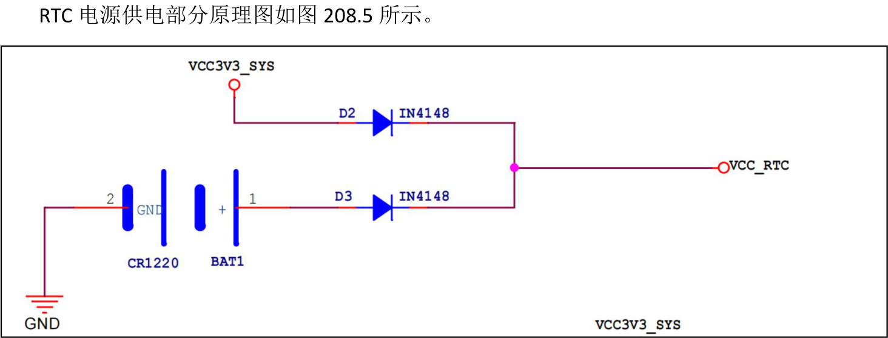
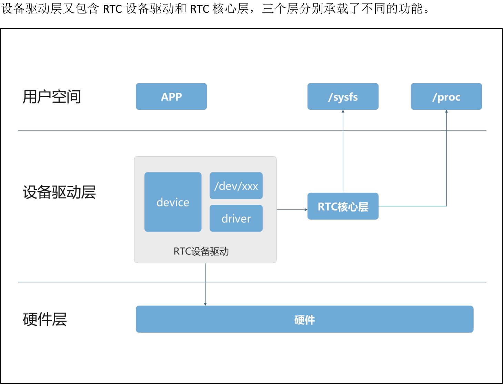
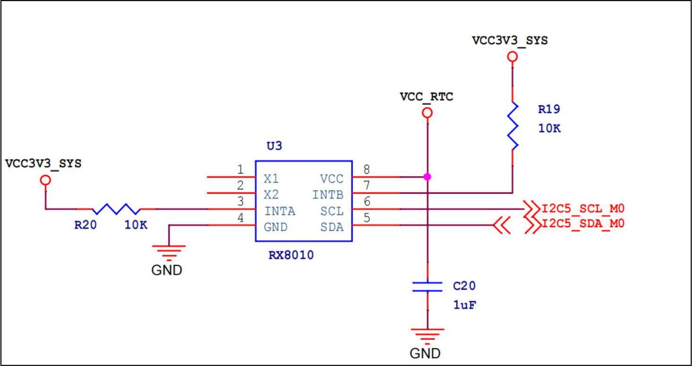
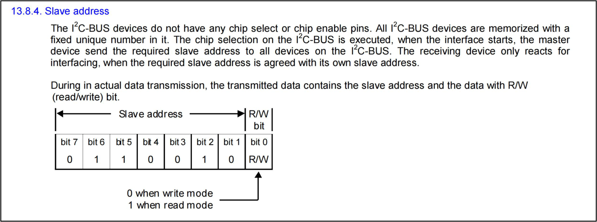
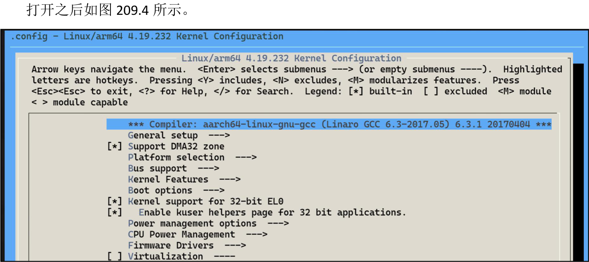
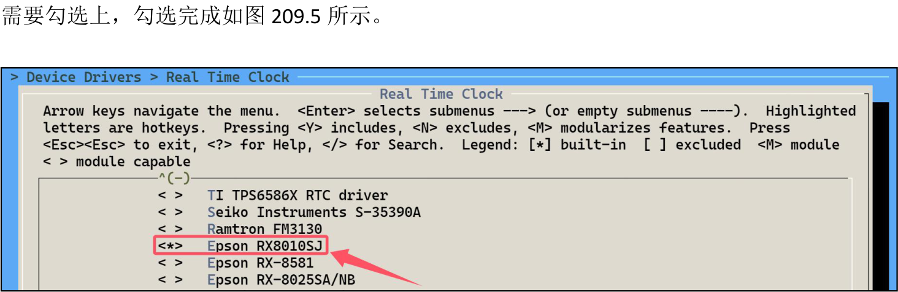
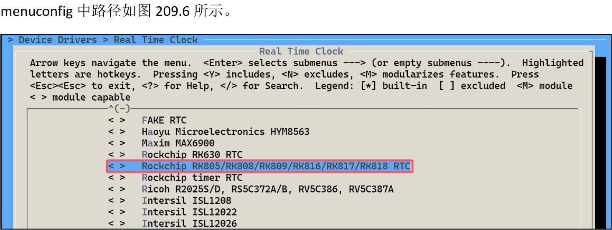

# 第209章 RX8010子系统框架

208.4

图208.5
RTC 电源部分有主电源供电和纽扣电池供电两种模式，两种供电模式介绍如下所示。(1)在系统正常运行时，VCC3V3_SYS 提供3.3V 电源，二极管D2 正向导通为RTC 模块供电，同时二极管D3 反向截止以防止主电源向电池充电或消耗电池电量。(2)当系统断电（VCC3V3_SYS 失效）时，二极管D2 反向截止以防止电池电量通过主电源回路消耗，同时二极管D3 正向导通，由纽扣电池（电池型号为CR1220）为RTC 模块供电，以确保RTC 能够继续运行。这样RTC 模块在主电源（VCC3V3_SYS）断电时仍能通过纽扣电池（CR1220）继续工作，从而保持时间信息不丢失，

本章介绍RTC 子系统框架。
## 209.1 RTC 子系统框架介绍
RTC 子系统框架如图209.1 所示，分为了用户空间、设备驱动层和硬件层三个层次，其中

图209.1用户空间是应用程序运行层，应用程序通过多种接口与系统交互，例如访问/dev/rtc0 设备节点读写RTC 时间，或通过sysfs 和proc 文件系统来获取或设置硬件状态。设备驱动层是连接用户空间与硬件层的核心，他又分为了RTC 设备驱动和RTC 核心层。RTC设备驱动负责硬件操作细节，RTC 设备驱动分为device（设备文件）和driver（驱动程序）两部分，通过/dev/xxx 设备节点与用户空间进行交互。RTC 核心层注册了一个RTC 类用来归类RTC设备，并向RTC 设备驱动序提供了注册和注销接口和基本的RTC 设备操作函数，如open()，read()

和ioctl 函数等。RTC 核心层也会通过sysyfs 和proc 虚拟文件系统向用户空间提供操作RTC 的接口。硬件层为实际的RTC 硬件，RTC 硬件通过I2C、SPI 等接口与设备驱动层通信。
## 209.2 RTC 设备驱动开发
由于RTC 核心层的存在，开发RTC 设备驱动程序对于驱动开发者来说变得十分简单。本章以RTC 芯片RX8010 为例讲解RTC 设备驱动。
## 209.3 RX8010 驱动程序分析
首先在内核源码下打开rk3568-evb.dtsi 设备树文件找到RX8010 对应的设备树节点，该设备节点即RTC 设备驱动的device 部分，具体内容如代码清单209.1 所示：
```c
rx8010: rx8010@32 {代码清单209.1
    compatible = "epson,rx8010";
    reg = <0x32>;
    status = "okay";
    #clock-cells = <0>;
};
```
compatible 属性通过字符串“epson,rx8010”匹配的驱动为kernel/drivers/rtc/rtc-rx8010.c，该驱动程序即RTC 设备驱动的driver 部分，其驱动的入口函数如代码清单209.2 所示：
```c
module_i2c_driver(rx8010_driver);代码清单209.2
```
module_i2c_driver 宏负责简化i2c 设备驱动的注册和注销流程，定义在include/linux/i2c.h文件中，具体内容如代码清单209.3 所示：
```c
#define module_i2c_driver(__i2c_driver) \代码清单209.3
          module_driver(__i2c_driver, i2c_add_driver, \
              i2c_del_driver)
```
其中module_driver 宏同样负责代码的简化，宏定义如代码清单209.4 所示：
```c
#define module_driver(__driver, __register, __unregister, ...) \代码清单209.4
```

```c
static int __init __driver##_init(void) \
{ \
  return __register(&(__driver) , ##__VA_ARGS__); \
} \
module_init(__driver##_init); \
static void __exit __driver##_exit(void) \
{ \
  __unregister(&(__driver) , ##__VA_ARGS__); \
} \
module_exit(__driver##_exit);
```
最后来对上述宏进行带入，展开内容如代码清单209.5 所示：
```c
static int __init rx8010_driver_init(void)代码清单209.5
    return i2c_add_driver(&rx8010_driver);
{
module_init(rx8010_driver_init);
}
static void __exit rx8010_driver_exit(void)
    i2c_del_driver(&rx8010_driver);
{
module_exit(rx8010_driver_exit);
}
```
初始化函数rx8010_driver_init()在模块加载时被调用，它通过i2c_add_driver 函数将rx8010_driver 结构体注册到内核中。模块卸载函数rx8010_driver_exit()在模块卸载时被调用，它通过i2c_del_driver 函数将rx8010_driver 结构体从内核中注销。当RTC 设备驱动的device 部分和driver 部分匹配成功之后会进入到driver 部分中的rx8010_probe()函数，其具体内容如代码清单209.6 所示：
```c
static int rx8010_probe(struct i2c_client *client,const struct i2c_device_id *id)代码清单209.6
    struct i2c_adapter *adapter = to_i2c_adapter(client->dev.parent);// 获取i2c 控制器
{
    const struct rtc_class_ops *rtc_ops; // RTC 操作函数指针
    struct rx8010_data *rx8010; // 用于存储设备私有数据的结构体
    int err = 0;
    // 检查i2c 适配器是否支持所需的SMBus 功能
    if (!i2c_check_functionality(adapter, i2c_FUNC_SMBUS_BYTE_DATA
        | i2c_FUNC_SMBUS_i2c_BLOCK)) {
        dev_err(&adapter->dev, "doesn't support required functionality\n");
```

```c
return -EIO;
}
// 分配内存以存储设备私有数据
rx8010 = devm_kzalloc(&client->dev, sizeof(struct rx8010_data),
          GFP_KERNEL);
if (!rx8010)
return -ENOMEM;
// 初始化设备私有数据
rx8010->client = client;
i2c_set_clientdata(client, rx8010);
// 初始化RX8010 设备
err = rx8010_init_client(client);
if (err)
return err;
// 检查设备是否提供了中断号
if (client->irq > 0) {
dev_info(&client->dev, "IRQ %d supplied\n", client->irq);
// 请求线程化的中断处理程序
err = devm_request_threaded_irq(&client->dev, client->irq, NULL,
                rx8010_irq_1_handler,
                IRQF_TRIGGER_LOW | IRQF_ONESHOT,
                "rx8010", client);
if (err) {
    dev_err(&client->dev, "unable to request IRQ\n");
    return err;
}
// 如果有中断支持，使用带有报警功能的RTC 操作函数
rtc_ops = &rx8010_rtc_ops_alarm;
rtc_ops = &rx8010_rtc_ops_default; // 如果没有中断支持，使用默认的RTC 操作函数
} else {
}
// 注册RTC 设备
rx8010->rtc = devm_rtc_device_register(&client->dev, client->name,
                   rtc_ops, THIS_MODULE);
if (IS_ERR(rx8010->rtc)) {
dev_err(&client->dev, "unable to register the class device\n");
return PTR_ERR(rx8010->rtc);
```

```c
}
rx8010->rtc->max_user_freq = 1;
return err;
}
```
在第5 行定义了一个用于存储RTC 设备私有数据的rx8010_data 结构体变量rx8010，该结构体定义如代码清单209.7 所示：
```c
struct rx8010_data {代码清单209.7
    struct i2c_client *client;// i2c 客户端
    struct rtc_device *rtc;// RTC 设备，用于管理实时时钟功能
    u8 ctrlreg; // 控制寄存器的值，用于存储或配置RX8010 的控制状态
};
```
其中结构体成员client 是指向i2c client 的指针，因为RX8010 芯片使用I2C5 接口与主机进行通信，因此本身也是I2C 设备。rx8010_data 结构体中的client 成员会保存rx8010 节点转换成的i2c client 结构体,用于与主机进行通信，而rtc_device 结构体表示与RX8010 设备关联的RTC 设备，rtc_device 结构体定义如代码清单209.8 下所示：
```c
struct rtc_device {代码清单209.8
    struct device dev;// 设备结构体，用于与设备模型集成
    struct module *owner;// 拥有该RTC 设备的模块
    int id;// RTC 设备的ID
    const struct rtc_class_ops *ops;// RTC 设备的操作函数集
    struct mutex ops_lock;
    struct cdev char_dev;
    unsigned long flags;
    unsigned long irq_data;// 中断相关数据
    spinlock_t irq_lock;// 用于保护中断数据的自旋锁
     .............................
};
```
接着继续分析rx8010_probe()函数，在第26 行通过rx8010_init_client()函数对RX8010 芯片进行初始化和配置，函数内容如代码清单209.9 所示：
```c
static int rx8010_init_client(struct i2c_client *client)代码清单209.9
    struct rx8010_data *rx8010 = i2c_get_clientdata(client); // 获取设备私有数据
{
    u8 ctrl[2]; // 用于存储控制寄存器的值
```

```c
int need_clear = 0, err = 0; // 标志位和错误码初始化
u8 flag;
// 读取RX8010 的FLAG 寄存器值
flag = i2c_smbus_read_byte_data(client, RX8010_FLAG);
if (err < 0)
    return err;
// 清除FLAG 寄存器中的VLF（电压低标志位）
flag &= ~(RX8010_FLAG_VLF);
err = i2c_smbus_write_byte_data(client, RX8010_FLAG, flag);
if (err < 0)
    return err;
/* 初始化保留寄存器，按照数据手册的要求*/
// 写入RX8010_RESV17 寄存器的默认值
err = i2c_smbus_write_byte_data(client, RX8010_RESV17, 0xD8);
if (err < 0)
    return err;
...............省略寄存器写入和检查相关代码
// 如果需要清除标志位，则清除AF、TF 和UF
if (need_clear) {
    ctrl[0] &= ~(RX8010_FLAG_AF | RX8010_FLAG_TF | RX8010_FLAG_UF);
    err = i2c_smbus_write_byte_data(client, RX8010_FLAG, ctrl[0]);
    if (err < 0)
        return err;
}
// 保存CTRL 寄存器的值，并清除TEST 位
rx8010->ctrlreg = (ctrl[1] & ~RX8010_CTRL_TEST);
return 0;
}
```
然后返回rx8010_probe 函数继续向下分析，在probe 函数的30-48 行，会根据设备是否提供了中断号来决定RTC 芯片的操作模式，但在iTOP-RK3568 开发板中无论是硬件连接还是在设备树配置中并没有使用中断，所以进入的是第二个判断并执行代码rtc_ops =&rx8010_rtc_ops_default。rx8010_rtc_ops_default 为RX8010 实时时钟芯片提供了一组默认的操作函数接口，包括读取当前时间的函数指针、设置当前时间的函数指针以及ioctl 控制功能，具体内容如代码清单

209.10 所示：
```c
static const struct rtc_class_ops rx8010_rtc_ops_default = {代码清单209.10
    .read_time = rx8010_get_time, // 读取当前时间的函数指针
    .set_time = rx8010_set_time,// 设置当前时间的函数指针
    .ioctl = rx8010_ioctl,// 提供额外控制功能的函数指针
};
```
最后在probe 函数的58 行，使用devm_rtc_device_register()函数注册rtc 设备，该函数定义在drivers/rtc/class.c 文件中，函数具体内容如代码清单209.11 所示：
```c
struct rtc_device *devm_rtc_device_register(struct device *dev,代码清单209.11
                         const char *name,
                         const struct rtc_class_ops *ops,
                         struct module *owner)
    struct rtc_device **ptr, *rtc;
{
    // 分配设备资源管理器的内存
    ptr = devres_alloc(devm_rtc_device_release, sizeof(*ptr), GFP_KERNEL);
    if (!ptr)
        return ERR_PTR(-ENOMEM);
    // 调用rtc_device_register 注册RTC 设备
    rtc = rtc_device_register(name, dev, ops, owner);
    if (!IS_ERR(rtc)) {
        *ptr = rtc;
        devres_add(dev, ptr); // 将资源添加到设备资源链表中
        devres_free(ptr);
    } else {
    return rtc;
    }
}
```
该函数的重点在于第14 行的rtc_device_register()函数，该函数同样定义在class.c 文件中，具体内容如代码清单209.12 所示：
```c
struct rtc_device *rtc_device_register(const char *name, struct device *dev,代码清单209.12
                       const struct rtc_class_ops *ops,
                       struct module *owner)
    struct rtc_device *rtc; // RTC 设备结构体指针
{
```

```c
struct rtc_wkalrm alrm; // 用于存储报警信息
int id, err;
// 获取一个唯一的RTC 设备ID
id = rtc_device_get_id(dev);
if (id < 0) {
    err = id;
    goto exit;
}
// 分配RTC 设备结构体
rtc = rtc_allocate_device();
if (!rtc) {
    err = -ENOMEM;
    goto exit_ida;
}
// 初始化RTC 设备的基本属性
rtc->id = id;
rtc->ops = ops;
rtc->owner = owner;
rtc->dev.parent = dev;
dev_set_name(&rtc->dev, "rtc%d", id);
// 获取RTC 设备的时间偏移量
rtc_device_get_offset(rtc);
// 检查硬件中是否已经设置了报警
err = __rtc_read_alarm(rtc, &alrm);
if (!err && !rtc_valid_tm(&alrm.time)) {
    rtc_initialize_alarm(rtc, &alrm);
}
// 准备RTC 设备的字符设备接口
rtc_dev_prepare(rtc);
// 将RTC 设备的字符设备和设备结构体添加到内核
err = cdev_device_add(&rtc->char_dev, &rtc->dev);
if (err) {
    dev_warn(&rtc->dev, "%s: failed to add char device %d:%d\n",
         name, MAJOR(rtc->dev.devt), rtc->id);
    put_device(&rtc->dev);
    goto exit;
} else {
```

```c
dev_dbg(&rtc->dev, "%s: dev (%d:%d)\n", name,
    MAJOR(rtc->dev.devt), rtc->id);
}
rtc_proc_add_device(rtc);// 将RTC 设备添加到proc 文件系统中
dev_info(dev, "rtc core: registered %s as %s\n",
 name, dev_name(&rtc->dev));
return rtc; // 返回注册成功的RTC 设备指针
exit_ida:
ida_simple_remove(&rtc_ida, id);
exit:
dev_err(dev, "rtc core: unable to register %s, err = %d\n",
name, err);
return ERR_PTR(err);
}
```
rtc_device_register()函数的主要作用是注册一个RTC 设备到Linux 内核中，并完成一系列初始化和资源分配工作。该函数的重点在第43 行的cdev_device_add()函数，cdev_device_add()函数将RTC 设备以字符设备的方式注册到内核中，然后是第54 行的rtc_proc_add_device()函数，rtc_proc_add_device()函数将RTC 设备的信息添加到了proc 子系统当中，便于在用户空间调试和监控。至此，关于RX8010 驱动源码分析就完成了。
## 209.4 RTC 设备驱动移植
RTC 设备一般都有现成的驱动程序，所以无需重新造轮子，本节以RX8010 为例，讲解如何移植RTC 设备驱动。在iTOP-RK3568 开发板底板原理图中，RX8010 芯片电路部分如图209.2 所示：


图209.2通过原理图可以确定RX8010 挂载到了i2c5 上，所以需要在设备树的i2c5 节点下添加rx8010的节点，添加内容如代码清单209.13 所示。该设备节点对应RTC 设备驱动的device 部分。
```c
&i2c5 {代码清单209.13
    status = "okay";
    rx8010: rx8010@32 {
        compatible = "epson,rx8010";
        reg = <0x32>;
        status = "okay";
        #clock-cells = <0>;
    };
};
```
第6 行的reg 属性表示RX8010 的地址为0x32，该地址可以根据RX8010 数据手册得到，如图209.3 所示：


图209.3通过图209.3 中可知从设备地址占字节的高7 位（bit 7 到bit 1）即0110010，换算为16进制得到0x32。然后来到Linux 内核源码的根目录，使用以下命令进入menuconfig 界面。
```c
export ARCH=arm64
make rockchip_linux_defconfig
make menuconfig
```

图209.4进到如下所示路径中。
```c
> Device Drivers
    > Real Time Clock
         <*>Epson RX8010SJ
```

图209.5 默认已经勾选了RX8010 设备驱动（driver 部分）对应的配置项，如果没有勾选，

图209.5
除此之外还要确保RK809 电源管理芯片的内部RTC 没有被勾选，确保系统里面不会存在两个RTC 设备，避免发生冲突，RK809 电源管理芯片的内部RTC 对应的驱动程序配置项在make

图209.6配置完成后，使用cp .config arch/arm64/configs/rockchip_linux_defconfig 命令将修改之后的配置文件覆盖默认配置文件，然后重新编译烧写内核即可将RX8010 驱动程序编译进内核。至此RX8010 驱动移植完成，因为直接使用的是内核提供的驱动程序，所以移植工作重点在设备树中的设备节点编写上。

