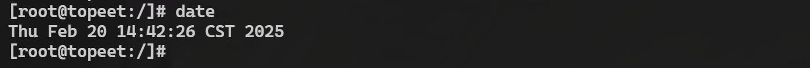
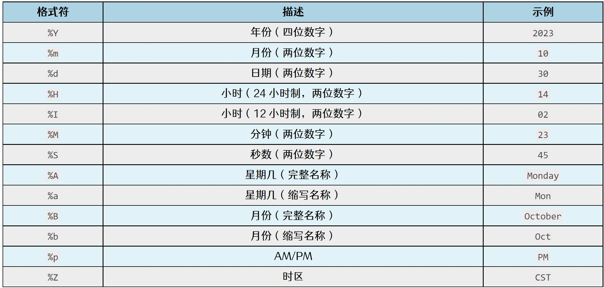
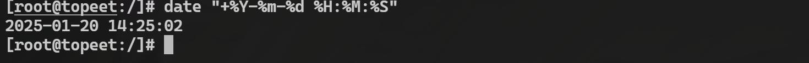

# 第210章 时间命令讲解

本章将会对Linux 系统中查看和设置系统时间的date 命令和负责访问和管理硬件时钟的hwclock 命令进行讲解。
## 210.1 date 命令
date 命令可以查看当前的系统时间，还可以设置系统时间、格式化日期和时间的输出、解析时间字符串并进行时间计算。下面对date 命令的常用功能进行演示。(1)显示当前日期和时间直接运行date 命令会显示当前系统的日期和时间，格式为默认的本地时间格式，如图210.1所示：

图210.1图210.1 中的显示结果含义如下。Thu：星期几（Thursday）Feb：月份（February）20：日期14:42:26：时间（小时:分钟:秒）CST：时区（China Standard Time）2025：年份(2) 设置系统时间使用date 命令可以设置系统时间,命令格式：date [MMDDhhmm[[CC]YY][.ss]]。其中，MM表示月份（两位数字，如10 表示十月）。DD 表示日期（两位数字，如30 表示30 日）。hh表示小时（24 小时制，两位数字，如14 表示下午2 点）。mm 表示分钟（两位数字，如23表示23 分钟）。CC 表示世纪（可选，两位数字，如20 表示2000 年代）。YY 表示年份（两位数字，如23 表示2023 年）。.ss 表示秒数（可选，两位数字，如.45 表示45 秒）。

例如将系统时间设置为2025 年1 月20 日14:23:45 可以使用以下命令。
```c
date 012014232025.45
```
运行结果如图210.2 所示。

图210.2（3）格式化输出date 命令支持通过格式化字符串自定义输出的日期和时间格式。在date 命令后加上+ 和格式化字符串，可以指定输出格式，常见格式符如图210.3 所示：

图210.3例如，通过date "+%Y-%m-%d %H:%M:%S" 命令将格式设置为YYYY-MM-DD HH:MM:SS，并输出当前时间，运行结果如图210.4 所示：

图210.4
## 210.2 hwclock 命令
hwclock 是Linux 系统中用于管理硬件时钟的命令行工具，包括查看、设置和同步硬件时

钟与系统时钟，接下来对hwclock 的常用功能进行演示。（1）查看硬件时钟直接运行hwclock 命令会显示当前硬件时钟的时间，运行结果如图210.5 所示：

图210.5图210.5 中时间部分表示硬件时钟的当前时间。0.0000000 seconds 表示硬件时钟与系统时钟之间的时间偏差。(2) 同步硬件时钟与系统时钟可以通过hwclock -s 命令将系统时钟同步到硬件时钟，可以通过hwclock -w 命令将硬件时钟同步到系统时钟
## 210.3 扩展知识
问题1：当开发板断电之后，系统时间将会丢失，但是RTC 硬件还在继续记时，那RTC硬件是如何在上电之后同步到系统时间的呢？每次系统上电启动之后，都会将RTC 里面的硬件时间同步到系统时间，具体实现为内核drivers/rtc/hctosys.c 文件中的rtc_hctosys 函数，具体内容如代码清单210.1 所示：
```c
int rtc_hctosys(void)代码清单210.1
    int err = -ENODEV; // 初始化错误码，默认为"没有设备" 错误
{
    struct rtc_time tm; // 用于存储从RTC 设备读取的时间
    struct timespec64 tv64 = {
        .tv_nsec = NSEC_PER_SEC >> 1,
    struct rtc_device *rtc = rtc_class_open(CONFIG_RTC_HCTOSYS_DEVICE); // 打开指定的RTC 备
    };
    if (rtc == NULL) { 败
        pr_info("无法打开RTC 设备(%s)\n", CONFIG_RTC_HCTOSYS_DEVICE);
        goto err_open;
    }
    // 从RTC 设备读取当前时间
    err = rtc_read_time(rtc, &tm);
```

```c
if (err) {
    dev_err(rtc->dev.parent,
        "hctosys: 无法读取硬件时钟\n");
    // 设置默认时间（2021 年1 月1 日00:00:00）
    tm.tm_year = 121; // 年份偏移量，表示2021 年（从1900 年开始计算）
    tm.tm_mon = 0;// 月份，从0 开始，0 表示1 月
    tm.tm_mday = 1;// 日期
    tm.tm_hour = 0;// 小时
    tm.tm_min = 0;// 分钟
    tm.tm_sec = 0;// 秒
    // goto err_read; // 如果需要跳过后续操作，可以取消注释此行
}
// 将RTC 时间转换为Unix 时间戳（自1970 年1 月1 日以来的秒数）
tv64.tv_sec = rtc_tm_to_time64(&tm);
// 将时间戳设置为系统时钟
err = do_settimeofday64(&tv64);
if (!err) {
    // 打印设置系统时钟的日志信息
    dev_info(rtc->dev.parent,
        "设置系统时钟为"
        "%d-%02d-%02d %02d:%02d:%02d UTC (%lld)\n",
        tm.tm_year + 1900, tm.tm_mon + 1, tm.tm_mday,
        tm.tm_hour, tm.tm_min, tm.tm_sec,
        (long long) tv64.tv_sec);
}
err_read:
rtc_class_close(rtc);
err_open:
rtc_hctosys_ret = err;
return err;
}
```
在第16 行通过rtc_read_time()函数读取RTC 硬件里面存储的时间，然后在第34 行通过do_settimeofday64()函数将转换之后的时间戳设置为系统时钟。
问题2：进入系统之后，分别通过date 和hwclock 获取时间，如图210.6 所示，可以发现获取到的系统时间和硬件时间有着8 个小时的时间差，这是为什么呢？

