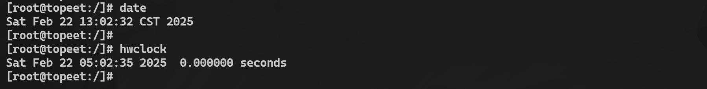
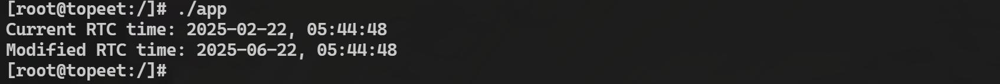
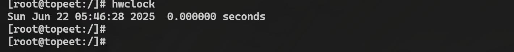

# 第211章 RTC应用程序编写


图210.6hwclock 命令显示的是硬件时钟的时间，而硬件时钟默认存储的是UTC 时间，UTC 是全球时间的基准，不属于任何时区，因此它也被称为世界标准时间。而date 命令显示的是系统时钟的时间，系统时钟会根据操作系统设置的时区来调整时间。上面打印的时区为CST，即中国时区，那么date 命令显示的时间会是UTC+8。因此，导致二者时间差的原因是系统时钟和硬件时钟采用了不同的时间标准。

本章讲解如何编写RTC 应用程序。
## 211.1 ioctl 命令讲解
可以通过ioctl 命令控制RTC 设备的功能，例如设置或读取RTC 时间、设置报警时间、启用或禁用周期性中断等，下面对最常用的设置和读取RTC 时间的ioctl 命令进行讲解。(1) 读取RTC 时间命令
```c
ioctl 命令宏定义：#define RTC_RD_TIME_IOR('p', 0x09, struct rtc_time)
```
功能：从RTC 设备读取当前时间。参数：第三个参数是一个指向struct rtc_time 的指针，用于存储读取的时间，具体定义如代码清单211.1 所示：
```c
struct rtc_time {代码清单211.1
    int tm_sec;// 秒（0-59）
    int tm_min;// 分钟（0-59）
    int tm_hour; // 小时（0-23）
    int tm_mday; // 日期（1-31）
    int tm_mon;// 月份（0-11，0 表示1 月）
    int tm_year; // 年份（从1900 年开始计算）
    int tm_wday; // 星期几（0-6，0 表示星期日）
    int tm_yday; // 一年中的第几天（0-365）
    int tm_isdst; // 夏令时标志（通常为0）
};
```
读取RTC 时间并打印具体示例如代码清单211.2 所示：
```c
struct rtc_time rtc_tm;代码清单211.2
ioctl(fd, RTC_RD_TIME, &rtc_tm);
printf("Current RTC time: %d-%02d-%02d %02d:%02d:%02d\n",
       rtc_tm.tm_year + 1900, rtc_tm.tm_mon + 1, rtc_tm.tm_mday,
   rtc_tm.tm_hour, rtc_tm.tm_min, rtc_tm.tm_sec);
```
(2) 设置RTC 时间命令
```c
ioctl 命令宏定义：#define RTC_SET_TIME_IOW('p', 0x0a, struct rtc_time)
```

功能：将指定的时间写入RTC 设备。参数：第三个参数是一个指向struct rtc_time 的指针，包含要设置的时间。设置时间并写入RTC 设备具体示例如代码清单211.3 所示：代码清单211.3
```c
struct rtc_time rtc_tm = {
    .tm_year = 123, // 2023 年（从1900 年开始计算）
    .tm_mon= 1,// 2 月（从0 开始计数）
    .tm_mday = 15,// 日期
    .tm_hour = 14,// 小时
    .tm_min= 30,// 分钟
    .tm_sec= 0// 秒
ioctl(fd, RTC_SET_TIME, &rtc_tm);
};
```
## 211.2 编写测试APP
本节通过应用程序，使用ioctl 命令读取当前RTC 时间，并将其打印到终端。并实现修改RTC 时间功能，如将月份设置为6 月，并将修改后的时间写回RTC 设备。然后再次读取RTC时间，验证修改是否成功，并将修改后的时间打印到终端。
本实验代码存放在iTOP-3568 开发板【V1.7 版本】\03_【iTOP-RK3568 开发板】指南教程\02_Linux 驱动配套资料\04_Linux 驱动程序\128_rtc\02_app 路径下。
实验代码app.c 应用程序如代码清单211.4 所示：
```c
#include <stdio.h>代码清单211.4
#include <fcntl.h>
#include <unistd.h>
#include <sys/ioctl.h>
#include <linux/rtc.h>
#include <errno.h>
#include <string.h>
int main() {
    int fd; // 文件描述符
    int ret; // ioctl 返回值
```

```c
struct rtc_time tm; // 用于存储RTC 时间
// 打开RTC 设备
fd = open("/dev/rtc0", O_RDONLY);
if (fd < 0) {
    perror("Failed to open /dev/rtc0");
    return -1;
}
// 读取当前RTC 时间
ret = ioctl(fd, RTC_RD_TIME, &tm);
if (ret < 0) {
    perror("RTC_RD_TIME error");
    close(fd);
    return -1;
}
// 打印当前RTC 时间
printf("Current RTC time: %d-%02d-%02d, %02d:%02d:%02d\n",
       tm.tm_year + 1900, tm.tm_mon + 1, tm.tm_mday,
       tm.tm_hour, tm.tm_min, tm.tm_sec);
// 修改RTC 时间（将月份设置为6）
tm.tm_mon = 5; // 注意：tm_mon 从0 开始计数，5 表示6 月
ret = ioctl(fd, RTC_SET_TIME, &tm);
if (ret < 0) {
    perror("RTC_SET_TIME error");
    close(fd);
    return -1;
}
// 再次读取RTC 时间以验证修改
ret = ioctl(fd, RTC_RD_TIME, &tm);
if (ret < 0) {
    perror("RTC_RD_TIME error");
    close(fd);
    return -1;
}
// 打印修改后的RTC 时间
printf("Modified RTC time: %d-%02d-%02d, %02d:%02d:%02d\n",
       tm.tm_year + 1900, tm.tm_mon + 1, tm.tm_mday,
       tm.tm_hour, tm.tm_min, tm.tm_sec);
```

```c
// 关闭RTC 设备
close(fd);
return 0;
}
```
使用aarch64-linux-gnu-gcc app.c -o app 命令交叉编译应用程序，编译完成如图211.1 所示：

图211.1然后将编译完成的可执行程序拷贝到开发板上，使用./app 命令运行该程序，运行结果如图211.2 所示：

图211.2通过图211.2 可知时间被修改成了6 月，并将修改后的时间打印了出来，然后使用hwclock命令重新打印RTC 硬件时间，可以看到RTC 硬件时间已经被修改为了6 月，说明实验成功，如图211.3 所示。

图211.3至此，RTC 实验例程就测试完成了。

