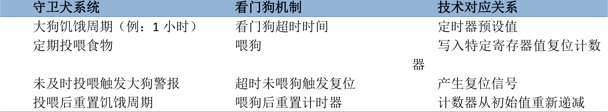
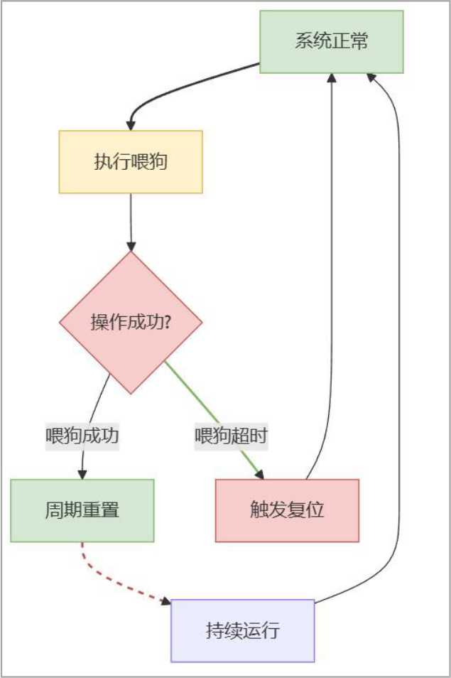

# 第212章 看门狗基础知识

## 212.1 看门狗的含义及作用
看门狗即Watchdog ，简称WDT，是嵌入式系统中基于定时器实现的保护机制。看门狗通过定时器来监控主程序的运行，在主程序的运行过程中，要在定时时间到之前对定时器进行复位，如果在定时时间到之前因为异常情况导致没有对定时器进行复位，那么定时时间到后就会使系统进行复位。这样当系统遭遇异常情况时，比如①电磁干扰导致程序跑飞②软件逻辑错误引发死循环③未知故障造成系统死锁，看门狗通过触发强制复位使系统恢复至初始状态，无需人工干预断电操作。因此可以显著提升设备长时间运行的稳定性。
## 212.2 看门狗工作机制
本节通过类比法将看门狗机制类比为守卫犬系统讲解看门狗机制，其运作逻辑如下表212.1 所示：表212.1

运行流程如下所示。1 初始化配置设置守卫犬的饥饿周期（也就是看门狗的超时时间）启动守卫犬巡逻（也就是使能看门狗定时器）2 正常工作状态系统任务按时执行“投喂”动作（也就是主程序定期喂狗）每次投喂之后，守卫犬重新计算饥饿周期（也就是定时器重置）3 异常处理机制若系统失控，无法投喂（也就是程序会跑飞/死锁）

守卫犬饥饿周期耗尽（也就是定时器归零）触发强制安全措施（也就是看门狗复位电路动作）系统恢复初始安全状态（也就是硬件复位）运行流程图如下图212.1 所示：

图212.1
## 212.3 看门狗集成方案
现代处理器内部往往都集成看门狗模块，以iTOP-RK3568 开发平台为例，RK3568 芯片集成WDT_NS 和WDT_S 两个看门狗，如图212.2 所示。

