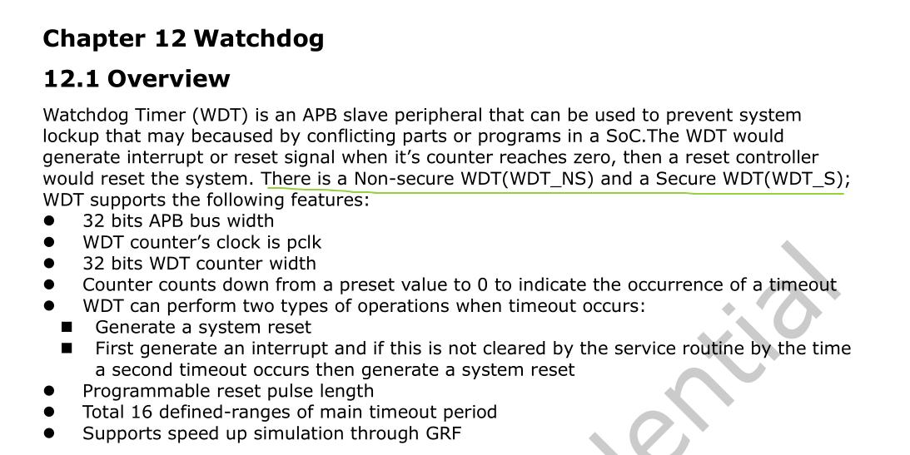
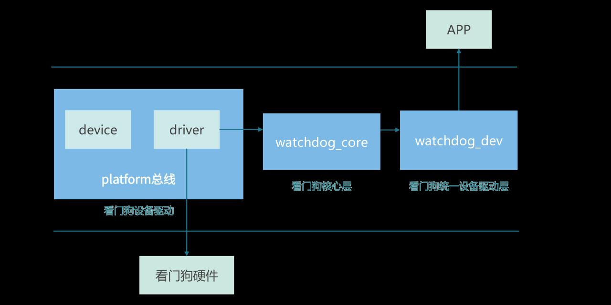

# 第213章 看门狗子系统框架


图212.2在图212.2 中，可以看到RK3568 芯片包含WDT_NS 和WDT_S 两个看门狗。
Linux 看门狗子系统框架采用三层架构设计，实现了用户接口，核心逻辑与硬件操作的解耦，其框架如图213.1 所示。

图213.1

由上图213.1 可见，自上而下依次为用户空间，内核空间以及硬件层。下文将重点分析内核空间的实现细节。
## 213.1 看门狗设备树配置
RK3568 芯片的看门狗模块有特定的寄存器地址和功能，这些信息在RK3568 芯片的数据手册中有详细描述，在内核源码中也有相应的体现，例如内核源码的arch/arm64/boot/dts/rockchip/rk3568.dtsi 文件中，可以看到看门狗设备的相关配置（device 部分），如代码清单213.1 所示：代码清单213.1
```c
wdt: watchdog@fe600000 {
        compatible = "snps,dw-wdt";
        reg = <0x0 0xfe600000 0x0 0x100>;
        clocks = <&cru CLK_WDT_NS>, <&cru PCLK_WDT_NS>;
        clock-names = "tclk", "pclk";
        interrupts = <GIC_SPI 149 IRQ_TYPE_LEVEL_HIGH>;
        status = “okay”
};
```
在上述代码清单213.1 中，compatible 属性用于设备驱动的匹配，reg 指定了看门狗寄存器的地址范围，clocks 和clock-names 定义了相关的时钟，interrupts 则配置了中断信息。在下个小节中将讲解看门狗对应的驱动文件（driver 部分）。
## 213.2 看门狗设备驱动层
看门狗设备驱动是Linux 内核中直接与硬件交互的核心，负责初始化硬件实现喂狗等底层操作，并向上对接看门狗核心层。
### 213.2.1 核心数据结构
Linux 中使用watchdog_device 结构体描述看门狗硬件，watchdog_device 结构体如代码清单213.2 所示。代码清单213.2
```c
#include <linux/watchdog.h>
```

```c
struct watchdog_device {
        const char *name;// 设备名称（如"sp805-wdt"）
        int id;// 设备ID（多设备时区分）
        struct device *dev;// 设备模型指针
        struct module *owner;// 驱动模块所有者
        const struct watchdog_ops *ops;// 硬件操作方法集
        unsigned int timeout;// 当前超时时间（秒）
        unsigned int min_timeout;// 最小支持超时时间
        unsigned int max_timeout;// 最大支持超时时间
        unsigned int flags;// 设备标志（如WDOG_FLAG_HW_RUNNING）
        // ... 其他属性（如状态、锁、定时器等）
    };
```
在watchdog_device 结构体中通过watchdog_ops 结构体定义看门狗硬件操作方法，watchdog_ops 结构体如代码清单213.3 所示。代码清单213.3
```c
struct watchdog_ops {
        // 启动看门狗（必选）
        int (*start)(struct watchdog_device *wdd);
        // 停止看门狗（可选，若硬件支持）
        int (*stop)(struct watchdog_device *wdd);
        // 设置超时时间（必选）
        int (*set_timeout)(struct watchdog_device *wdd, unsigned int timeout);
        // 喂狗操作（必选，重置定时器）
        int (*feed)(struct watchdog_device *wdd);
        // 获取当前超时时间（可选）
        unsigned int (*get_timeleft)(struct watchdog_device *wdd);
        // ... 其他硬件特定操作（如获取温度、中断处理）
};
```
### 213.2.2 初始化流程
在Linux 源码内核目录下搜索compatible 属性值“snps,dw-wdt”，可以找到drivers/watchdog/dw_wdt.c 文件，此文件是看门狗设备驱动（driver 部分）。dw_wdt.c 驱动文件如代码清单213.4 所示：代码清单213.4
```c
// 定义一个平台驱动结构体dw_wdt_driver
static struct platform_driver dw_wdt_driver = {
```

```c
.probe= dw_wdt_drv_probe,
.remove= dw_wdt_drv_remove,
.driver= {
     // 驱动的名称，用于在系统中标识该驱动
   .name= "dw_wdt",
     // 设备树匹配表，用于将驱动与设备树中的节点进行匹配
   .of_match_table = of_match_ptr(dw_wdt_of_match),
     // 电源管理操作结构体，定义了该驱动的电源管理相关操作
   .pm= &dw_wdt_pm_ops,
 },
};
// 将dw_wdt_driver 注册为一个平台驱动
module_platform_driver(dw_wdt_driver);
// 声明模块的作者
MODULE_AUTHOR("Jamie Iles");
// 描述模块的功能
MODULE_DESCRIPTION("Synopsys DesignWare Watchdog Driver");
// 声明模块的许可证，这里是GPL（通用公共许可证）
MODULE_LICENSE("GPL");
```
在上述代码中，使用module_platform_driver(dw_wdt_driver)宏将dw_wdt_driver 注册为一个平台驱动。当设备树中的看门狗节点和该驱动匹配成功时会调用dw_wdt_drv_probe()函数。dw_wdt_drv_probe()函数如代码清单213.5 所示：代码清单213.5
```c
static int dw_wdt_drv_probe(struct platform_device *pdev)
{
        // 获取设备结构体指针
        struct device *dev = &pdev->dev;
        // 定义指向看门狗设备结构体的指针
        struct watchdog_device *wdd;
        // 定义指向dw_wdt 结构体的指针，dw_wdt 结构体包含看门狗设备的特定信息
        struct dw_wdt *dw_wdt;
        // 定义指向资源结构体的指针，用于获取设备的内存资源
        struct resource *mem;
        // 定义用于存储函数返回值的变量
        int ret;
        // 1、使用devm_kzalloc 函数分配内存，用于存储dw_wdt 结构体
        dw_wdt = devm_kzalloc(dev, sizeof(*dw_wdt), GFP_KERNEL);
```

```c
if (!dw_wdt)
  return -ENOMEM;
// 2、获取设备的内存资源，IORESOURCE_MEM 表示内存资源类型，0 表示资源索引
mem = platform_get_resource(pdev, IORESOURCE_MEM, 0);
// 使用devm_ioremap_resource 函数将内存资源映射到内核虚拟地址空间
// dev 是设备结构体指针，mem 是要映射的内存资源
dw_wdt->regs = devm_ioremap_resource(dev, mem);
if (IS_ERR(dw_wdt->regs))
  return PTR_ERR(dw_wdt->regs);
/*
* 3、尝试请求看门狗专用的定时器时钟
*/
// 获取名为"tclk" 的时钟
dw_wdt->clk = devm_clk_get(dev, "tclk");
// 如果获取失败
if (IS_ERR(dw_wdt->clk)) {
  // 尝试获取默认时钟
  dw_wdt->clk = devm_clk_get(dev, NULL);
  // 如果再次失败，返回PTR_ERR(dw_wdt->clk) 错误码
  if (IS_ERR(dw_wdt->clk))
      return PTR_ERR(dw_wdt->clk);
}
...
// 4、初始化设备属性
// 将dw_wdt 结构体中的wdd 成员赋值给wdd 指针
wdd = &dw_wdt->wdd;
// 设置看门狗设备的信息
wdd->info = &dw_wdt_ident;
// 设置看门狗设备的操作函数集
wdd->ops = &dw_wdt_ops;
// 设置看门狗设备的最小超时时间为1 秒
wdd->min_timeout = 1;
// 根据dw_wdt 结构体和DW_WDT_MAX_TOP 计算最大硬件心跳时间（以毫秒为单位）
wdd->max_hw_heartbeat_ms =
  dw_wdt_top_in_seconds(dw_wdt, DW_WDT_MAX_TOP) * 1000;
// 设置看门狗设备的父设备
wdd->parent = dev;
// 将dw_wdt 结构体与看门狗设备关联起来
watchdog_set_drvdata(wdd, dw_wdt);
// 设置看门狗设备的nowayout 属性
watchdog_set_nowayout(wdd, nowayout);
```

```c
// 使用默认超时时间初始化看门狗设备
watchdog_init_timeout(wdd, 0, dev);
// 检查看门狗是否已经启用
if (dw_wdt_is_enabled(dw_wdt)) {
    // 如果已经启用，获取当前的超时时间并设置到看门狗设备中
    wdd->timeout = dw_wdt_get_top(dw_wdt);
    // 设置看门狗设备的状态位，表示硬件正在运行
    set_bit(WDOG_HW_RUNNING, &wdd->status);
} else {
    // 如果未启用，设置默认超时时间
    wdd->timeout = DW_WDT_DEFAULT_SECONDS;
    // 使用默认超时时间重新初始化看门狗设备
    watchdog_init_timeout(wdd, 0, dev);
}
// 将dw_wdt 结构体与平台设备关联起来
platform_set_drvdata(pdev, dw_wdt);
// 设置看门狗设备的重启优先级为128
watchdog_set_restart_priority(wdd, 128);
//5、注册看门狗设备到内核
ret = watchdog_register_device(wdd);
if (ret)
goto out_disable_pclk;
    return 0;
...
}
```
代码清单213.5 中最重要的操作是第82 行代码调用watchdog_register_device()函数注册看门狗设备到内核。至此dw_wdt_drv_probe 函数分析完毕。
## 213.3 看门狗核心层
在上一小节代码分析里，使用watchdog_register_device()函数对wdd 指针所指向的structwatchdog_device 结构体进行注册操作。watchdog_register_device()函数实现如代码清单217.6所示。代码清单213.6

```c
int watchdog_register_device(struct watchdog_device *wdd)
{
    int ret;
    mutex_lock(&wtd_deferred_reg_mutex);
    if (wtd_deferred_reg_done)
        ret = __watchdog_register_device(wdd);
    else
        ret = watchdog_deferred_registration_add(wdd);
    mutex_unlock(&wtd_deferred_reg_mutex);
    return ret;
}
```
在上述代码清单213.6 中，使用if 语句进行判断，如果wtd_deferred_reg_done 为真，则执行__watchdog_register_device(wdd)函数，在kernel/drivers/watchdog/watchdog_core.c 文件中的watchdog_deferred_registration()函数中可以确定wtd_deferred_reg_done 的值为true，如代码清单213.7 所示：代码清单213.7
```c
static int __init watchdog_deferred_registration(void)
{
    mutex_lock(&wtd_deferred_reg_mutex);
    wtd_deferred_reg_done = true;
    while (!list_empty(&wtd_deferred_reg_list)) {
        struct watchdog_device *wdd;
        wdd = list_first_entry(&wtd_deferred_reg_list,
                        struct watchdog_device, deferred);
        list_del(&wdd->deferred);
        __watchdog_register_device(wdd);
    }
    mutex_unlock(&wtd_deferred_reg_mutex);
    return 0;
}
```
在代码清单213.6 中第7 行接下来执行的__watchdog_register_device(wdd)函数如代码清单213.8 所示：代码清单213.8
```c
static int __watchdog_register_device(struct watchdog_device *wdd)
```

```c
{
        // 参数有效性检查
        if (wdd == NULL || wdd->info == NULL || wdd->ops == NULL)
            return -EINVAL;
        // 操作函数校验（必须实现start 和stop/max_hw_heartbeat_ms）
        if (!wdd->ops->start || (!wdd->ops->stop && !wdd->max_hw_heartbeat_ms))
            return -EINVAL;
        // 检查超时时间的合法性
        watchdog_check_min_max_timeout(wdd);
        // 获取watchdog ID（优先使用设备树别名）
        if (wdd->parent) {
            ret = of_alias_get_id(wdd->parent->of_node, "watchdog");
            if (ret >= 0)
                id = ida_simple_get(&watchdog_ida, ret, ret + 1, GFP_KERNEL);
        }
        // 分配ID 失败时的处理
        if (id < 0)
            id = ida_simple_get(&watchdog_ida, 0, MAX_DOGS, GFP_KERNEL);
        // 注册watchdog 字符设备
        ret = watchdog_dev_register(wdd);
        if (ret) {
            // 处理旧版驱动冲突的特殊情况（id=0 时可能被占用）
            if (!(id == 0 && ret == -EBUSY))
                return ret;
            // 重试从id=1 开始分配
        }
        // 注册系统重启通知回调
        if (test_bit(WDOG_STOP_ON_REBOOT, &wdd->status)) {
            wdd->reboot_nb.notifier_call = watchdog_reboot_notifier;
            ret = register_reboot_notifier(&wdd->reboot_nb);
            // 错误处理（注销设备并释放ID）
        }
        // 注册系统重启处理函数
        if (wdd->ops->restart) {
            wdd->restart_nb.notifier_call = watchdog_restart_notifier;
            ret = register_restart_handler(&wdd->restart_nb);
            // 仅警告不中断注册流程
```

```c
}
return 0;
}
```
在代码清单213.8 中第14-19 行如果wdd 所指向的设备有父设备（wdd->parent 不为空），尝试通过设备树节点（wdd->parent->of_node）获取与“watchdog”相关的别名ID。如果获取到的别名ID（存储在ret 中）大于等于0，表示获取成功，就从watchdog_ida 这个ID 分配器中获取一个唯一的ID，范围是从ret 到ret + 1，采用GFP_KERNEL 内存分配标志。在代码清单213.8 中第26 - 32 行调用watchdog_dev_register()函数注册wdd 指向的看门狗设备对应的字符设备。watchdog_dev_register()函数如代码清单213.9 所示：代码清单213.9
```c
int watchdog_dev_register(struct watchdog_device *wdd)
{
        int ret;
        // 1. 注册字符设备（创建/dev/watchdogX 节点）
        ret = watchdog_cdev_register(wdd);
        if (ret)
            return ret;
        // 2. 注册预超时处理机制
        ret = watchdog_register_pretimeout(wdd);
        if (ret)
            watchdog_cdev_unregister(wdd); // 失败时回滚字符设备注册
        return ret;
}
```
在上述代码中，最重要的是使用watchdog_cdev_register()函数注册字符设备，在下个小节中我们进行再详细介绍。
## 213.4 看门狗统一设备驱动层
接着上一小节进行解析，watchdog_cdev_register()函数的作用是注册字符设备，函数实现如代码清单213.10 所示：代码清单213.10
```c
static int watchdog_cdev_register(struct watchdog_device *wdd)
```

```c
{
        // 分配核心数据结构（包含设备状态、定时器等）
        struct watchdog_core_data *wd_data = kzalloc(sizeof(...), GFP_KERNEL);
        mutex_init(&wd_data->lock); // 初始化保护锁
        // 建立双向关联（设备↔核心数据）
        wd_data->wdd = wdd;
        wdd->wd_data = wd_data;
        // 校验内核工作队列有效性（心跳维持机制依赖）
        if (IS_ERR_OR_NULL(watchdog_kworker)) {
            kfree(wd_data);
            return -ENODEV;
        }
        // 设备节点初始化
        device_initialize(&wd_data->dev);
        wd_data->dev.devt = MKDEV(MAJOR(watchdog_devt), wdd->id);// 分配设备号
        wd_data->dev.class = &watchdog_class;
        wd_data->dev.parent = wdd->parent;
        wd_data->dev.groups = wdd->groups;
        wd_data->dev.release = watchdog_core_data_release;
        dev_set_drvdata(&wd_data->dev, wdd);
        dev_set_name(&wd_data->dev, "watchdog%d", wdd->id); // 命名设备节点
        // 定时机制初始化
        kthread_init_work(&wd_data->work, watchdog_ping_work);// 心跳工作队列
        hrtimer_init(&wd_data->timer, CLOCK_MONOTONIC, HRTIMER_MODE_REL); // 初始化高精度定时器
        // 传统设备注册（/dev/watchdog）
        if (wdd->id == 0) {
            // 注册misc 设备（兼容旧版接口）
            err = misc_register(&watchdog_miscdev);
            // 处理设备号冲突的特殊情况（旧驱动存在时返回EBUSY）
            if (err == -EBUSY) {
                pr_err("legacy watchdog module present\n");
                ...
            }
        }
        // 字符设备注册（创建/dev/watchdogX 节点）
        cdev_init(&wd_data->cdev, &watchdog_fops); // 绑定文件操作接口
        cdev_device_add(&wd_data->cdev, &wd_data->dev); // 添加至系统
```

```c
// 运行状态处理
if (watchdog_hw_running(wdd)) {
    __module_get(wdd->ops->owner); // 增加模块引用计数
    // 根据配置启动定时器（用户空间接管前维持心跳）
    if (handle_boot_enabled)
        hrtimer_start(...);
}
}
```
在代码清单213.10 中第28 行调用kthread_init_work()函数用于初始化一个kthread_work结构体，使其能够异步地在内核线程中执行指定的工作函数watchdog_ping_work()。watchdog_ping_work()函数中执行了与看门狗相关的任务操作。函数代码如代码清单213.11 所示：代码清单213.11
```c
static void watchdog_ping_work(struct kthread_work *work)
{
        // 通过工作项获取核心数据结构
        struct watchdog_core_data *wd_data = container_of(work, struct watchdog_core_data, work);
        // 加锁保证操作原子性（防止并发访问）
        mutex_lock(&wd_data->lock);
        // 判断是否需要发送心跳信号：
        // 1. 设备存在
        // 2. 看门狗处于激活状态或硬件正在运行
        if (watchdog_worker_should_ping(wd_data))
            __watchdog_ping(wd_data->wdd);// 执行实际的心跳操作
        // 释放互斥锁
        mutex_unlock(&wd_data->lock);
}
```
在代码清单213.10 中第31 行-44 行介绍了看门狗设备在系统中的两种不同类型的注册操作，一种是针对传统设备（/dev/watchdog）的相关处理，另一种是进行字符设备注册，用于创建新的设备节点（/dev/watchdogX）并绑定相应的文件操作接口到系统中。第43 行使用cdev_init()函数对wd_data->cdev 这个字符设备结构体进行初始化操作，并将watchdog_fops 绑定到该字符设备上，这样就为后续通过文件操作来与看门狗设备进行交互做好了准备。watchdog_fops 结构体如代码清单213.12 所示：

代码清单213.12
```c
static const struct file_operations watchdog_fops = {
    .owner= THIS_MODULE,
    .write= watchdog_write,
    .unlocked_ioctl= watchdog_ioctl,
    .open= watchdog_open,
    .release= watchdog_release,
    };
```
从代码清单213.12 中第5 行可以看出open 系统调用对应的操作函数指定为watchdog_open()函数。当用户空间程序尝试打开与该文件操作结构体关联的设备文件时，内核会调用watchdog_open()函数来打开设备，进行一些资源分配、状态初始化等工作。watchdog_open()函数实现如代码清单213.13 所示：代码清单213.13
```c
static int watchdog_open(struct inode *inode, struct file *file)
{
        struct watchdog_core_data *wd_data;
        struct watchdog_device *wdd;
        bool hw_running;
        int err;
        /* 获取对应的看门狗核心数据结构*/
        // 传统设备通过miscdevice 获取，新设备通过字符设备结构获取
        if (imajor(inode) == MISC_MAJOR)
            wd_data = old_wd_data;
        else
            wd_data = container_of(inode->i_cdev, struct watchdog_core_data, cdev);
        /* 单例模式检测- 保证设备只能被打开一次*/
        if (test_and_set_bit(_WDOG_DEV_OPEN, &wd_data->status))
            return -EBUSY;
        wdd = wd_data->wdd;
        /* 模块引用管理*/
        hw_running = watchdog_hw_running(wdd);
        // 如果硬件未运行，增加模块引用计数防止卸载
        if (!hw_running && !try_module_get(wdd->ops->owner)) {
            err = -EBUSY;
            goto out_clear;
```

```c
}
/* 启动看门狗硬件*/
if ((err = watchdog_start(wdd)) < 0)
    goto out_mod;
/* 保存核心数据结构到文件私有数据*/
file->private_data = wd_data;
/* 更新设备引用计数*/
if (!hw_running)
    get_device(&wd_data->dev);// 增加设备引用计数
/* 返回非定位设备打开结果*/
return nonseekable_open(inode, file);
out_mod:
module_put(wd_data->wdd->ops->owner);// 释放模块引用
out_clear:
clear_bit(_WDOG_DEV_OPEN, &wd_data->status);// 清除打开状态位
return err;
}
```
从代码清单213.12 中第3 行可以看出write 系统调用对应的操作函数指定为watchdog_write()函数。当用户空间程序对与该文件操作结构体关联的设备文件（比如/dev/watchdog）执行write 操作时，内核会调用这里指定的watchdog_write()函数来处理具体的写入请求。这个函数用于执行喂狗操作等与写入相关的功能。watchdog_write()函数实现如代码清单213.14 所示：代码清单213.14

```c
static ssize_t watchdog_write(struct file *file, const char __user *data,size_t len, loff_t *ppos)
{
    struct watchdog_core_data *wd_data = file->private_data;
    struct watchdog_device *wdd;
    int err;
    size_t i;
    char c;
    if (len == 0)
        return 0;
    clear_bit(_WDOG_ALLOW_RELEASE, &wd_data->status);
    for (i = 0; i != len; i++) {
        if (get_user(c, data + i))// 从用户空间安全复制数据
             return -EFAULT;
        if (c == 'V')
             set_bit(_WDOG_ALLOW_RELEASE, &wd_data->status);
    }
    /* 触发看门狗心跳维持*/
    err = -ENODEV;
    mutex_lock(&wd_data->lock);// 加锁保护设备状态
    wdd = wd_data->wdd;
    if (wdd)
        err = watchdog_ping(wdd);// 执行底层心跳操作
    mutex_unlock(&wd_data->lock);// 释放锁
    if (err < 0)
        return err;
    return len;// 返回实际写入长度（成功时返回请求长度）
    }
```
从代码清单213.12中第4行可以看出ioctl 系统调用对应的操作函数指定为watchdog_ioctl()函数。ioctl 是一种在Linux 中用于对设备进行特定控制操作的接口，用户空间程序可以通过ioctl向设备发送各种自定义的命令。当对关联的设备文件执行ioctl 操作时，内核会调用watchdog_ioctl()函数来处理这些特定的控制请求。对于看门狗设备，这个函数用于设置超时时间、获取设备状态等各种需要通过ioctl 实现的功能。watchdog_ioctl()函数实现如代码清单

213.15 所示：代码清单213.15
```c
static long watchdog_ioctl(struct file *file, unsigned int cmd,unsigned long arg)
{
    struct watchdog_core_data *wd_data = file->private_data;
    void __user *argp = (void __user *)arg;
    struct watchdog_device *wdd;
    int __user *p = argp;
    unsigned int val;
    int err;
    mutex_lock(&wd_data->lock);// 获取设备状态锁
    wdd = wd_data->wdd;
    if (!wdd) {
        err = -ENODEV;// 设备未就绪
        goto out_ioctl;
    }
    /* 优先处理驱动自定义的ioctl 操作*/
    err = watchdog_ioctl_op(wdd, cmd, arg);
    if (err != -ENOIOCTLCMD)// 已处理或错误
        goto out_ioctl;
    /* 标准ioctl 命令处理*/
    switch (cmd) {
    case WDIOC_GETSUPPORT:// 获取看门狗能力信息
        err = copy_to_user(argp, wdd->info, sizeof(struct watchdog_info)) ? -EFAULT : 0;
        break;
    case WDIOC_GETSTATUS:// 获取设备状态标志
        val = watchdog_get_status(wdd);
        err = put_user(val, p);
        break;
    case WDIOC_GETBOOTSTATUS:// 获取启动状态
        err = put_user(wdd->bootstatus, p);
        break;
    case WDIOC_SETOPTIONS:// 设置设备选项
        if (get_user(val, p)) {
             err = -EFAULT;
             break;
        }
        if (val & WDIOS_DISABLECARD)// 停用看门狗
```

```c
err = watchdog_stop(wdd);
if (val & WDIOS_ENABLECARD)// 启用看门狗
err = watchdog_start(wdd);
break;
case WDIOC_KEEPALIVE:// 手动触发心跳
if (!(wdd->info->options & WDIOF_KEEPALIVEPING)) {
err = -EOPNOTSUPP;// 设备不支持该操作
break;
}
err = watchdog_ping(wdd);
break;
case WDIOC_SETTIMEOUT:// 设置超时时间
if (get_user(val, p)) {
err = -EFAULT;
break;
}
if ((err = watchdog_set_timeout(wdd, val)) < 0)
break;
/* 设置成功后立即发送心跳，确保新超时生效*/
err = watchdog_ping(wdd);
break;
// ... 其他case 处理...
default:
err = -ENOTTY;// 未知ioctl 命令
break;
}
out_ioctl:
mutex_unlock(&wd_data->lock);// 释放设备状态锁
return err;
}
```
代码清单213.12 中定义了watchdog_fops 这个struct file_operations 结构体，并且将其各个成员设定为对应的函数后，便搭建起了一座桥梁。这座桥梁连通了用户空间程序与内核中的看门狗设备，使得用户空间程序能够借助标准的文件操作接口，如open、write、ioctl、release等，与看门狗设备展开交互。下一章节，我们将在用户空间编写watchdog 应用程序。

