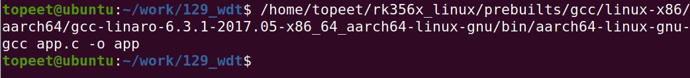
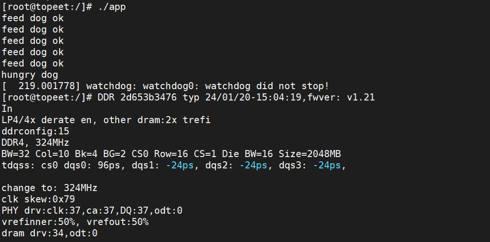

# 第214章 看门狗应用程序编写

本章学习在应用程序中如何使用看门狗。
## 214.1 看门狗操作步骤
本节通过打开设备节点、设置超时时间、喂狗等三步完成以下看门狗实验代码。
(1) 打开设备节点：以可读可写模式打开/dev/watchdog0，失败则输出“open error”并返回-1。(2) 设置超时时间：成功打开后，通过系统调用设超时时间为2 秒，失败输出“set time out error”并返回-2。(3) 喂狗操作：设置超时后，循环5 次执行喂狗操作，成功输出“feed dog ok”并暂停1 秒，失败输出“feed dog error”并返回-2。(4) 结束提示：完成喂狗循环后，输出“hungry dog”，程序以返回值0 正常结束。
本实验代码存放在iTOP-RK3568 开发板\07_学习教程配套资料\03_Linux 驱动配套资料\04_Linux 驱动程序\129_wdt\路径下。实验代码app.c 如代码清单214.1 所示：代码清单214.1
```c
#include <stdio.h>
#include <sys/types.h>
#include <sys/stat.h>
#include <fcntl.h>
#include <unistd.h>
#include <stdlib.h>
#include <sys/ioctl.h>
#include <linux/watchdog.h>
int main(int argc, char *argv[]) {
        int fd;
        // 用于存储设置的超时时间值
        int time_out;
        // 用于存储系统调用等操作的返回值
        int ret;
        // 用于循环计数，这里初始化为5，可能用于控制喂狗操作的次数等
        int i = 5;
```

```c
// 尝试打开看门狗设备文件"/dev/watchdog0"，以可读可写的方式打开
// O_RDWR：表示以可读可写模式打开文件
// 如果打开失败，fd 的值会小于0
fd = open("/dev/watchdog0", O_RDWR);
if (fd < 0) {
    // 如果打开失败，打印错误信息"open error"
    printf("open error\n");
    // 返回-1，表示程序因打开设备文件失败而异常退出
    return -1;
}
// 设置超时时间为2 秒
time_out = 2;
//使用ioctl 系统调用设置看门狗设备的超时时间
// fd：是前面打开的设备文件描述符
// WDIOC_SETTIMEOUT：是一个定义在<linux/watchdog.h>中的宏，用于表示设置超时时间的ioctl 命令
// &time_out：是要设置的超时时间值的地址，作为ioctl 调用的参数传递进去
ret = ioctl(fd, WDIOC_SETTIMEOUT, &time_out);
if (ret < 0) {
    // 如果设置超时时间失败，打印错误信息"set time out error"
    printf("set time out error\n");
    // 返回-2，表示程序因设置超时时间失败而异常退出
    return -2;
}
// 进入循环，循环次数由i 的值决定，每次循环执行喂狗操作并等待1 秒
while (i--) {
//使用ioctl 系统调用执行喂狗操作，保持看门狗设备处于活动状态
// WDIOC_KEEPALIVE：是一个定义在<linux/watchdog.h>中的宏，用于表示执行喂狗操作的ioctl 命令
// NULL：这里表示不需要额外的参数传递给喂狗操作
    ret = ioctl(fd, WDIOC_KEEPALIVE, NULL);
    if (ret < 0) {
        // 如果喂狗操作失败，打印错误信息"feed dog error"
        printf("feed dog error\n");
        // 返回-2，表示程序因喂狗操作失败而异常退出
        return -2;
    }
    // 如果喂狗操作成功，打印信息"feed dog ok"
    printf("feed dog ok\n");
    // 使程序暂停执行1 秒
    sleep(1);
}
// 循环结束后，打印信息"hungry dog"
```

```c
printf("hungry dog\n");
// 程序正常结束，返回0
return 0;
}
```
## 214.2 编译测试APP
使用aarch64-linux-gnu-gcc app.c -o app 命令交叉编译应用程序，编译成功如图214.1 所示。

图214.1测试程序app 拷贝到开发板上以后，使用./app 命令运行该程序，如下图214.2 所示。

图214.2从上图214.2 可以看出，程序首先会成功打开/dev/watchdog0 设备文件并设置超时时间为2 秒。然后进入喂狗操作的循环，每次循环执行喂狗操作。由于程序在循环中按设定会自动进行喂狗操作，在循环执行期间（也就是前5 次喂狗操作过程中），看门狗设备会持续收到“系统正常运行”的信号，所以不会触发看门狗的超时复位机制。但当循环结束（完成5 次喂狗操

作）后，程序不再发送喂狗信号，此时如果超过了之前设置的2 秒超时时间，看门狗设备就会认为系统出现故障（因为没有按时收到“喂狗”信号），进而系统重启。

