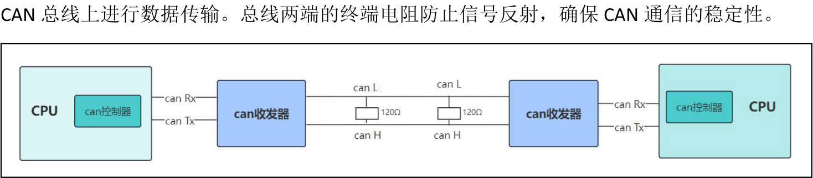
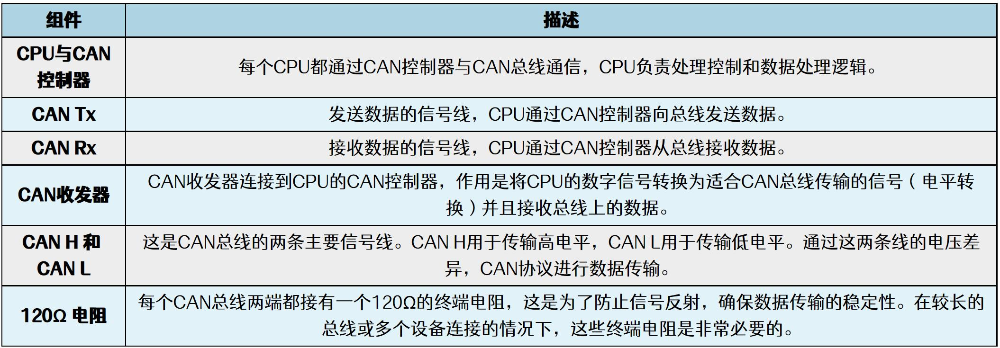
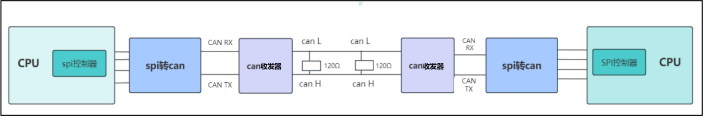
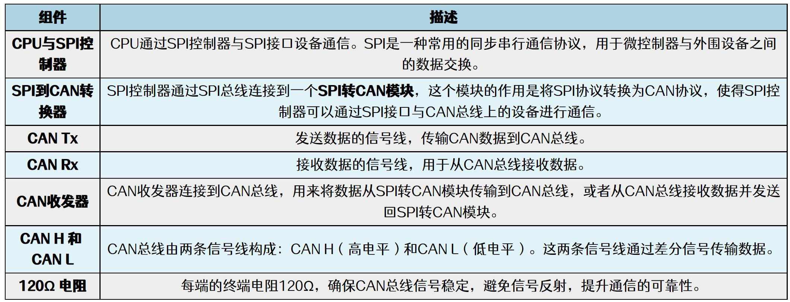
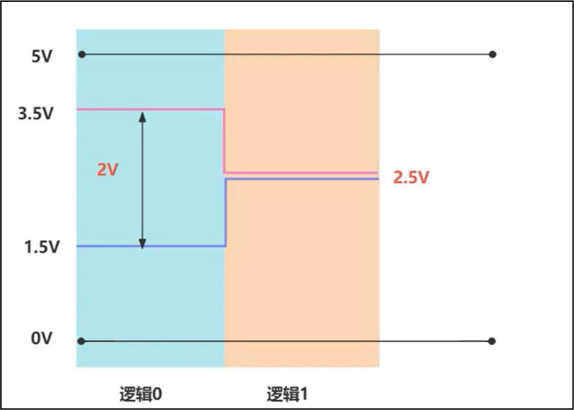
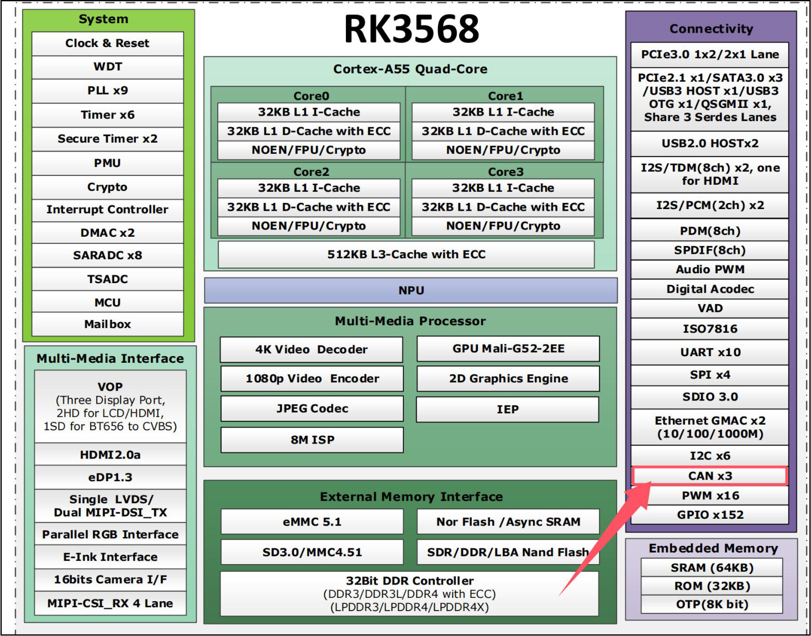
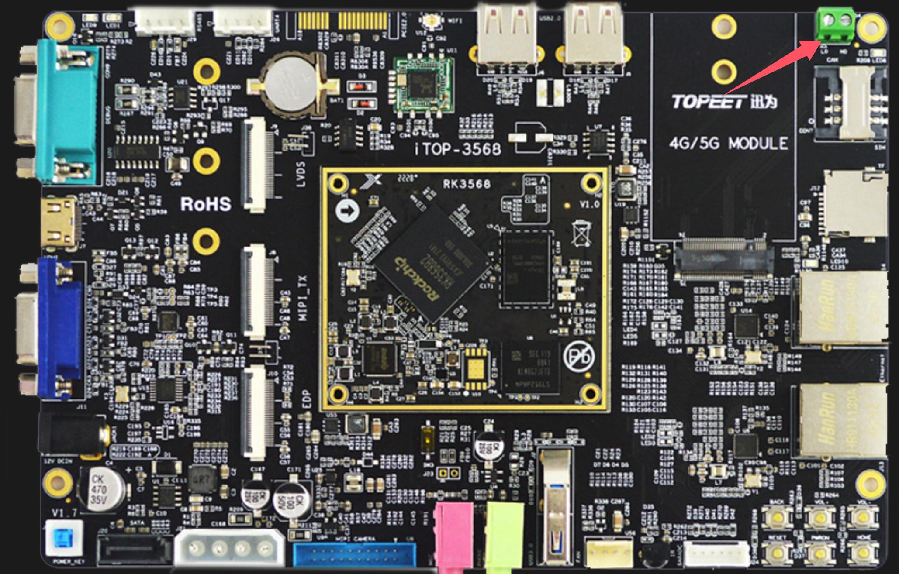
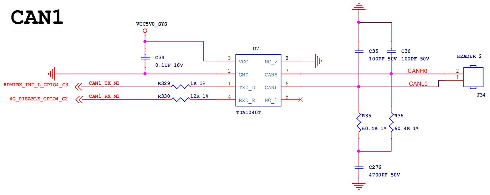

# 第215章 CAN总线概述

本章学习CAN 总线的基本知识。
## 215.1 CAN 总线介绍
CAN（Controller Area Network）总线是由博世（Bosch）公司于1986 年推出的串行通信协议，专为汽车电子系统设计，旨在减少车辆中线束数量，实现多个电子控制单元（ECU）之间的高效通信。
1.CAN 总线核心特点CAN 总线支持多主通信，所有节点均可主动发送数据，无需依赖中心控制器。其采用非破坏性仲裁机制，通过ID 优先级解决总线冲突，确保高优先级数据优先传输。CAN 总线具备高可靠性，内置CRC 校验、错误检测与恢复机制，同时采用差分信号增强抗电磁干扰能力。此外，CAN 总线通过简化布线和降低系统复杂度，实现了低成本的优势。2. 应用领域(1)汽车电子：发动机控制、车身模块（灯光/门窗）、诊断系统（OBD-II）等。(2)工业自动化：PLC、传感器网络、机器人控制。(3)其他领域：医疗设备、航空航天、智能楼宇。3.发展历程1983 年：Bosch 启动汽车网络技术研究。1986 年：正式发布CAN 协议。1987 年：英特尔与飞利浦推出首款CAN 控制器芯片。1991 年：CAN 2.0 规范发布，首次应用于奔驰S 级轿车。1993 年：成为国际标准（ISO 11898）。2015 年：CAN FD（Flexible Data Rate）标准化（支持更高速率与64 字节数据）。2020 年：下一代CAN XL 发布，带宽进一步提升。

## 215.2 CAN 总线硬件连接
在CAN 总线硬件连接中，有CPU 自带CAN 控制器和CPU 没有CAN 控制器需外设转接（如SPI 转CAN）这两种情况，本小节将对这两种连接方式进行讲解。（1）CPU 自带CAN 控制器如图215.1 所示，CPU 内部集成了CAN 控制器，通过该控制器直接连接外部CAN 收发器。CAN 收发器负责将来自CAN 控制器的数字信号转换为差分信号（CAN_H 和CAN_L），用于在

图215.1CPU 自带CAN 控制器连接图中各部分介绍如图215.2 所示。

图215.2（2）CPU 没有CAN 控制器如图215.3 所示，若CPU 不集成CAN 控制器，可通过SPI 接口连接一个SPI 转CAN 模块（如mcp2515），也可以通过其他接口，这里只是以SPI 接口为例。SPI 转CAN 模块负责将SPI 信号转换为标准CAN 协议信号并与CAN 收发器及总线交互。总线两端的终端电阻也是为了确保CAN通信的稳定性。

图215.3CPU 没有CAN 控制器连接图中各组件的介绍如图215.4 所示。

图215.4
## 215.3 CAN 总线电气属性
1.CAN 总线信号电平CAN 总线使用CAN_H（高电平）和CAN_L（低电平）两条信号线进行数据传输。CAN_H 和CAN_L 之间的电压差异决定了逻辑信号的状态。（1）CAN_H：高电平信号线，通常电压范围为2.5V 至3.5V。（2）CAN_L：低电平信号线，通常电压范围为1.5V 至2.5V。2.差分信号和抗干扰CAN 总线通过差分信号进行数据传输，信息的传输依赖于CAN_H 与CAN_L 之间的电压差，而不是单独的电压值。差分信号的特性使得CAN 总线在噪声环境中具有极强的抗干扰能力。差分信号的优点：噪声通常同时影响CAN_H 和CAN_L，但由于差分信号依赖于两者的电压差，噪声对两者的影响会相互抵消，从而保持信号的完整性。3.工作状态隐性状态（逻辑1）：当CAN_H 与CAN_L 的电压相等（通常为2.5V），表示总线处于空闲状态。此时，总线没有数据传输，所有设备都在等待通信。因此隐性状态也被称为“空闲电

平”或“逻辑1”。显性状态（逻辑0）：当CAN_H 与CAN_L 的电压差为2V 时，表示数据正在传输。具体来说，CAN_H 为3.5V，CAN_L 为1.5V，表示逻辑0。显性状态表示总线正在传输数据，且具有较高的优先级。CAN 总线逻辑状态如图215.5 所示，其中蓝色部分是显性0.橘色部分是隐性1。

图215.5
## 215.4 iTOP-RK3568 开发板CAN 接口介绍
RK3568 处理器至多可以使用3 个CAN 接口，如图215.6 所示。

图215.6而在iTOP-RK3568 开发板上因为外设复用的关系，只引出了1 个CAN 接口，如图215.7 所示。

图215.7

图215.8
其中TJA1040T 是一款由恩智浦（NXP）公司生产的高速CAN 收发器芯片。负责将CPU 的数字信号转换为适合CAN 总线传输的信号，也可以接收来自CAN 总线上的数据。根据网络标号可以得到开发板使用的是CAN 总线是CAN1，那另外2 组CAN 被用在了哪里呢？如果在自己做的底板上想要使用3 路CAN 要如何做呢？这就要查看具体的复用关系了，整理好的复用关

