# 第216章CAN总线中帧格式

系如图215.9 所示。
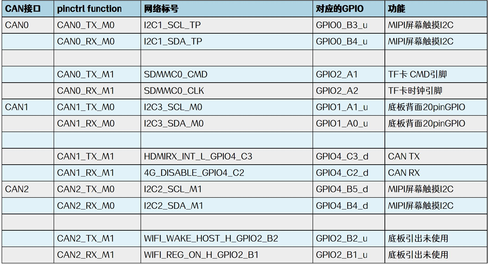
图215.9
帧是CAN 总线通信中数据传输的基本单位，在CAN 总线通信中有数据帧、遥控帧、错误帧、过载帧和帧间隔五种不同类型的帧。
## 216.1 数据帧
数据帧是CAN 通信中最常用的帧类型，主要用于传输实际数据，数据帧由帧起始、仲裁段、控制段、数据段、CRC 段、ACK 段和帧结束七部分组成。数据帧有标准数据帧和扩展数据帧两种格式，如图216.1 所示为标准数据帧结构。
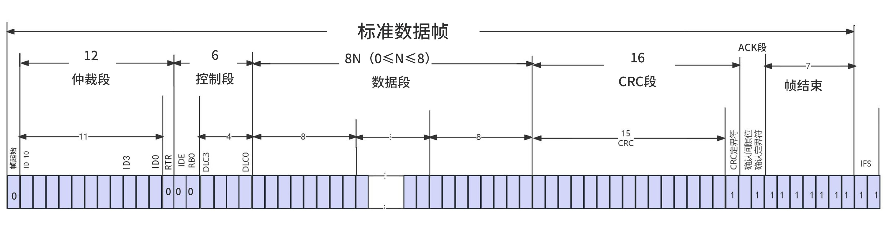

图216.1图216.1 中帧起始SOF 为一个显性0 位，用于标识数据帧的开始。它不仅通知接收设备准备接收数据，还起到同步发送端和接收端时钟的作用，确保后续数据解析的准确性。仲裁段由11 位标识符ID 和1 位远程传输请求RTR 位组成。其ID 值越小优先级越高。RTR位则用于区分是数据帧还是遥控帧，RTR 位为显性0 表示数据帧，为隐性1 则表示遥控帧。控制段由1 位IDE、1 位保留位r0 和4 位数据长度码DLC 组成。IED 用于区分标准帧和扩展帧，IED 为显性0 表示标准帧，为隐性1 则表示扩展帧。r0 位固定为显性0 以备未来扩展使用。DLC 位用于指示后续数据段的字节数，范围为0 到8 个字节。数据段用于承载0 到8 位字节的实际通信数据内容，长度由DLC 决定。CRC 段由15 位CRC 码加1 位界定符组成。接收设备通过重新计算CRC 位并与接收到的CRC校验码进行比对验证数据完整性。CRC 界定符固定为隐性1 来明确CRC 字段的结束位置。ACK 段由1 位ACK 槽和1 位界定符组成。当接收设备成功接收到数据帧后，会在ACK 槽中返回一个显性位作为确认信号，表示数据帧已正确接收。ACK 界定符固定为隐性1 来标识ACK字段的结束。帧结束由七个连续隐性位构成。用于明确标识数据帧的结束，它不仅告诉接收设备数据帧已经传输完毕，还提供了额外的时间用于信号同步，确保下一帧的正确接收。扩展数据帧与标准数据帧主要是仲裁段和控制段的区别，其余部分扩展数据帧与标准数据帧格式相同，不同部分如图216.2 所示。

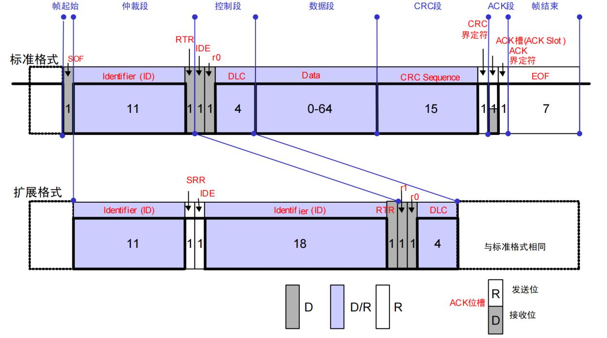
图216.2在仲裁段扩展数据帧将标准数据帧的11 位标识符扩展到了29 位，能支持多达2^29 种标识符，并添加1 位替代位SRR 和1 位扩展标志位IDE，SRR 固定为隐性1 用于与标准帧兼容，IDE 固定为隐性1 表示该帧为扩展帧。在控制段扩展数据帧则包含2 位保留位r1、r0 和4 位DLC。
## 216.2 遥控帧
遥控帧（Remote Frame）是CAN 协议中用于主动请求数据的特殊帧类型。当一个节点需要获取其他节点的数据时，可通过发送遥控帧向总线发起请求，目标节点收到请求后返回对应的数据帧。例如节点A 如果想要获取节点B 采集到的温度，就可以通过遥控帧请求数据，如图216.3 所示。

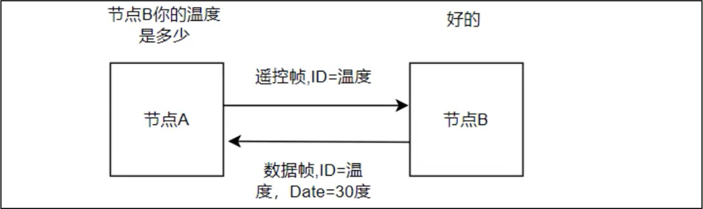
图216.3因为数据帧去掉数据段后就是遥控帧，所以遥控帧和数据帧一样也分标准遥控帧和扩展遥控帧，如图216.4 所示为标准遥控帧结构。
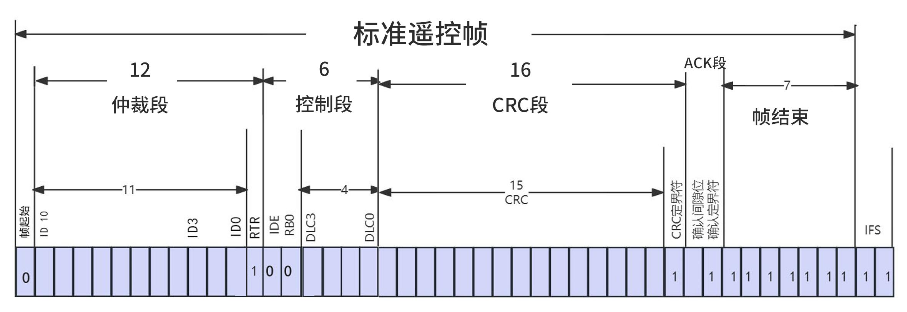
图216.4遥控帧各段解析与数据帧相同，只是遥控帧在仲裁段中的RTR 位改为隐性1，因此RTR 位的作用是区分是遥控帧还是数据帧。扩展遥控帧与标准遥控帧的区别也是在仲裁段和控制段，区别如图216.5 所示。

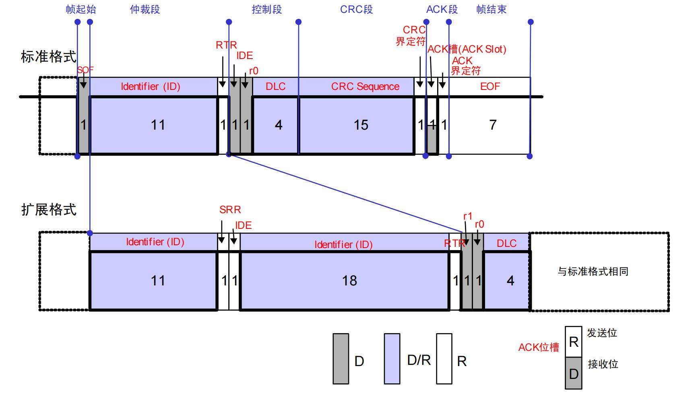
图216.5在扩展遥控帧中，仲裁字段扩展为29 位标识符ID，并添加1 位替代位SRR 和1 位扩展标志位IDE。其中，SRR 位为隐性1 替代标准帧的RTR 位，确保扩展帧在仲裁时优先级低于标准数据帧。IDE 位为隐性1 用于标识该帧为扩展帧。控制段则与标准数据帧和扩展数据帧中的控制字段相同。
## 216.3 错误帧
错误帧是CAN 总线中用于标识通信过程中发生错误的特殊帧，主要用于通知CAN 网络中的所有节点当前传输存在错误，其结构与其他帧（如数据帧或遥控帧）不同，错误帧的组成如图216.6 所示。

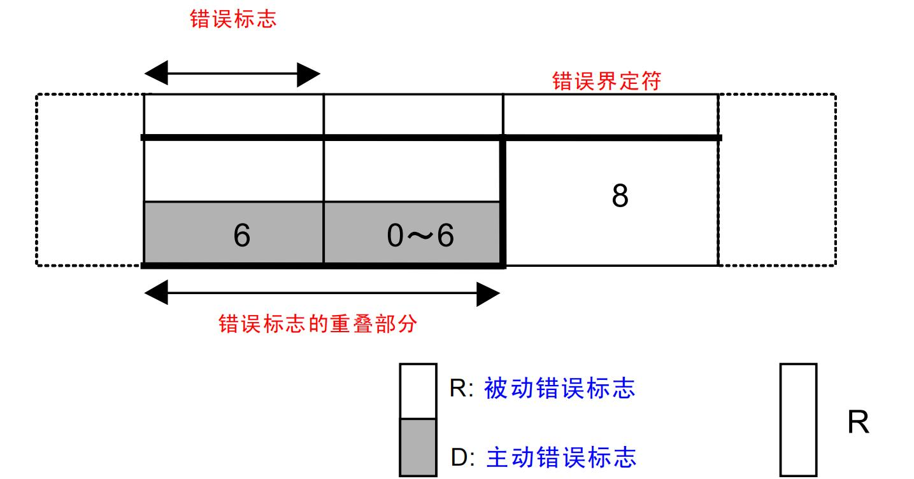
图216.6错误标志由6 位连续的显性0 位或隐性1 位组成，分为主动错误标志（6 个位的显性位）和被动错误标志（6 个位的隐性位）。主动错误标志由检测到错误的节点发送，强制中断当前帧的传输，通知网络中所有节点错误的发生。被动错误标志则由处于被动错误状态的节点发送，避免干扰其他节点的正常通信。错误界定符由8 位连续的隐性1 位组成，用于标识错误帧的结束。它确保所有节点能够明确识别错误帧的边界，并在错误处理完成后恢复正常的通信流程。
## 216.4 过载帧
过载帧是CAN 总线中用于通知网络中的其他节点当前接收设备需要更多时间来处理数据的特殊帧。它通常在接收节点无法及时处理接收到的数据时发送，以请求发送节点延迟下一帧的传输。过载帧的组成如图216.7 所示。

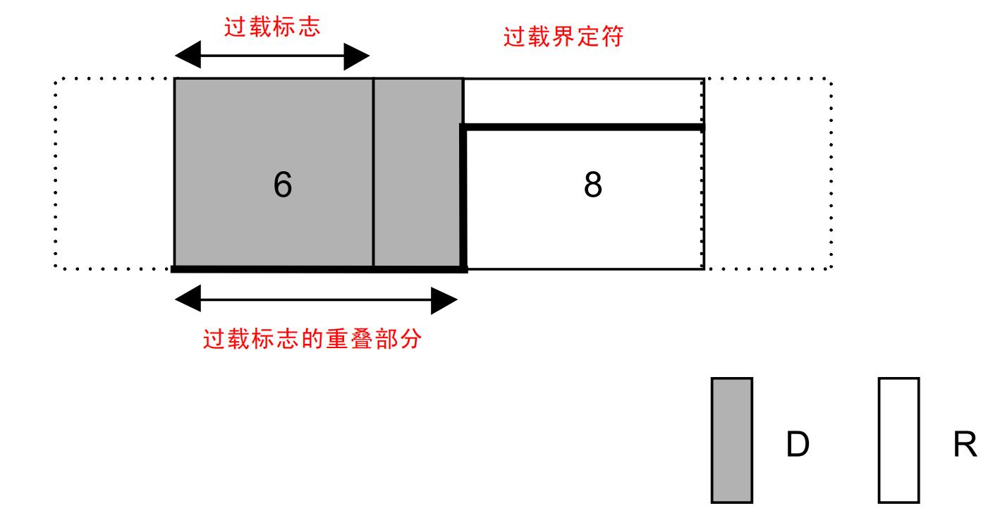
图216.7过载标志由6 位连续的显性0 位组成，由接收节点发送，用于通知网络中的其他节点当前接收设备需要更多时间来处理数据，从而请求延迟下一帧的传输。多个节点可以同时发送过载标志，这些标志会叠加在一起，形成一个更长的显性位序列。过载界定符由8 位连续的隐性1 位组成，用于标识过载帧的结束。它确保所有节点能够明确识别过载帧的边界，并在过载处理完成后恢复正常的通信流程。
## 216.5 帧间隔
帧间隔是CAN 总线中用于分隔数据帧、遥控帧或其他帧之间的时间段，确保网络中的节点能够正确处理前一帧并为下一帧的传输做好准备。帧间隔的长度和组成根据节点的状态（主动错误状态或被动错误状态）有所不同。帧间隔的组成如图216.8 所示。

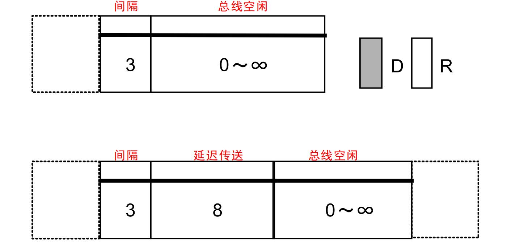
图216.8间隔字段由3 位连续的隐性1 位组成，用于提供一个固定的时间间隔，允许节点完成前一帧的处理，并为下一帧的传输做好准备。在此期间，总线处于空闲状态，任何节点不得发起新的帧传输。总线空闲时间由至少1 位隐性1 位组成，表示总线在帧之间的空闲状态。节点可以在此期间检测总线是否空闲，并决定是否开始发送下一帧。总线空闲时间的实际长度取决于网络负载和节点状态。延迟传送字段由8 位连续的隐性1 位组成，仅由处于被动错误状态的节点使用。它在间隔字段之后附加8 位隐性位，进一步延迟下一帧的传输，避免被动错误状态节点对网络通信的干扰，确保高优先级节点能够优先使用总线。
## 216.6 位填充
位填充是CAN 协议中用于确保数据传输过程中信号同步的重要机制，其作用是在数据帧中避免出现长时间不变的信号电平，从而保障发送端与接收端的同步。位填充规则：当数据中出现5 个连续的相同极性位时，在第6 位插入一个与这些位极性相反的填充位。填充范围：从帧起始部分到CRC 字段之间进行，CRC 字段之后的数据（如ACK 字段和帧结束）不进行填充。（1）示例1：

原始数据：110000011分析：出现5 个连续的相同极性位0，因此需填充。实际发送数据：1100000111接收方直接恢复原始数据：110000011（2）示例2：原始数据：0111111分析：出现5 个连续的1，在第6 位插入一个0。实际发送数据：01111101接收方检测并移除填充位，恢复原始数据：0111111（3）示例3：原始数据：1000001111分析：出现5 个连续的0，在第6 位插入一个1，插入1 之后，又出现了五个连续的1，所以在最后一位需要补0。实际发送数据：100000111110接收方检测并移除填充位，恢复原始数据：1000001111
## 216.7 CAN 总线波形实例分析
### 216.7.1 实例分析1
实例1 的波形如图216.9 所示。
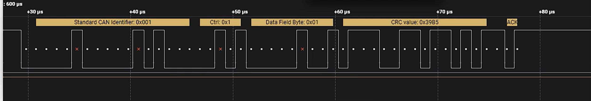
图216.9首先提出一个疑问，在前面的学习中，CAN 通信是由一对差分信号线决定的，但为啥图220.9中的CAN 波形就只有一根信号线呢？这是因为图220.9 中波形是由逻辑分析仪采集得到的，逻辑分析仪会自动将差分信号转换为逻辑信号，这样可以方便对CAN 波形进行分析。图216.9 中首先是帧起始，帧起始由一个固定的显性位（逻辑0）组成，用于标识数据帧的开始，如图216.10 所示。

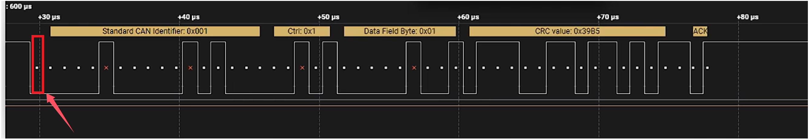
图216.10接下来是12 位（图226.11 中红色框）的仲裁字段，其中前11 位（图226.11 中蓝色框）为标识符（ID），最后一位是远程传输请求RTR 位，如图216.11 所示，其中部分位被标记为红色×的表示填充位，这些填充位在波形分析时需忽略。此处RTR 位为显性位（逻辑0），所以当前传输的帧为数据帧。
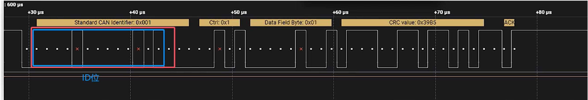
图216.11仲裁字段后面是六位的控制字段（图216.12 中蓝色框），包括1 位IDE 位、1 位保留位（R0）和4 位数据长度码（DLC）。其中IDE 位为显性位（逻辑0），所以当前帧为标准帧。保留位R0 默认为显性位（逻辑0）。后四位的DLC 位为0001，表示数据区将包含1 字节（8 位）数据。
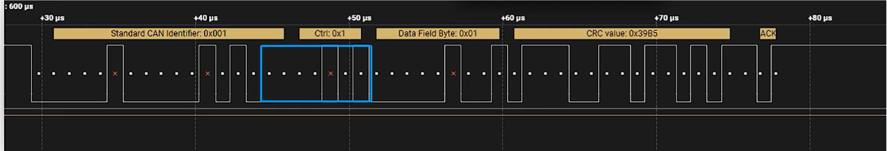
图216.12接下来是8 位的数据字段，它用于承载实际通信数据内容，如图216.13 中蓝色框所示，要发送的数据为00000001。
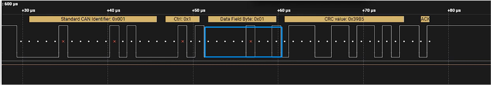

图216.13接下来的CRC 校验字段由15 位CRC 校验码和1 位CRC 界定符组成，用于检测数据传输过程中是否发生错误，如图216.14 中蓝色框所示。其中最后一位的CRC 界定符固定为隐性1，用于明确CRC 字段的结束位置。
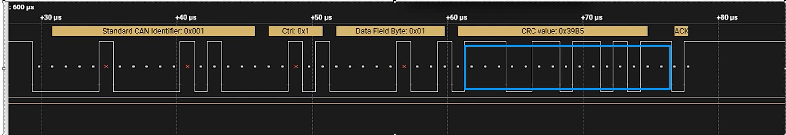
图216.14接下来的两位是ACK 字段，包括1 位ACK 槽和1 位ACK 界定符，如图216.15 中蓝色框所示。当接收设备成功接收到数据帧后，会在ACK 槽中返回一个显性位作为确认信号，表示数据帧已正确接收。ACK 界定符固定为隐性1，用于标识ACK 字段的结束。
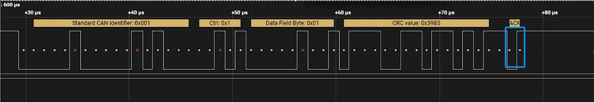
图216.15最后是由7 位连续的隐性位（逻辑1）组成的帧结束，用于明确标识数据帧的结束。至此，关于该数据帧的分析就完成了。
### 216.7.2 实例分析2
实例2 的CAN 波形图如图216.16 所示。
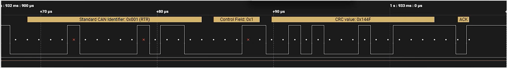
图216.16仍然按照实例1 的逻辑来分析，首先是帧起始，由一个固定的显性位（逻辑0）组成，用于标识数据帧的开始，如图216.17 中蓝色框所示。

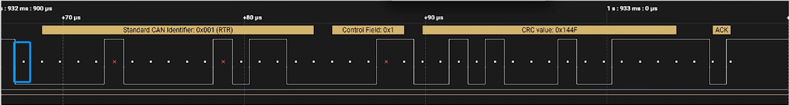
图216.17接下来是12 位的仲裁字段，其中前11 位为标识符（ID）最后一位是远程传输请求RTR 位组成，如图216.18 中蓝色框所示，其中部分位被标记为红色×的表示填充位，这些填充位在波形分析时需忽略。此处RTR 位为隐性位（逻辑1），并且之后没有数据字段，所以当前传输的帧为遥控帧。
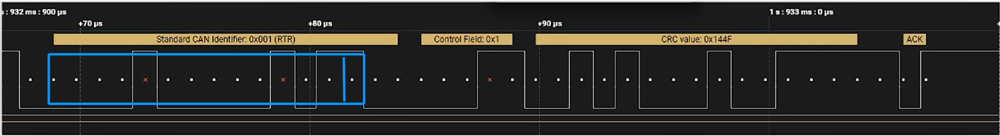
图216.18仲裁字段后面是六位的控制字段，包括1 位IDE 位、1 位保留位（R0）和4 位数据长度码（DLC），如图216.19 中蓝色框所示。其中IDE 位为显性位（逻辑0），所以当前帧为标准遥控帧，保留位R0 默认为显性位（逻辑0），后四位的DLC 位为0001，理论上表示后续将发送1 字节数据，但由于当前帧是遥控帧，所以不会实际发送数据字段。
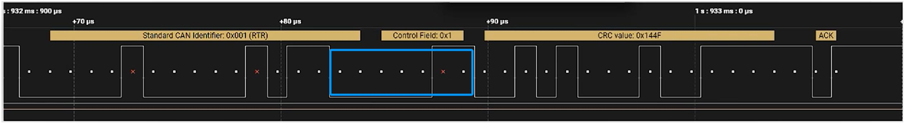
图216.19接下来的CRC 校验字段由15 位CRC 校验码和1 位CRC 界定符组成，用于检测数据传输过程中是否发生错误，如图216.20 中蓝色框所示。其中最后一位的CRC 界定符固定为隐性1，用于明确CRC 字段的结束位置。
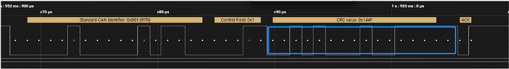
图216.20接下来的两位是ACK 字段，包括1 位ACK 槽和1 位ACK 界定符，如图216.21 中蓝色框所

示。若接收设备成功接收，会在ACK 槽中返回一个显性位作为确认信号，ACK 界定符固定为隐性1，用于标识ACK 字段的结束。
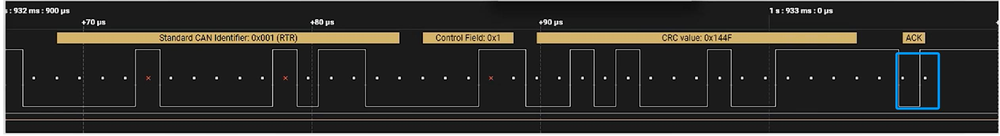
图216.21最后是由7 位连续的隐性位（逻辑1）组成的帧结束，用于明确标识数据帧的结束。至此，关于该数据帧的分析就完成了。
### 216.7.3 实例分析3
实例3 的CAN 波形图如图216.22 所示。
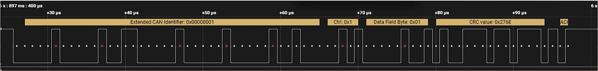
图216.22仍然按照实例1 的逻辑来分析，首先是帧起始，帧起始由一个固定的显性位（逻辑0）组成，用于标识数据帧的开始，如图216.23 中蓝色框所示。
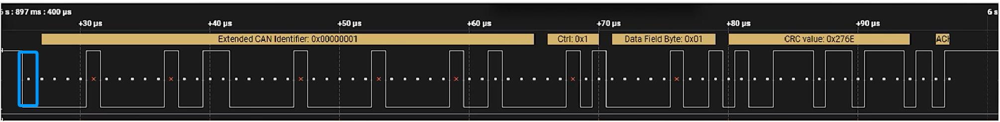
图216.23根据波形长度以及上方黄色标识可以得到，该帧为扩展帧，其仲裁字段总共由29 位标识符（ID）、SRR 位、IDE 位和RTR 位组成。首先前11 位为基础ID，第12 位是SRR 位，如图216.24中蓝色框所示。其中部分位被标记为红色×的表示填充位，这些填充位在波形分析时需忽略。此处SRR 位为隐形位（逻辑1）。
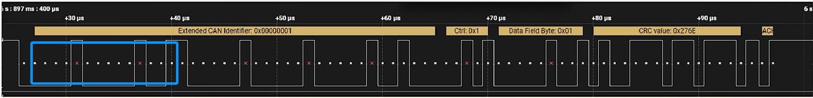
图216.24接下来是仲裁字段第13 位IDE 位，同样为隐性位（逻辑1），如图216.25 中蓝色框所示，说明该帧为扩展帧，但具体是扩展遥控帧还是扩展数据帧，还需要继续向下分析。

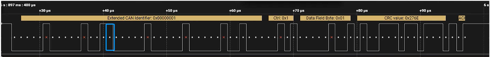
图216.25接下来是仲裁字段剩余的19 位，其中前18 位为扩展ID，组成完整的29 位标识符，最后一位为RTR 位，如图216.26 中蓝色框所示。其中最后一位的RTR 位为显性位（逻辑0），所以当前传输的帧为扩展数据帧，而非遥控帧。
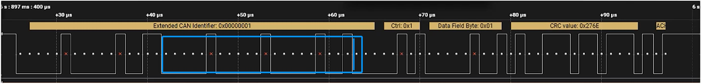
图216.26接下来的六位是控制字段，包括2 位保留位（R1 和R0）和4 位数据长度码（DLC），如图216.27 中蓝色框所示。其中后四位的DLC 位为0001，表示后续将传输1 字节（8 位）数据。
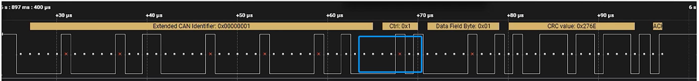
图216.27接下来是8 位是数据字段，用于承载实际通信数据内容，如图216.28 所示，要发送的数据为00000001。
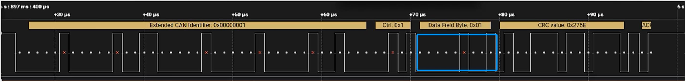
图216.28接下来是CRC 校验字段，由15 位CRC 校验码和1 位CRC 界定符组成，用于检测数据传输过程中是否发生错误，如图216.29 所示。其中最后一位的CRC 界定符固定为隐性1，用于明确CRC 字段的结束位置。
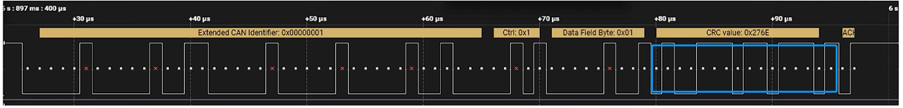
图216.29接下来的两位是ACK 字段，包括1 位ACK 槽和1 位ACK 界定符，如图216.30 所示。当接

