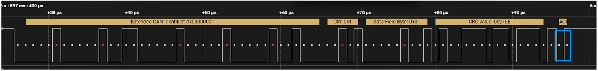
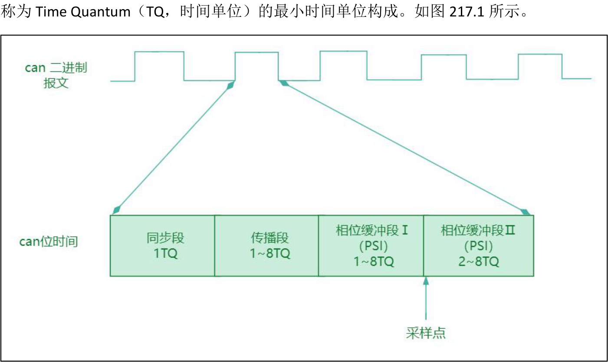
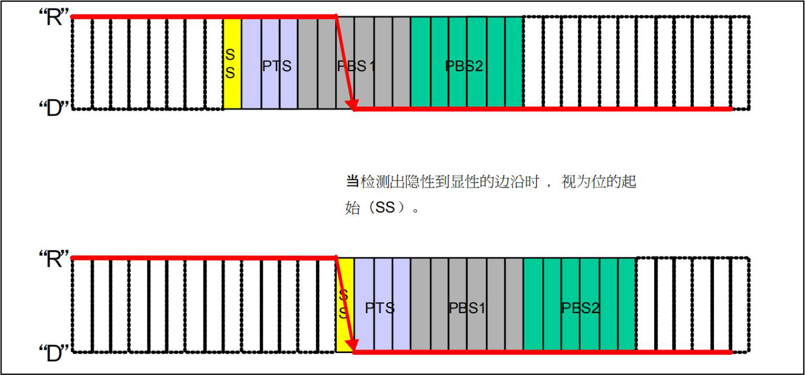
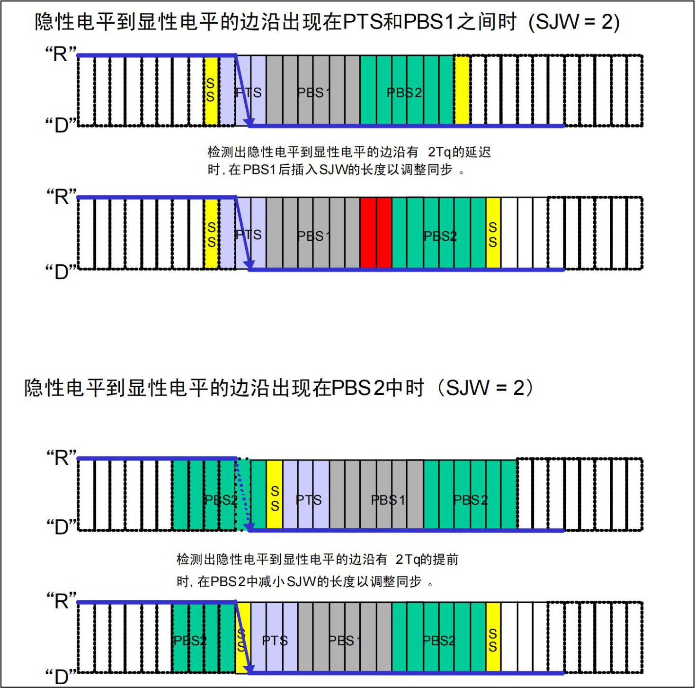
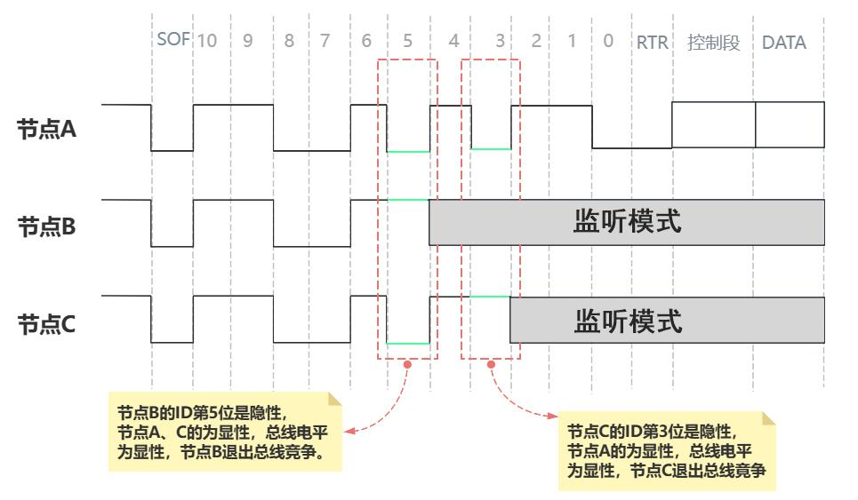
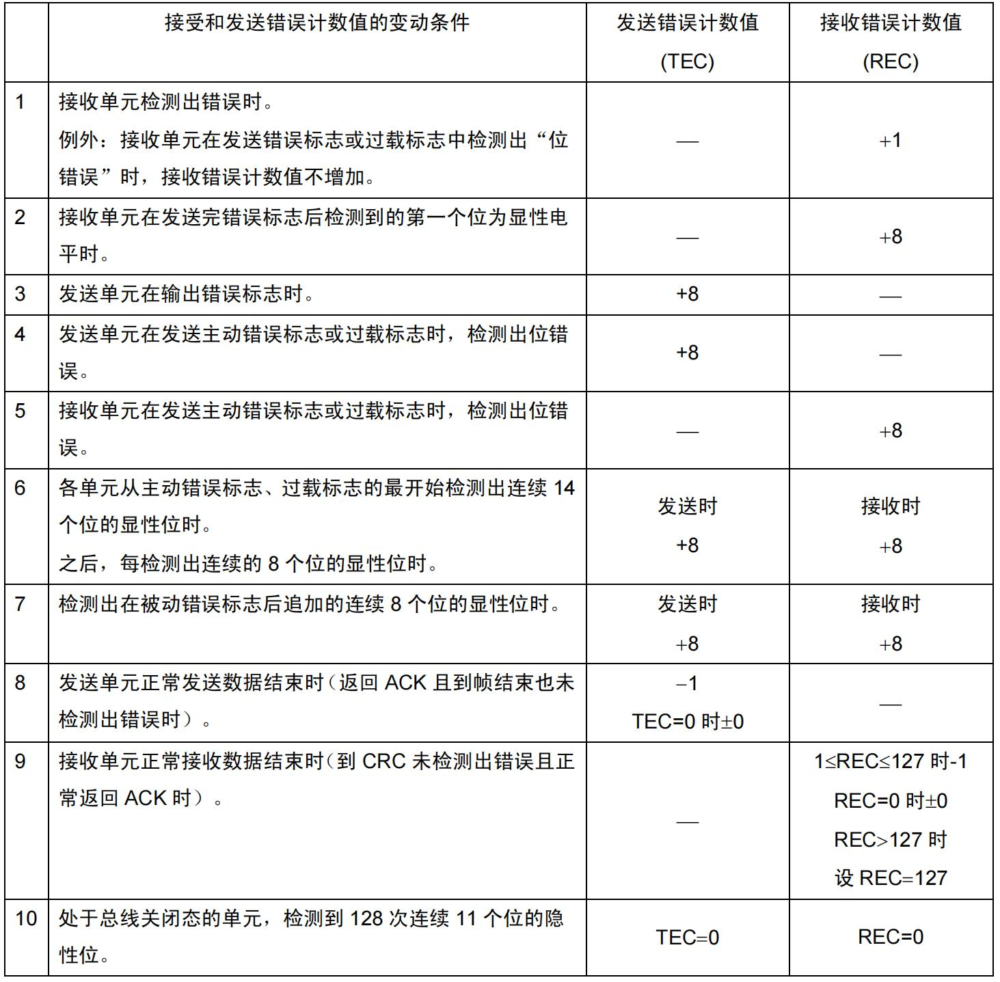
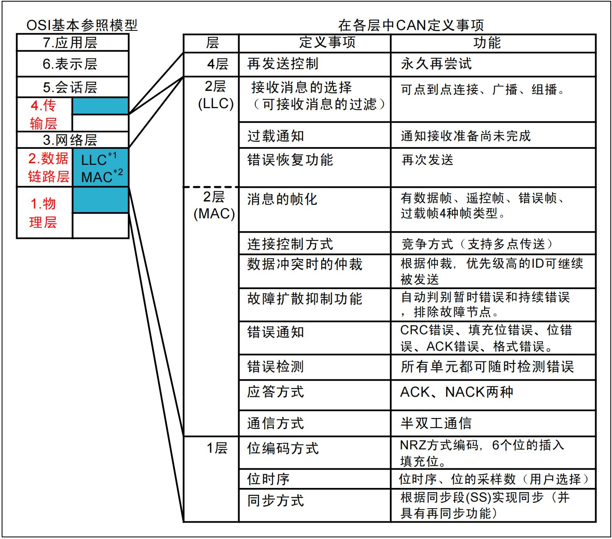
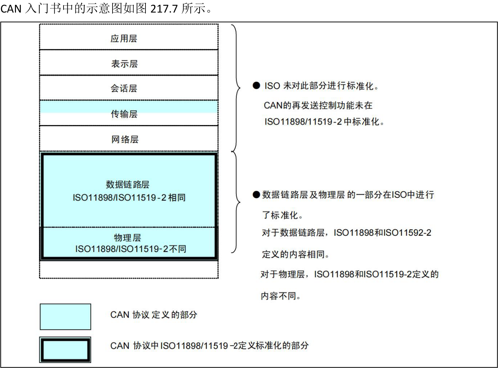

# 第217章CAN总线核心机制

收设备成功接收到数据帧后，会在ACK 槽中返回一个显性位作为确认信号，表示数据帧已正确接收，ACK 界定符固定为隐性1，用于标识ACK 字段的结束。

图216.30最后是由7 位连续的隐性位（逻辑1）组成的帧结束，用于明确标识数据帧的结束。至此，关于该数据帧的分析就完成了。
## 217.1 位时间
位时间（Bit Time）是指一个二进制位在总线上传输所需的时间，它由4 段组成，每段又由

图217.1位时间的4 个段分别是同步段、传播段、相位缓冲段PS1 和相位缓冲段PS2。各段介绍如下。其中同步段用来判断节点与CAN 总线是否同步，主要看总线上边沿的跳变是否包含在SS段内。传播段、相位缓冲段PS1 和相位缓冲段PS2 用来补偿误差从而实现同步。因此位时间的

作用为：（1）保证时钟同步：通过划分时间段，CAN 节点能够在信号边沿出现时动态调整采样点，补偿时钟偏差和信号延迟，从而实现多节点间的同步。（2）提高抗干扰能力：将采样点设置在信号稳定区域（如位时间的87.5%处），避免因信号边沿抖动或干扰导致的误判。（3）支持灵活配置：通过调整各时间段的长度（如传播段、相位缓冲段等），可以适应不同的波特率和网络环境。
## 217.2 硬同步和再同步
在CAN 通信中，由于采用异步通信方式且没有独立时钟线，各节点依赖本地晶振进行数据传输，但晶振的时钟漂移会导致节点间时序逐渐偏移，最终引发采样错误。为解决这一问题，CAN 协议通过硬同步和再同步两大机制实现动态时序调整。
### 217.2.1 硬同步
硬同步是在帧起始位（SOF）时触发的一种初始同步机制，用于消除各节点在通信开始时的初始时序差异。。硬同步的触发条件是当总线处于空闲状态（连续的隐性位），一旦检测到SOF 位的显性电平下降沿，节点立即执行硬同步，将其位时间的起点（同步段）对齐到该下降沿。这一过程可以分为以下几个步骤：（1）节点在总线空闲期间持续监测电平变化；（2）当检测到下降沿时，节点会检测下降沿是否在SS 段上，如果不在说明内部时序与总线不同步。（3）节点强制调整时序，将当前位的ss 段起点对齐到该边沿，并重新开始后续位时间的计数。以上步骤如图如图217.2 所示。

图217.2然而，硬同步的作用范围有限，它仅在消息帧的起始阶段生效，且只能解决初始相位偏差问题。对于通信过程中由于时钟漂移或信号干扰引发的动态相位误差，硬同步无能为力，这些问题需要依赖后续的重同步机制来处理。
### 217.2.2 再同步
与硬同步不同，再同步并非仅限于帧起始阶段，而是在整个数据传输过程中持续发挥作用。它的核心作用是通过动态调整采样点的位置，确保接收节点能够在正确的时间读取总线电平，从而维持通讯的可靠性。再同步的触发条件是当检测到信号边沿（如显性电平到隐性电平的变化）与预期位置存在偏差时，即视为发生相位误差，触发再同步。·如果信号边沿提前到达，说明发送节点的时钟快于接收节点，此时接收节点会通过缩短相位缓冲段1 来提前采样点；·如果信号边沿延迟到达，则说明发送节点的时钟慢于接收节点，接收节点会通过延长相位缓冲段2 来推迟采样点。每次调整的最大幅度由同步跳转宽度（SJW, Synchronization Jump Width）决定，防止调整过度导致新的采样错误。我们看图217.3 中的例子。

图217.3图217.3 上半部分隐形电平到显性电平的边沿出现在PTS 和PBS1 之间，并相对SS 段慢了2 个TQ，所以在PBS1 段插入SJW 为2 个TQ 的时间补偿误差时间从而实现同步。图221.3 下半部分隐形电平到显性电平的边沿出现在PTBS2 中，并相对SS 段快了2 个TQ 的时间，所以在PBS2 中减少SJW 为2 个TQ 的时间补偿误差时间从而实现同步。再同步的优势在于其灵活性和实时性，能够有效应对通信过程中因时钟漂移或信号传播延迟带来的挑战。然而，再同步的调整范围受限于SJW 的配置，若相位误差超出SJW 的限制，则可能导致采样错误，进而影响通讯的可靠性。因此，再同步与硬同步协同工作，共同构成了CAN 协议中完整的同步机制。

## 217.3 仲裁规则
在CAN 总线通信中，多个节点共享同一条总线，但同一时刻只能传输一帧数据，为保证数据的有序传输，CAN 协议通过载波侦听、非破坏性仲裁和回读机制共同协作，实现多节点间的高效、无冲突通信。1.载波侦听每个节点在发送数据前首先侦听总线状态，仅在总线空闲时（即没有其他节点发送数据）才允许开始发送。有效避免了多个节点同时抢占总线的情况。如果两个或多个节点几乎同时检测到总线空闲并开始发送数据，则进入非破坏性仲裁阶段。2.非破坏性仲裁非破坏性仲裁是CAN 仲裁机制的核心。基于线与机制工作，所有节点在发送隐性电平（逻辑1）时，总线表现为隐性，一旦有节点发送显性电平（逻辑0），总线则转为显性。仲裁过程具体如下：（1）每个数据帧的标识符（ID）用于仲裁，ID 越小优先级越高。（2）当多个节点同时发送数据时，它们逐位比较各自发送的ID 与总线电平。如果某个节点发送隐性电平但检测到总线上为显性电平，则说明有更高优先级的节点在传输，该节点会立即停止发送，进入监听模式，待总线空闲后再次尝试发送。反之，如果节点发送显性电平，且总线上也为显性电平，则该节点继续发送，表明其当前具有最高优先级。仲裁过程如图217.4 所示。

图217.43.回读机制为确保仲裁正确与数据可靠传输，发送节点不断回读总线上信号并与自身发送的数据进行比较。如果发现回读数据与发送数据不符，例如发送隐性电平但回读显性电平，则说明发生了仲裁冲突。此时，节点将立即停止发送并切换到监听模式，确保低优先级节点及时退出，避免干扰高优先级节点的通信。
## 217.4 错误状态和错误检测机制
在CAN 总线通信中，错误状态管理和错误检测机制是保障系统可靠性的关键环节。CAN 协议通过定义主动错误状态、被动错误状态和总线关闭态三种错误状态，结合多种错误检测手段（如位错误、填充错误、CRC 错误等），构建了一套完整的容错体系。这些机制不仅能够快速发现通信中的异常，还能根据节点的错误严重程度动态调整其行为，从而有效隔离故障节点，避免对整体网络的影响。接下来，我们将对错误状态以及错误检测机制进行讲解。
### 217.4.1 错误状态
错误状态有三种。1 主动错误状态

当节点的发送错误计数器（TEC）和接收错误计数器（REC）均小于或等于127 时，节点处于主动错误状态。在此状态下，节点能够正常参与总线通信，并在检测到错误时主动发送主动错误标志（显性位）。这种显性标志会强制覆盖总线信号，通知其他节点当前存在错误。由于显性位具有更高的优先级，这种机制能够快速传播错误信息，从而确保错误被及时处理，维护总线通信的可靠性。2 被动错误状态如果节点的发送错误计数器（TEC）或接收错误计数器（REC）超过127（通常由TEC 触发），节点将进入被动错误状态。在这一状态下，节点仍可参与通信，但其行为受到限制，它不能主动发送显性错误标志，而是发送被动错误标志（隐性位），以避免对总线造成干扰。此外，每次发送后需插入8 个隐性位的延迟才能再次尝试通信。值得注意的是，如果仅被动错误状态的节点检测到错误，而其他主动节点未检测到，则总线被视为无错误，通信继续进行。这种设计既限制了低可靠性节点对总线的影响，又保证了高可靠性节点的通信效率。3 总线关闭态当节点的发送错误计数器（TEC）超过255 时，节点进入总线关闭态。在这种状态下，节点完全禁止通信，既不能发送也不能接收数据，以防止其对总线造成进一步干扰。要恢复通信，节点需要检测到128 次连续的11 个隐性位（即总线空闲足够长时间），随后重置TEC 和REC为0，从而恢复为主动错误状态并重新加入总线通信。这种机制旨在隔离严重故障节点，同时为其提供重新加入总线的机会。
更具体的接收错误计数值（REC）和发送错误计数值（TEC)的变动条件如图217.5 所示。

图217.5
### 217.4.2 错误检测机制
CAN 协议通过多种错误检测手段，有效提升了通信的可靠性。错误检测机制可以分为位错误、填充错误、CRC 错误、格式错误和ACK 错误五种，接下来对五种主要的错误检测机制进行介绍。1.位错误位错误是指发送单元在通信过程中会实时监测总线电平是否与自身输出一致（不包括填充位）。若在非仲裁阶段输出显性位却检测到隐性位，或输出隐性位却检测到显性位（不包括仲

裁期内的合法冲突），则判定为位错误。由于位错误是由发送单元自身检测到的，因此其检测单元为发送单元。2.填充错误CAN 协议规定，在位填充段中，每连续5 个相同电平后必须插入一个相反电平的填充位，以确保信号的直流平衡。如果接收单元检测到连续6 位相同的电平，则认为发生了填充错误。填充错误主要发生在数据帧和遥控帧的任意段内（从SOF 到EOF），其检测单元为接收单元。3.CRC 错误CRC 错误是指接收单元会根据接收到的数据字段与控制字段内容计算CRC 值，并与帧中携带的CRC 序列进行比较。若二者不一致，则判定为CRC 错误，说明数据可能在传输过程中损坏。CRC 错误通常发生在数据帧和遥控帧的CRC 段内，其检测单元为接收单元。4.格式错误格式错误是指接收单元在解析帧时检测到与固定格式的位段相反的格式时所触发的错误。例如，CRC 界定符、ACK 界定符或EOF 的非法值均可能导致格式错误。这种错误通常表明帧结构不符合CAN 协议的规范。格式错误可以发生在数据帧和遥控帧的CRC 界定符、ACK 界定符、EOF 段、以及错误界定符和过载界定符中，其检测单元为接收单元。5.ACK 错误ACK 错误是指发送单元在ACK 槽中检测到隐性电平时所触发的错误。在CAN 协议中，当发送单元完成数据帧或遥控帧的发送后，会在ACK 槽等待其他节点的确认信号（显性电平）。如果发送单元未检测到显性电平，则认为未收到确认信号，从而触发ACK 错误。ACK 错误主要发生在数据帧和遥控帧的ACK 槽段内，其检测单元为发送单元。
## 217.5 分层模型
CAN 设备在Linux 中被归类为网络设备。网络设备中经典架构是OSI 七层网络模型，OSI七层网络模型将网络通信过程分为七个功能层级。虽然CAN 协议并未完全遵循该模型，但其功能可映射到其中的部分层级，主要集中在物理层、数据链路层和传输层。OSI 七层网络模型介绍（1）物理层（Physical Layer）物理层负责设备间的物理信号传输，因此物理层定义了通信所需的电气信号、硬件规格和通信介质。其中涵盖了通信方式（如单工、半双工、全双工）、信号电平（如高低电平表示逻

辑0 和1）、硬件规格（如电缆、连接器、收发器）以及位时序条件（如位同步、采样点），从而确保数据能够在物理媒介上可靠传输。（2）数据链路层（Data Link Layer）数据链路层将物理层接收到的位序列组织成有意义的数据帧，并提供错误检测与控制功能。其具体项目包括数据帧的格式（如帧起始、标识符、数据字段、CRC 校验）、访问控制方法（如CSMA/CD、CSMA/CA）以及错误检测与纠正机制（如CRC 校验、ACK 应答），以确保数据在链路上传输的准确性和完整性。（3）网络层（Network Layer）网络层负责数据包的路由选择和中继，确保数据能够从源设备高效传输到目标设备。它通过路由选择（如静态路由、动态路由）、地址管理（如IP 地址分配）以及数据包的分段与重组等功能，实现跨网络的数据传输，为复杂网络环境中的通信提供支持。（4）传输层（Transport Layer）传输层确保数据传输的可靠性，控制数据顺序、错误恢复和流量控制。它通过数据传输顺序控制（如序列号、确认机制）、错误恢复（如重传机制）以及流量控制（如滑动窗口协议）等机制，保障数据在端到端传输过程中的一致性、完整性和高效性。（5）会话层（Session Layer）会话层管理通信会话的建立、维护和终止，确保数据能够在会话期间正确传输。它通过会话建立与终止（如握手协议）、会话同步（如检查点机制）以及会话恢复（如断点续传）等功能，协调应用程序之间的交互，提高通信的稳定性和效率。（6）表示层（Presentation Layer）表示层负责数据的表现形式转换，确保不同系统间的数据兼容性。它通过数据格式转换（如文本编码、图像格式）、数据加密与解密以及数据压缩与解压缩等功能，使数据能够在不同平台和应用之间进行无缝交换和处理。（7）应用层（Application Layer）应用层为应用程序提供网络服务接口，实现具体的应用功能。它通过应用程序协议（如HTTP、FTP、SMTP）、用户接口（如浏览器、邮件客户端）以及数据服务（如文件传输、电子邮件）等功能，直接服务于最终用户，满足多样化的网络应用需求。而CAN 协议主要集中在重物理层和数据链路层，接下来对CAN 协议中的物理层和数据链路层进行介绍：

（1）CAN 协议中的物理层物理层负责定义信号的实际发送方式，采用NRZ（非归零）编码，并采用位填充机制（每5 个连续相同电平插入1 个反向位）。它还定义了同步段（SS）、相位缓冲段（PS1、PS2）以实现位同步与再同步。CAN 协议标准并不具体规定物理电气参数（如信号电平、总线电阻、采样点位置、线缆特性等），这些由实现者根据系统需求自行定义。。（2）CAN 协议中的数据链路层数据链路层又可以分为MAC 子层和LLC 子层。MAC 子层（介质访问控制子层）负责将数据组织成帧，包括数据帧、遥控帧、错误帧和过载帧。它还处理数据冲突时的仲裁，根据优先级决定哪个消息继续发送，并通过ACK 和NACK进行应答。此外，MAC 子层检测并报告CRC 错误、填充位错误、位错误、ACK 错误和格式错误，同时具备故障扩散抑制功能，能够自动区分暂时错误和持续错误，并排除故障节点。LLC 子层（逻辑链路控制子层）则负责接收消息的选择，支持点到点连接、广播和组播。它还提供错误恢复功能，在检测到错误时进行重发控制，确保数据的可靠传输。CAN 协议中关于ISO/OSI 基本参照模型中的传输层、数据链路层及物理层，具体定义如图221.6 所示。

图217.6CAN 协议经过ISO 标准化后，分为ISO11898 和ISO11519-2 两种标准。这两个标准在数据链路层的定义是相同的，但在物理层有所不同，其中ISO11898 是通信速度为125kbps-1Mbps的CAN 高速通信标准，而ISO11519-2 则是通信速度为125kbps 以下的CAN 低速通信标准。在

图217.7ISO11898 和ISO11519-2 两个不同标准的对比表格如图217.8 所示。

