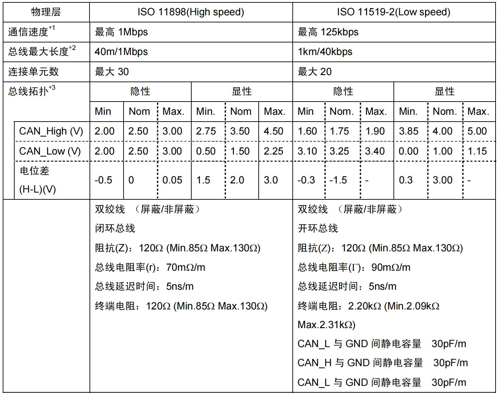
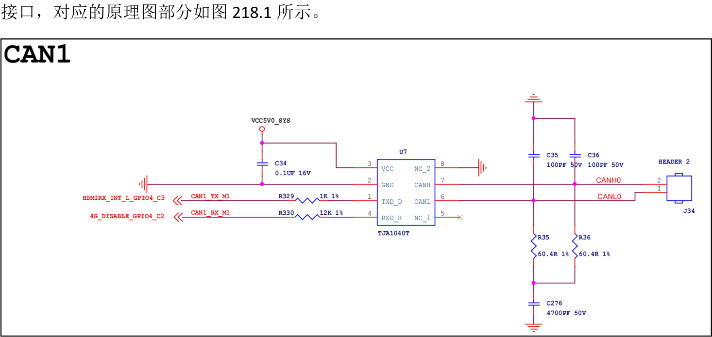

# 第218章 如何把CAN用起来?


图217.8
前面章节已介绍了CAN 通信的基础知识，并提到RK3568 这颗SOC 提供了3 路CAN 控制器。那么如何在Linux 系统中正确启用它们呢？本章将讲解如何通过修改设备树和内核配置来使能CAN 设备。
## 218.1 配置CAN 设备节点及内核
打开Linux 内核源码下的arch/arm64/boot/dts/rockchip/rk3568.dtsi 设备树文件，在其中可以找到三个CAN 控制器节点，如代码清单218.1 所示。代码清单218.1

```c
can0: can@fe570000 {
    compatible = "rockchip,canfd-1.0";
    reg = <0x0 0xfe570000 0x0 0x1000>;
    interrupts = <GIC_SPI 1 IRQ_TYPE_LEVEL_HIGH>;
    clocks = <&cru CLK_CAN0>, <&cru PCLK_CAN0>;
    clock-names = "baudclk", "apb_pclk";
    resets = <&cru SRST_CAN0>, <&cru SRST_P_CAN0>;
    reset-names = "can", "can-apb";
    tx-fifo-depth = <1>;
    rx-fifo-depth = <6>;
    status = "disabled";
};
can1: can@fe580000 {
    compatible = "rockchip,canfd-1.0";
    reg = <0x0 0xfe580000 0x0 0x1000>;
    interrupts = <GIC_SPI 2 IRQ_TYPE_LEVEL_HIGH>;
    clocks = <&cru CLK_CAN1>, <&cru PCLK_CAN1>;
    clock-names = "baudclk", "apb_pclk";
    resets = <&cru SRST_CAN1>, <&cru SRST_P_CAN1>;
    reset-names = "can", "can-apb";
    tx-fifo-depth = <1>;
    rx-fifo-depth = <6>;
    status = "disabled";
};
can2: can@fe590000 {
    compatible = "rockchip,canfd-1.0";
    reg = <0x0 0xfe590000 0x0 0x1000>;
    interrupts = <GIC_SPI 3 IRQ_TYPE_LEVEL_HIGH>;
    clocks = <&cru CLK_CAN2>, <&cru PCLK_CAN2>;
    clock-names = "baudclk", "apb_pclk";
    resets = <&cru SRST_CAN2>, <&cru SRST_P_CAN2>;
    reset-names = "can", "can-apb";
    tx-fifo-depth = <1>;
    rx-fifo-depth = <6>;
    status = "disabled";
};
```
由于每个节点的内容都是相似的，所以这里选取can0 节点的内容进行讲解，添加完具体注释的内容如代码清单218.2 所示。代码清单218.2

```c
can0: can@fe570000 {
        compatible = "rockchip,canfd-1.0";//匹配驱动使用的兼容字符串
        reg = <0x0 0xfe570000 0x0 0x1000>;//寄存器地址和长度
        interrupts = <GIC_SPI 1 IRQ_TYPE_LEVEL_HIGH>;//中断号为1，触发类型为高电平
        clocks = <&cru CLK_CAN0>, <&cru PCLK_CAN0>;// 定义时钟源：引用cru 节点中的CLK_CAN0（波
特率时钟）和PCLK_CAN0（APB 总线时钟）
        clock-names = "baudclk", "apb_pclk";//为时钟信号命名
        resets = <&cru SRST_CAN0>, <&cru SRST_P_CAN0>;//定义复位信号：引用cru 节点中的
SRST_CAN0（主复位）和SRST_P_CAN0（APB 复位）
        reset-names = "can", "can-apb";//为复位信号命名
        tx-fifo-depth = <1>;// 定义发送FIFO 深度为1，即一次只能存储一个待发送的消息
        rx-fifo-depth = <6>;// 定义接收FIFO 深度为6，即可以同时存储6 个接收到的消息
        status = "disabled";// 定义设备初始状态：默认禁用，启动时不会启用该设备
};
```
虽然SOC 支持3 路CAN，但由于引脚复用限制，iTOP-RK3568 开发板底板只实际引出了CAN1

图218.1而在rk3568.dtsi 设备树中can1 节点的status 设置的是disabled，表示不使能，接着打开rk3568-evb1-ddr4-v10-linux.dts 设备树，该设备树中对can1 节点的追加描述如代码清单218.3所示。代码清单218.3
```c
&can1 {
        compatible = "rockchip,rk3568-can-2.0";//匹配驱动使用的兼容字符串
        status = "okay";// 设置设备状态为"okay"，表示启用该设备
        assigned-clocks = <&cru CLK_CAN1>;//分配时钟源：引用cru 节点中的CLK_CAN1。
        assigned-clock-rates = <150000000>; //设置分配的时钟频率为150MHz，如果CAN 波特率低于
```

