# 第219章 CAN工具的移植和使用

```c
3Mbps，则建议将时钟频率设置为100MHz；否则设置为200MHz。
        pinctrl-names = "default";//定义引脚控制状态的名称，默认状态为"default"。
        pinctrl-0 = <&can1m1_pins>;//引用引脚配置节点&can1m1_pins，定义CAN1 的引脚复用和电气
属性。
};
```
若要启用其他CAN 控制器（如CAN0 或CAN2），可参考上述格式添加对应节点，并确保其状态设置为"okay"，同时配置正确的引脚复用和时钟参数。除了设备树配置，内核中还需启用相应的驱动。在迅为提供的SDK 中，默认已启用CAN设备支持，对应配置在内核make menuconfig 图形化界面中路径如代码清单218.4 所示。代码清单218.4
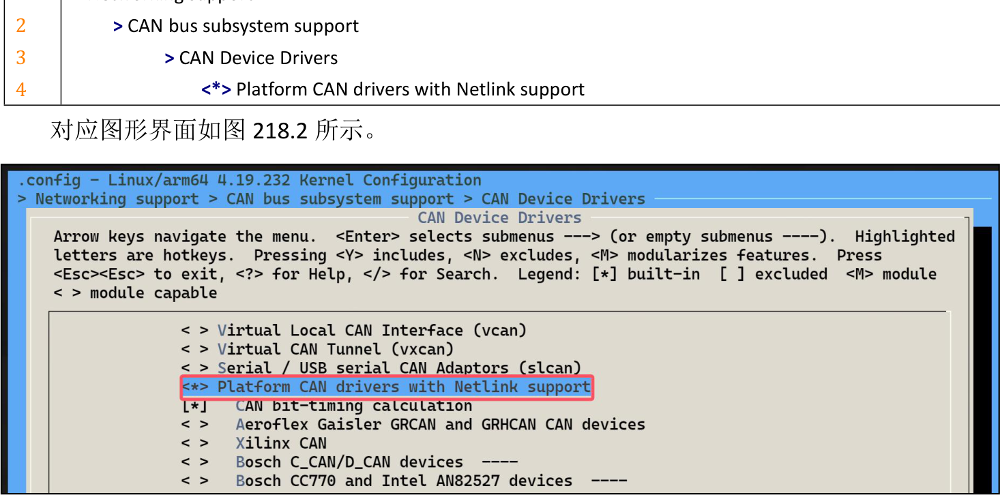
图218.2

使用CAN 总线进行通信有两种方法，第一种方法是使用命令行工具（如iproute2 和canutils）来配置和管理CAN 接口，第二种方式是编写C 应用程序来配置和管理CAN 接口。本章将对第一种CAN 设备的使用进行讲解。注意：迅为提供的buildroot 系统中默认已经集成了对应的测试工具，ubuntu 和debian 系统可以直接使用apt 命令进行安装，如果使用的是迅为提供的系统，可以直接进行第三小节的测试。
## 219.1 iproute2 工具移植
iproute2 是一个用于网络管理的工具集，包含ip、ss、tc 等命令，对应的源码压缩包可以在官网https://www.kernel.org/pub/linux/utils/net/iproute2/进行下载，下载完成之后拷贝到虚拟机Ubuntu 上，如图219.1 所示。

图219.1使用tar -vxf iproute2--6.9.0.tar.gz 命令解压之后进入源码目录下，如图219.2 所示。

图219.2然后运行./configure 命令得到Makefile，运行过程如图219.3 所示。
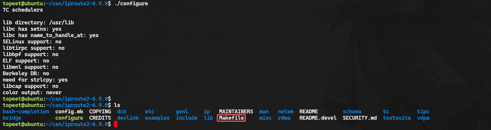

图219.3然后编辑Makefile 的第72 行，只留下lib 和ip，修改完成如图219.4 所示。

图219.4然后使用以下命令进行编译，需要注意的是CC 需要指定自己开发环境对应的交叉编译器实际路径。
```c
makeCC=/home/topeet/work/linux_sdk/prebuilts/gcc/linux-x86/aarch64/gcc-linaro-6.3.1-2017.05-x86_64_aar
ch64-linux-gnu/bin/aarch64-linux-gnu-gcc
```
编译过程如图219.5 所示。
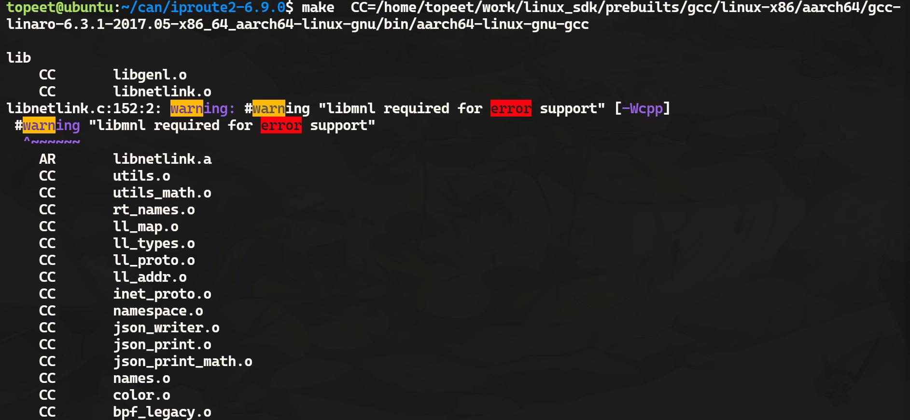
图219.5编译完成之后在ip 目录下就会生成对应的可执行文件，即iproute2 工具，如图219.6 所示。将该文件拷贝到开发板上即可。
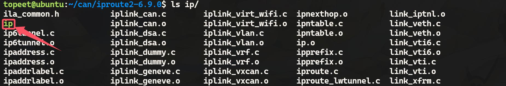
图219.6

## 219.2 canutils 工具移植
canutils 是一个常用的CAN 通信测试工具包，包含canconfig、candump、canecho、cansend和cansequence 5 个独立的工具，每个工具的介绍如图219.7 所示。
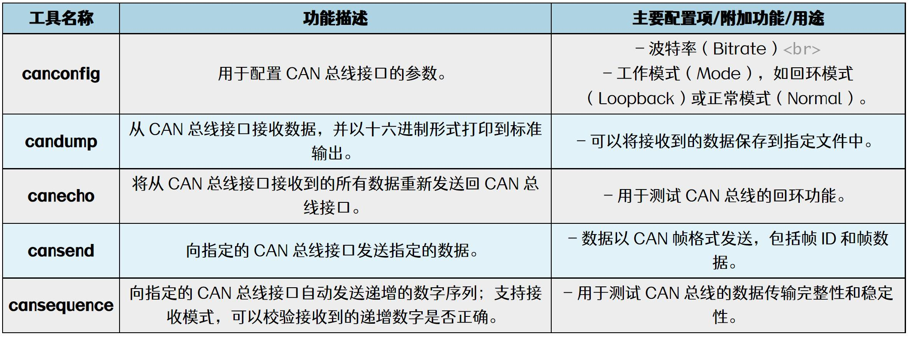
图219.7接下来对移植过程进行讲解，由于canutils 依赖于libsocketcan 库，因此需要先编译libsocketcan 库，然后再编译canutils 工具。libsocketcan 库源码可以从http://www.pengutronix.de/software/libsocketcan/download/获取，这里老师选择libsocketcan-0.0.12.tar.bz2 版本，下载完成之后，拷贝到虚拟机ubuntu 上并解压，解压完成如图219.8 所示。

图219.8然后进入libsocketcan-0.0.12 目录下，使用以下4 条命令配置交叉编译器以及配置源码。注意交叉编译器所在路径需换成自己开发环境中交叉编译器所在的实际路径。
```c
export ARCH=arm64
export CROSS_COMPILE=/home/topeet/work/linux_sdk/prebuilts/gcc/linux-x86/aarch64/gcc-linaro-6.3.1-2017.0
5-x86_64_aarch64-linux-gnu/bin/aarch64-linux-gnu-
export PATH=$PATH:/home/topeet/work/linux_sdk/prebuilts/gcc/linux-x86/aarch64/gcc-linaro-6.3.1-2017.05-x8
6_64_aarch64-linux-gnu/bin/
./configure --host=aarch64-linux-gnu --prefix=/home/topeet/can/libsocketcan-0.0.12/out
```
执行过程如图219.9 所示

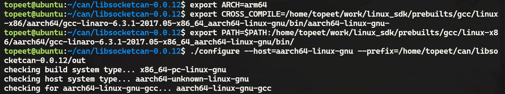
图219.9接下来使用make && make install 命令编译并安装，如图219.10 所示。

图219.10编译完成之后会在当前目录的out 目录下生成对应的文件目录，如图219.11 所示。

图219.11至此，关于libsocketcan 源码的编译就完成了，然后移植canutils 工具，canutils 源码下载地址为https://public.pengutronix.de/software/socket-can/canutils/v4.0/，下载完成之后拷贝到虚拟机ubuntu 上并解压，解压完成如图223.12 所示。

图219.12然后进入到canutils-4.0.6 目录下对config/autoconf/config.sub 文件进行修改，添加代码清单219.1 所示内容增加对aarch64 的支持。代码清单219.1
```c
| aarch64 | aarch64_be \
| aarch64-* | aarch64_be-* \
```
修改完成如图219.13、219.14 所示。

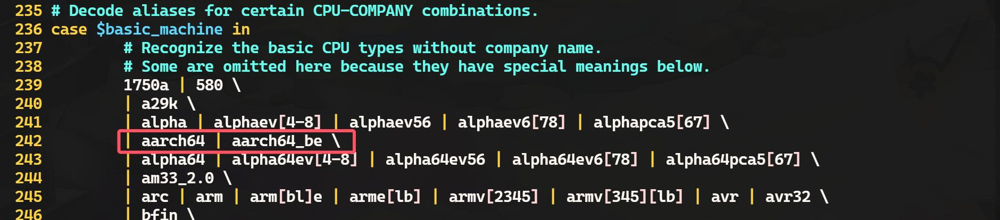
图219.13

图219.14然后对configure 配置文件进行修改，将2604 行编译器修改为aarch64-linux-gnu-gcc，修改完成如图219.15 所示。
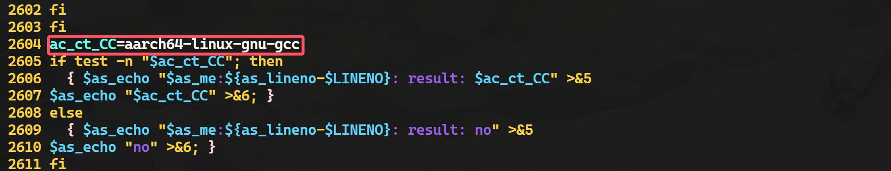
图219.15然后使用以下命令对源码和编译器进行配置，需要注意命令中的编译好的libsocketcan 库所在环境的路径需要根据自己环境的实际路径来编写。
```c
export ARCH=arm64
export CROSS_COMPILE=/home/topeet/work/linux_sdk/prebuilts/gcc/linux-x86/aarch64/gcc-linaro-6.3.1-2017.0
5-x86_64_aarch64-linux-gnu/bin/aarch64-linux-gnu-
export PATH=$PATH:/home/topeet/work/linux_sdk/prebuilts/gcc/linux-x86/aarch64/gcc-linaro-6.3.1-2017.05-x8
6_64_aarch64-linux-gnu/bin/
./configure \
    --host=aarch64-linux-gnu \
    --prefix=/home/topeet/can/canutils-4.0.6/out \
    libsocketcan_LIBS="-L/home/topeet/can/libsocketcan-0.0.12/out/lib -lsocketcan" \
    libsocketcan_LDFLAGS="-L/home/topeet/can/libsocketcan-0.0.12/out/lib" \
    libsocketcan_CFLAGS="-I/home/topeet/can/libsocketcan-0.0.12/out/include" \
    CFLAGS="-I/home/topeet/can/libsocketcan-0.0.12/out/include"
```

配置过程如图219.16 所示。
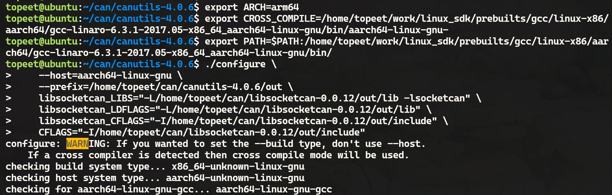
图219.16然后执行make && make install 命令进行编译和安装，过程如图219.17 所示。

图219.17在源码目录的out/bin 目录下就会生成对应的可执行的二进制文件，即canutils 工具，如图219.18 所示。

图219.18至此关于canutils 工具就交叉编译完成了，将上述可执行文件拷贝到开发板上即可。
## 219.3 CAN 工具的使用
1.设备连接在本小节将会对can 工具的使用进行讲解，而在讲解之前先来对硬件的连接进行讲解。开发板上的can 接口如图219.19 所示。

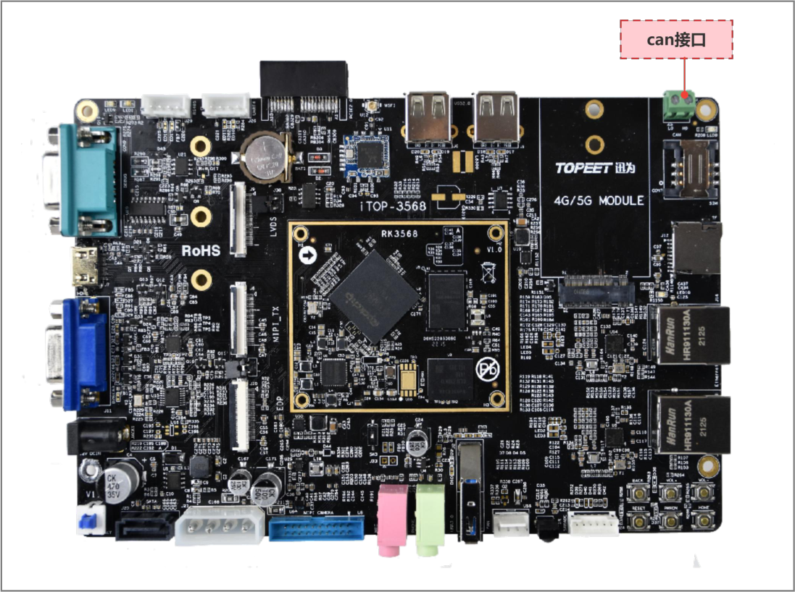
图219.19在实际的测试中可以通过两个iTOP-RK3568 开发板进行连接并测试CAN，两个iTOP-RK3568开发板连接方式为CAN L 连接CAN L、CAN H 连接CAN H，但这样测试比较复杂，所以在后面的测试中会使用USB 转CAN 设备，该设备可以将USB 信号转换为CAN 信号并与iTOP-RK3568开发板连接，然后在PC 电脑上通过USB 转CAN 上位机来接收和发送CAN 数据，迅为所使用的USB 转CAN 设备如图219.20 所示（如有需要请自行购买）。

图219.20该USB 转CAN 设备有两路CAN 接口，连接方式同样是CAN H 接iTOP-RK3568 开发板的CANH，CAN L 接开发板的CAN L，具体连接示意如图219.21 所示。

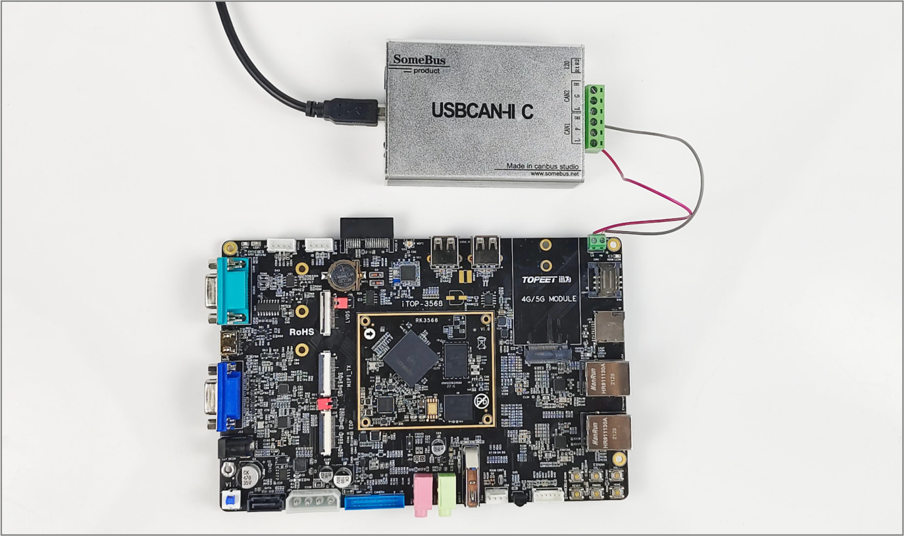
图219.21USB 转CAN 的上位机软件界面如图219.22 所示，可以通过该上位机软件进行CAN 数据
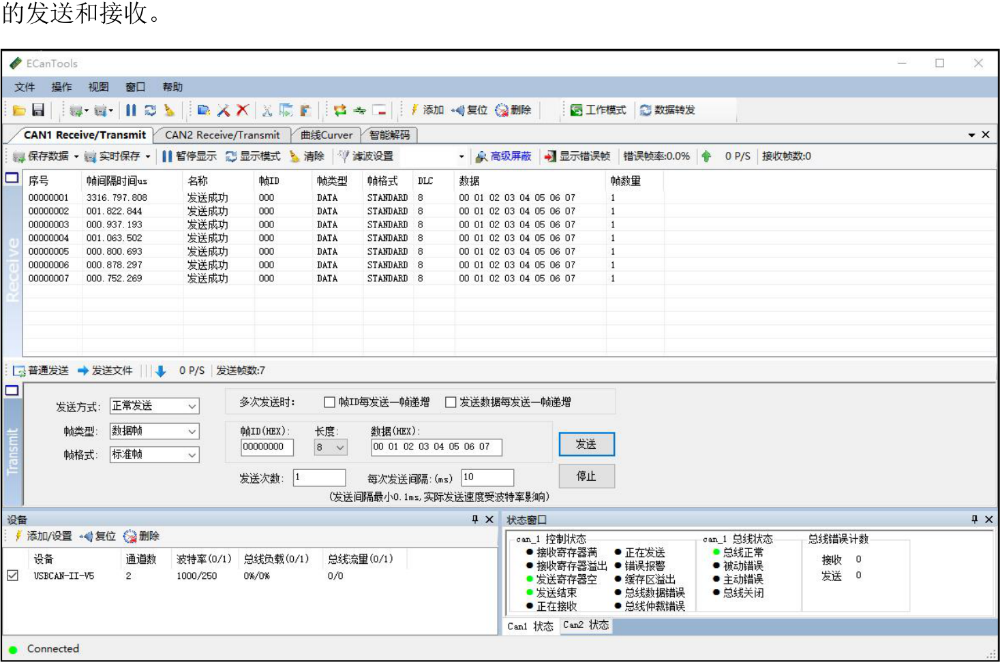

图219.22在后续的章节中都会使用USB 转CAN 设备与iTOP-RK3568 开发板连接进行测试，后续的硬件连接也不再赘述。
2.设置CAN 接囗的波特率CAN 接口的波特率可以通过ip 命令设置，例如可以通过ip link set can0 type can bitrate250000 命令设置CAN0 接口的波特率为250 k，如图219.23 所示。

图219.233.启动和关闭CAN 接口（1）方法1：使用ifconfig 命令通过ifconfig can0 up 命令启动CAN 接口，如图219.24 所示。
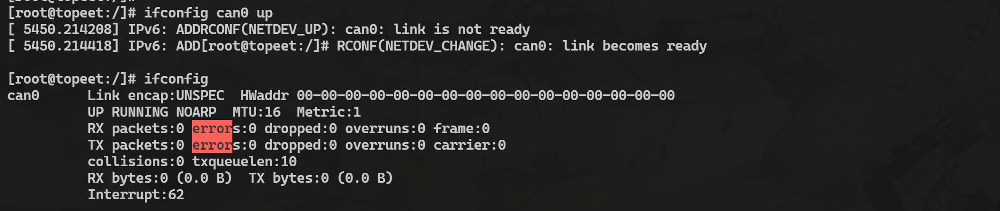
图219.24关闭CAN 接口使用ifconfig can0 down 命令。（2）方法2：使用ip 命令使用ip link set can0 up 命令启动CAN 接口，如图219.25 所示。
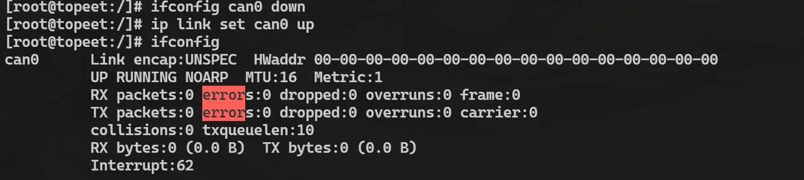
图219.25关闭CAN 接口使用ip link set can0 down 命令。

4.检查CAN 接口状态（1）使用ifconfig can0 命令检查，如图219.26 所示。
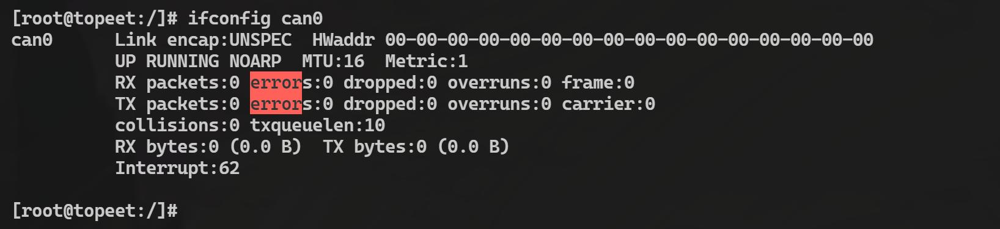
图219.26（2）使用ip -details link show can0 命令检查，如图219.27 所示。
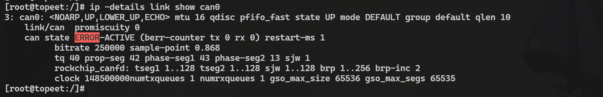
图219.27
5.使用CAN 工具测试通信（1）使用candump 接收数据candump 用于从CAN 总线接口接收数据，并以十六进制形式打印到标准输出。命令格式为candump <接口> [选项]。使用candump can0 -L &命令开启接收，如图219.28 所示。

图219.28然后使用USB 转CAN 的上位机软件向开发板发送数据，如果发送成功在开发板上会收到数据，如图219.29 所示。

图219.29（2）使用cansend 发送数据cansend 用于向CAN 总线接口发送不同的帧，发送不同帧的示例如下：·发送标准数据帧

命令格式：cansend <接口> <帧ID>#<数据><接口>：CAN 接口名称（如can0）。<帧ID>：CAN 帧的ID（11 位，十六进制）。<数据>：CAN 帧的数据（十六进制）。示例：使用cansend can0 123#DEADBEEF 命令向can0 发送一个标准数据帧，ID 为0x123，数据为DE AD BE EF，如图219.30 所示。

图219.30
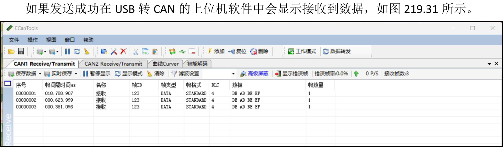
图219.31·发送远程帧命令格式：cansend <接口> <帧ID>#RR：表示远程帧。示例：使用cansend can0 123#R 命令向can0 发送一个标准远程帧，ID 为0x123，如图219.32所示。

图219.32如果发送成功在USB 转CAN 的上位机软件中会显示接收到数据，如图219.33 所示。

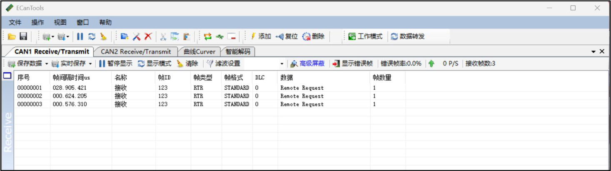
图219.33·发送扩展数据帧命令格式：cansend <接口> <帧ID>#<数据><帧ID>：CAN 帧的ID（29 位，十六进制）。示例：使用cansend can0 00000123#12345678 命令向can0 发送一个扩展数据帧，ID 为0x00000123，数据为12 34 56 78，如图219.34 所示。

图219.34
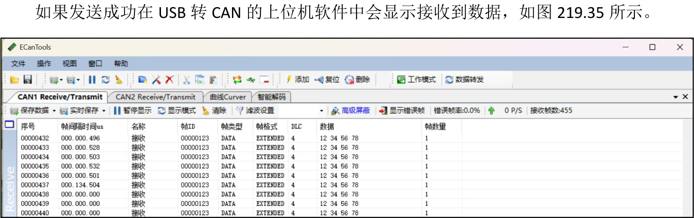
图219.35·发送扩展远程帧命令格式：cansend <接口> <帧ID>#RR：表示远程帧。示例：使用cansend can0 00000123#R 命令向can0 发送一个扩展远程帧，ID 为0x00000123，如图219.36 所示。


