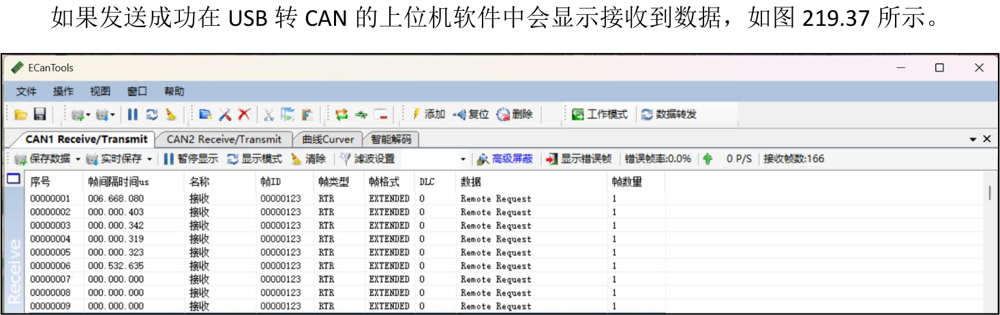
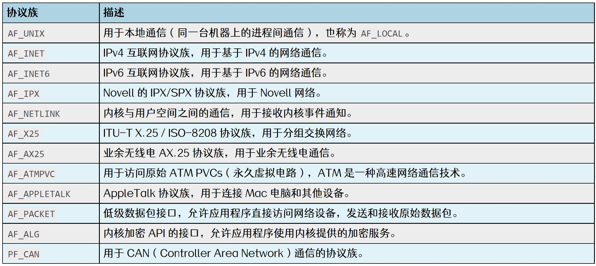
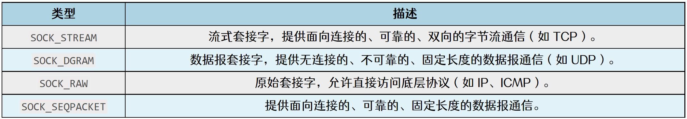
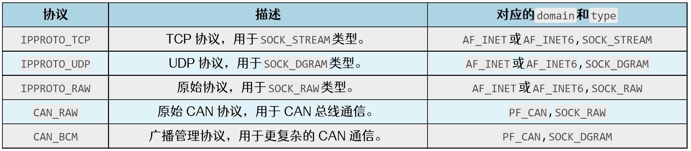
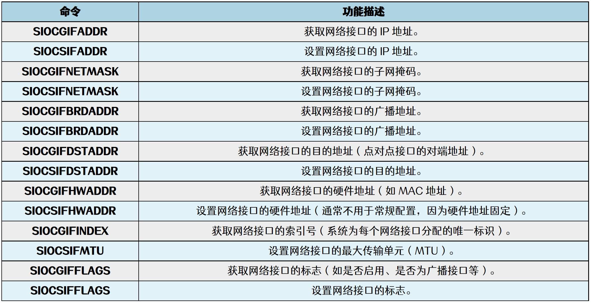
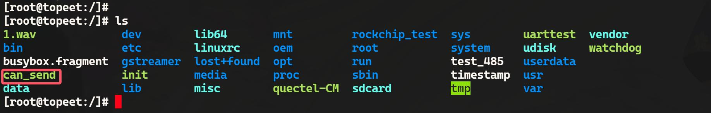
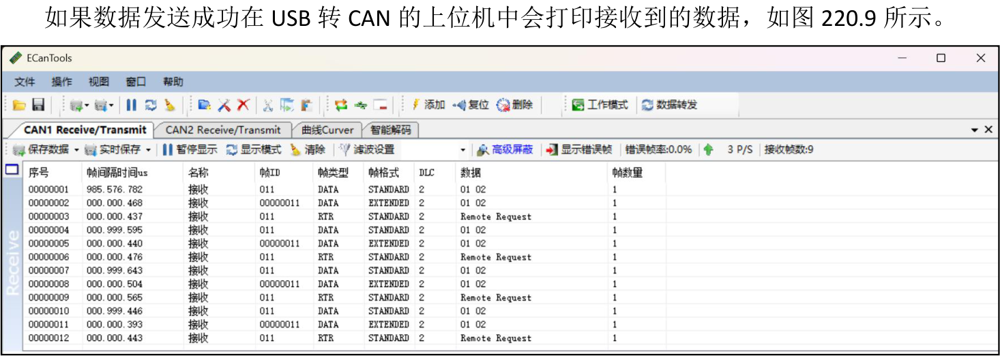
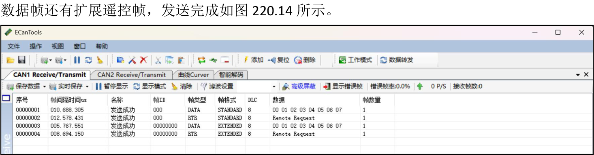

# 第220章 CAN应用编程

图219.36

图219.37
本章节中将会讲解控制CAN 接口的第二种方式，通过C 应用程序来控制CAN 接口。因为CAN 设备在Linux 中被归类为网络设备，所以也是使用socket 控制CAN。
## 220.1 创建套接字
socket()是网络通信的基础函数，用于创建套接字（socket），相当于网络通信的“端口”。函数原型：
```c
int socket(int domain, int type, int protocol);
```
返回值：成功时返回一个非负整数（套接字描述符），后续的网络操作都需要使用这个描述符。失败返回-1。函数参数：（1）domain：协议族常用的协议族如图220.1 所示：


图220.1（2）type：套接字类型常用的类型如图220.2 所示：

图220.2（3）protocol：协议类型指定具体的协议，通常设置为0，表示根据domain 和type 自动选择合适的协议。常的协议如图220.3 所示：

图220.3创建CAN 套接字示例代码如代码清单220.1 所示。代码清单220.1

```c
#include <stdio.h>
#include <fcntl.h>
#include <unistd.h>
#include <stdlib.h>
#include <sys/socket.h>
#include <linux/can.h>
#include <linux/can/raw.h>
int main() {
    int sockfd;
    //创建CAN 套接字，PF_CAN 表示使用CAN 协议族，SOCK_RAW 表示使用原始套接字，CAN_RAW 表
示使用原始CAN 协议
    sockfd = socket(PF_CAN, SOCK_RAW, CAN_RAW);
    if (sockfd == -1) {
        perror("Socket creation failed");
        return EXIT_FAILURE;
    }
    printf("CAN socket created successfully\n");
    //关闭套接字（可选）
    close(sockfd);
    return 0;
}
```
## 220.2 绑定网络接口
使用bind()函数将创建的套接字与物理CAN 接口进行绑定，以便参与CAN 网络的通信。函数原型：
```c
int bind(int sockfd, const struct sockaddr *addr, socklen_t addrlen);
```
返回值：成功时返回0，表示绑定成功。失败时，返回-1。函数参数：（1）sockfd:通过socket()函数创建的套接字描述符，指定要绑定的套接字。（2）addr:指向sockaddr 结构体的指针，存储要绑定的地址信息（实际使用时通常使用structsockaddr_in 或struct sockaddr_in6 等具体类型，再强制转换为struct sockaddr *类型）。（3）addrlen :addr 结构体的大小，通常用sizeof()获取对应地址结构体的长度。

然后在上一小节编写的创建CAN 套接字代码的基础上加上bind()绑定相关的内容，具体如代码清单220.2 所示。代码清单220.2
```c
#include <stdio.h>
#include <fcntl.h>
#include <unistd.h>
#include <string.h>
#include <sys/socket.h>
#include <sys/ioctl.h>
#include <net/if.h>
#include <linux/can.h>
#include <linux/can/raw.h>
int main(int argc, char *argv[]) {
    int sockfd; //套接字描述符
    struct sockaddr_can addr; // CAN 地址结构体
    struct ifreq ifr; //用于获取网络接口信息
    //创建CAN 套接字
    sockfd = socket(PF_CAN, SOCK_RAW, CAN_RAW);
    if (sockfd < 0) {
        printf("Socket creation failed");
        return -1;
    }
    //指定要绑定的CAN 接口名称，以can0 为例
    strncpy(ifr.ifr_name, "can0", IFNAMSIZ - 1);
    //使用ioctl 获取CAN 接口的索引号
    ioctl(sockfd, SIOCGIFINDEX, &ifr)
    //设置CAN 地址结构体
    addr.can_family = AF_CAN; //CAN 地址族
    addr.can_ifindex = ifr.ifr_ifindex; //CAN 接口索引号
    //绑定套接字到指定的CAN 接口
    bind(sockfd, (struct sockaddr *)&addr, sizeof(addr))
    //关闭套接字（实际应用中可以继续发送/接收数据）
    close(s);
    return 0;
```

```c
}
```
第27 行，使用ioctl 系统调用通过SIOCGIFINDEX 宏获取CAN 接口的索引号，除了SIOCGIFINDEX 宏之外，在网络设备中还有其他功能的宏，具体如图220.4 所示。

图220.4
## 220.3 发送数据
在CAN总线通信中，数据不能直接发送，必须先进行封包操作。Linux中使用struct can_frame结构体来封装CAN 数据帧，该结构体定义在<linux/can.h>头文件中，结构体内容如代码清单220.3 所示。代码清单220.3
```c
struct can_frame {
    canid_t can_id;// CAN 标识符（ID）
    __u8can_dlc; //数据长度码（0 到8 字节）
    __u8data[8]; //数据内容，最多8 字节
};
```
如代码清单220.4 所示展示了如何定义并填充3 个不同类型的CAN 帧：标准帧、扩展帧和远程帧。代码清单220.4

```c
struct can_frame frame[3];//定义3 个CAN 帧
unsigned char data[2] = {0x01, 0x02}; //要发送的数据内容
frame[0].can_id = 0x11;//标准帧ID
frame[0].can_dlc = 2;//数据长度为2 字节
memcpy(frame[0].data, data, 2); //填充数据内容
frame[1].can_id = 0x11 | CAN_EFF_FLAG; //扩展帧ID
frame[1].can_dlc = 2;//数据长度为2 字节
memcpy(frame[1].data, data, 2);//填充数据内容
frame[2].can_id = 0x11 | CAN_RTR_FLAG; //远程帧ID
frame[2].can_dlc = 2;//数据长度为2 字节
```
因此编写发送CAN 数据应用程序通常包括以下三个步骤：步骤一：使用socket()函数创建CAN 原始套接字。步骤二：通过bind()函数将套接字与物理CAN 接口绑定。步骤三：定义CAN 帧数组并初始化CAN 帧，使用write()函数将CAN 帧发送至总线。CAN 数据发送应用代码can_send.c 如代码清单220.5 所示。本实验代码存放在网盘iTOP-RK3568 开发板\07_学习教程配套资料\03_Linux 驱动配套资料\04_Linux 驱动程序\130_can\02_send 路径下。代码清单220.5
```c
#include <stdio.h>
#include <fcntl.h>
#include <unistd.h>
#include <string.h>
#include <sys/socket.h>
#include <sys/ioctl.h>
#include <net/if.h>
#include <linux/can.h>
#include <linux/can/raw.h> //包含CAN_RAW 相关定义
int main(int argc, char *argv[]) {
    int sockfd; //套接字描述符
    struct sockaddr_can addr; //CAN 地址结构体
    struct ifreq ifr; //用于获取网络接口信息
    int ret; //用于存储系统调用返回值
    //创建CAN 套接字
    sockfd = socket(PF_CAN, SOCK_RAW, CAN_RAW);
    if (sockfd < 0) {
```

```c
printf("Socket creation failed");
return -1;
}
//指定要绑定的CAN 接口名称，以can0 为例
strncpy(ifr.ifr_name, "can0", IFNAMSIZ - 1);
//使用ioctl 获取CAN 接口的索引号
if (ioctl(sockfd, SIOCGIFINDEX, &ifr) < 0) {
printf("ioctl failed");
close(sockfd);
return -1;
}
//设置CAN 地址结构体
addr.can_family = AF_CAN; //CAN 地址族
addr.can_ifindex = ifr.ifr_ifindex; //CAN 接口索引号
//绑定套接字到指定的CAN 接口
if (bind(sockfd, (struct sockaddr *)&addr, sizeof(addr)) < 0) {
printf("Bind failed");
close(sockfd);
return -1;
}
//定义CAN 帧数组
struct can_frame frame[3]; //CAN 帧数组
unsigned char data[2] = {0x01, 0x02}; //数据内容
//初始化标准帧
frame[0].can_id = 0x11; //标准帧ID
frame[0].can_dlc = 2;//数据长度（2 字节）
memcpy(frame[0].data, data, 2); //填充数据
//初始化扩展帧
frame[1].can_id = 0x11 | CAN_EFF_FLAG; //扩展帧ID
frame[1].can_dlc = 2;//数据长度（2 字节）
memcpy(frame[1].data, data, 2);//填充数据
//初始化远程帧
frame[2].can_id = 0x11 | CAN_RTR_FLAG; //远程帧ID
frame[2].can_dlc = 2;//数据长度（2 字节）
//循环发送CAN 帧
```

```c
while (1) {
    //发送标准帧
    ret = write(sockfd, &frame[0], sizeof(frame[0]));
    if (ret != sizeof(frame[0])) {
        printf("write (标准帧)");
        break;
    }
    printf("标准帧发送成功！\n");
    //发送扩展帧
    ret = write(sockfd, &frame[1], sizeof(frame[1]));
    if (ret != sizeof(frame[1])) {
        printf("write (扩展帧)");
        break;
    }
    printf("扩展帧发送成功！\n");
    //发送远程帧
    ret = write(sockfd, &frame[2], sizeof(frame[2]));
    if (ret != sizeof(frame[2])) {
        printf("write (远程帧)");
        break;
    }
    printf("远程帧发送成功！\n");
    //延时1 秒
    sleep(1);
}
//关闭套接字
close(sockfd);
return 0;
}
```
使用aarch64-linux-gnu-gcc can_send.c -o can_send 命令交叉应用程序，如图220.5 所示。

图220.5然后将编译完成的可执行程序拷贝到开发板上，拷贝完成如图220.6 所示。


图220.6然后使用以下命令设置CAN 接口波特率并启动。
```c
ip link set can0 type can bitrate 250000
ifconfig can0 up
```
如图220.7 所示。

图220.7然后使用./can_send 运行程序向USB 转CAN 设备发送数据，运行之后如图220.8 所示。

图220.8

图220.9至此，关于发送数据的应用程序就测试完成了。
## 220.4 接收数据
编写接收CAN 数据应用程序包括以下三个主要步骤：

步骤一：使用socket()函数创建CAN 原始套接字。步骤二：通过bind()函数将套接字与物理CAN 接口绑定。步骤三：通过read()函数监听总线数据，并解析帧类型与内容。CAN 数据接收应用代码can_recv.c 如代码清单220.6 所示。本实验代码存放在网盘iTOP-RK3568 开发板\07_学习教程配套资料\03_Linux 驱动配套资料\04_Linux 驱动程序\130_can\03_recv 路径下。代码清单220.6
```c
#include <stdio.h>
#include <stdlib.h>
#include <string.h>
#include <unistd.h>
#include <net/if.h>
#include <sys/ioctl.h>
#include <sys/socket.h>
#include <linux/can.h>
#include <linux/can/raw.h>
#define BUF_SIZE 128 //缓冲区大小
int main() {
    int sockfd; //套接字文件描述符
    struct sockaddr_can addr; //CAN 地址结构体
    struct ifreq ifr; //网络接口请求结构体
    struct can_frame frame; //CAN 帧结构体
    char buf[BUF_SIZE]; //格式化输出缓冲区
    int ret, n, i, err;
    FILE *out = stdout; //输出文件流（标准输出）
    //创建CAN 套接字
    sockfd = socket(PF_CAN, SOCK_RAW, CAN_RAW);
    //指定CAN 接口名称
    strcpy(ifr.ifr_name, "can0");
    ioctl(sockfd, SIOCGIFINDEX, &ifr);
    //设置地址信息
    addr.can_family = AF_CAN;
    addr.can_ifindex = ifr.ifr_ifindex;
    //绑定CAN 接口
```

```c
bind(sockfd, (struct sockaddr *)&addr, sizeof(addr));
//循环接收CAN 帧
while (1) {
    //接收CAN 帧
    ret = read(sockfd, &frame, sizeof(frame));
    if (ret <= 0) {
        printf("read");
        break;
    }
    //格式化输出CAN 帧信息
    if (frame.can_id & CAN_EFF_FLAG) {
        //扩展帧
        n = snprintf(buf, BUF_SIZE, "<0x%08x>", frame.can_id & CAN_EFF_MASK);
    } else {
        //标准帧
        n = snprintf(buf, BUF_SIZE, "<0x%03x>", frame.can_id & CAN_SFF_MASK);
    }
    //添加数据长度
    n += snprintf(buf + n, BUF_SIZE - n, "[%d]", frame.can_dlc);
    //添加数据内容
    for (i = 0; i < frame.can_dlc; i++) {
        n += snprintf(buf + n, BUF_SIZE - n, " %02x", frame.data[i]);
    }
    //如果是远程帧
    if (frame.can_id & CAN_RTR_FLAG) {
        n += snprintf(buf + n, BUF_SIZE - n, " remote request");
    }
    //输出到标准输出
    fprintf(out, "%s\n", buf);
    //刷新输出缓冲区
    err = fflush(out);
    if (err < 0) {
        perror("fflush");
        break;
    }
}
```

```c
//关闭套接字
close(sockfd);
return 0;
}
```
使用aarch64-linux-gnu-gcc -o can_recv can_recv.c 命令交叉应用程序，如图220.10 所示。

图220.10然后将编译完成的可执行程序拷贝到开发板上，拷贝完成如图220.11 所示。

图220.11然后使用以下命令设置CAN 接口波特率并启动。
```c
ip link set can0 type can bitrate 250000
ifconfig can0 up
```
如图220.12 所示。

图220.12然后使用./can_recv 运行程序等待数据的发送，运行之后如图220.13 所示。

图220.13然后使用USB 转CAN 设备分别向iTOP-RK3568 开发板发送标准数据帧、标准遥控帧、扩展

图220.14如果开发板上成功接收到数据会打印对应的帧，如图220.15 所示。


图220.15至此，关于接收CAN 帧的应用程序就测试完成了。

